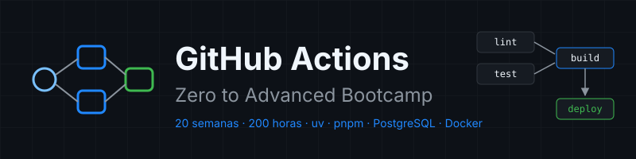

<p align="center">
  
</p>

<p align="center">
  <a href="LICENSE"></a>
  <a href="#"></a>
  <a href="#"></a>
  <a href="docs/stack-versions.md"></a>
</p>

<p align="center">
  <a href="README_EN.md"></a>
</p>

---

## 📋 Descripción

Bootcamp de **20 semanas a 10 h/semana (200 horas)** que lleva GitHub Actions **de cero a avanzado**: desde tu primer workflow hasta operar runners propios en Kubernetes, desplegar con OIDC, demostrar la procedencia de lo que publicas y gobernar el CI/CD de toda una organización. Prepara para la certificación **GitHub Actions (GH-200)**.

Un solo proyecto, `tablero` (API FastAPI con uv, web React con pnpm, PostgreSQL 17), es el monorepo cuyo pipeline construyes capa a capa: de un workflow que pasa actionlint en la Semana 01 a un CI/CD con merge queue, attestations y despliegue a Kubernetes con rollback en la 20. Todo a **coste cero**.

### 🎯 Objetivos

Al finalizar el bootcamp serás capaz de:

- ✅ Explicar cómo un evento se convierte en jobs que corren en un runner, y leer cualquier ejecución
- ✅ Escribir CI para Python con uv y para frontend con pnpm, con caché, matrices y artefactos
- ✅ Probar contra PostgreSQL real con service containers y publicar imágenes en GHCR por digest
- ✅ Controlar cuándo corre cada workflow: filtros, cron, dispatch, encadenamiento y concurrencia
- ✅ Probar y depurar workflows con actionlint, zizmor y act
- ✅ Reutilizar CI con workflows reutilizables y actions propias, gobernadas desde la organización
- ✅ Defender un pipeline: permisos mínimos, inyección de scripts, actions por SHA, secretos y OIDC
- ✅ Publicar releases con SBOM y attestations verificables
- ✅ Operar runners propios efímeros, en Docker y con ARC en Kubernetes
- ✅ Desplegar de forma continua a Kubernetes con aprobación y rollback
- ✅ Escalar el CI de un monorepo con rulesets, merge queue y medición de coste

### 🚀 ¿Por qué este bootcamp?

> **Seguro desde el primer workflow.** Cada `uses:` va fijado por SHA, cada workflow declara `permissions:` mínimos y ningún dato no confiable llega al shell sin pasar por `env:`. No es un tema avanzado de la Semana 12: es la forma de escribir desde la Semana 01.

Python con uv, Node con pnpm, PostgreSQL y Docker. Versiones fijadas y fechadas en [`docs/stack-versions.md`](docs/stack-versions.md).

---

## 📋 Prerrequisitos

| Qué se asume | Dónde se aprende si falta |
|---|---|
| Git: commit, branch, merge, push, pull request | [bc-github](https://github.com/ergrato-dev/bc-github) semanas 01-08 |
| Terminal: navegar, variables de entorno, ejecutar scripts | [bc-linux-commandline](https://github.com/ergrato-dev/bc-linux-commandline) |

YAML, Docker, Compose, Kubernetes y Helm se enseñan "lo justo" en la semana que los necesita.

Equipo: Linux o WSL2 con Docker, **8 GB de RAM** (16 GB recomendados desde la Semana 16, por kind + ARC). Cuenta de GitHub gratuita; en la Semana 01 creas una organización gratuita.

---

## 🗓️ Estructura del Bootcamp

| Fase | Semanas | Horas | Temas |
|---|:--:|:--:|---|
| **1 · Fundamentos** | 01-04 | 40 h | Modelo de ejecución, expresiones, CI con uv y pnpm, matrices, artefactos |
| **2 · Pipelines de Integración** | 05-08 | 40 h | PostgreSQL en CI, imágenes en GHCR, disparadores, concurrencia, depuración |
| **3 · Reutilización** | 09-11 | 30 h | Workflows reutilizables, actions propias, gobierno de organización |
| **4 · Seguridad** | 12-14 | 30 h | Amenazas, secretos, environments, OIDC, releases, SBOM, attestations |
| **5 · Runners y Despliegue** | 15-17 | 30 h | Runners propios, ARC en kind, despliegue continuo a Kubernetes |
| **6 · Escala y Operación** | 18-20 | 30 h | Rulesets, merge queue, monorepos, coste, observabilidad, capstone |

**Total: 20 semanas** | **200 horas**

| Semana | Tema |
|:--:|---|
| [01](bootcamp/week-01-primer_workflow_y_modelo_de_ejecucion/README.md) | Primer workflow y modelo de ejecución |
| [02](bootcamp/week-02-expresiones_contextos_y_flujo_de_datos/README.md) | Expresiones, contextos y flujo de datos |
| 03 | CI de Python con uv |
| 04 | CI de frontend con pnpm, matrices y artefactos |
| 05 | Service containers y PostgreSQL |
| 06 | Imágenes Docker y GHCR |
| 07 | Disparadores, filtros y concurrencia |
| 08 | Probar y depurar workflows |
| 09 | Workflows reutilizables |
| 10 | Actions propias: composite, JavaScript y Docker |
| 11 | Actions a escala de organización |
| 12 | Modelo de amenazas y endurecimiento |
| 13 | Secretos, entornos y OIDC |
| 14 | Releases, cadena de suministro y attestations |
| 15 | Runners propios |
| 16 | Actions Runner Controller en kind |
| 17 | Despliegue continuo a Kubernetes |
| 18 | Merge queue, rulesets y monorepos |
| 19 | Rendimiento, coste y observabilidad |
| 20 | Capstone: un pipeline de producción defendido |

Estado de publicación de cada semana: [`bootcamp/README.md`](bootcamp/README.md). Qué funcionalidad de Actions introduce cada semana: [`docs/mapa-funcionalidades.md`](docs/mapa-funcionalidades.md).

---

## 📚 Contenido por Semana

```
bootcamp/week-NN-tema/
├── README.md                 # Objetivos, contenidos, tiempos, entregables
├── rubrica-evaluacion.md     # Criterios de evaluación
├── checks.json               # Autograding de la semana
├── 0-assets/                 # Diagramas SVG
├── 1-teoria/                 # Material teórico
├── 2-practicas/              # Prácticas guiadas paso a paso
├── 3-proyecto/               # La capa de la semana para tablero
├── 4-recursos/               # ebooks-free, videografia, webgrafia
└── 5-glosario/               # Términos clave A-Z
```

---

## 🛠️ Stack Tecnológico

Versiones exactas, fecha de comprobación y estado de seguridad en [`docs/stack-versions.md`](docs/stack-versions.md).

| Tecnología | Uso |
|---|---|
| GitHub Actions (runners `ubuntu-24.04`) | CI/CD |
| gh CLI | Lanzar, seguir y verificar ejecuciones |
| actionlint · zizmor · act | Lint, auditoría de seguridad y ejecución local de workflows |
| Python + uv · FastAPI · ruff · pytest | API de `tablero` |
| Node LTS + pnpm · React + Vite · Vitest | Web de `tablero` |
| PostgreSQL 17 | Base de datos, también como service container en CI |
| Docker · Docker Compose · GHCR | Imágenes y registry |
| kind · Helm · ARC | Runners en Kubernetes y destino de despliegue |

---

## 🚀 Inicio Rápido

```bash
git clone https://github.com/ergrato-dev/bc-github-actions.git
cd bc-github-actions

# Comprueba tu entorno (gh, git, jq, yq, actionlint, uv, pnpm, Docker)
./scripts/check-week.sh --doctor

# Empieza
cd bootcamp/week-01-primer_workflow_y_modelo_de_ejecucion
```

Instalación paso a paso: [`docs/setup-entorno.md`](docs/setup-entorno.md). Cómo funciona el autograding contra tu repo `<tu-org>/tablero`: [`docs/autograding.md`](docs/autograding.md).

---

## 📊 Metodología

- 🎯 **Proyecto hilo conductor**: el pipeline de `tablero` crece cada semana
- 🧩 **Práctica deliberada** en un repo real, cada paso con su porqué y su verificación
- ✅ **Autograding**: `./scripts/check-week.sh NN` comprueba tus archivos y tus ejecuciones en GitHub, y te dice dónde arreglar lo que falta
- 🔐 **Seguridad por defecto**: actions por SHA, permisos mínimos y datos por `env:` desde el primer día

### Distribución del tiempo (10 h/semana)

- **Teoría**: 2-3 horas
- **Prácticas**: 4-5 horas
- **Proyecto**: 2-3 horas

### Evaluación

1. **Conocimiento 🧠** (30%): 10 preguntas conceptuales por semana
2. **Desempeño 💪** (40%): prácticas verificadas por `checks.json`
3. **Producto 📦** (30%): la capa del proyecto, autograding + calidad

**Criterio de aprobación**: mínimo 70% en cada tipo de evidencia.

---

## 🤝 Contribuir

Lee la [Guía de Contribución](CONTRIBUTING.md) y el [Código de Conducta](CODE_OF_CONDUCT.md). La guía de autoría del contenido es [`CLAUDE.md`](CLAUDE.md).

## 📞 Soporte

- 💬 [GitHub Discussions](https://github.com/ergrato-dev/bc-github-actions/discussions)
- 🐛 [GitHub Issues](https://github.com/ergrato-dev/bc-github-actions/issues)
- 🔒 Vulnerabilidades: [Política de Seguridad](SECURITY.md)

## 📄 Licencia

CC BY-NC-SA 4.0 — ver [LICENSE](LICENSE).

---

<p align="center">
  <strong>🎓 Bootcamp GitHub Actions — Zero to Advanced</strong><br>
  <em>20 semanas · 200 horas</em>
</p>

<p align="center">
  <a href="bootcamp/README.md">Ver Semanas</a> •
  <a href="docs/README.md">Ver Documentación</a> •
  <a href="https://github.com/ergrato-dev/bc-github-actions/issues">Reportar Issue</a>
</p>
