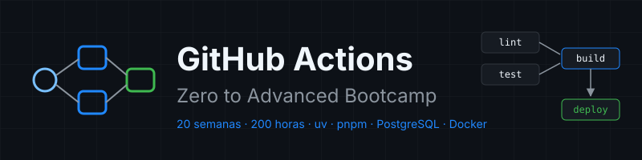

<p align="center">
  
</p>

<p align="center">
  <a href="LICENSE"></a>
  <a href="#"></a>
  <a href="#"></a>
  <a href="docs/stack-versions.md"></a>
</p>

<p align="center">
  <a href="README.md"></a>
</p>

---

> The course content is written in Spanish. This page summarizes it for English readers.

## 📋 Description

A **20-week, 10 h/week (200 hours)** bootcamp that takes GitHub Actions **from zero to advanced**: from your first workflow to operating self-hosted runners on Kubernetes, deploying with OIDC, proving the provenance of what you publish, and governing CI/CD across an organization. It prepares you for the **GitHub Actions (GH-200)** certification.

A single project, `tablero` (FastAPI API with uv, React web with pnpm, PostgreSQL 17), is the monorepo whose pipeline you build layer by layer: from a workflow that passes actionlint in Week 01 to CI/CD with a merge queue, attestations and Kubernetes deployments with rollback in Week 20. All at **zero cost**.

### 🎯 Objectives

By the end of the bootcamp you will be able to:

- ✅ Explain how an event becomes jobs running on a runner, and read any workflow run
- ✅ Write CI for Python with uv and for the frontend with pnpm, with caching, matrices and artifacts
- ✅ Test against a real PostgreSQL with service containers and publish images to GHCR by digest
- ✅ Control when each workflow runs: filters, cron, dispatch, chaining and concurrency
- ✅ Test and debug workflows with actionlint, zizmor and act
- ✅ Reuse CI with reusable workflows and custom actions, governed from the organization
- ✅ Defend a pipeline: least privilege, script injection, SHA-pinned actions, secrets and OIDC
- ✅ Publish releases with verifiable SBOMs and attestations
- ✅ Operate ephemeral self-hosted runners, in Docker and with ARC on Kubernetes
- ✅ Continuously deploy to Kubernetes with approval and rollback
- ✅ Scale monorepo CI with rulesets, merge queue and cost measurement

---

## 📋 Prerequisites

| Assumed | Where to learn it |
|---|---|
| Git: commit, branch, merge, push, pull request | [bc-github](https://github.com/ergrato-dev/bc-github) weeks 01-08 |
| Terminal: navigation, environment variables, running scripts | [bc-linux-commandline](https://github.com/ergrato-dev/bc-linux-commandline) |

Hardware: Linux or WSL2 with Docker, **8 GB RAM** (16 GB recommended from Week 16). A free GitHub account; in Week 01 you create a free organization.

---

## 🗓️ Bootcamp Structure

| Phase | Weeks | Hours | Topics |
|---|:--:|:--:|---|
| **1 · Fundamentals** | 01-04 | 40 h | Execution model, expressions, CI with uv and pnpm, matrices, artifacts |
| **2 · Integration Pipelines** | 05-08 | 40 h | PostgreSQL in CI, GHCR images, triggers, concurrency, debugging |
| **3 · Reuse** | 09-11 | 30 h | Reusable workflows, custom actions, organization governance |
| **4 · Security** | 12-14 | 30 h | Threats, secrets, environments, OIDC, releases, SBOM, attestations |
| **5 · Runners and Deployment** | 15-17 | 30 h | Self-hosted runners, ARC on kind, continuous deployment to Kubernetes |
| **6 · Scale and Operations** | 18-20 | 30 h | Rulesets, merge queue, monorepos, cost, observability, capstone |

**Total: 20 weeks** | **200 hours**

| Week | Topic |
|:--:|---|
| [01](bootcamp/week-01-primer_workflow_y_modelo_de_ejecucion/README.md) | First workflow and execution model |
| [02](bootcamp/week-02-expresiones_contextos_y_flujo_de_datos/README.md) | Expressions, contexts and data flow |
| [03](bootcamp/week-03-ci_de_python_con_uv/README.md) | Python CI with uv |
| [04](bootcamp/week-04-ci_de_frontend_pnpm_matrices_y_artefactos/README.md) | Frontend CI with pnpm, matrices and artifacts |
| [05](bootcamp/week-05-service_containers_y_postgresql/README.md) | Service containers and PostgreSQL |
| [06](bootcamp/week-06-imagenes_docker_y_ghcr/README.md) | Docker images and GHCR |
| [07](bootcamp/week-07-disparadores_filtros_y_concurrencia/README.md) | Triggers, filters and concurrency |
| [08](bootcamp/week-08-probar_y_depurar_workflows/README.md) | Testing and debugging workflows |
| [09](bootcamp/week-09-workflows_reutilizables/README.md) | Reusable workflows |
| [10](bootcamp/week-10-actions_propias/README.md) | Custom actions: composite, JavaScript and Docker |
| [11](bootcamp/week-11-actions_a_escala_de_organizacion/README.md) | Actions at organization scale |
| [12](bootcamp/week-12-modelo_de_amenazas_y_endurecimiento/README.md) | Threat model and hardening |
| [13](bootcamp/week-13-secretos_entornos_y_oidc/README.md) | Secrets, environments and OIDC |
| [14](bootcamp/week-14-releases_cadena_de_suministro_y_attestations/README.md) | Releases, supply chain and attestations |
| [15](bootcamp/week-15-runners_self_hosted/README.md) | Self-hosted runners |
| [16](bootcamp/week-16-actions_runner_controller_en_kind/README.md) | Actions Runner Controller on kind |
| [17](bootcamp/week-17-despliegue_continuo_a_kubernetes/README.md) | Continuous deployment to Kubernetes |
| [18](bootcamp/week-18-merge_queue_rulesets_y_monorepos/README.md) | Merge queue, rulesets and monorepos |
| 19 | Performance, cost and observability |
| 20 | Capstone: a defended production pipeline |

Publication status per week: [`bootcamp/README.md`](bootcamp/README.md).

---

## 🚀 Quick Start

```bash
git clone https://github.com/ergrato-dev/bc-github-actions.git
cd bc-github-actions
./scripts/check-week.sh --doctor
cd bootcamp/week-01-primer_workflow_y_modelo_de_ejecucion
```

## 📊 Methodology

- **Time split per week**: theory 2-3 h, practice 4-5 h, project 2-3 h
- **Evaluation**: knowledge 30%, performance 40%, product 30%; **at least 70% in each**
- **Autograding**: `./scripts/check-week.sh NN` checks your files and your runs on GitHub

## 📄 License

CC BY-NC-SA 4.0 — see [LICENSE](LICENSE).
