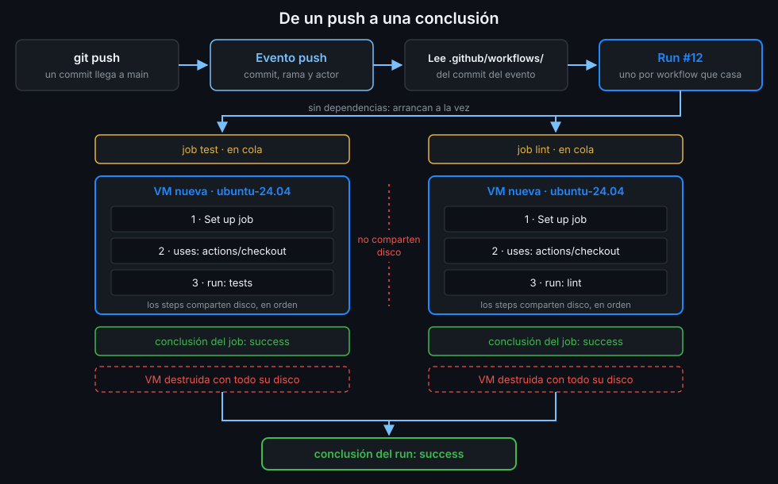

# Qué es GitHub Actions

> Un sistema que convierte cada cosa que pasa en tu repo en trabajo ejecutado en una máquina
> limpia. Si entiendes ese viaje, del evento al runner, puedes leer cualquier ejecución.



## 🎯 Objetivos

Al terminar este archivo eres capaz de:

- Explicar qué problema resuelve la integración continua y por qué hacerla a mano no escala
- Nombrar las cinco piezas del modelo de ejecución: evento, workflow, job, runner y step
- Distinguir un run de un intento (attempt) y saber qué cambia al relanzar
- Situar dónde vive un workflow y qué versión de él se ejecuta

---

## 1. Qué problema resuelve

Imagina `tablero` sin CI. Antes de aceptar un pull request alguien tiene que:

1. Bajar la rama a su máquina.
2. Instalar las dependencias exactas de la API y de la web.
3. Pasar el linter y los tests de las dos partes.
4. Construir las imágenes y comprobar que arrancan.
5. Avisar en el PR de que todo está bien.

Cada paso depende de la máquina de esa persona: su versión de Python, la caché que tenga, si se
acordó de hacer `git pull`. Si el resultado sale distinto en dos máquinas, nadie sabe cuál es el
bueno. Y si un día nadie lo hace, el fallo llega a `main`.

La **integración continua** (CI, *continuous integration*) automatiza esa lista: cada cambio se
comprueba solo, siempre igual y en una máquina que no tiene nada heredado. GitHub Actions es la
plataforma de CI/CD integrada en GitHub: el código, los pull requests y el pipeline viven en el
mismo sitio, y el resultado aparece en el propio PR.

Lo que no resuelve por sí solo: **qué** se comprueba. Actions ejecuta lo que le pidas. Un
pipeline sin tests no protege nada aunque salga en verde.

---

## 2. Cómo funciona

El modelo tiene cinco piezas. Todo lo que verás en las 20 semanas es una variación de este viaje.

### 2.1 Evento

Algo pasa en GitHub: un `push`, un pull request abierto, alguien que pulsa un botón, una hora del
reloj. GitHub genera un **evento** con datos de lo que pasó (quién, qué commit, qué rama). Los
eventos de esta semana están en [Eventos básicos](05-eventos-basicos.md).

### 2.2 Workflow

Un **workflow** es un archivo YAML en `.github/workflows/` de tu repo. Dice a qué eventos
responde y qué trabajo hay que hacer. Un repo puede tener muchos: cada uno decide por su cuenta si
el evento le interesa.

GitHub lee el workflow **del commit del evento**. Si haces push de un commit que cambia `ci.yml`,
se ejecuta el `ci.yml` de ese commit, no el que había antes. Por eso puedes probar un cambio de
workflow en una rama sin tocar `main`.

### 2.3 Run

Cuando un evento casa con un workflow, GitHub crea un **run** (una ejecución) de ese workflow. Un
`push` puede generar varios runs a la vez, uno por cada workflow que responda a `push`.

### 2.4 Job

Un run contiene uno o más **jobs**. Un job es una unidad de trabajo que se asigna a una máquina.
Por defecto **los jobs no dependen unos de otros y corren en paralelo**. En la Semana 02 verás
cómo encadenarlos.

### 2.5 Runner

Un **runner** es la máquina que ejecuta un job. En esta semana usas los que aloja GitHub: cada
job recibe una máquina virtual nueva que se destruye al terminar. Lo ves a fondo en
[Runners alojados por GitHub](04-runners-alojados.md).

### 2.6 Step

Un job es una lista ordenada de **steps**. Cada step es un comando de shell (`run:`) o una action
(`uses:`), un paquete reutilizable que alguien publicó. Los steps de un job corren **uno detrás de
otro en la misma máquina**: comparten disco, así que un step puede usar lo que dejó el anterior.
Si un step falla, los siguientes no se ejecutan y el job falla.

### 2.7 Conclusión

Cada step, cada job y el run entero terminan con una **conclusión**: `success`, `failure`,
`cancelled` o `skipped`, entre otras. La del run es la que aparece en el commit y en el PR.

### El mismo viaje, como tabla

| Pieza | Dónde la ves | Cuántas hay |
|---|---|---|
| Evento | Pestaña Actions, columna "Event" | Una por cosa que pasa |
| Workflow | `.github/workflows/*.yml` | Las que tú escribas |
| Run | Pestaña Actions, una fila | Una por evento que casa con un workflow |
| Job | Dentro del run, en la columna izquierda | Las que declare el workflow |
| Step | Dentro del job, cada bloque desplegable del log | Las que declare el job |

---

## 3. Cómo se usa

### Un run, varios intentos

Si un run falla por algo pasajero (una descarga que no respondió), puedes **relanzarlo**. No se
crea un run nuevo: se crea un nuevo **intento** (*attempt*) del mismo run. Las variables que
GitHub pone en cada job lo reflejan:

| Variable | Qué es | Cambia al relanzar |
|---|---|:--:|
| `GITHUB_RUN_ID` | Identificador único del run en el repo | No |
| `GITHUB_RUN_NUMBER` | Contador del workflow: 1, 2, 3... | No |
| `GITHUB_RUN_ATTEMPT` | Número de intento, empieza en 1 | Sí |
| `GITHUB_SHA` | Commit que disparó el run | No |

El relanzamiento usa el mismo commit y el mismo evento. Si el fallo era del código, vuelve a
fallar: relanzar solo sirve para fallos que no dependen de ti.

Un workflow mínimo que muestra esas variables:

```yaml
name: run-ids

on:
  workflow_dispatch:

# Mínimo privilegio: lo verás a fondo en la Semana 12.
permissions:
  contents: read

jobs:
  show:
    runs-on: ubuntu-24.04
    steps:
      - name: Identificadores de este run
        run: |
          echo "run id:      $GITHUB_RUN_ID"
          echo "run number:  $GITHUB_RUN_NUMBER"
          echo "attempt:     $GITHUB_RUN_ATTEMPT"
          echo "commit:      $GITHUB_SHA"
```

Lánzalo dos veces y relanza el segundo: verás `run number` 1 y 2, y en el relanzamiento el mismo
`run id` con `attempt` 2. Los detalles de cada clave están en
[Anatomía de un workflow](03-anatomia-de-un-workflow.md).

### Dónde mirar

- En la web: pestaña **Actions** del repo. Cada fila es un run.
- En la terminal: `gh run list` y `gh run view`. Lo practicas en
  [la práctica 03](../2-practicas/03-gh-cli-para-actions.md) y lo explica
  [Leer una ejecución](06-leer-una-ejecucion.md).

### Por qué una máquina limpia en cada job

Cada job arranca de cero, así que el resultado no depende de lo que hizo el job anterior ni de lo
que tenga instalado nadie. Si algo funciona en tu portátil y falla en el runner, el runner tiene
razón: le falta algo que tu máquina tenía y tu proyecto no declaraba.

---

## 4. Antipatrones

| Antipatrón | Por qué duele | Qué hacer en su lugar |
|---|---|---|
| Relanzar hasta que salga verde | Un test que falla a ratos es un bug, y relanzarlo lo esconde | Relanza una vez; si vuelve a fallar, lee el log |
| Un único job gigante con todo | Un fallo al principio oculta el resto, y no se paraleliza | Un job por cosa independiente |
| Contar con que un job ve los archivos de otro | Cada job está en otra máquina; el disco no se comparte | Hazlo en el mismo job o pásalo como artefacto (Semana 04) |
| Probar el workflow solo en `main` | Cada intento rompe la rama de todos | Pruébalo en una rama: se ejecuta el workflow de ese commit |
| Pipeline verde sin tests | El verde no dice nada | Que el workflow ejecute comprobaciones de verdad |

---

## 5. Trucos

- **La pestaña Actions filtra por workflow, rama, evento y actor.** Con un repo con muchos runs,
  filtrar por `event:workflow_dispatch` te enseña solo los que lanzaste a mano.
- **El badge del workflow** (`.../actions/workflows/ci.yml/badge.svg`) muestra el estado del
  último run en la rama por defecto. Está en el menú `···` de cada workflow, "Create status badge".
- **`GITHUB_RUN_ATTEMPT` en un log** te dice en un vistazo si estás leyendo el primer intento o
  un relanzamiento.

---

## 📚 Recursos Adicionales

- [Understanding GitHub Actions](https://docs.github.com/en/actions/get-started/understand-github-actions):
  las piezas del modelo, en la documentación oficial
- [Variables reference](https://docs.github.com/en/actions/reference/workflows-and-actions/variables):
  todas las variables que GitHub pone en cada job

---

## ✅ Checklist de Verificación

- [ ] Sé explicar qué es la CI y qué parte de ella no hace Actions por mí
- [ ] Sé recorrer el viaje evento → workflow → run → job → runner → step
- [ ] Sé que los jobs corren en paralelo por defecto y en máquinas distintas
- [ ] Sé que los steps de un job comparten máquina y disco
- [ ] Sé qué cambia y qué no al relanzar un run
- [ ] Sé que se ejecuta el workflow del commit del evento

_Verificado con ubuntu-24.04 y la documentación de GitHub Actions, noviembre de 2026._

---

| ← Anterior | Siguiente → |
|:---|---:|
| [Semana 01](../README.md) | [YAML para workflows](02-yaml-para-workflows.md) |
