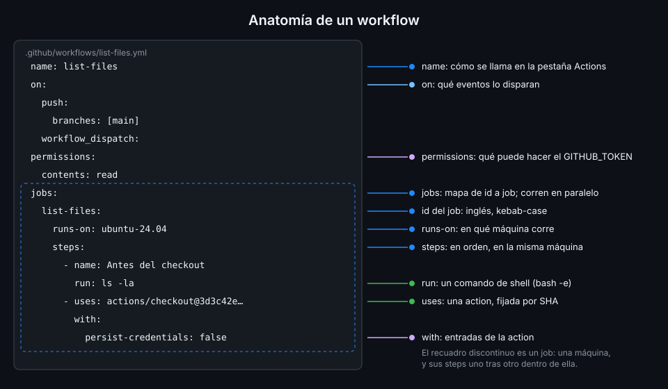

# Anatomía de un workflow

> Cada clave de un workflow responde a una pregunta: cómo se llama, cuándo corre, con qué
> permisos, dónde y qué hace. Si sabes qué pregunta responde cada una, sabes leer cualquiera.



## 🎯 Objetivos

Al terminar este archivo eres capaz de:

- Nombrar las claves de primer nivel de un workflow y qué pregunta responde cada una
- Escribir un job con `runs-on` y steps de los dos tipos: `run` y `uses`
- Saber con qué shell y en qué directorio se ejecuta un `run:`
- Distinguir el id de un job de su `name:` y saber cuál se usa para qué

---

## 1. Qué problema resuelve

Un workflow tiene que decirle a GitHub cinco cosas sin ambigüedad:

| Pregunta | Clave |
|---|---|
| ¿Cómo lo enseño en la pestaña Actions? | `name` |
| ¿Qué eventos lo disparan? | `on` |
| ¿Qué puede hacer el token que recibe? | `permissions` |
| ¿Qué trabajos hay? | `jobs` |
| ¿En qué máquina y con qué pasos? | `runs-on` y `steps`, dentro de cada job |

Si falta `on` o `jobs`, no es un workflow. El resto tiene un valor por defecto, y en algunos casos
ese valor por defecto es el problema.

---

## 2. Cómo funciona

### 2.1 Dónde vive

Un workflow es un archivo `.yml` o `.yaml` en `.github/workflows/`, en la raíz del repo. No hay
subcarpetas: un workflow en `.github/workflows/ci/ci.yml` no se ejecuta.

### 2.2 `name`

El nombre que aparece en la pestaña Actions. Si lo omites, GitHub muestra la ruta del archivo
(`.github/workflows/ci.yml`). Pon uno corto y estable: es lo que buscas en la lista de runs.

### 2.3 `on`

Los eventos que lo disparan. Puede ser un evento, una lista o un mapa con filtros:

```yaml
on:
  push:
    branches: [main]
  pull_request:
  workflow_dispatch:
```

Cada evento de esta semana está en [Eventos básicos](05-eventos-basicos.md).

### 2.4 `permissions`

Cada job recibe un token, `GITHUB_TOKEN`, para hablar con la API de GitHub. `permissions` dice qué
puede hacer. En este bootcamp todo workflow empieza con:

```yaml
# Mínimo privilegio: lo verás a fondo en la Semana 12.
permissions:
  contents: read
```

Sin esta clave, el token hereda los permisos por defecto del repo o de la organización. Declararlo
en el archivo hace que el workflow diga lo que necesita, sin depender de un ajuste que alguien
puede cambiar.

### 2.5 `jobs`

Un mapa: cada clave es el **id del job**, y su valor, el job.

- El id empieza por una letra o `_` y solo contiene letras, números, `-` y `_`.
- El id es lo que se usa para referirse al job desde otros sitios (Semana 02), así que es
  nomenclatura técnica: en inglés y en kebab-case, como `unit-tests`.
- `name:` dentro del job es lo que se lee en la UI. Puede ir en español y con espacios.

### 2.6 `runs-on`

En qué tipo de máquina corre el job. Con runners de GitHub es una etiqueta de imagen, y en este
bootcamp siempre `ubuntu-24.04`. Por qué no `ubuntu-latest`, en <!-- antipatron -->
[Runners alojados por GitHub](04-runners-alojados.md).

### 2.7 `steps`

Una lista que se ejecuta en orden en la misma máquina. Cada step es de uno de dos tipos:

| Tipo | Clave | Qué hace |
|---|---|---|
| Comando | `run:` | Ejecuta un script en el shell del runner |
| Action | `uses:` | Ejecuta una action publicada por alguien, con entradas en `with:` |

Los dos admiten `name:`, que es el título del step en el log. Sin `name:`, GitHub usa el propio
comando o la referencia de la action, que en un `run:` de varias líneas es ilegible.

### 2.8 El shell de un `run:`

En Linux, si no indicas `shell:`, GitHub ejecuta el script con `bash -e {0}`, donde `{0}` es un
archivo temporal con tu script. `-e` hace que el script se pare en el primer comando que falla.

Si escribes `shell: bash` de forma explícita, el comando cambia a
`bash --noprofile --norc -eo pipefail {0}`: además falla si falla cualquier comando de una tubería
(`cmd | grep x`), no solo el último. Para scripts con tuberías, `shell: bash` es más seguro.

### 2.9 El directorio de trabajo

Los steps se ejecutan en `$GITHUB_WORKSPACE`, el directorio donde se deja tu repositorio. Al
empezar el job está **vacío**: el código del repo no está ahí hasta que un step lo descarga, y eso
lo hace la action `actions/checkout`.

---

## 3. Cómo se usa

Un workflow completo que lista lo que hay en el repo:

```yaml
name: list-files

on:
  push:
    branches: [main]
  workflow_dispatch:

# Mínimo privilegio: lo verás a fondo en la Semana 12.
permissions:
  contents: read

jobs:
  list-files:
    name: Archivos del repo
    runs-on: ubuntu-24.04
    steps:
      - name: Antes del checkout
        run: ls -la "$GITHUB_WORKSPACE"

      - name: Descargar el código
        uses: actions/checkout@3d3c42e5aac5ba805825da76410c181273ba90b1 # v7.0.1
        with:
          persist-credentials: false

      - name: Después del checkout
        shell: bash
        run: |
          ls -la
          git log --oneline -1
```

Si lo ejecutas, el primer step muestra un directorio vacío y el tercero, tu repo. Es la forma más
directa de ver que el runner no trae tu código de serie.

Lo que hay en el `uses:`:

- `actions/checkout` es el repositorio de la action.
- Detrás de `@` va un SHA de 40 caracteres, la versión exacta, y en el comentario el tag que
  corresponde. Por qué así y cómo obtenerlo, en
  [Actions de terceros y pinning por SHA](07-actions-de-terceros-y-pinning.md).
- `persist-credentials: false` evita que el token quede configurado en git para el resto
  del job. Este job no hace `git push`, así que no lo necesita.

---

## 4. Antipatrones

| Antipatrón | Por qué duele | Qué hacer en su lugar |
|---|---|---|
| Workflow en una subcarpeta de `.github/workflows/` | No se ejecuta y no da error | Todos en `.github/workflows/` directamente |
| Sin `permissions:` | El token tiene lo que diga el ajuste del repo, que puede ser escritura | `permissions: contents: read` en la raíz |
| Steps sin `name:` | El log enseña el comando entero como título | `name:` corto que diga para qué es |
| Ids de job en español o con espacios | El id es técnico y se usa para referirse al job | Inglés en kebab-case; el texto, en `name:` |
| Esperar el código en el directorio sin checkout | `$GITHUB_WORKSPACE` empieza vacío | `actions/checkout` como primer step |
| Tuberías con el shell por defecto | `bash -e` no ve el fallo de la mitad de una tubería | `shell: bash`, que añade `pipefail` |

---

## 5. Trucos

- **`yq '.jobs | keys'` y `yq '.jobs.<id>.steps[].name'`** te dan el índice de un workflow largo
  sin abrirlo.
- **El step "Set up job"** que GitHub añade al principio de cada job lista la imagen del runner
  y su versión, y los permisos reales del `GITHUB_TOKEN`. Es lo primero que miras cuando algo
  "no tiene permiso".
- **`defaults.run.shell: bash`** en la raíz aplica `pipefail` a todos los `run:` de una vez. Lo
  verás con el resto de `defaults` en la Semana 02.

---

## 📚 Recursos Adicionales

- [Workflow syntax](https://docs.github.com/en/actions/reference/workflows-and-actions/workflow-syntax):
  cada clave, con sus valores posibles
- [actions/checkout](https://github.com/actions/checkout): el README explica cada entrada de
  `with:`

---

## ✅ Checklist de Verificación

- [ ] Sé qué pregunta responden `name`, `on`, `permissions` y `jobs`
- [ ] Escribo ids de job en inglés en kebab-case y el texto legible en `name:`
- [ ] Sé la diferencia entre un step `run:` y un step `uses:`
- [ ] Sé con qué shell corre un `run:` por defecto y qué añade `shell: bash`
- [ ] Sé que `$GITHUB_WORKSPACE` empieza vacío y quién trae el código
- [ ] Pongo `persist-credentials: false` en cada checkout que no hace push

_Verificado con actions/checkout@v7.0.1 y ubuntu-24.04, noviembre de 2026._

---

| ← Anterior | Siguiente → |
|:---|---:|
| [YAML para workflows](02-yaml-para-workflows.md) | [Runners alojados por GitHub](04-runners-alojados.md) |
