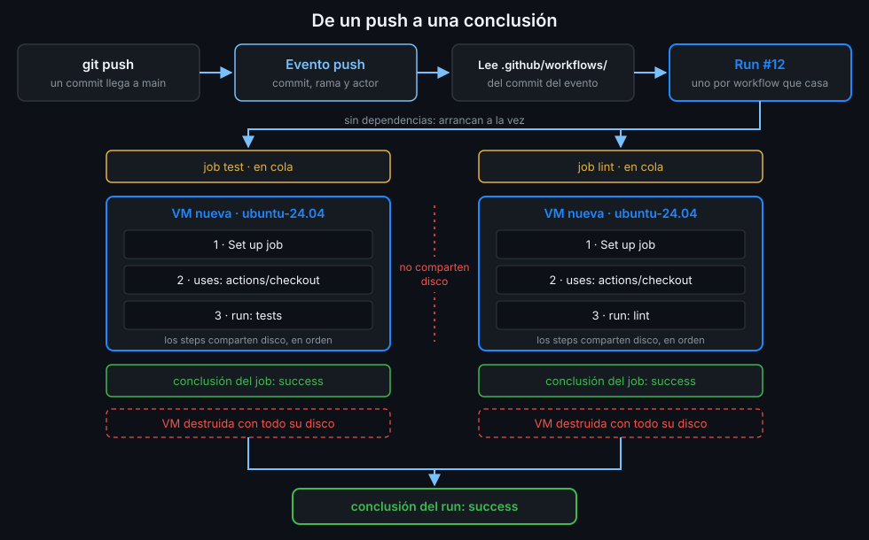

# Runners alojados por GitHub

> El runner es la máquina donde se ejecuta tu job. Con los de GitHub, cada job recibe una
> máquina virtual recién creada que se destruye al terminar. Casi todo lo que te sorprenda de
> Actions al principio sale de ahí.



## 🎯 Objetivos

Al terminar este archivo eres capaz de:

- Explicar qué recibe cada job: una máquina virtual nueva, aislada y desechable
- Predecir qué se comparte entre steps y qué no se comparte entre jobs
- Conocer el hardware y los límites de un runner estándar en un repo público
- Justificar por qué este bootcamp fija `runs-on: ubuntu-24.04` y nunca `ubuntu-latest` <!-- antipatron -->

---

## 1. Qué problema resuelve

Para ejecutar un job hace falta una máquina con sistema operativo, red y herramientas. Podrías
poner la tuya, y en la Semana 15 lo harás. Pero mantener máquinas tiene coste: actualizarlas,
limpiar lo que deja cada job, evitar que un job vea los restos del anterior.

Los **runners alojados por GitHub** (*GitHub-hosted runners*) te quitan todo eso: GitHub crea la
máquina cuando el job empieza y la tira cuando acaba. En un repo público, los runners estándar no
consumen minutos de pago. Por eso este bootcamp sale a 0 € (detalle en
[`docs/modelo-de-costes.md`](../../../docs/modelo-de-costes.md)).

---

## 2. Cómo funciona

### 2.1 Una máquina virtual nueva por job

Cada job en un runner estándar recibe **una máquina virtual (VM) nueva**. El ciclo es:

1. El job entra en la cola.
2. GitHub le asigna una VM recién arrancada desde una imagen conocida.
3. Los steps se ejecutan uno tras otro en esa VM.
4. El job termina y la VM se destruye con todo lo que tenía.

La única excepción es el runner de una CPU, `ubuntu-slim`, que corre en un contenedor sobre una
VM compartida. No lo usas en este bootcamp.

### 2.2 Qué se comparte y qué no

| Entre... | ¿Comparten disco? | Por qué |
|---|:--:|---|
| Steps del mismo job | Sí | Corren en la misma VM, en orden |
| Jobs del mismo run | No | Cada uno tiene su VM |
| Dos runs del mismo workflow | No | Cada job de cada run tiene su VM |

Si un job compila algo, otro job no lo ve. Para pasar archivos entre jobs están los artefactos
(Semana 04); para reutilizar descargas entre runs, la caché (Semana 03).

### 2.3 Paralelismo

Los jobs de un run sin dependencias **arrancan a la vez**, cada uno en su VM. Un workflow con dos
jobs independientes tarda lo que tarde el más lento, no la suma. El límite del plan Free es de
**20 jobs simultáneos** en runners estándar; los que pasen de ahí esperan en la cola.

### 2.4 Hardware

| Runner estándar Linux x64 | CPU | RAM | Disco SSD |
|---|:--:|:--:|:--:|
| Repo **público** | 4 | 16 GB | 14 GB |
| Repo privado | 2 | 8 GB | 14 GB |

`<tu-org>/tablero` es público: tus jobs tienen 4 CPU. Las VM de Linux tienen `sudo` sin
contraseña, así que un step puede instalar paquetes del sistema si lo necesita.

### 2.5 Límites

- Un job puede durar como máximo **6 horas** de ejecución. Pasado ese tiempo, GitHub lo termina.
- Un run entero puede durar como máximo **35 días**, contando esperas.

En la Semana 07 fijarás `timeout-minutes` en cada job: un job colgado no debería esperar 6 horas
a que lo maten.

### 2.6 Software preinstalado

La imagen trae mucho de serie: git, Docker, `gh`, `jq`, compiladores, varios Python y Node. La
lista exacta de cada imagen está en el repositorio
[actions/runner-images](https://github.com/actions/runner-images), un README por imagen, y cambia
con cada actualización semanal.

Que algo venga preinstalado no significa que debas usarlo así: en este bootcamp las versiones de
Python, uv, Node y pnpm las fija tu proyecto (Semanas 03 y 04), no la imagen.

---

## 3. Cómo se usa

### La etiqueta de `runs-on`

`runs-on` lleva una **etiqueta** que elige la imagen. Las de Ubuntu disponibles hoy:

| Etiqueta | Arquitectura | Imagen |
|---|---|---|
| `ubuntu-24.04` | x64 | Ubuntu 24.04 |
| `ubuntu-26.04` | x64 | Ubuntu 26.04 |
| `ubuntu-22.04` | x64 | Ubuntu 22.04 |
| `ubuntu-latest` | x64 | **Hoy** Ubuntu 24.04 <!-- antipatron --> |
| `ubuntu-24.04-arm`, `ubuntu-26.04-arm`, `ubuntu-22.04-arm` | arm64 | La versión de su nombre |

### Por qué `ubuntu-24.04` y nunca `ubuntu-latest` <!-- antipatron -->

`ubuntu-latest` no es una imagen: es un alias que GitHub mueve cuando decide. Hoy apunta a 24.04 y <!-- antipatron -->
**`ubuntu-26.04` ya está disponible**, así que el salto llegará. El día que ocurra:

- Tu workflow corre en otro sistema sin que hayas cambiado una línea.
- Cambian las versiones de lo preinstalado, y algún paquete deja de existir.
- Un fallo aparece "solo" en un run, y el diff de tu repo no explica nada.

Con `runs-on: ubuntu-24.04` el cambio de sistema lo decides tú, en un commit, y si algo se rompe
sabes por qué. Es la misma idea que fijar versiones de dependencias: lo que no está en tu repo no
lo controlas.

```yaml
name: runner-facts

on:
  workflow_dispatch:

# Mínimo privilegio: lo verás a fondo en la Semana 12.
permissions:
  contents: read

jobs:
  x64:
    runs-on: ubuntu-24.04
    steps:
      - name: Arquitectura y sistema
        run: |
          uname -m
          grep PRETTY_NAME /etc/os-release
  arm64:
    runs-on: ubuntu-24.04-arm
    steps:
      - name: Arquitectura y sistema
        run: |
          uname -m
          grep PRETTY_NAME /etc/os-release
```

Lánzalo y compara: los dos jobs arrancan a la vez, uno imprime `x86_64` y el otro `aarch64`, y los
dos el mismo Ubuntu 24.04. Dos VM, dos arquitecturas, ninguna comparte nada con la otra.

### Comprobar en qué imagen corrió un job

El step **Set up job** del log tiene una sección "Runner Image" con el nombre y la versión de la
imagen. Si un job pasa ayer y falla hoy sin cambios tuyos, compara esa versión entre los dos runs.

---

## 4. Antipatrones

| Antipatrón | Por qué duele | Qué hacer en su lugar |
|---|---|---|
| `runs-on: ubuntu-latest` | Cambia de sistema sin aviso cuando GitHub mueve el alias | `ubuntu-24.04`, y el salto a 26.04 en un commit tuyo <!-- antipatron --> |
| Contar con que un job ve los archivos de otro | Cada job tiene su VM | Mismo job, o artefactos (Semana 04) |
| Depender del Python o Node preinstalado | La imagen se actualiza cada semana | La versión la fija tu proyecto (Semanas 03 y 04) |
| Guardar algo "para el siguiente run" en el disco | La VM se destruye al terminar | Caché (Semana 03) o artefacto |
| Jobs sin límite de tiempo | Uno colgado consume hasta 6 horas | `timeout-minutes` (Semana 07) |

---

## 5. Trucos

- **`ubuntu-24.04-arm` en repos públicos** te deja probar tu proyecto en arm64 sin tener una
  máquina arm. Útil para saber si tus imágenes funcionan en un portátil Apple Silicon.
- **"Runner Image" en el step Set up job** enlaza al README exacto de esa versión de la imagen,
  con todo lo que traía instalado ese día.
- **`nproc` y `free -h` en un step** te dicen al momento qué hardware te tocó: útil para decidir
  cuántos procesos lanzar en paralelo en los tests.

---

## 📚 Recursos Adicionales

- [GitHub-hosted runners reference](https://docs.github.com/en/actions/reference/runners/github-hosted-runners):
  etiquetas, hardware y red de los runners alojados
- [Actions limits](https://docs.github.com/en/actions/reference/limits): duración de jobs y
  runs, y jobs simultáneos por plan
- [actions/runner-images](https://github.com/actions/runner-images): el software de cada imagen

---

## ✅ Checklist de Verificación

- [ ] Sé que cada job recibe una VM nueva que se destruye al terminar
- [ ] Sé qué comparten los steps de un job y qué no comparten dos jobs
- [ ] Sé que los jobs independientes arrancan a la vez, hasta el límite del plan
- [ ] Conozco el hardware de un runner estándar en un repo público
- [ ] Sé explicar por qué `ubuntu-latest` es un alias que se mueve <!-- antipatron -->
- [ ] Sé encontrar en el log en qué imagen corrió un job

_Verificado con ubuntu-24.04 y la documentación de runners alojados, noviembre de 2026._

---

| ← Anterior | Siguiente → |
|:---|---:|
| [Anatomía de un workflow](03-anatomia-de-un-workflow.md) | [Eventos básicos: push, pull_request y workflow_dispatch](05-eventos-basicos.md) |
