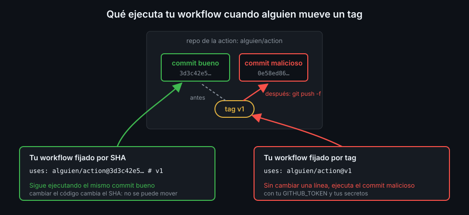

# Actions de terceros y pinning por SHA

> Cada `uses:` ejecuta código de otra persona en tu runner, con tu token. Un tag como `v7` puede
> apuntar mañana a otro código; un SHA de 40 caracteres no. Esta es la primera regla de seguridad
> del bootcamp y se aplica desde el primer workflow.



## 🎯 Objetivos

Al terminar este archivo eres capaz de:

- Explicar qué es una action y las tres formas de referenciarla en `uses:`
- Explicar por qué un tag de git no garantiza qué código ejecutas
- Fijar una action por SHA completo con el tag en comentario, resuelto con `scripts/resolve-sha.sh`
- Activar el ajuste del repo que rechaza las actions sin SHA
- Usar `actions/checkout` sin dejar el token disponible para el resto del job

## 1. Qué problema resuelve

Muchas tareas de un workflow ya las resolvió alguien: descargar el repo, instalar uv, subir un
artefacto. Una **action** empaqueta esa tarea para que la uses en un step con `uses:` en vez de
escribirla en bash. Es cómodo, pero tiene un precio: **el código de la action corre en tu runner
con los mismos permisos que tus steps**. Puede leer el `GITHUB_TOKEN`, los secretos que el job
recibe y todo lo que haya en disco.

Eso no es teórico:

- **Marzo de 2025, `tj-actions/changed-files`** (GHSA-mw4p-6x4p-x5m5). Entre el 14 y el 15 de
  marzo, un atacante movió varios tags de la action (`v1.0.0`, `v35.7.7-sec`, `v44.5.1`...) a un
  commit malicioso. Ese commit volcaba la memoria del proceso del runner y escribía los secretos
  en el log, que en un repo público lee cualquiera. Afectó a más de 23 000 repos. Los que fijaban
  la action por SHA no ejecutaron el código malicioso.
- **19 de marzo de 2026, Trivy** (GHSA-69fq-xp46-6x23). Con credenciales robadas, un atacante
  publicó un Trivy `v0.69.4` malicioso y forzó 76 de los 77 tags de `aquasecurity/trivy-action` a
  un código que robaba credenciales. Durante unas 12 horas, todo workflow que usaba esa action por
  tag ejecutó el malware. Por eso este bootcamp prohíbe esa versión y esa action por tag
  ([`docs/stack-versions.md`](../../../docs/stack-versions.md)).

En los dos casos nadie cambió su workflow: cambió **a qué apuntaba** la referencia que usaban.

## 2. Cómo funciona

### Las tres formas de `uses:`

| Forma | Ejemplo | Qué ejecuta |
|---|---|---|
| Repo remoto | `actions/checkout@<ref>` | La action del repo `actions/checkout` en esa ref |
| Ruta local | `./.github/actions/setup` | Una action de tu propio repo (Semana 10) |
| Imagen Docker | `docker://alpine@sha256:...` | Un contenedor con esa imagen |

Esta semana solo usas la primera. La `<ref>` puede ser un tag (`v7.0.1`), una rama (`main`) o un
SHA de commit. El [Marketplace](https://github.com/marketplace?type=actions) es solo un escaparate:
lo que se ejecuta es siempre el contenido del repo en esa ref.

### Un tag es un puntero que se puede mover

En git, un tag es un nombre que apunta a un commit. Quien tenga permiso de escritura en el repo de
la action puede **borrarlo y volver a crearlo apuntando a otro commit**. El nombre `v7.0.1` sigue
siendo el mismo; el código, no. Una rama (`@main`) es peor: cambia con cada commit.

Un **SHA de commit** es el hash del contenido del commit. Si alguien cambia una sola línea, el SHA
es otro. Para hacer pasar código malicioso por un SHA que ya fijaste, el atacante tendría que
fabricar una colisión de SHA-1 sobre un objeto git válido. Por eso la guía de seguridad de GitHub
recomienda fijar por **SHA completo de 40 caracteres**: no 7, no 12.

### El comentario con el tag

Un SHA no dice qué versión es. Por eso la regla del bootcamp es SHA **más** el tag en comentario:

```yaml
- uses: actions/checkout@3d3c42e5aac5ba805825da76410c181273ba90b1 # v7.0.1
```

El comentario no lo lee GitHub; lo leen las personas y Dependabot, que en la Semana 12 abrirá PRs
que actualizan SHA y comentario a la vez.

### De dónde sale el SHA

Nunca lo escribas a mano ni lo copies de otro repo. Dos motivos:

- **Un tag anotado no apunta al commit**: apunta a un objeto "tag" que a su vez apunta al commit.
  Si fijas el SHA del objeto tag, el workflow falla o, peor, fijas algo que no es lo que crees.
- **Los forks comparten objetos con el repo original.** Un SHA que existe solo en un fork de
  `actions/checkout` también se puede referenciar como `actions/checkout@<sha>`. GitHub avisa de
  que compruebes que el SHA viene del repo de la action y no de un fork.

`scripts/resolve-sha.sh` resuelve las dos cosas: pide a la API **el tag del repo original** y, si
es anotado, lo sigue hasta el commit.

```bash
./scripts/resolve-sha.sh actions/checkout v7.0.1
# uses: actions/checkout@3d3c42e5aac5ba805825da76410c181273ba90b1 # v7.0.1
```

## 3. Cómo se usa

### Un job que descarga el repo

```yaml
name: pinning-demo

on:
  push:
    branches: [main]

# Mínimo privilegio: lo verás a fondo en la Semana 12.
permissions:
  contents: read

jobs:
  list-files:
    runs-on: ubuntu-24.04
    steps:
      - uses: actions/checkout@3d3c42e5aac5ba805825da76410c181273ba90b1 # v7.0.1
        with:
          persist-credentials: false
      - name: Archivos del repo
        run: ls -la
```

Sin `actions/checkout`, el runner empieza con un directorio de trabajo **vacío**: tu código no
está ahí hasta que lo descargas.

### `persist-credentials: false`

Por defecto (`persist-credentials: true`), `actions/checkout` deja configurado el token en la
configuración de git del repo descargado, para que un `git push` posterior funcione sin más.
Desde la v6 lo guarda en un archivo aparte bajo `$RUNNER_TEMP` en vez de escribirlo directamente
en `.git/config`, pero el efecto es el mismo: **cualquier step siguiente del job, incluida
cualquier action de terceros, puede usar ese token** hasta que el job termina.

Ninguno de los jobs de esta semana hace `git push`, así que no lo necesitan:

```yaml
      - uses: actions/checkout@3d3c42e5aac5ba805825da76410c181273ba90b1 # v7.0.1
        with:
          persist-credentials: false
```

La regla del bootcamp: siempre `false`, salvo que el job haga `git push`, y entonces se justifica
en un comentario.

### Que el repo rechace lo que no esté fijado

Una regla que depende de que te acuerdes falla el día que tienes prisa. El repo tiene un ajuste
que la convierte en obligatoria: **Settings → Actions → General → "Require actions to be pinned to
a full-length commit SHA"**. En la API es el campo `sha_pinning_required`:

```bash
gh api repos/{owner}/{repo}/actions/permissions --jq .sha_pinning_required
# true
```

Con el ajuste activo, un workflow con `uses: actions/checkout@v7` no llega a ejecutarse. Lo
activas en la [práctica 04, paso 4](../2-practicas/04-actionlint-y-sha.md).

### Qué tiene que llevar cada `uses:` remota

1. `owner/repo@` seguido de **40 caracteres hexadecimales**.
2. Un espacio, `#` y el tag: `# v7.0.1`.
3. El SHA resuelto con `scripts/resolve-sha.sh`, nunca copiado.

## 4. Antipatrones

| Antipatrón | Por qué duele | Qué hacer en su lugar |
|---|---|---|
| `uses: actions/checkout@v7` <!-- antipatron --> | El tag puede moverse a otro código sin que tu workflow cambie | SHA completo con `# vX.Y.Z` |
| `uses: alguien/action@main` <!-- antipatron --> | Ejecuta lo último que alguien empujó a esa rama | SHA de un release concreto |
| SHA corto (`@3d3c42e`) | GitHub exige el SHA completo; y 7 caracteres no protegen de colisiones | Los 40 caracteres |
| SHA sin el tag en comentario | Nadie sabe qué versión es ni cuándo actualizarla | `# v7.0.1` detrás |
| Copiar el SHA de un blog o de otro repo | Puede ser de un fork o de un tag anotado | `scripts/resolve-sha.sh` |
| `actions/checkout` sin `persist-credentials: false` en un job que no empuja | El token queda disponible para todos los steps siguientes | `persist-credentials: false` |
| Añadir una action para algo que son dos líneas de bash | Cada action es código ajeno con tu token | Un `run:`; una action solo si aporta de verdad |

## 5. Trucos

- **Ver a qué commit apunta hoy un tag** sin clonar nada: `gh api
  repos/actions/checkout/git/ref/tags/v7.0.1 --jq '.object.type + " " + .object.sha'`. Si el tipo
  es `tag`, es anotado y ese SHA todavía no es el commit.
- **Leer los inputs de una action en el SHA que vas a fijar**: `gh api
  "repos/actions/checkout/contents/action.yml?ref=<sha>" --jq .content | base64 -d`. Un input que
  no está ahí no existe, por bien que suene.
- **Encontrar todas las `uses:` sin fijar** de tu repo: `grep -hE '^\s*-?\s*uses:'
  .github/workflows/*.yml | grep -vE 'uses: \./|@[0-9a-f]{40} # v'`. Es la misma comprobación que
  hace el autograding.
- **Avisos de seguridad de una action**: `gh api repos/<owner>/<repo>/security-advisories --jq
  '.[].summary'` antes de adoptarla.

Verificado con `actions/checkout@v7.0.1` y ubuntu-24.04, noviembre de 2026.

## 📚 Recursos Adicionales

- [Secure use reference](https://docs.github.com/en/actions/reference/security/secure-use): por
  qué fijar por SHA completo y comprobar que no viene de un fork
- [GHSA-mw4p-6x4p-x5m5](https://github.com/tj-actions/changed-files/security/advisories/GHSA-mw4p-6x4p-x5m5): el aviso del
  compromiso de `tj-actions/changed-files`
- [README de `actions/checkout`](https://github.com/actions/checkout): qué hace
  `persist-credentials` y dónde guarda el token
- [`docs/politica-versiones.md`](../../../docs/politica-versiones.md): cómo se actualiza un SHA en
  este bootcamp

## ✅ Checklist de Verificación

- [ ] Sé qué puede hacer una action con mi token y mis secretos
- [ ] Puedo explicar por qué `@v7` no garantiza el código y `@<sha>` sí
- [ ] Sé por qué un tag anotado y un fork hacen peligroso copiar un SHA a mano
- [ ] Resuelvo un SHA con `scripts/resolve-sha.sh` y lo escribo con el tag en comentario
- [ ] Sé qué hace `persist-credentials: false` y cuándo no usarlo
- [ ] Sé qué ajuste del repo rechaza las actions sin SHA

---

| ← Anterior | Siguiente → |
|:---|---:|
| [Leer una ejecución](06-leer-una-ejecucion.md) | [Organización y repo tablero](../2-practicas/01-organizacion-y-repo-tablero.md) |
