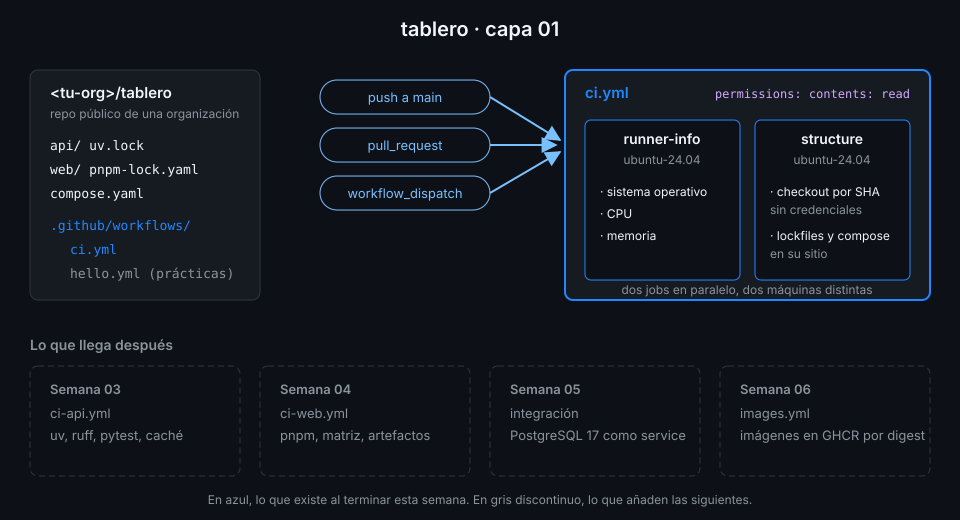

# Proyecto: capa 01 de tablero



## 🎯 Objetivo

Que `<tu-org>/tablero` tenga su primer workflow de verdad: `ci.yml`, que corre en cada push a
`main`, en cada pull request y a mano, con dos jobs en paralelo que te enseñan en qué máquina
corres y que comprueban que el monorepo tiene lo que el resto del bootcamp va a necesitar.

## 📦 Qué añade esta capa

Es la primera: hasta ahora el repo solo tiene el código de `app/` y el `hello.yml` de las
prácticas. Esta capa deja fijas las tres costumbres que todos los workflows de las 19 semanas
siguientes respetan: permisos mínimos en la raíz, `runs-on: ubuntu-24.04` y toda action remota
fijada por SHA.

| Job | Qué hace | Por qué existe |
|---|---|---|
| `runner-info` | Imprime sistema operativo, CPU y memoria del runner | Ver con tus ojos que cada job es una máquina nueva y qué trae |
| `structure` | Descarga el código y falla si falta `api/uv.lock`, `web/pnpm-lock.yaml` o `compose.yaml` | Los lockfiles son la base de los CI de las semanas 03 y 04; sin ellos, nada es reproducible |

Desbloquea la Semana 02, que conecta estos dos jobs en un grafo con `needs:`, pasa datos entre
ellos y escribe un resumen del run.

## ✅ Requisitos verificables

- El repo tablero es público
- El repo tablero pertenece a una organización, no a tu usuario
- El código de tablero está en la raíz del repo: api/uv.lock, web/pnpm-lock.yaml y compose.yaml
- El GITHUB_TOKEN del repo es de solo lectura por defecto
- Los workflows de un pull request de cualquier colaborador externo esperan tu aprobación
- hello.yml terminó en success al menos una vez lanzado a mano (workflow_dispatch)
- El repo rechaza cualquier action que no esté fijada por SHA completo
- ci.yml pasa actionlint
- ci.yml se dispara con push, pull_request y workflow_dispatch
- El push de ci.yml solo corre en la rama main
- ci.yml declara en la raíz permissions con solo contents: read
- ci.yml tiene exactamente dos jobs: runner-info y structure
- Todos los jobs de ci.yml corren en ubuntu-24.04
- Toda uses: remota de tus workflows está fijada por SHA de 40 caracteres con el tag en comentario
- Todo actions/checkout de ci.yml lleva persist-credentials: false
- ci.yml terminó en success sobre el último commit de main
- ci.yml terminó en success al menos una vez en un pull request

## 🎨 Criterios de calidad

Lo que `check-week.sh` no ve y la [rúbrica](../rubrica-evaluacion.md) sí puntúa:

- Cada step tiene un `name:` que se entiende en la UI sin abrir el log.
- Si falta un archivo, el step dice **cuál**: un `exit 1` mudo obliga a leer el script para
  saber qué pasó.
- El comentario de `permissions:` explica para qué está, no repite la clave.
- No queda ningún `TODO` en `.github/workflows/`.
- Los commits van en inglés con Conventional Commits (`ci: add ci workflow`).

## 💡 Adaptación a tu dominio

Si quieres practicar con un proyecto tuyo además de `tablero`, la misma capa se traduce así:

| Tu proyecto | `runner-info` imprime | `structure` comprueba |
|---|---|---|
| API en Python con uv | `python3 --version` y `uv --version` si existe | `pyproject.toml` y `uv.lock` |
| Frontend con pnpm | La versión de Node preinstalada | `package.json` y `pnpm-lock.yaml` |
| Infraestructura con Compose | `docker version` y `docker compose version` | `compose.yaml` y `.env.example` |
| Documentación | El idioma y la zona horaria del runner (`locale`, `date`) | Que existen `README.md` y `docs/` |

## 🚦 Cómo entregarlo

1. Copia el starter a tu repo y completa los `TODO 1` a `TODO 5`:

   ```bash
   cd ~/code/tablero
   cp ~/code/bc-github-actions/bootcamp/week-01-primer_workflow_y_modelo_de_ejecucion/3-proyecto/starter/.github/workflows/ci.yml .github/workflows/
   actionlint .github/workflows/ci.yml
   # (sin salida: no hay errores)
   ```

2. Súbelo a `main` y espera al run de **tu** commit:

   ```bash
   git add .github/workflows/ci.yml
   git commit -m "ci: add ci workflow"
   git push
   gh run list --workflow ci.yml --commit "$(git rev-parse HEAD)" --json conclusion --jq '.[0].conclusion'
   # success
   ```

3. Abre un pull request que toque cualquier archivo y comprueba que `ci.yml` corre en él:

   ```bash
   git switch -c docs/readme-ci
   echo "CI: [ci.yml](.github/workflows/ci.yml)" >> README.md
   git commit -am "docs: link ci workflow"
   git push -u origin docs/readme-ci
   gh pr create --fill
   gh pr checks --watch
   # Información del runner	pass	...
   # Estructura del monorepo	pass	...
   ```

   Puedes fusionarlo después con `gh pr merge --squash --delete-branch`.

4. Lanza la verificación:

   ```bash
   cd ~/code/bc-github-actions
   ./scripts/check-week.sh 01
   # 17/17 comprobaciones superadas.
   ```

## 🧯 Errores comunes

| Síntoma | Causa | Solución |
|---|---|---|
| `ci-events` en rojo con `workflow_dispatch` solo | Falta el `TODO 1` | Añade `push` con `branches: [main]` y `pull_request` bajo `on:` |
| `structure` falla con `api/uv.lock: falta` aunque el archivo existe | No hay checkout: el workspace del runner empieza vacío | `TODO 4`: `actions/checkout` antes del step que comprueba |
| El run termina en `startup_failure` | Activaste `sha_pinning_required` y una `uses:` va por tag | Resuélvela con `scripts/resolve-sha.sh` (práctica 04, paso 3) |
| `ci-green-on-main` en rojo aunque la UI está en verde | El verde es de un commit anterior | Espera al run del último commit de `main` o vuelve a hacer push |
| `ci-ran-on-pr` en rojo | El PR viene de un fork o nunca terminó | Abre el PR desde una rama de tu propio repo (paso 3) |
| `gh pr create` pregunta a qué repo | Tienes otro remoto además de `origin` | `gh repo set-default <tu-org>/tablero` |

## 🔗 Navegación

---

| ← Anterior | Siguiente → |
|:---|---:|
| [actionlint y pinning por SHA](../2-practicas/04-actionlint-y-sha.md) | [Rúbrica de evaluación](../rubrica-evaluacion.md) |
