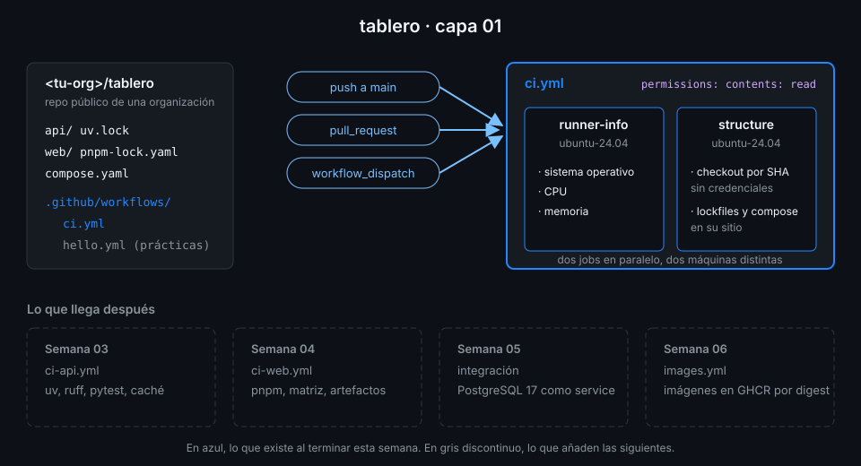

# Semana 01 — Primer workflow y modelo de ejecución

> Un push no "lanza el CI": crea un evento, GitHub busca qué workflows reaccionan a él y reparte sus
> jobs entre máquinas nuevas que nacen y mueren en minutos. Esta semana aprendes a ver esa cadena.

## 🎯 Objetivos de la Semana

Al terminar la semana eres capaz de:

- Explicar qué pasa entre un `git push` y un check verde: evento, workflow, run, job, step y runner
- Escribir un workflow en YAML sin caer en las trampas del formato, empezando por `on:`
- Saber qué te da un runner alojado de GitHub, qué no comparte entre jobs y por qué se fija
  `ubuntu-24.04` y no `ubuntu-latest`
- Disparar un workflow con `push`, `pull_request` y `workflow_dispatch`, y saber qué commit ejecuta
  cada uno
- Seguir, leer, depurar y relanzar ejecuciones desde la terminal con `gh run` y `gh workflow`
- Usar una action de terceros fijada por SHA, comprobarla con actionlint y hacer que tu repo rechace
  las que no lo estén
- Dejar `<tu-org>/tablero` creado, con el código de la app y un `ci.yml` en verde

## 📋 Prerrequisitos

| Necesitas | Dónde se aprende |
|---|---|
| Git: commit, branch, push y pull request | [`bc-github`](https://github.com/ergrato-dev/bc-github), semanas 01-08 |
| Terminal: rutas, variables de entorno, ejecutar scripts | [`bc-linux-commandline`](https://github.com/ergrato-dev/bc-linux-commandline) |
| gh con el scope `workflow`, jq, yq (mikefarah) y actionlint instalados con checksum | [`docs/setup-entorno.md`](../../docs/setup-entorno.md), apartados 0-3 |
| Este repositorio clonado en `~/code/bc-github-actions` | `git clone https://github.com/ergrato-dev/bc-github-actions.git ~/code/bc-github-actions` |

YAML no se asume: se ve en la teoría 02. uv, pnpm y Docker no hacen falta hasta las semanas 03,
04 y 05.

## 🗂️ Estructura de la Semana

```
week-01-primer_workflow_y_modelo_de_ejecucion/
├── README.md
├── rubrica-evaluacion.md
├── checks.json                    17 comprobaciones
├── 0-assets/                      4 diagramas SVG
├── 1-teoria/                      7 archivos, uno por concepto
├── 2-practicas/                   4 prácticas guiadas
├── 3-proyecto/
│   ├── README.md
│   └── starter/.github/workflows/ci.yml
├── 4-recursos/{ebooks-free,videografia,webgrafia}/README.md
└── 5-glosario/README.md
```

## 📝 Contenidos

### Teoría

| # | Archivo | Qué aprendes | Tiempo |
|:--:|---|---|:--:|
| 01 | [Qué es GitHub Actions](1-teoria/01-que-es-github-actions.md) | La cadena evento → workflow → run → job → step → runner | 25 min |
| 02 | [YAML para workflows](1-teoria/02-yaml-para-workflows.md) | Lo justo de YAML y la trampa de `on:` | 25 min |
| 03 | [Anatomía de un workflow](1-teoria/03-anatomia-de-un-workflow.md) | Cada clave de un workflow y qué decide | 30 min |
| 04 | [Runners alojados por GitHub](1-teoria/04-runners-alojados.md) | Una máquina nueva por job, qué trae y por qué `ubuntu-24.04` | 25 min |
| 05 | [Eventos básicos: push, pull_request y workflow_dispatch](1-teoria/05-eventos-basicos.md) | Qué commit ejecuta cada evento y qué pasa con los forks | 30 min |
| 06 | [Leer una ejecución](1-teoria/06-leer-una-ejecucion.md) | Runs, attempts, conclusiones y logs, desde la UI y desde `gh` | 20 min |
| 07 | [Actions de terceros y pinning por SHA](1-teoria/07-actions-de-terceros-y-pinning.md) | Por qué un tag no basta y cómo fijar una action | 25 min |

### Prácticas

| # | Archivo | Qué haces | Tiempo |
|:--:|---|---|:--:|
| 01 | [Organización y repo tablero](2-practicas/01-organizacion-y-repo-tablero.md) | Org gratuita, repo público con la app y Actions configurado con criterio | 1 h |
| 02 | [Tu primer workflow](2-practicas/02-primer-workflow.md) | `hello.yml`: lo escribes, lo ejecutas, lo rompes y lo arreglas | 1,5 h |
| 03 | [gh CLI para Actions](2-practicas/03-gh-cli-para-actions.md) | Lanzar, seguir, leer y relanzar ejecuciones sin abrir el navegador | 1 h |
| 04 | [actionlint y pinning por SHA](2-practicas/04-actionlint-y-sha.md) | Errores cazados antes del push y actions fijadas por SHA | 1 h |

### Proyecto

[Capa 01 de `tablero`](3-proyecto/README.md): `ci.yml` con dos jobs en paralelo que se disparan
con `push` a `main`, `pull_request` y `workflow_dispatch`, con permisos mínimos y `actions/checkout`
fijado por SHA.



## ⏱️ Distribución del Tiempo (10 horas)

| Actividad | Horas |
|---|:--:|
| Teoría (7 archivos) | 3 |
| Práctica 01 — Organización y repo tablero | 1 |
| Práctica 02 — Tu primer workflow | 1,5 |
| Práctica 03 — gh CLI para Actions | 1 |
| Práctica 04 — actionlint y pinning por SHA | 1 |
| Proyecto — capa 01 | 1,5 |
| Autoevaluación con la rúbrica | 1 |
| **Total** | **10** |

## 🎩 Trucos y atajos

- **`gh run watch <id> --exit-status`** sale con error si el run falla. Encadenado
  (`gh run watch "$id" --exit-status && git push origin HEAD:release`) convierte la terminal en una
  puerta: lo siguiente solo ocurre si el CI está en verde.
- **El run de tu commit, no "el último"**: `gh run list --commit "$(git rev-parse HEAD)"` filtra por
  SHA. Con dos pushes seguidos, "el último run" puede ser el del commit anterior.
- **`gh run view <id> --log-failed`** imprime solo los steps que fallaron, con su prefijo de job y
  step. En un log de 3.000 líneas es la diferencia entre leer y buscar.
- **`gh run rerun <id> --debug`** relanza con los logs de depuración del runner activados, sin
  crear los secretos `ACTIONS_STEP_DEBUG` ni `ACTIONS_RUNNER_DEBUG` y solo para ese intento.
- **`gh api repos/{owner}/{repo}/actions/permissions`** te enseña de un vistazo si Actions está
  activado, qué actions se permiten y si se exige SHA (`sha_pinning_required`), tres ajustes que en
  la UI están repartidos por la página de Settings.

## 📌 Entregables

- La organización `<tu-org>` y el repo público `<tu-org>/tablero` con el código de `app/` en la raíz
- Actions configurado: token de solo lectura, aprobación para colaboradores externos y SHA obligatorio
- `hello.yml` ejecutado al menos una vez a mano con `gh workflow run`
- `.github/workflows/ci.yml` completado desde el starter, en verde en `main` y en un pull request
  (ver [proyecto](3-proyecto/README.md))
- Las 10 preguntas de la [rúbrica](rubrica-evaluacion.md) respondidas antes de mirar las respuestas

## ✅ Verificación

```bash
cd ~/code/bc-github-actions
./scripts/check-week.sh 01
# Semana 01 — Primer workflow y modelo de ejecución  [repo: <tu-org>/tablero]
#
#   ✅ El repo tablero es público
#   ✅ El repo tablero pertenece a una organización, no a tu usuario
#   ...
# 17/17 comprobaciones superadas.
```

Si algo sale en rojo, la pista te dice qué práctica y qué paso lo arreglan.

## 🔗 Navegación


| ← Anterior | Siguiente → |
|:---|---:|
| [Índice del bootcamp](../README.md) | [Qué es GitHub Actions](1-teoria/01-que-es-github-actions.md) |
