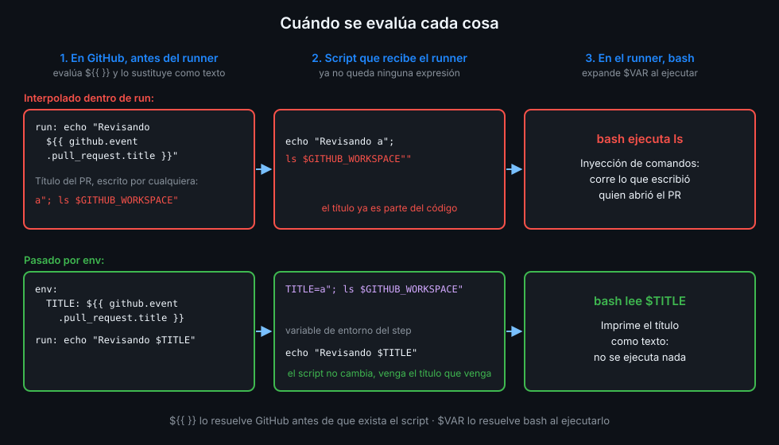

# Expresiones y funciones

> `${{ }}` es un pequeño lenguaje que GitHub evalúa en su servidor antes de que tu script exista.
> Entender **cuándo** se evalúa es lo que separa un workflow correcto de uno inyectable.



## 🎯 Objetivos

- Escribir expresiones con literales, operadores y funciones sin errores de tipo
- Predecir el resultado de una comparación entre tipos distintos
- Usar `contains`, `startsWith`, `endsWith`, `format`, `join`, `toJSON`, `fromJSON` y `hashFiles`
- Explicar por qué `${{ }}` dentro de `run:` puede ejecutar código ajeno y cómo evitarlo con `env:`

## 1. Qué problema resuelve

Un workflow necesita valores que no conoces al escribirlo: la rama del push, si el evento es un pull
request, el hash de un lockfile. Y necesita combinarlos: "corre solo si es `main` **y** no es un
borrador", "el nombre del artefacto es `tablero-` más el número de run".

Las expresiones son ese cálculo. Se escriben entre `${{` y `}}`, y pueden leer contextos (teoría
01), comparar, combinar con `&&` y `||`, y llamar a funciones.

## 2. Cómo funciona

### Cuándo se evalúa

Esta es la idea más importante de la semana. Mira el diagrama de arriba:

1. GitHub lee el workflow en su servidor.
2. **Evalúa cada `${{ }}` y lo sustituye por su resultado, como texto.** El script de un `run:`
   todavía no existe como script: es una plantilla.
3. El runner recibe el script **ya sustituido**, lo guarda en un archivo temporal y lo ejecuta con
   bash.
4. Bash expande `$VAR` en ese momento, en la máquina.

Por eso `${{ }}` y `$VAR` no son dos formas de escribir lo mismo. Con `${{ github.sha }}` dentro de
un `run:`, bash recibe el SHA escrito literalmente en el código. Con `$GITHUB_SHA`, bash recibe el
nombre de una variable y lee su valor él mismo. En el primer caso **el valor pasa a ser parte del
código**. Con un SHA da igual. Con el título de un pull request, que escribe cualquiera, no.

### Literales

| Tipo | Ejemplo | Nota |
|---|---|---|
| Booleano | `true`, `false` | |
| Nulo | `null` | |
| Número | `42`, `-2.99e-2`, `0xff` | Cualquier formato de número válido en JSON |
| Cadena | `'main'`, `'It''s open source'` | **Comillas simples**. Las dobles dan error. Una comilla dentro se duplica |

### Operadores

`( )` agrupa, `[ ]` indexa, `.` accede a una propiedad, `!` niega, `<` `<=` `>` `>=` comparan,
`==` y `!=` comprueban igualdad, `&&` es "y" y `||` es "o".

```yaml
if: github.event_name == 'push' && github.ref == 'refs/heads/main'
```

### Comparaciones y tipos

- **Las cadenas se comparan sin distinguir mayúsculas**: `'Main' == 'main'` es `true`.
- **La igualdad es laxa.** Si los tipos difieren, GitHub convierte los dos lados a número: `null`
  vale `0`, `true` vale `1`, una cadena se lee como número JSON (vacía vale `0`; si no es un número
  vale `NaN`) y un array u objeto vale `NaN`. Cualquier comparación con `NaN` es `false`.
- **Un output de step siempre es una cadena.** `steps.x.outputs.count > 9` compara texto convertido
  a número; para un booleano o un número de verdad, `fromJSON(steps.x.outputs.count)`.

Valores falsos en una condición: `false`, `0`, `-0`, `''` y `null`. Todo lo demás es verdadero,
incluida la cadena `'false'`. Esa es una trampa clásica:

```yaml
env:
  DEPLOY: 'false'
# ${{ env.DEPLOY }} es la cadena 'false': no vacía, luego verdadera en un if.
# ${{ fromJSON(env.DEPLOY) }} es el booleano false.
```

### Funciones

| Función | Qué hace | Ejemplo |
|---|---|---|
| `contains(a, b)` | ¿`a` contiene `b`? Vale para cadenas y arrays, sin distinguir mayúsculas | `contains(github.ref, 'release')` |
| `startsWith(a, b)` | ¿`a` empieza por `b`? | `startsWith(github.ref, 'refs/tags/')` |
| `endsWith(a, b)` | ¿`a` termina en `b`? | `endsWith(github.repository, '/tablero')` |
| `format(plantilla, v0, v1...)` | Sustituye `{0}`, `{1}`... `{{` y `}}` escapan llaves | `format('tablero-{0}', github.run_number)` |
| `join(array, sep)` | Une un array; el separador por defecto es la coma | `join(fromJSON('["a","b"]'), ' + ')` |
| `toJSON(valor)` | Convierte a JSON con sangría | `toJSON(runner)` |
| `fromJSON(texto)` | Convierte JSON en valor: booleano, número, array, objeto | `fromJSON('["push","workflow_dispatch"]')` |
| `hashFiles(patrones)` | SHA-256 de los archivos que casan, relativos al workspace; `''` si no casa ninguno | `hashFiles('api/uv.lock')` |

`contains` con un array literal es la forma de preguntar "¿es uno de estos?":

```yaml
if: contains(fromJSON('["push", "workflow_dispatch"]'), github.event_name)
```

`hashFiles` solo funciona en las claves de un step, porque lee archivos del workspace. Sin checkout
devuelve una cadena vacía. Lo usarás para la caché en la Semana 03.

### El filtro `*`

`*` selecciona una propiedad de todos los elementos de un objeto o array. `needs.*.result` devuelve
el array con el resultado de cada job del que dependes:

```yaml
if: contains(needs.*.result, 'failure')
```

El orden del array no está garantizado: úsalo para preguntar "¿alguno?", no "¿el primero?".

## 3. Cómo se usa

Un workflow que usa funciones en `if:`, en `name:` y en `env:`, y nunca dentro de `run:`
(verificado con actionlint 1.7.12 y ubuntu-24.04, noviembre de 2026):

```yaml
name: expressions-demo
run-name: ${{ format('demo {0} en {1}', github.event_name, github.ref_name) }}

on:
  push:
    branches: [main]
  workflow_dispatch:

# Mínimo privilegio: lo verás a fondo en la Semana 12.
permissions:
  contents: read

jobs:
  demo:
    runs-on: ubuntu-24.04
    steps:
      - uses: actions/checkout@3d3c42e5aac5ba805825da76410c181273ba90b1 # v7.0.1
        with:
          persist-credentials: false

      - name: Solo si el evento es push o manual
        if: contains(fromJSON('["push", "workflow_dispatch"]'), github.event_name)
        env:
          LOCK_HASH: ${{ hashFiles('api/uv.lock') }}
          LABEL: ${{ format('tablero-{0}', github.run_number) }}
        run: |
          echo "Etiqueta: $LABEL"
          echo "Hash de uv.lock: $LOCK_HASH"

      - name: Solo en main
        if: github.ref == 'refs/heads/main'
        run: echo "Esto es main"
```

Fíjate en el patrón: la expresión vive en `env:` y el script lee `$LABEL`. El valor llega al shell
como dato, no como código.

## 4. Antipatrones

El primero es el más grave del bootcamp y se ataca a fondo en la Semana 12. Imagina este step en un
workflow que corre con `pull_request`:

```text
run: echo "Revisando ${{ github.event.pull_request.title }}"
```

Si alguien abre un pull request titulado `a"; ls $GITHUB_WORKSPACE"`, GitHub sustituye la expresión
**antes** de que bash vea nada, y el script que ejecuta el runner queda así:

```text
echo "Revisando a"; ls $GITHUB_WORKSPACE""
```

Las comillas del título cierran las tuyas y `ls` se ejecuta. En lugar de `ls`, un atacante pondría
un comando que envíe el token a su servidor. La versión segura pasa el dato por `env:`:

```text
env:
  TITLE: ${{ github.event.pull_request.title }}
run: echo "Revisando $TITLE"
```

Ahora bash recibe `$TITLE` como variable: el contenido nunca se interpreta como código, tenga las
comillas que tenga.

| Antipatrón | Por qué duele | Qué hacer en su lugar |
|---|---|---|
| `${{ github.event.* }}`, `${{ github.head_ref }}` o `${{ inputs.* }}` dentro de `run:` | El valor se pega en el script como código: inyección de comandos. Penalización grave en la rúbrica | Pásalo por `env:` y usa `"$VAR"` entre comillas |
| Comillas dobles dentro de `${{ }}` | Error de sintaxis de la expresión | Comillas simples: `'main'` |
| `if: env.DEPLOY` con `DEPLOY: 'false'` | La cadena `'false'` no está vacía: es verdadera | `if: fromJSON(env.DEPLOY)` |
| Comparar outputs como números sin convertir | Los outputs son cadenas | `fromJSON(steps.x.outputs.n) > 9` |
| `hashFiles()` antes del checkout | El workspace está vacío: devuelve `''` y la caché se comparte entre todo | `actions/checkout` primero |
| Depender del orden de `needs.*.result` | El orden no está garantizado | `contains(needs.*.result, 'failure')` |

Campos que nunca debes considerar de confianza: los que terminan en `title`, `body`, `message`,
`name`, `email`, `label`, `ref`, `head_ref`, `default_branch` o `page_name` del evento. Los escribe
quien abre la issue, el PR o la rama.

## 5. Trucos

- **`run-name`** acepta expresiones y cambia cómo se ve cada run en la lista de Actions. Con
  `format()` distingues de un vistazo un run manual de uno por push.
- **Prueba una expresión sin push**: actionlint evalúa los tipos de las expresiones y detecta
  propiedades inexistentes (`github.evnt_name`) y contextos fuera de sitio.
- **`case(pred1, valor1, ..., por_defecto)`** devuelve el valor del primer predicado verdadero. Es
  el "operador ternario" que antes se escribía como `cond && 'a' || 'b'`, que falla cuando `'a'` es
  falso.

## 📚 Recursos Adicionales

- [Expressions reference](https://docs.github.com/en/actions/reference/workflows-and-actions/expressions):
  literales, operadores, conversión de tipos y todas las funciones
- [Script injections](https://docs.github.com/en/actions/concepts/security/script-injections):
  el caso del título de PR malicioso contado por GitHub

## ✅ Checklist de Verificación

- [ ] Sé que `${{ }}` se sustituye como texto en GitHub antes de que el shell vea el script
- [ ] Nunca meto `github.event.*`, `github.head_ref` ni `inputs.*` dentro de `run:`: van por `env:`
- [ ] Escribo las cadenas de una expresión con comillas simples
- [ ] Sé por qué la cadena `'false'` es verdadera y cómo convertirla con `fromJSON`
- [ ] Sé usar `contains` con un array de `fromJSON` y con `needs.*.result`
- [ ] Sé que `hashFiles` necesita el checkout y solo funciona en las claves de un step

---

| ← Anterior | Siguiente → |
|:---|---:|
| [Contextos](01-contextos.md) | [Condiciones y funciones de estado](03-condiciones-y-funciones-de-estado.md) |
