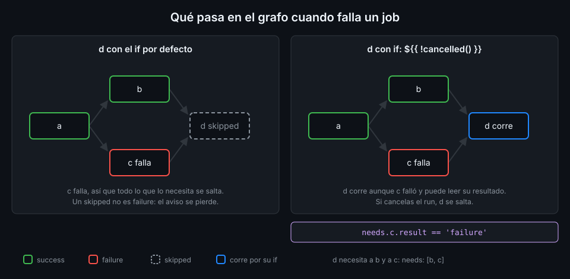

# Condiciones y funciones de estado

> Por defecto, un fallo lo para todo: los steps siguientes no corren y los jobs que dependen del
> roto se saltan. `if:` y las funciones de estado deciden qué sigue corriendo cuando algo falla.



## 🎯 Objetivos

- Escribir condiciones `if:` en jobs y en steps, sabiendo cuándo puedes omitir `${{ }}`
- Usar `success()`, `failure()`, `always()` y `cancelled()`, y explicar por qué `!cancelled()` es
  mejor opción que `always()` casi siempre
- Distinguir `outcome` de `conclusion` en un step con `continue-on-error`
- Predecir qué jobs de un grafo corren, fallan o se saltan cuando uno falla

## 1. Qué problema resuelve

En la Semana 01 viste que un step con `exit 3` impide que corran los siguientes. Es el
comportamiento correcto casi siempre: si los tests fallan, no quieres publicar. Pero hay steps que
tienen que correr **precisamente** cuando algo falla:

- Guardar los logs de la base de datos para entender el fallo.
- Escribir un resumen del run con qué pasó en cada job.
- Limpiar algo que un step anterior creó.

Y hay steps o jobs que solo tienen sentido en ciertos casos: publicar solo en `main`, comentar solo
en un pull request. Para las dos cosas existe `if:`.

## 2. Cómo funciona

### `if:` en un job y en un step

`if:` acepta una expresión. Si es falsa, el job o el step **se salta** (`skipped`): no falla, no
corre y aparece tachado en la UI.

```yaml
jobs:
  publish:
    if: github.ref == 'refs/heads/main'
    runs-on: ubuntu-24.04
    steps:
      - run: echo "solo en main"
```

En `if:` puedes omitir `${{ }}`: GitHub evalúa la clave como expresión de todas formas. **Excepto
si empieza por `!`**: entonces tienes que escribir `${{ }}` o envolverla en paréntesis. El motivo
es YAML, no GitHub: un valor que empieza por `!` es una etiqueta de tipo en YAML, y la condición
se queda vacía. actionlint lo caza: `string should not be empty`.

```yaml
if: ${{ !cancelled() }}   # correcto
if: (!cancelled())        # también correcto
```

Las dos formas son válidas. Este bootcamp usa `${{ }}` siempre que la condición empieza por `!`.

### `success()` implícito

Un `if:` **sin** función de estado lleva un `success()` delante que no ves. Estas dos líneas son
iguales:

```yaml
if: github.ref == 'refs/heads/main'
if: success() && github.ref == 'refs/heads/main'
```

Por eso un step con `if: github.ref == 'refs/heads/main'` tampoco corre si un step anterior falló.

### Las cuatro funciones de estado

Solo funcionan dentro de `if:`.

| Función | Es verdadera cuando |
|---|---|
| `success()` | Todos los steps anteriores (y los jobs de los que dependes) terminaron bien |
| `failure()` | Algún step anterior falló, o falló un job del que dependes, directa o indirectamente |
| `cancelled()` | El run se canceló |
| `always()` | Siempre, **incluso si cancelas el run** |

Fuera de `if:`, `job.status` te da el estado del job en curso: `success`, `failure` o `cancelled`.

### `always()` frente a `!cancelled()`

Las dos hacen que un step corra aunque algo haya fallado. La diferencia está en la cancelación:

| Condición | Algo falló | Cancelas el run |
|---|---|---|
| `if: always()` | Corre | **Corre igualmente** |
| `if: ${{ !cancelled() }}` | Corre | Se salta |

Cuando cancelas un run es porque quieres que pare. Un step con `always()` sigue corriendo y, si
cuelga (un checkout, una descarga lenta), el run no termina hasta el timeout. La propia
documentación de GitHub recomienda `!cancelled()` para esos casos. Reserva `always()` para lo que de
verdad tiene que pasar incluso al cancelar, como liberar un recurso externo.

El job `summary` de tu proyecto usa `!cancelled()`: tiene que contar qué falló, pero no tiene
sentido que corra si tú mismo paraste el run.

### `failure()` con condiciones extra

Si quieres un step que corra solo cuando falló **un step concreto**, tienes que escribir
`failure()` de forma explícita. Si no, el `success()` implícito lo impide:

```yaml
- name: Diagnóstico
  if: failure() && steps.tests.conclusion == 'failure'
  run: echo "fallaron los tests"
```

### `continue-on-error`, `outcome` y `conclusion`

`continue-on-error: true` en un step hace que su fallo no falle el job. El step sigue marcado como
fallido en la UI, pero los siguientes corren como si hubiera ido bien. Para distinguirlo tienes dos
propiedades en el contexto `steps` (el step necesita un `id`):

| Propiedad | Qué es | Step con `continue-on-error` que falla |
|---|---|---|
| `steps.<id>.outcome` | El resultado **antes** de aplicar `continue-on-error` | `failure` |
| `steps.<id>.conclusion` | El resultado **después** | `success` |

Los valores posibles son `success`, `failure`, `cancelled` y `skipped`.

### Jobs saltados y propagación

En el grafo de jobs (con `needs:`, lo ves a fondo en la teoría 06), **si un job falla o se salta,
todos los que dependen de él se saltan**, salvo que su `if:` diga otra cosa. Míralo en el diagrama
de arriba: `c` falla, y `d`, que necesita a `b` y a `c`, se salta con su `if` por defecto. Con
`if: ${{ !cancelled() }}`, `d` corre y puede leer `needs.c.result`, que vale `failure`.

Un job saltado cuenta como `skipped`, no como `failure`. Si dejas que un job final se salte, tu run
puede quedar "verde" sin haber hecho lo que debía. Por eso el job `summary` de tu proyecto comprueba
los resultados y falla si alguno no es `success`.

## 3. Cómo se usa

Un workflow que muestra las funciones de estado en acción (verificado con actionlint 1.7.12 y
ubuntu-24.04, noviembre de 2026):

```yaml
name: status-demo

on:
  workflow_dispatch:

# Mínimo privilegio: lo verás a fondo en la Semana 12.
permissions:
  contents: read

jobs:
  checks:
    runs-on: ubuntu-24.04
    steps:
      - name: Un chequeo opcional que falla
        id: optional
        continue-on-error: true
        run: exit 1

      - name: Ver outcome y conclusion
        env:
          OUTCOME: ${{ steps.optional.outcome }}
          CONCLUSION: ${{ steps.optional.conclusion }}
        run: echo "outcome=$OUTCOME conclusion=$CONCLUSION"

      - name: Un chequeo obligatorio que falla
        id: required
        run: exit 1

      - name: Solo si falló el obligatorio
        if: failure() && steps.required.conclusion == 'failure'
        run: echo "diagnóstico del fallo"

      - name: Siempre que no se cancele
        if: ${{ !cancelled() }}
        env:
          STATUS: ${{ job.status }}
        run: echo "estado del job $STATUS"

      - name: Este no corre
        run: echo "nunca llegas aquí"
```

El run termina en `failure` por el step `required`. El log muestra `outcome=failure
conclusion=success`, el diagnóstico, `estado del job failure` y el último step saltado.

## 4. Antipatrones

| Antipatrón | Por qué duele | Qué hacer en su lugar |
|---|---|---|
| `if: !cancelled()` sin `${{ }}` | YAML lee `!cancelled()` como una etiqueta de tipo, no como texto | `if: ${{ !cancelled() }}` |
| `if: always()` en un step de limpieza o resumen | Sigue corriendo cuando cancelas: un run que querías parar no para | `if: ${{ !cancelled() }}` |
| `if: steps.tests.conclusion == 'failure'` sin `failure()` | El `success()` implícito lo impide: nunca corre | `if: failure() && steps.tests.conclusion == 'failure'` |
| `continue-on-error: true` para silenciar un test que falla | El run queda verde con un fallo dentro; nadie lo vuelve a mirar | Arréglalo, o sácalo a un job opcional con nombre claro |
| Un job final que se salta cuando falla otro | El run puede quedar verde aunque el job final no corrió | `if: ${{ !cancelled() }}` y comprueba `needs.*.result` |
| Leer `steps.x.outcome` de un step sin `id` | El contexto `steps` solo guarda steps con `id` | Pon `id:` al step que quieres consultar |

## 5. Trucos

- **`contains(needs.*.result, 'failure')`** responde "¿falló alguno de los jobs que necesito?" en
  una línea, sin listar los jobs uno a uno.
- **Un output que no existe vale cadena vacía**, sin error. Si un `if:` compara un output mal
  escrito (`steps.test.outputs.reslt`), la condición es falsa y el step se salta en silencio. Ante
  un step tachado que no esperabas, mira primero el `if:`.
- **Cancelar desde la terminal**: `gh run cancel <id>`. Úsalo para ver con tus ojos la diferencia
  entre `always()` y `!cancelled()` en el log.

## 📚 Recursos Adicionales

- [Expressions: status check functions](https://docs.github.com/en/actions/reference/workflows-and-actions/expressions#status-check-functions):
  las cuatro funciones de estado con ejemplos
- [Workflow syntax: jobs.<job_id>.if](https://docs.github.com/en/actions/reference/workflows-and-actions/workflow-syntax#jobsjob_idif):
  cuándo puedes omitir `${{ }}` y por qué no con `!`
- [Contexts: steps context](https://docs.github.com/en/actions/reference/workflows-and-actions/contexts#steps-context):
  `outcome` frente a `conclusion`

## ✅ Checklist de Verificación

- [ ] Sé que un `if:` sin función de estado lleva `success()` implícito
- [ ] Escribo `${{ }}` cuando la condición empieza por `!`
- [ ] Sé cuándo usar `!cancelled()` y cuándo `always()`
- [ ] Sé escribir un step que solo corre si falló un step concreto
- [ ] Distingo `outcome` de `conclusion` en un step con `continue-on-error`
- [ ] Sé qué les pasa a los jobs que dependen de uno que falla o se salta

---

| ← Anterior | Siguiente → |
|:---|---:|
| [Expresiones y funciones](02-expresiones-y-funciones.md) | [Variables de entorno, vars y defaults](04-variables-de-entorno-vars-y-defaults.md) |
