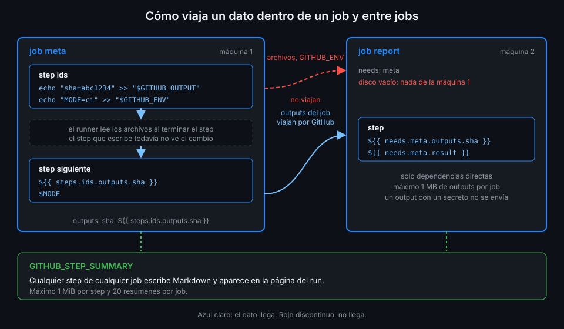

# Datos entre steps

> Cada `run` es un proceso de bash distinto: una variable que exportas en un step muere con él.
> Para pasar un dato al step siguiente, el runner te da unos archivos especiales. Este archivo
> enseña cuáles son y cuándo usar cada uno.



## 🎯 Objetivos

Al terminar este archivo eres capaz de:

- Explicar por qué `export` no sirve entre steps
- Publicar un output de step con `$GITHUB_OUTPUT` y leerlo con `steps.<id>.outputs`
- Escribir valores de varias líneas con un delimitador seguro
- Usar `$GITHUB_ENV` y `$GITHUB_PATH`, y saber desde qué step tienen efecto
- Escribir un resumen en Markdown con `$GITHUB_STEP_SUMMARY`
- Reconocer `::set-output` y `::save-state` como formas retiradas

---

## 1. Qué problema resuelve

Este job parece correcto y no lo es:

```bash
# step 1
export SHORT_SHA="${GITHUB_SHA::7}"
# step 2
echo "Versión: $SHORT_SHA"     # imprime "Versión: "
```

El runner lanza **un proceso de shell nuevo por step**. `export` cambia el entorno del proceso
del step 1, que termina al acabar el step. El step 2 nace con el entorno del job, sin `SHORT_SHA`.

Lo mismo pasa con cualquier cosa que viva en memoria. Lo único que se comparte entre steps del
mismo job es el **disco** de la máquina. GitHub aprovecha eso: te da la ruta de unos archivos
donde escribes, y el runner los lee entre un step y el siguiente.

---

## 2. Cómo funciona

### 2.1 Los archivos de entorno

En cada step, el runner define estas variables con la ruta de un archivo:

| Variable | Qué escribes | Quién lo ve |
|---|---|---|
| `GITHUB_OUTPUT` | `nombre=valor` | Expresiones `steps.<id>.outputs.nombre` en los steps siguientes y en `outputs:` del job |
| `GITHUB_ENV` | `NOMBRE=valor` | Variables de entorno de **todos los steps siguientes** del job |
| `GITHUB_PATH` | Una carpeta por línea | Se antepone al `PATH` de los steps siguientes |
| `GITHUB_STEP_SUMMARY` | Markdown | La página del run, bajo el job |

Al terminar el step, el runner lee el archivo y aplica lo que encuentra. Por eso **el step que
escribe no ve el cambio**: ni la variable de `GITHUB_ENV` ni la carpeta de `GITHUB_PATH` existen
todavía para él (verificado con la documentación de workflow commands y ubuntu-24.04, noviembre
de 2026).

### 2.2 Outputs de step

Un output necesita dos cosas: que el step tenga `id:` y que escriba en `$GITHUB_OUTPUT`.

```bash
echo "sha_short=${GITHUB_SHA::7}" >> "$GITHUB_OUTPUT"
```

Después, cualquier step siguiente lo lee con `steps.<id>.outputs.sha_short`. El contexto `steps`
solo contiene los steps con `id` que ya terminaron: referirte a uno posterior devuelve vacío.

Un output de step es siempre una **cadena**. `echo "count=3"` da la cadena `"3"`; si necesitas un
número o un objeto, `fromJSON` lo convierte (teoría 02).

### 2.3 Valores de varias líneas

`nombre=valor` termina en el salto de línea. Para un valor de varias líneas, el formato es:

```text
nombre<<DELIMITADOR
línea 1
línea 2
DELIMITADOR
```

La documentación pide que el delimitador **no aparezca en una línea propia dentro del valor**.
Si el valor viene de fuera (la salida de un comando, el título de un PR), alguien puede meter esa
línea y cerrar tu bloque antes de tiempo, añadiendo después las variables que quiera. La defensa
es un delimitador que nadie puede adivinar:

```bash
delimiter="EOF_$(openssl rand -hex 16)"
{
  echo "files<<${delimiter}"
  ls api/migrations
  echo "${delimiter}"
} >> "$GITHUB_OUTPUT"
```

Si el valor es arbitrario y grande, la propia documentación recomienda otra cosa: escribirlo en un
archivo y pasar la **ruta**.

### 2.4 `GITHUB_ENV` y `GITHUB_PATH`

`echo "BUILD_SHA=${GITHUB_SHA::7}" >> "$GITHUB_ENV"` crea `BUILD_SHA` para todos los steps
siguientes del job, como si estuviera en `env:`. Dos límites (verificado con la documentación de
workflow commands, noviembre de 2026):

- No puedes sobrescribir las `GITHUB_*` ni las `RUNNER_*`.
- Por seguridad, `GITHUB_ENV` no puede fijar `NODE_OPTIONS`.

`echo "$HOME/.local/bin" >> "$GITHUB_PATH"` hace que las herramientas que instales ahí se
encuentren sin ruta completa en los steps siguientes.

### 2.5 `GITHUB_STEP_SUMMARY`

Lo que escribes en `$GITHUB_STEP_SUMMARY` es Markdown que aparece en la página del run, debajo del
job: tablas, enlaces, listas. Es el sitio para lo que una persona tiene que ver sin abrir el log.

Límites (verificado con la documentación de workflow commands, noviembre de 2026):

- Cada step puede escribir como máximo **1 MiB**. Si se pasa, falla la subida y aparece una
  anotación de error, pero el step no cambia de estado.
- Se muestran como máximo **20 resúmenes de step por job**.
- Los resúmenes están aislados por step: un Markdown roto en uno no rompe los siguientes.

---

## 3. Cómo se usa

Un job que calcula dos datos en un step, los usa en otro y deja un resumen:

```yaml
name: step-data

on: workflow_dispatch

# Mínimo privilegio: lo verás a fondo en la Semana 12.
permissions:
  contents: read

defaults:
  run:
    shell: bash

jobs:
  migrations:
    runs-on: ubuntu-24.04
    steps:
      - uses: actions/checkout@3d3c42e5aac5ba805825da76410c181273ba90b1 # v7.0.1
        with:
          persist-credentials: false

      - name: Contar migraciones
        id: scan
        run: |
          echo "count=$(find api/migrations -name '*.sql' | wc -l)" >> "$GITHUB_OUTPUT"
          delimiter="EOF_$(openssl rand -hex 16)"
          {
            echo "files<<${delimiter}"
            ls api/migrations
            echo "${delimiter}"
          } >> "$GITHUB_OUTPUT"
          echo "BUILD_SHA=${GITHUB_SHA::7}" >> "$GITHUB_ENV"

      - name: Resumen
        env:
          COUNT: ${{ steps.scan.outputs.count }}
          FILES: ${{ steps.scan.outputs.files }}
        run: |
          {
            echo "### Migraciones en ${BUILD_SHA}"
            echo
            echo "Hay **${COUNT}** archivos SQL:"
            echo
            while read -r file; do echo "- ${file}"; done <<<"$FILES"
          } >> "$GITHUB_STEP_SUMMARY"
```

Lo que conviene copiar de aquí:

- Los outputs llegan al segundo step por `env:`, no con `${{ }}` dentro del `run`. Un nombre de
  archivo con comillas o `$(...)` no puede convertirse en código (teoría 02, sección 4).
- `BUILD_SHA` no necesita `env:`: `GITHUB_ENV` ya la puso en el entorno del step siguiente.
- El resumen se escribe con un único `>>` sobre un bloque `{ ... }`: un solo punto de escritura,
  más fácil de leer y de mover.

---

## 4. Antipatrones

| Antipatrón | Por qué duele | Qué hacer en su lugar |
|---|---|---|
| `echo "::set-output name=x::valor"` <!-- antipatron --> | Deprecado desde octubre de 2022: cualquier línea del log, incluida una con datos no confiables, podía fijar un output | `echo "x=valor" >> "$GITHUB_OUTPUT"` |
| `echo "::save-state name=x::valor"` <!-- antipatron --> | Deprecado por el mismo motivo | `$GITHUB_STATE` (lo usarás en una action propia, Semana 10) |
| `export VAR=...` para el step siguiente | El proceso del step muere y la variable con él | `GITHUB_ENV` u output de step |
| Delimitador fijo (`EOF`) con un valor que viene de fuera | Una línea `EOF` en el valor cierra el bloque y lo que sigue se interpreta como nuevas variables | Delimitador aleatorio, o pasa una ruta de archivo |
| Leer el output del mismo step que lo escribe con `steps.<id>.outputs` | Aún no existe: el runner lo procesa al terminar el step | Usa la variable de shell dentro del step |
| Volcar el log entero en el resumen | Pasa de 1 MiB o nadie lo lee | Una tabla con lo que hay que decidir |

GitHub anunció la retirada de `::set-output` y `::save-state` para 2023 y la pospuso en julio de
ese año porque mucha gente aún los usaba. Siguen produciendo aviso. Este bootcamp no los enseña
como vigentes: un workflow que los use pierde puntos en la rúbrica.

---

## 5. Trucos

- **`cat "$GITHUB_OUTPUT"`** al final de un step te enseña en el log qué outputs acabas de
  escribir. Quítalo cuando deje de hacerte falta.
- **`${GITHUB_SHA::7}`** es expansión de bash, no una función de GitHub: el SHA corto sin `cut` ni
  `git`.
- **`jq -r ... >> "$GITHUB_STEP_SUMMARY"`** convierte JSON en filas de tabla Markdown sin bucles
  de bash.
- **`gh run view <id> --web`** abre la página del run, que es donde se lee el resumen: desde la
  terminal llegas en un comando.

---

## 📚 Recursos Adicionales

- [Workflow commands: environment files y job summaries](https://docs.github.com/en/actions/reference/workflows-and-actions/workflow-commands)
- [Contexts: `steps`](https://docs.github.com/en/actions/reference/workflows-and-actions/contexts)
- [Changelog: deprecating save-state and set-output commands](https://github.blog/changelog/2022-10-11-github-actions-deprecating-save-state-and-set-output-commands/)

---

## ✅ Checklist de Verificación

- [ ] Sé por qué `export` no llega al step siguiente
- [ ] Publico un output con `id:` y `$GITHUB_OUTPUT`, y lo leo con `steps.<id>.outputs`
- [ ] Escribo un valor multilínea con un delimitador aleatorio
- [ ] Sé que `GITHUB_ENV` y `GITHUB_PATH` solo afectan a los steps siguientes
- [ ] Sé los límites de `GITHUB_STEP_SUMMARY`
- [ ] Sustituyo `::set-output` por `$GITHUB_OUTPUT` cuando lo veo

---

| ← Anterior | Siguiente → |
|:---|---:|
| [Variables de entorno, vars y defaults](04-variables-de-entorno-vars-y-defaults.md) | [Datos entre jobs: needs y outputs](06-datos-entre-jobs.md) |
