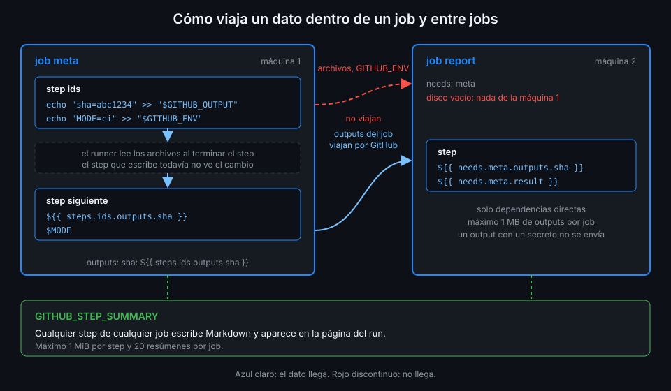

# Datos entre jobs: needs y outputs

> Dos jobs son dos máquinas distintas: no comparten disco ni memoria. `needs:` decide el orden en
> que corren y `outputs:` es el único canal para que uno le pase un dato al otro.



## 🎯 Objetivos

Al terminar este archivo eres capaz de:

- Ordenar jobs con `needs:` y dibujar el grafo que resulta
- Publicar outputs de job a partir de outputs de step
- Leer `needs.<job>.outputs` y `needs.<job>.result` en un job dependiente
- Predecir qué pasa con los dependientes cuando un job falla o se salta
- Conocer los límites de los outputs y por qué uno puede llegar vacío

---

## 1. Qué problema resuelve

En la Semana 01 viste que cada job recibe su propia máquina virtual. Eso tiene dos consecuencias:

1. **Sin `needs:`, todos los jobs empiezan a la vez.** Si un job usa algo que calcula otro, no
   hay garantía de que ese algo exista.
2. **Nada pasa de un job a otro por sí solo.** Un archivo escrito en el job A no existe en el job
   B, ni un `GITHUB_ENV`, ni un output de step.

`needs:` resuelve lo primero: un job espera a otros. Los **outputs de job** resuelven lo segundo
para datos pequeños: una versión, un SHA, una lista de carpetas. Para archivos (un `dist/`, un
informe) hacen falta artefactos, que llegan en la Semana 04.

---

## 2. Cómo funciona

### 2.1 `needs:` construye un grafo

```yaml
jobs:
  meta:      # sin needs: empieza en cuanto hay runner
  api:
    needs: meta
  web:
    needs: meta
  report:
    needs: [api, web]
```

`api` y `web` esperan a `meta` y corren en paralelo entre ellos. `report` espera a los dos. GitHub
dibuja este grafo en la página del run, y actionlint avisa si un `needs:` apunta a un job que no
existe o crea un ciclo.

### 2.2 Outputs de job

Un job publica outputs en `jobs.<id>.outputs`, normalmente copiando outputs de sus steps:

```yaml
  meta:
    outputs:
      sha_short: ${{ steps.ids.outputs.sha_short }}
    steps:
      - id: ids
        run: echo "sha_short=${GITHUB_SHA::7}" >> "$GITHUB_OUTPUT"
```

Las expresiones de `outputs:` se evalúan **en el runner, al terminar el job**. Después, el runner
envía los valores a GitHub y la máquina se destruye. Los valores viajan; los archivos no.

### 2.3 El contexto `needs`

Un job dependiente lee lo que publicaron los jobs de su `needs:`:

| Expresión | Qué contiene |
|---|---|
| `needs.<job>.outputs.<nombre>` | El output publicado por ese job |
| `needs.<job>.result` | `success`, `failure`, `cancelled` o `skipped` |

El contexto `needs` contiene **solo las dependencias directas**. Si `report` necesita `api` y
`api` necesita `meta`, en `report` no existe `needs.meta`: para leer un output de `meta` tienes que
añadir `meta` a su `needs:` (verificado con la referencia de contextos, noviembre de 2026).

### 2.4 Fallos que se propagan

Si un job falla o se salta, **todos los jobs que lo necesitan se saltan**, y la cadena sigue
hacia abajo: los dependientes de esos también se saltan. Un fallo en `meta` deja `api`, `web` y
`report` en `skipped`.

Para que un job corra aunque una dependencia no termine bien, necesita una condición con una
función de estado en su `if:`. Cuál usar (`always()`, `!cancelled()`, `failure()`) y en qué se
diferencian lo tienes en la [teoría 03](03-condiciones-y-funciones-de-estado.md).

### 2.5 Límites de los outputs

Verificado con la referencia de sintaxis, noviembre de 2026:

- **Tamaño**: como máximo 1 MB de outputs por job y 50 MB en total por run. El tamaño se calcula
  aproximado, en UTF-16.
- **Secretos**: si un output contiene un secreto, el runner lo tapa y **no lo envía**. En el log
  del job aparece `Skip output '<nombre>' since it may contain secret` y el dependiente recibe
  vacío. Un output que contiene un secreto casi siempre es un error de diseño: el secreto se lee
  donde se usa.

---

## 3. Cómo se usa

Un grafo de cuatro jobs: `meta` calcula el SHA corto y el número de migraciones, `api` y `web` los
usan en paralelo y `report` junta el resultado.

```yaml
name: job-data

on: workflow_dispatch

# Mínimo privilegio: lo verás a fondo en la Semana 12.
permissions:
  contents: read

defaults:
  run:
    shell: bash

jobs:
  meta:
    runs-on: ubuntu-24.04
    outputs:
      sha_short: ${{ steps.ids.outputs.sha_short }}
      migrations: ${{ steps.ids.outputs.migrations }}
    steps:
      - uses: actions/checkout@3d3c42e5aac5ba805825da76410c181273ba90b1 # v7.0.1
        with:
          persist-credentials: false
      - name: Identificadores del build
        id: ids
        run: |
          echo "sha_short=${GITHUB_SHA::7}" >> "$GITHUB_OUTPUT"
          echo "migrations=$(find api/migrations -name '*.sql' | wc -l)" >> "$GITHUB_OUTPUT"

  api:
    needs: meta
    runs-on: ubuntu-24.04
    steps:
      - name: Usar los datos de meta
        env:
          SHA_SHORT: ${{ needs.meta.outputs.sha_short }}
          MIGRATIONS: ${{ needs.meta.outputs.migrations }}
        run: echo "API en ${SHA_SHORT} con ${MIGRATIONS} migraciones"

  web:
    needs: meta
    runs-on: ubuntu-24.04
    steps:
      - name: Usar el SHA corto
        env:
          SHA_SHORT: ${{ needs.meta.outputs.sha_short }}
        run: echo "Web en ${SHA_SHORT}"

  report:
    needs: [meta, api, web]
    runs-on: ubuntu-24.04
    steps:
      - name: Resultado de cada job
        env:
          SHA_SHORT: ${{ needs.meta.outputs.sha_short }}
          API: ${{ needs.api.result }}
          WEB: ${{ needs.web.result }}
        run: |
          {
            echo "### Build ${SHA_SHORT}"
            echo "| Job | Resultado |"
            echo "|---|---|"
            echo "| api | ${API} |"
            echo "| web | ${WEB} |"
          } >> "$GITHUB_STEP_SUMMARY"
```

Tres detalles que no son casualidad:

- `report` lista `meta` en su `needs:` aunque ya depende de él a través de `api` y `web`. Sin
  eso, `needs.meta.outputs.sha_short` sería vacío en `report`.
- `api` y `web` no hacen checkout: lo que necesitan de `meta` les llega como output. Un job que no
  toca el código no necesita descargarlo.
- Tal como está, si `api` falla, `report` se salta y no hay resumen. Hacer que corra igualmente es
  justo lo que practicas en la práctica 04 y en el proyecto.

---

## 4. Antipatrones

| Antipatrón | Por qué duele | Qué hacer en su lugar |
|---|---|---|
| Escribir un archivo en un job y leerlo en otro | Son dos máquinas: el archivo no existe en la segunda | Un output para datos pequeños; un artefacto para archivos (Semana 04) |
| Leer `needs.X` sin tener `X` en el `needs:` del job | El contexto solo tiene dependencias directas: llega vacío sin error | Añade `X` a `needs:` |
| Un único job gigante "para no pasar datos" | No se paraleliza y un fallo no dice qué parte falló | Jobs pequeños unidos por outputs |
| Meter un secreto en un output | El runner no lo envía y el dependiente recibe vacío | Lee el secreto en el job que lo usa |
| `needs:` en cadena lineal sin motivo | Cada eslabón suma el arranque de una máquina | Paraleliza lo que no depende entre sí |
| Interpolar `${{ needs.X.outputs.Y }}` dentro de `run:` | Si el output contiene texto externo, se convierte en código | Pásalo por `env:` |

---

## 5. Trucos

- **`gh run view <id> --json jobs --jq '.jobs[] | [.name, .conclusion] | @tsv'`** te enseña el
  estado de cada job del grafo, incluidos los `skipped`, sin abrir la UI.
- **`toJSON(needs)`** en un `env:` te da en una sola variable el resultado y los outputs de todas
  las dependencias directas. Con `jq` lo recorres sin escribir un `env:` por job.
- **Un job que solo consume outputs no necesita checkout**: quitarlo ahorra la descarga del repo
  en cada run.
- **actionlint comprueba los `needs.<job>.outputs.<nombre>`**: si escribes mal el nombre de un
  output, te lo dice antes del push.

---

## 📚 Recursos Adicionales

- [Workflow syntax: `jobs.<job_id>.needs` y `jobs.<job_id>.outputs`](https://docs.github.com/en/actions/reference/workflows-and-actions/workflow-syntax)
- [Contexts: `needs`](https://docs.github.com/en/actions/reference/workflows-and-actions/contexts)
- [Passing information between jobs](https://docs.github.com/en/actions/how-tos/write-workflows/choose-what-workflows-do/pass-job-outputs)

---

## ✅ Checklist de Verificación

- [ ] Sé dibujar el grafo que forma un conjunto de `needs:`
- [ ] Publico outputs de job a partir de outputs de step
- [ ] Sé que `needs` solo contiene dependencias directas
- [ ] Sé qué valores puede tener `needs.<job>.result`
- [ ] Sé qué pasa con los dependientes cuando un job falla o se salta
- [ ] Sé por qué un output con un secreto llega vacío

---

| ← Anterior | Siguiente → |
|:---|---:|
| [Datos entre steps](05-datos-entre-steps.md) | [Explorar contextos](../2-practicas/01-explorar-contextos.md) |
