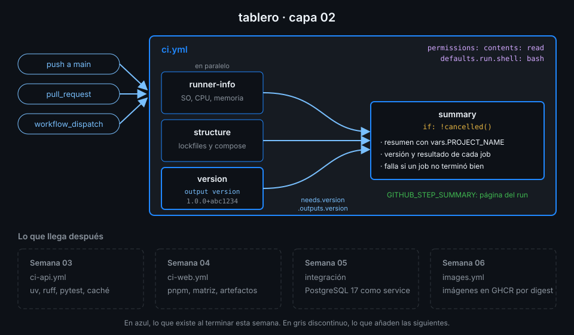

# Proyecto: capa 02 de tablero



## 🎯 Objetivo

Que `ci.yml` deje de ser tres jobs sueltos y pase a ser un grafo: un job calcula la versión del
commit, otro espera a todos y escribe en la página del run qué pasó y con qué versión, aunque
alguno haya fallado.

## 📦 Qué añade esta capa

Parte de la capa 01 (`runner-info` y `structure` en paralelo, permisos mínimos y checkout por
SHA), que el starter trae resuelta. Añade:

| Pieza | Qué hace | Por qué existe |
|---|---|---|
| `defaults.run.shell: bash` | Todos los `run` con `bash --noprofile --norc -eo pipefail` | Sin `pipefail`, un fallo a mitad de una tubería pasa desapercibido |
| Job `version` | Lee `project.version` de `api/pyproject.toml` y publica `version=<versión>+<sha corto>` | Una sola fuente de la versión para todo el pipeline: la Semana 06 la usará para etiquetar imágenes |
| Job `summary` | Espera a los otros tres, corre salvo si cancelas, escribe el resumen y falla si alguno falló | Que el resultado de un run se lea en la página del run, sin abrir cada log |

Desbloquea la Semana 03, que añade `ci-api.yml` con uv, ruff y pytest y reutiliza todo lo de
esta semana: condiciones, outputs y el shell por defecto.

## ✅ Requisitos verificables

- El repo tiene la variable de configuración PROJECT_NAME con el valor tablero
- explore.yml terminó en success al menos una vez lanzado a mano
- conditions.yml se ejecutó al menos una vez
- data-flow.yml terminó en success al menos una vez lanzado a mano
- graph.yml terminó en success al menos una vez lanzado a mano
- ci.yml pasa actionlint
- ci.yml fija bash como shell por defecto de todos sus run
- El job version de ci.yml publica el output version a partir de un step
- El job version escribe la versión en $GITHUB_OUTPUT
- Ningún workflow usa los comandos retirados ::set-output ni ::save-state
- El job summary de ci.yml espera a runner-info, structure y version
- El job summary corre aunque falle un job anterior, salvo si el run se cancela
- El job summary escribe en $GITHUB_STEP_SUMMARY
- El job summary usa la variable de configuración vars.PROJECT_NAME
- Ningún run de tus workflows interpola datos del evento, de la rama o de inputs con ${{ }}
- Toda uses: remota de tus workflows está fijada por SHA de 40 caracteres con el tag en comentario
- ci.yml terminó en success sobre el último commit de main

## 🎨 Criterios de calidad

Lo que `check-week.sh` no ve y la [rúbrica](../rubrica-evaluacion.md) sí puntúa:

- Todos los valores que usa `summary` llegan al shell por `env:`, también los que no vienen del
  usuario: es la costumbre que te protege cuando sí vengan.
- El resumen se lee sin saber YAML: un título con proyecto y versión y una tabla con un job por fila.
- Hay un comentario que dice **para qué** está `defaults.run.shell`, no que "fija el shell".
- La versión es reproducible: el mismo commit da siempre la misma versión.
- No queda ningún `TODO` en `.github/workflows/` y los commits siguen Conventional Commits.

## 💡 Adaptación a tu dominio

| Tu proyecto | De dónde sale la versión | Qué añadirías al resumen |
|---|---|---|
| Paquete de Python | `project.version` de `pyproject.toml` | La versión de Python del runner |
| Frontend con pnpm | `version` de `package.json` (`jq -r .version package.json`) | El tamaño de `dist/` (desde la Semana 04) |
| Servicio sin manifiesto | `git describe --tags --always` (necesita `fetch-depth: 0` en checkout) | El autor y el mensaje del commit, por `env:` |
| Documentación | La fecha del commit (`git log -1 --format=%cs`) | El número de páginas de `docs/` |

## 🚦 Cómo entregarlo

1. Sustituye tu `ci.yml` por el starter y completa los `TODO 1` a `TODO 6`:

   ```bash
   cd ~/code/tablero
   cp ~/code/bc-github-actions/bootcamp/week-02-expresiones_contextos_y_flujo_de_datos/3-proyecto/starter/.github/workflows/ci.yml .github/workflows/ci.yml
   actionlint .github/workflows/ci.yml
   # (sin salida: no hay errores)
   ```

2. Súbelo a `main` y espera al run de **tu** commit:

   ```bash
   git add .github/workflows/ci.yml
   git commit -m "ci: add version and summary jobs"
   git push
   gh run list --workflow ci.yml --commit "$(git rev-parse HEAD)" --json conclusion --jq '.[0].conclusion'
   # success
   ```

3. Abre el run en el navegador (`gh run view --web` con su id) y comprueba que el resumen aparece
   arriba, con la versión `1.0.0+<sha corto>` y los tres jobs anteriores en `success`.

4. Lanza la verificación:

   ```bash
   cd ~/code/bc-github-actions
   ./scripts/check-week.sh 02
   # 17/17 comprobaciones superadas.
   ```

## 🧯 Errores comunes

| Síntoma | Causa | Solución |
|---|---|---|
| `summary` sale `skipped` cuando falla `structure` | Sin `if:`, un job con `needs` solo corre si todos terminan en `success` | `TODO 5`: `if: ${{ !cancelled() }}` |
| `summary` en verde aunque `structure` falló | El script escribe el resumen pero no comprueba los resultados | Termina con un `jq -e` sobre `toJSON(needs)` que falle si alguno no es `success` |
| La versión sale vacía en el resumen | El output del job no está mapeado o el id del step no coincide | `TODO 3`: `outputs.version` desde `steps.<id>.outputs.version`; actionlint avisa del id |
| `yq: Error: ... no such file` en `version` | El job no tiene checkout: cada job empieza con el workspace vacío | El job `version` ya trae checkout en el starter; no lo quites |
| `vars.PROJECT_NAME` sale vacío | La variable no existe en el repo | Práctica 01, paso 3: `gh variable set PROJECT_NAME --body tablero` |
| actionlint: `property "x" is not defined` | Un id de step o de job mal escrito en una expresión | Corrige el nombre: actionlint te da línea y columna |

## 🔗 Navegación

---

| ← Anterior | Siguiente → |
|:---|---:|
| [Un pipeline con grafo](../2-practicas/04-pipeline-con-grafo.md) | [Rúbrica de evaluación](../rubrica-evaluacion.md) |
