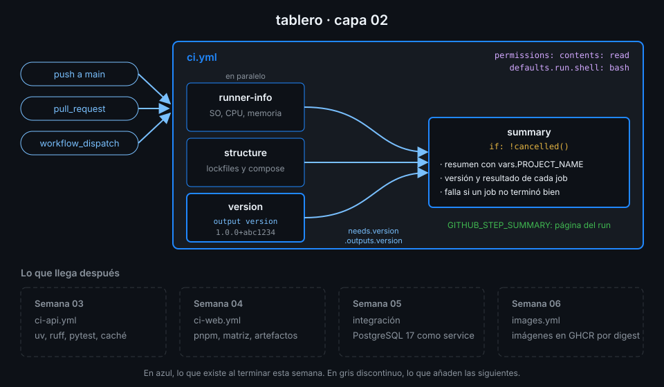

# Semana 02 — Expresiones, contextos y flujo de datos

> Un workflow no es una lista de comandos: es un programa que GitHub evalúa antes de que el runner
> vea nada. Esta semana aprendes qué evalúa cada uno, cómo viajan los datos y qué pasa cuando falla un job.

## 🎯 Objetivos de la Semana

Al terminar la semana eres capaz de:

- Leer cualquier contexto (`github`, `env`, `vars`, `job`, `steps`, `runner`, `needs`) y saber en
  qué claves del workflow está disponible
- Escribir expresiones `${{ }}` con operadores y funciones, y distinguir lo que evalúa GitHub de lo
  que evalúa el shell
- Explicar por qué un dato del evento nunca se interpola dentro de `run:` y pasarlo por `env:`
- Decidir cuándo corre un step o un job con `if:` y las funciones de estado, y por qué
  `!cancelled()` y no `always()`
- Pasar datos entre steps con `$GITHUB_OUTPUT` y `$GITHUB_ENV`, y entre jobs con `outputs:` y
  `needs:`
- Fijar el shell y el directorio por defecto con `defaults:` y usar variables de configuración
  (`vars`)
- Escribir un resumen del run en `$GITHUB_STEP_SUMMARY` y convertir `ci.yml` en un grafo de cuatro
  jobs

## 📋 Prerrequisitos

| Necesitas | Dónde se aprende |
|---|---|
| `<tu-org>/tablero` con `ci.yml` en verde y `check-week.sh 01` en 17/17 | [Semana 01](../week-01-primer_workflow_y_modelo_de_ejecucion/README.md) |
| `gh run` y `gh workflow run` desde la terminal | [Semana 01, práctica 03](../week-01-primer_workflow_y_modelo_de_ejecucion/2-practicas/03-gh-cli-para-actions.md) |
| actionlint instalado | [`docs/setup-entorno.md`](../../docs/setup-entorno.md), apartado 3 |
| jq a nivel de `.campo`, `.[]` y `select()` | `man jq`, o la [webgrafía](4-recursos/webgrafia/README.md) de esta semana |

## 🗂️ Estructura de la Semana

```
week-02-expresiones_contextos_y_flujo_de_datos/
├── README.md
├── rubrica-evaluacion.md
├── checks.json                    17 comprobaciones
├── 0-assets/                      4 diagramas SVG
├── 1-teoria/                      6 archivos, uno por concepto
├── 2-practicas/                   4 prácticas guiadas
├── 3-proyecto/
│   ├── README.md
│   └── starter/.github/workflows/ci.yml
├── 4-recursos/{ebooks-free,videografia,webgrafia}/README.md
└── 5-glosario/README.md
```

## 📝 Contenidos

### Teoría

| # | Archivo | Qué aprendes | Tiempo |
|:--:|---|---|:--:|
| 01 | [Contextos](1-teoria/01-contextos.md) | Qué información te da GitHub en cada momento y dónde puedes usarla | 30 min |
| 02 | [Expresiones y funciones](1-teoria/02-expresiones-y-funciones.md) | `${{ }}`, operadores, funciones y cuándo se evalúa cada cosa | 35 min |
| 03 | [Condiciones y funciones de estado](1-teoria/03-condiciones-y-funciones-de-estado.md) | `if:`, `success()`, `failure()`, `!cancelled()` y la propagación de fallos | 30 min |
| 04 | [Variables de entorno, vars y defaults](1-teoria/04-variables-de-entorno-vars-y-defaults.md) | `env:` en tres niveles, variables de configuración y shell por defecto | 25 min |
| 05 | [Datos entre steps](1-teoria/05-datos-entre-steps.md) | `$GITHUB_OUTPUT`, `$GITHUB_ENV`, `$GITHUB_PATH` y el resumen del run | 30 min |
| 06 | [Datos entre jobs: needs y outputs](1-teoria/06-datos-entre-jobs.md) | El grafo de jobs y cómo cruza un dato de una máquina a otra | 30 min |

### Prácticas

| # | Archivo | Qué haces | Tiempo |
|:--:|---|---|:--:|
| 01 | [Explorar contextos](2-practicas/01-explorar-contextos.md) | `explore.yml`: contextos, funciones y una variable de configuración | 1 h |
| 02 | [Condiciones y estado](2-practicas/02-condiciones-y-estado.md) | `conditions.yml`: steps que solo corren si algo falla, y un run cancelado | 1 h |
| 03 | [Outputs entre steps y jobs](2-practicas/03-outputs-entre-steps-y-jobs.md) | `data-flow.yml`: un dato que viaja de step a step y de job a job | 1 h |
| 04 | [Un pipeline con grafo](2-practicas/04-pipeline-con-grafo.md) | `graph.yml`: un diamante de jobs, un fallo controlado y un resumen | 1 h |

### Proyecto

[Capa 02 de `tablero`](3-proyecto/README.md): `ci.yml` pasa a ser un grafo. Un job `version`
calcula la versión a partir del commit y un job `summary` espera a los demás y escribe el resumen
del run, aunque alguno falle.



## ⏱️ Distribución del Tiempo (10 horas)

| Actividad | Horas |
|---|:--:|
| Teoría (6 archivos) | 3 |
| Práctica 01 — Explorar contextos | 1 |
| Práctica 02 — Condiciones y estado | 1 |
| Práctica 03 — Outputs entre steps y jobs | 1 |
| Práctica 04 — Un pipeline con grafo | 1 |
| Proyecto — capa 02 | 2 |
| Autoevaluación con la rúbrica | 1 |
| **Total** | **10** |

## 🎩 Trucos y atajos

- **actionlint comprueba los tipos de tus expresiones**: si escribes `steps.compute.outputs.version`
  y el step se llama `comptue`, o `needs.aa` con un job `a`, te lo dice con línea y columna antes
  del push. Es el error más común de esta semana y el más caro de encontrar en un run.
- **`toJSON(needs)` por `env:` y `jq`** te da el resultado de todos los jobs anteriores en un solo
  valor: `jq -r 'to_entries[] | "\(.key) \(.value.result)"' <<<"$RESULTS"`. Añades un job a
  `needs:` y el resumen lo incluye sin tocar el script.
- **yq ya viene en el runner y lee TOML por la extensión**: `yq -oy '.project.version'
  api/pyproject.toml` saca la versión sin instalar nada ni escribir un parser con `grep` y `sed`.
- **`gh variable set -f vars.env`** carga de una vez todas las variables de configuración de un
  archivo dotenv. Con `gh variable list` compruebas qué hay sin abrir Settings.
- **`${GITHUB_SHA::7}`** es una expansión de bash, no una expresión de GitHub: el SHA corto sale
  del shell, que es donde tiene que estar un dato que vas a escribir en `$GITHUB_OUTPUT`.

## 📌 Entregables

- La variable de configuración `PROJECT_NAME=tablero` en `<tu-org>/tablero`
- `explore.yml`, `conditions.yml`, `data-flow.yml` y `graph.yml` en `.github/workflows/`, cada uno
  ejecutado al menos una vez a mano
- `ci.yml` completado desde el starter de la capa 02, en verde sobre el último commit de `main` y
  con el resumen visible en la página del run (ver [proyecto](3-proyecto/README.md))
- Las 10 preguntas de la [rúbrica](rubrica-evaluacion.md) respondidas antes de mirar las respuestas

## ✅ Verificación

```bash
cd ~/code/bc-github-actions
./scripts/check-week.sh 02
# Semana 02 — Expresiones, contextos y flujo de datos  [repo: <tu-org>/tablero]
#
#   ✅ El repo tiene la variable de configuración PROJECT_NAME con el valor tablero
#   ...
# 17/17 comprobaciones superadas.
```

Si algo sale en rojo, la pista te dice qué práctica y qué paso lo arreglan.

## 🔗 Navegación

---

| ← Anterior | Siguiente → |
|:---|---:|
| [Semana 01 — Primer workflow y modelo de ejecución](../week-01-primer_workflow_y_modelo_de_ejecucion/README.md) | [Contextos](1-teoria/01-contextos.md) |
