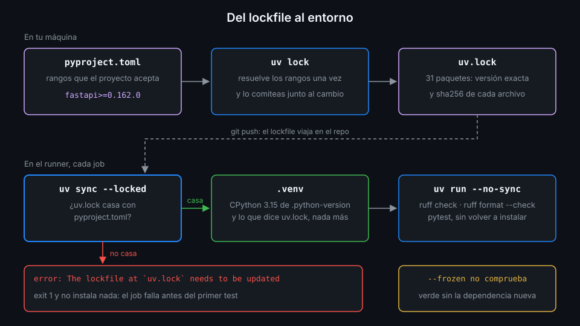

# uv en CI

> Un CI de Python solo es reproducible si instala exactamente lo que alguien revisó. uv lo
> garantiza con un lockfile y un flag: `--locked`. Este archivo explica qué hace ese flag, sus dos
> alternativas y cómo llega uv al runner.



## 🎯 Objetivos

Al terminar este archivo eres capaz de:

- Explicar qué guarda `uv.lock` y por qué es el contrato entre tu máquina y el CI
- Elegir entre `uv sync`, `uv sync --locked` y `uv sync --frozen`, y decir qué pasa con cada uno
  cuando `pyproject.toml` cambió sin regenerar el lockfile
- Usar `uv run --no-sync` y `uv lock --check` en un workflow
- Instalar uv en el runner con `astral-sh/setup-uv`, con la versión fijada
- Saber de dónde sale el Python 3.15 del job y por qué no necesitas `actions/setup-python`

## 1. Qué problema resuelve

`pyproject.toml` dice qué acepta el proyecto: `fastapi>=0.162.0`. Eso no es una versión, es un
rango. Si el CI resuelve el rango cada vez, el martes instala la 0.162.0 y el jueves la 0.163.0,
que acaba de salir. El código no cambió, el resultado sí, y nadie revisó esa versión nueva.

El lockfile cierra el rango: para cada uno de los 31 paquetes guarda versión exacta, origen y hash
de cada archivo descargable.

```toml
[[package]]
name = "annotated-types"
version = "0.8.0"
source = { registry = "https://pypi.org/simple" }
sdist = { url = "https://files.pythonhosted.org/.../annotated_types-0.8.0.tar.gz", hash = "sha256:13b2beaad985e05e2d6407ee4c4f35590b11f8d693a258a561055cac8f64cab7", ... }
```

Con el hash, un archivo distinto en PyPI con el mismo nombre no se instala. Con la versión exacta,
el CI y tu máquina tienen el mismo entorno. El problema que queda es **qué hace uv cuando el
lockfile y `pyproject.toml` no casan**, y eso lo decide el flag.

## 2. Cómo funciona

### `uv sync --locked`: el lockfile manda y tiene que estar al día

`uv sync` crea `.venv`, instala el proyecto y sus dependencias, y deja el entorno igual que el
lockfile. Lo que cambia entre las tres formas es qué hace antes de instalar:

| Comando | Comprueba si `uv.lock` casa con `pyproject.toml` | Si no casa |
|---|:--:|---|
| `uv sync` | Sí | **Reescribe `uv.lock`** y sigue |
| `uv sync --locked` | Sí | **Falla** con un error y no instala nada |
| `uv sync --frozen` | No | Instala lo que diga el lockfile, aunque falten dependencias nuevas |

Lo comprobé añadiendo `rich` a `dependencies` sin ejecutar `uv lock`:

```bash
uv sync --locked
# Resolved 34 packages in 8ms
# error: The lockfile at `uv.lock` needs to be updated, but `--locked` was provided.
#
# hint: To update the lockfile, run `uv lock`.
echo $?
# 1

uv sync --frozen
# ...
echo $?
# 0
grep -c 'name = "rich"' uv.lock
# 0
```

`--frozen` terminó en verde **y `rich` no se instaló**. En local es útil cuando sabes que el
lockfile es correcto y quieres ir rápido. En CI es exactamente el fallo que quieres detectar: un
`pyproject.toml` modificado sin su lockfile.

`uv sync` a secas es peor todavía en CI: arregla el problema en la copia del runner, que se
destruye al terminar el job, y el verde no dice nada del lockfile que hay en el repo.

Por eso en este bootcamp **todo job de CI instala con `uv sync --locked`**. La ayuda de uv lo dice
así:

```bash
uv help sync | grep -A4 -- '--locked'
#       --locked
#           Assert that the `uv.lock` will remain unchanged.
#
#           Requires that the lockfile is up-to-date. If the lockfile is missing or needs to be
#           updated, uv will exit with an error.
```

### `uv run --no-sync`: ejecutar sin volver a instalar

`uv run <comando>` sincroniza el entorno antes de ejecutar. En un job que ya hizo
`uv sync --locked`, esa segunda sincronización sobra y, sin `--locked`, podría tocar el lockfile.
`--no-sync` la quita: según la ayuda, "implies `--frozen`" y no actualiza nada.

```bash
uv sync --locked                       # una vez: instala y valida
uv run --no-sync ruff check .          # después: solo ejecuta
uv run --no-sync pytest tests/unit
```

### `uv lock --check`: solo comprobar

Si quieres el error de `--locked` sin crear ningún entorno (en un job que solo valida, o en un
hook de pre-commit), `uv lock --check` sale con 1 y el mismo mensaje cuando el lockfile está
desactualizado, y con 0 cuando está al día.

### De dónde sale Python 3.15

La imagen `ubuntu-24.04` trae Python 3.12.3 en el `PATH`, y en su caché de herramientas varias
versiones más para `actions/setup-python` (README de la imagen 20261026, consultado en noviembre
de 2026). `api/.python-version` pide `3.15` y `requires-python` dice `>=3.15`.

uv lee `.python-version` y busca un intérprete que lo cumpla. Si no lo encuentra, descarga una
build gestionada y crea `.venv` con ella. En el log del step lo ves en la primera línea:

```text
Using CPython 3.15.2
Creating virtual environment at: .venv
```

No hace falta `actions/setup-python`: sería otra action que fijar, con la versión de Python
repetida en su input además de en `.python-version`.

### `astral-sh/setup-uv`: uv en el runner

uv no viene en la imagen. La action oficial lo descarga y lo pone en el `PATH`. Inputs que importan
esta semana, leídos del `action.yml` en el SHA fijado:

| Input | Por defecto | Para qué |
|---|---|---|
| `version` | (vacío) | Sin valor, busca `required-version` en `uv.toml` o `pyproject.toml` y, si no hay, **instala la última**. Fíjala |
| `enable-cache` | `auto` | Caché de uv entre runs. `auto` la activa en runners de GitHub salvo en algunos eventos. Archivo 05 |
| `cache-dependency-glob` | varios patrones | Qué archivos forman la clave de la caché. Archivo 05 |
| `working-directory` | `${{ github.workspace }}` | Dónde busca `pyproject.toml` y desde dónde resuelve los globs |
| `python-version` | (sin valor) | Fija `UV_PYTHON`. No lo necesitas: ya está `.python-version` |
| `activate-environment` | `false` | Con `true` activa `.venv` para los steps siguientes. Aquí se usa `uv run` |

Su README marca dos reglas: `actions/checkout` **antes** que `setup-uv` (al revés no está
soportado) y `setup-uv` **no instala tus dependencias**: eso lo hace tu `uv sync`.

## 3. Cómo se usa

Un job que valida el entorno de la API sin ejecutar tests:

```yaml
name: uv-env

on:
  workflow_dispatch:

# Mínimo privilegio: lo verás a fondo en la Semana 12.
permissions:
  contents: read

jobs:
  environment:
    name: Entorno de la API
    runs-on: ubuntu-24.04
    defaults:
      run:
        working-directory: api
    steps:
      - uses: actions/checkout@3d3c42e5aac5ba805825da76410c181273ba90b1 # v7.0.1
        with:
          persist-credentials: false
      - uses: astral-sh/setup-uv@68559e99cc807c1eb7e9238fd43a15bba460eec2 # v10.3.3
        with:
          version: "0.13.6"
      - name: El lockfile casa con pyproject.toml
        run: uv lock --check
      - name: Entorno exacto del lockfile
        run: uv sync --locked
      - name: Qué quedó instalado
        run: |
          uv run --no-sync python --version
          uv tree --depth 1
```

Fíjate en dos detalles:

- `defaults.run.working-directory: api` vale para los steps `run`, **no** para los `uses`. Por eso
  `setup-uv` sigue trabajando desde la raíz del repo, y un glob que le pases va relativo a la raíz
  (`api/uv.lock`).
- La versión de uv va entre comillas por costumbre: `0.13.6` sin comillas ya es una cadena (tiene
  dos `.`), pero `0.14` sin comillas YAML lo lee como el número `0.14` y lo envía así a la action.

Verificado con astral-sh/setup-uv@v10.3.3 y ubuntu-24.04, noviembre de 2026.

## 4. Antipatrones

| Antipatrón | Por qué duele | Qué hacer en su lugar |
|---|---|---|
| `uv sync` sin `--locked` en CI | Reescribe el lockfile en el runner y el verde no dice nada del repo | `uv sync --locked` |
| `uv sync --frozen` en CI | Pasa en verde con dependencias nuevas sin instalar | `--locked`: falla si el lockfile no está al día |
| `setup-uv` sin `version` | Cada run puede traer un uv distinto | `version: "0.13.6"`, la de `docs/stack-versions.md` |
| `actions/setup-python` y luego pip para instalar uv <!-- antipatron --> | Dos herramientas, dos versiones de Python que mantener | `setup-uv`; uv instala el Python de `.python-version` |
| `uv run` sin `--no-sync` después de `uv sync --locked` | Una sincronización de más en cada comando | `uv run --no-sync` |
| `actions/checkout` después de `setup-uv` | No está soportado y la caché no encuentra `uv.lock` | Checkout primero |
| Comitear `.venv` o cachear `.venv` entre runs | Rutas absolutas y binarios atados a una máquina | Cachear la caché de uv (archivo 05) y recrear `.venv` |

## 5. Trucos

- **`UV_LOCKED: 1` en el `env:` del job** equivale a `--locked` en cada `uv sync` y `uv run` del
  job. Sirve como red: un `uv run` al que se le olvide `--no-sync` tampoco podrá tocar el lockfile.
- **`uv lock --check`** como primer step de un job barato te da el error del lockfile en segundos,
  antes de descargar ninguna dependencia.
- **`uv tree --depth 1`** en el log deja escrito qué versión de cada dependencia directa usó ese
  run, con `(group: dev)` en las de desarrollo.

## 📚 Recursos Adicionales

- [uv: Locking and syncing](https://docs.astral.sh/uv/concepts/projects/sync/)
- [uv: Using uv in GitHub Actions](https://docs.astral.sh/uv/guides/integration/github/)
- [astral-sh/setup-uv](https://github.com/astral-sh/setup-uv)
- [uv: Python versions](https://docs.astral.sh/uv/concepts/python-versions/)
- [actions/runner-images: Ubuntu 24.04](https://github.com/actions/runner-images/blob/main/images/ubuntu/Ubuntu2404-Readme.md)

## ✅ Checklist de Verificación

- [ ] Sé qué guarda `uv.lock` además de la versión de cada paquete
- [ ] Sé qué hace cada uno de `uv sync`, `--locked` y `--frozen` cuando el lockfile está desactualizado
- [ ] Uso `uv run --no-sync` después de `uv sync --locked`
- [ ] Fijo `version` en `setup-uv` y lo pongo después de `actions/checkout`
- [ ] Sé de dónde sale Python 3.15 en el runner sin `setup-python`
- [ ] Sé que `defaults.run` no afecta a los steps `uses`

---

| ← Anterior | Siguiente → |
|:---|---:|
| [La API de tablero](01-el-api-de-tablero.md) | [ruff: lint y formato](03-ruff.md) |
