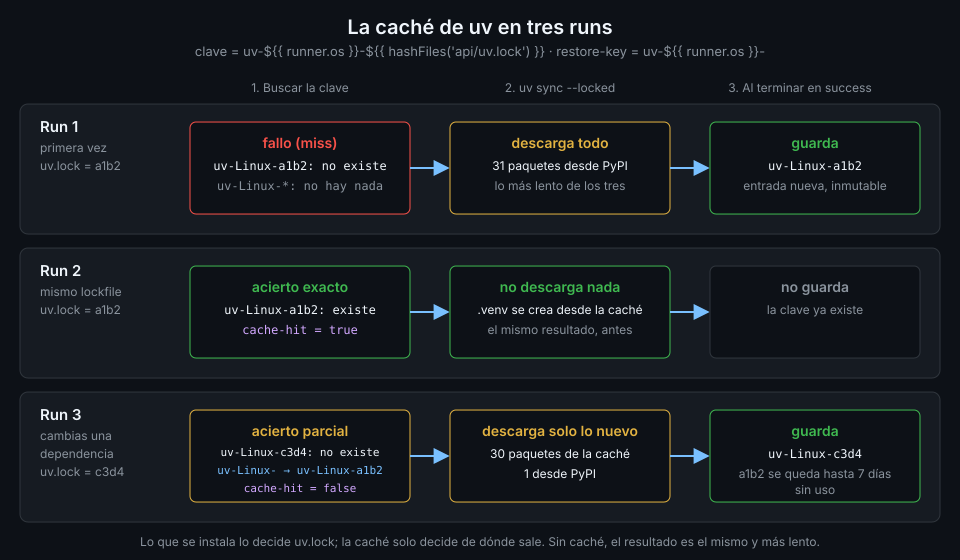

# Caché de dependencias

> Cada job empieza en una máquina vacía y vuelve a descargar todo. La caché de Actions guarda lo que
> descargaste en un run y lo devuelve en el siguiente, siempre que la clave diga que sigue valiendo.



## 🎯 Objetivos

- Explicar qué guarda la caché de Actions, quién puede leerla y cuándo se borra
- Construir una clave que cambie exactamente cuando cambian las dependencias
- Distinguir un acierto exacto de una restauración parcial con `restore-keys`
- Elegir qué cachear con uv (su caché, no `.venv`) y activarlo con `setup-uv`
- Ver y borrar cachés desde la terminal con `gh cache`

## 1. Qué problema resuelve

En la Semana 01 viste que cada job corre en una máquina virtual nueva que se destruye al terminar.
Eso es bueno para la reproducibilidad, pero significa que `uv sync --locked` descarga en cada run
las mismas ruedas de FastAPI, pydantic o psycopg desde PyPI. Con el API de `tablero` son unos
segundos; en un proyecto con cientos de dependencias son minutos, multiplicados por cada push y cada
job.

La caché de Actions es un almacén de archivos por repositorio. Un step guarda un directorio con un
nombre (la **clave**) y un run posterior lo pide por ese nombre. Si existe, se descarga de la
infraestructura de GitHub, que está más cerca del runner que PyPI, y uv encuentra ahí lo que
necesita.

La caché no cambia **qué** se instala: eso lo decide `uv.lock`. Solo cambia **de dónde** sale. Si
la caché está vacía, rota o es de otro lockfile, el resultado tiene que ser el mismo, solo más
lento. Si tu CI da un resultado distinto con caché y sin ella, el fallo está en lo que cacheas.

## 2. Cómo funciona

### La clave, y el acierto exacto

Una entrada de caché es un archivo comprimido con una clave de hasta 512 caracteres. Al principio
del job, la action busca una entrada con **exactamente** esa clave. Si la encuentra, la restaura y
publica el output `cache-hit` a `true`. Si no, el job sigue sin caché y, si termina en `success`, al
final guarda una entrada nueva con esa clave.

Una entrada no se modifica nunca: si las dependencias cambian, se crea otra con otra clave. Por eso
la clave tiene que incluir todo lo que, si cambia, invalida el contenido: el sistema operativo y, en
Python, el lockfile. `hashFiles('api/uv.lock')` calcula un SHA-256 del archivo, así que cualquier
cambio en el lock produce otra clave.

### `restore-keys`, y la restauración parcial

Si no hay acierto exacto, la action prueba las `restore-keys` en orden. Cada una es un **prefijo**:
si varias entradas empiezan por él, se queda con la creada más recientemente. Esa restauración no
cuenta como acierto (`cache-hit` sigue en `false`), así que al final del job se guarda una entrada
nueva con la clave exacta.

Para uv es muy útil: cuando cambias una dependencia en `uv.lock`, el run restaura la caché del lock
anterior, uv reutiliza las 30 ruedas que no cambiaron y solo descarga la nueva.

### Quién puede leer qué

| Run que pide la caché | Puede restaurar entradas creadas en |
|---|---|
| Un push a `main` (rama por defecto) | `main` |
| Un push a una rama `feature/x` | `feature/x` y `main` |
| Un pull request de `feature/x` a `main` | El merge ref del PR (`refs/pull/N/merge`) y su rama base, `main` |
| Un push a `feature/y`, hermana de `feature/x` | `feature/y` y `main`, **nunca** `feature/x` |

Lo que guarda un pull request queda en su merge ref y no lo ve nadie más. La consecuencia práctica:
**la caché que comparten todos es la de `main`**. Si solo se llena en ramas, cada rama empieza fría.

### Límites

- **10 GB por repositorio** por defecto. Si se supera, GitHub guarda la entrada nueva y borra las de
  acceso más antiguo hasta volver a bajar del límite.
- **7 días sin uso**: una entrada que nadie restaura en una semana se borra.

Ninguno de los dos te cobra nada en un repo público, pero los dos te dicen lo mismo: una clave que
cambia en cada run (con `github.sha`, por ejemplo) llena el repo de entradas que nadie vuelve a leer
y expulsa las útiles.

## 3. Cómo se usa

### Qué se cachea con uv

uv mantiene una **caché global** con las ruedas descargadas y las que construye. `uv sync` crea
`.venv` a partir de esa caché enlazando o copiando archivos, lo que es casi instantáneo cuando la
caché está caliente. Lo que se cachea es ese directorio, nunca `.venv`:

- `.venv` apunta al intérprete con rutas absolutas: si cambia la ruta o la versión de Python, queda
  inservible.
- Restaurar `.venv` salta `uv sync --locked`, que es justo el paso que comprueba que el entorno
  coincide con el lockfile.

### La forma corta: `setup-uv` con `enable-cache`

`astral-sh/setup-uv` trae la caché integrada. Los inputs que importan, según su `action.yml` en el
SHA de la v10.3.3:

| Input | Por defecto | Qué hace |
|---|---|---|
| `enable-cache` | `auto` | Activa la caché. `auto` la activa en runners de GitHub salvo en eventos de release, push de tags, `pull_request_target` y `workflow_run` |
| `cache-dependency-glob` | Una lista de patrones de manifiestos y lockfiles | Archivos cuyo hash entra en la clave. Fíjalo a `api/uv.lock` para que la clave solo dependa del lock |
| `prune-cache` | `false` | Poda la caché antes de guardarla. Para CI, uv recomienda `uv cache prune --ci`, que quita las ruedas que se descargan rápido y deja lo que costó construir |
| `cache-suffix` | vacío | Sufijo para separar cachés de jobs que instalan cosas distintas |
| `restore-cache` / `save-cache` | `true` / `auto` | Permiten un job que solo lee o solo escribe |

La clave que genera tiene esta forma (es real, de un run de este repositorio):
`setup-uv-2-x86_64-unknown-linux-gnu-ubuntu-24.04-3.12.3-<hash>`. Incluye la arquitectura, la
imagen del runner y la versión de Python además del hash, así que un cambio de imagen invalida la
caché sola. La action expone el output `cache-hit` igual que `actions/cache`.

### La forma larga: `actions/cache` a mano

Merece verla una vez porque deja a la vista lo que `setup-uv` hace por ti. El ejemplo sigue la guía
de integración con GitHub de la documentación de uv:

```yaml
name: uv-cache-demo

on:
  workflow_dispatch:

# Mínimo privilegio: lo verás a fondo en la Semana 12.
permissions:
  contents: read

jobs:
  deps:
    runs-on: ubuntu-24.04
    defaults:
      run:
        shell: bash
        working-directory: api
    env:
      # Ruta fija: la clave de la caché tiene que apuntar siempre al mismo sitio.
      UV_CACHE_DIR: /tmp/.uv-cache
    steps:
      - uses: actions/checkout@3d3c42e5aac5ba805825da76410c181273ba90b1 # v7.0.1
        with:
          persist-credentials: false
      - uses: astral-sh/setup-uv@68559e99cc807c1eb7e9238fd43a15bba460eec2 # v10.3.3
        with:
          version: "0.13.6"
          enable-cache: false
      - name: Restaurar la caché de uv
        id: uv-cache
        uses: actions/cache@55cc8345863c7cc4c66a329aec7e433d2d1c52a9 # v6.1.0
        with:
          path: /tmp/.uv-cache
          key: uv-${{ runner.os }}-${{ hashFiles('api/uv.lock') }}
          restore-keys: |
            uv-${{ runner.os }}-
      - name: ¿Acierto exacto?
        env:
          HIT: ${{ steps.uv-cache.outputs.cache-hit }}
        run: echo "cache-hit=${HIT:-false}"
      - run: uv sync --locked
      - name: Dejar en la caché solo lo que cuesta reconstruir
        run: uv cache prune --ci
```

Fíjate en tres detalles:

- `enable-cache: false` en `setup-uv`, para no tener dos cachés peleando por el mismo directorio.
- La `restore-key` es la clave sin el hash: cualquier caché anterior del mismo sistema operativo
  sirve de punto de partida.
- `actions/cache` guarda en un step posterior que GitHub añade solo al final del job (lo verás en el
  log como `Post Restaurar la caché de uv`). Por eso `uv cache prune --ci` va al final: lo que
  quede en el directorio en ese momento es lo que se sube.

Los inputs de `actions/cache` v6.1.0, comprobados en su `action.yml`: `path`, `key` y `restore-keys`
son los de siempre; `lookup-only` comprueba si existe la entrada sin descargarla y
`fail-on-cache-miss` hace fallar el job si no la encuentra. `save-always` sigue en el archivo, pero
no lo uses: un job que falla a medias guardaría una caché incompleta.

_Verificado con actions/cache@v6.1.0, astral-sh/setup-uv@v10.3.3 y ubuntu-24.04, noviembre de
2026._

### Ver y borrar cachés desde la terminal

```bash
gh cache list --json key,ref,sizeInBytes,lastAccessedAt \
  --jq '.[] | "\(.ref)  \(.sizeInBytes / 1048576 | floor) MB  \(.key)"'
# refs/heads/main  NN MB  setup-uv-2-x86_64-unknown-linux-gnu-ubuntu-24.04-...

gh cache list --key uv-Linux- --sort size_in_bytes
gh cache delete <clave-o-id>                      # una entrada
gh cache delete --all --ref refs/pull/7/merge     # todas las de un PR
```

Borrar una caché nunca rompe un build: el siguiente run tarda más y la vuelve a crear. Es la forma
correcta de descartar que un fallo raro venga de la caché.

## 4. Antipatrones

| Antipatrón | Por qué duele | Qué hacer en su lugar |
|---|---|---|
| Clave con `github.sha` o `github.run_id` | Cada run crea una entrada que nadie vuelve a leer: expulsa las útiles y nunca hay acierto | La clave depende de `hashFiles` del lockfile y del sistema |
| Cachear `.venv` | Rutas absolutas al intérprete y se salta la comprobación del lockfile | Cachear el directorio de caché de uv y ejecutar siempre `uv sync --locked` |
| Clave sin el sistema operativo | Un runner de otra arquitectura restaura ruedas compiladas que no le sirven | `runner.os` en la clave, o deja que `setup-uv` la construya |
| `restore-keys` igual a la clave | No aporta nada: si no hubo acierto exacto, tampoco hay prefijo que coincida | El prefijo sin la parte variable: `uv-${{ runner.os }}-` |
| Confiar en que la caché "arregla" algo | Si el resultado cambia con caché o sin ella, la caché esconde un problema | Borra la caché con `gh cache delete` y reproduce en frío |
| Llenar la caché solo en ramas | Las ramas hermanas no se ven entre sí: cada una empieza fría | Que el workflow corra en `push` a `main`; esa caché la leen todos |
| `setup-uv` con caché y `actions/cache` sobre el mismo directorio | Dos guardados del mismo contenido con claves distintas: doble espacio, doble tiempo | Una sola de las dos |

## 5. Trucos

- **El output `cache-hit` distingue los tres casos**: `true` es acierto exacto, `false` con la
  caché restaurada por una `restore-key` es parcial, y vacío o `false` sin restaurar nada es un
  fallo. En el log del step de la caché lo ves como `Cache restored from key: ...` o `Cache not
  found for input keys: ...`.
- **Mide antes de optimizar**: compara la duración del step `uv sync --locked` en frío y en caliente
  con `gh run view <id> --json jobs`. Si la diferencia son dos segundos, el resto del tiempo se va
  en otra parte.
- **`gh cache list --ref refs/heads/main`** te enseña lo único que comparten todas las ramas.

## 📚 Recursos Adicionales

- [Dependency caching reference](https://docs.github.com/en/actions/reference/workflows-and-actions/dependency-caching)
  — reglas de acceso, límites y expulsión
- [actions/cache](https://github.com/actions/cache) — inputs, outputs y ejemplos por lenguaje
- [Using uv in GitHub Actions](https://docs.astral.sh/uv/guides/integration/github/) — caché con
  `setup-uv` y con `actions/cache`, y `uv cache prune --ci`
- [astral-sh/setup-uv](https://github.com/astral-sh/setup-uv) — todos los inputs de la caché

## ✅ Checklist de Verificación

- [ ] Sé qué ramas pueden restaurar una caché creada en un pull request y cuáles no
- [ ] Mi clave cambia cuando cambia `uv.lock` y no cambia en cada commit
- [ ] Sé distinguir en el log un acierto exacto de una restauración parcial
- [ ] Cacheo la caché de uv, nunca `.venv`
- [ ] Sé listar y borrar cachés con `gh cache list` y `gh cache delete`

---

| ← Anterior | Siguiente → |
|:---|---:|
| [pytest y cobertura](04-pytest-y-cobertura.md) | [Fallar bien](06-fallar-bien.md) |
