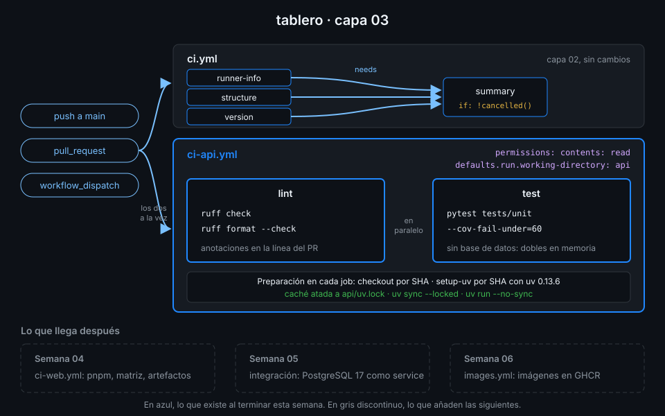

# Proyecto: capa 03 de tablero



## 🎯 Objetivo

Que la API de `tablero` tenga su propio CI: un `ci-api.yml` que instala exactamente lo que dice
`api/uv.lock`, pasa ruff y los tests unitarios con un umbral de cobertura, y lo hace en paralelo y
con caché.

## 📦 Qué añade esta capa

`ci.yml` (capas 01 y 02) se queda como está: sigue comprobando la estructura y escribiendo el
resumen. Esta capa añade un workflow nuevo, solo para la API:

| Job | Qué hace | Por qué existe |
|---|---|---|
| `lint` | `uv sync --locked`, `ruff check --output-format=github` y `ruff format --check` | Es lo más barato: si el código no está formateado, no merece la pena esperar a los tests |
| `test` | `uv sync --locked` y `pytest tests/unit` con `--cov-fail-under=60` | Los tests unitarios no necesitan base de datos; los de integración llegan en la Semana 05 |

Los dos usan `astral-sh/setup-uv` con la versión de uv fijada y la caché atada a `api/uv.lock`.
El umbral es 60 porque los tests unitarios cubren hoy el 62 %; en la Semana 05, con los de
integración, la cobertura combinada pasa del 90 % y el umbral sube.

Desbloquea la Semana 04, que hace lo mismo para `web/` con pnpm y añade matrices y artefactos.

## ✅ Requisitos verificables

- api/uv.lock está al día con api/pyproject.toml
- python-lab.yml terminó en success al menos una vez lanzado a mano
- python-lab.yml falló al menos una vez por un error sembrado a propósito
- El repo guarda al menos una caché de Actions
- ci-api.yml pasa actionlint
- ci-api.yml se dispara con push, pull_request y workflow_dispatch
- Todos los run de ci-api.yml se ejecutan en api/
- ci-api.yml tiene exactamente dos jobs: lint y test
- Todo astral-sh/setup-uv de ci-api.yml fija la versión exacta de uv
- Todo astral-sh/setup-uv de ci-api.yml activa la caché
- Los dos jobs instalan con uv sync --locked
- El job lint ejecuta ruff check y ruff format --check
- El job test exige al menos un 60 % de cobertura con --cov-fail-under
- Ningún workflow instala Python ni dependencias con pip o venv
- Toda uses: remota de tus workflows está fijada por SHA de 40 caracteres con el tag en comentario
- ci-api.yml terminó en success sobre el último commit de main
- ci-api.yml terminó en success al menos una vez en un pull request

## 🎨 Criterios de calidad

Lo que `check-week.sh` no ve y la [rúbrica](../rubrica-evaluacion.md) sí puntúa:

- Cada step tiene un `name:` que dice qué comprueba, no qué comando ejecuta.
- `cache-dependency-glob` apunta a `api/uv.lock`: la caché se invalida cuando cambian las
  dependencias y solo entonces.
- Ningún `ruff --fix` en el CI: el CI comprueba, no corrige.
- Los tests de integración (`tests/integration`) no corren aquí todavía, y un comentario dice por qué.
- Un comentario explica de dónde sale el 60 % y cuándo sube.
- Sin `TODO` en `.github/workflows/` y commits en Conventional Commits.

## 💡 Adaptación a tu dominio

| Tu proyecto | Qué cambia en `ci-api.yml` |
|---|---|
| Una librería de Python | `working-directory: .` y `uv build` en un tercer job para comprobar que empaqueta |
| Un proyecto con mypy o pyright | Un step de tipos en `lint`, con la herramienta en el grupo `dev` del lockfile |
| Un monorepo con varios paquetes uv | Un workflow por paquete, cada uno con su `working-directory` y su `cache-dependency-glob` |
| Scripts sueltos sin tests | Solo `lint`, y `uv run --script` para comprobar que cada script arranca |

## 🚦 Cómo entregarlo

1. Copia el starter y completa los `TODO 1` a `TODO 4`:

   ```bash
   cd ~/code/tablero
   cp ~/code/bc-github-actions/bootcamp/week-03-ci_de_python_con_uv/3-proyecto/starter/.github/workflows/ci-api.yml .github/workflows/
   actionlint .github/workflows/ci-api.yml
   # (sin salida: no hay errores)
   ```

2. Súbelo a `main` y espera al run de **tu** commit:

   ```bash
   git add .github/workflows/ci-api.yml
   git commit -m "ci(api): add lint and unit test workflow"
   git push
   gh run list --workflow ci-api.yml --commit "$(git rev-parse HEAD)" --json conclusion --jq '.[0].conclusion'
   # success
   ```

3. Abre un pull request que toque la API y comprueba que `ci-api.yml` corre en él:

   ```bash
   git switch -c docs/api-docstring
   sed -i '1i """API de tablero: health y CRUD de tareas."""' api/src/tablero/main.py
   git commit -am "docs(api): add module docstring"
   git push -u origin docs/api-docstring
   gh pr create --fill
   gh pr checks --watch
   ```

   Si `lint` falla por formato, ejecuta `uv run --no-sync ruff format .` en `api/`, haz commit y
   vuelve a empujar: es exactamente para lo que existe el job.

4. Lanza la verificación:

   ```bash
   cd ~/code/bc-github-actions
   ./scripts/check-week.sh 03
   # 17/17 comprobaciones superadas.
   ```

## 🧯 Errores comunes

| Síntoma | Causa | Solución |
|---|---|---|
| `The lockfile at uv.lock needs to be updated` | Cambiaste `pyproject.toml` sin `uv lock` | `uv lock` en `api/`, commit de `uv.lock` y push |
| `No pyproject.toml found` | Falta `working-directory: api` | `TODO 1`, en `defaults.run` |
| `ruff format` falla en el CI y no en tu máquina | Tu ruff local es otra versión | Usa siempre `uv run --no-sync ruff`, que es la del lockfile |
| `FAIL Required test coverage of 60% not reached` | Ejecutaste también otra ruta o quitaste tests | `pytest tests/unit` con `--cov=tablero`, y revisa qué tests borraste |
| La caché nunca acierta | `cache-dependency-glob` apunta a un archivo que no existe | Ruta relativa a la raíz del repo: `api/uv.lock` |
| El PR no lanza `ci-api.yml` | El PR viene de un fork o el archivo no está en la rama | Rama de tu propio repo, con `ci-api.yml` ya en `main` |

## 🔗 Navegación

---

| ← Anterior | Siguiente → |
|:---|---:|
| [Romper y arreglar](../2-practicas/04-romper-y-arreglar.md) | [Rúbrica de evaluación](../rubrica-evaluacion.md) |
