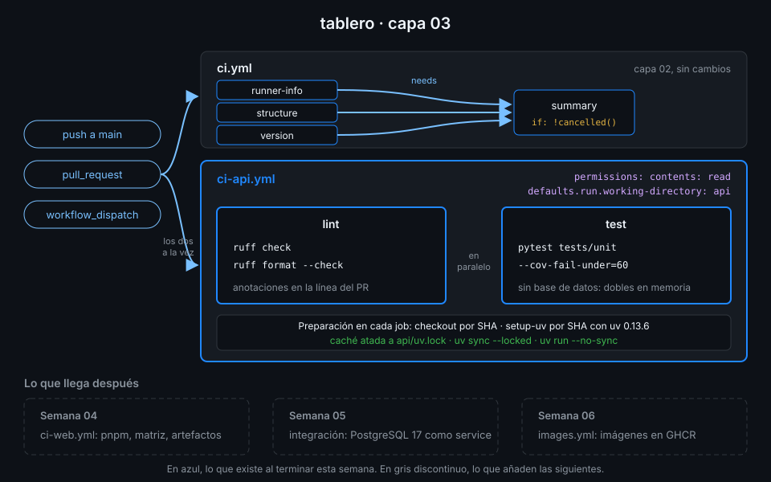

# Semana 03 — CI de Python con uv

> Un CI de Python que instala "lo último" en cada run no prueba tu código: prueba lo que PyPI
> publicó esa mañana. Esta semana conviertes `uv.lock` en un contrato que el CI hace cumplir.

## 🎯 Objetivos de la Semana

Al terminar la semana eres capaz de:

- Explicar qué garantiza `uv.lock` y por qué el CI instala con `uv sync --locked` y nunca con pip
- Preparar Python en un runner con `astral-sh/setup-uv`, con la versión de uv fijada y el Python
  que pide `.python-version`
- Pasar lint y formato con ruff y tests con pytest, con un umbral de cobertura que falla el job
- Cachear las dependencias con criterio: qué se guarda, con qué clave y cuándo se invalida
- Leer un fallo de CI de Python y saber en un vistazo si es del lockfile, del formato, de un test
  o de la cobertura
- Reconocer y reescribir los antipatrones de Python en CI más comunes
- Añadir a `tablero` un `ci-api.yml` con dos jobs en paralelo, verde en `main` y en un pull request

## 📋 Prerrequisitos

| Necesitas | Dónde se aprende |
|---|---|
| `check-week.sh 02` en 17/17: `ci.yml` con `version` y `summary` | [Semana 02](../week-02-expresiones_contextos_y_flujo_de_datos/README.md) |
| `defaults.run`, `if:`, outputs de step y `!cancelled()` | [Semana 02, teoría 03-05](../week-02-expresiones_contextos_y_flujo_de_datos/1-teoria/03-condiciones-y-funciones-de-estado.md) |
| uv 0.13.6 instalado en tu máquina | [`docs/setup-entorno.md`](../../docs/setup-entorno.md), apartado 4 |
| Python a nivel de leer una función y un test de pytest | No hace falta escribir Python: la API ya está hecha |

## 🗂️ Estructura de la Semana

```
week-03-ci_de_python_con_uv/
├── README.md
├── rubrica-evaluacion.md
├── checks.json                    17 comprobaciones
├── 0-assets/                      3 diagramas SVG
├── 1-teoria/                      7 archivos, uno por concepto
├── 2-practicas/                   4 prácticas guiadas
├── 3-proyecto/
│   ├── README.md
│   └── starter/.github/workflows/ci-api.yml
├── 4-recursos/{ebooks-free,videografia,webgrafia}/README.md
└── 5-glosario/README.md
```

## 📝 Contenidos

### Teoría

| # | Archivo | Qué aprendes | Tiempo |
|:--:|---|---|:--:|
| 01 | [La API de tablero](1-teoria/01-el-api-de-tablero.md) | Qué hay en `api/`, qué prueba cada test y qué tiene que correr el CI | 20 min |
| 02 | [uv en CI](1-teoria/02-uv-en-ci.md) | El lockfile como contrato, `--locked` frente a `--frozen` y `setup-uv` | 35 min |
| 03 | [ruff: lint y formato](1-teoria/03-ruff.md) | Reglas, formato y anotaciones en el pull request | 20 min |
| 04 | [pytest y cobertura](1-teoria/04-pytest-y-cobertura.md) | Tests unitarios, markers y un umbral de cobertura que falla | 25 min |
| 05 | [Caché de dependencias](1-teoria/05-cache-de-dependencias.md) | Claves, aciertos parciales, alcance por rama y la caché de uv | 35 min |
| 06 | [Fallar bien](1-teoria/06-fallar-bien.md) | Jobs separados, lo barato primero y fallos que dicen qué y dónde | 20 min |
| 07 | [Antipatrones de Python en CI](1-teoria/07-antipatrones-de-python-en-ci.md) | Lo que vas a ver en repos ajenos y cómo se reescribe con uv | 25 min |

### Prácticas

| # | Archivo | Qué haces | Tiempo |
|:--:|---|---|:--:|
| 01 | [uv en local](2-practicas/01-uv-en-local.md) | Sincronizar, ejecutar las herramientas y romper el lockfile a propósito | 1 h |
| 02 | [uv en un workflow](2-practicas/02-uv-en-un-workflow.md) | `python-lab.yml`: setup-uv fijado y el Python que pide el proyecto | 1 h |
| 03 | [Caché y tiempos](2-practicas/03-cache-y-tiempos.md) | Medir un run sin caché, con `actions/cache` y con la de setup-uv | 1 h |
| 04 | [Romper y arreglar](2-practicas/04-romper-y-arreglar.md) | Cuatro fallos sembrados y la línea del log que delata cada uno | 1 h |

### Proyecto

[Capa 03 de `tablero`](3-proyecto/README.md): `ci-api.yml` con los jobs `lint` (ruff) y `test`
(pytest con cobertura mínima del 60 %), instalando siempre desde `uv.lock` y con caché.



## ⏱️ Distribución del Tiempo (10 horas)

| Actividad | Horas |
|---|:--:|
| Teoría (7 archivos) | 3 |
| Práctica 01 — uv en local | 1 |
| Práctica 02 — uv en un workflow | 1 |
| Práctica 03 — Caché y tiempos | 1 |
| Práctica 04 — Romper y arreglar | 1 |
| Proyecto — capa 03 | 2 |
| Autoevaluación con la rúbrica | 1 |
| **Total** | **10** |

## 🎩 Trucos y atajos

- **`uv lock --check` antes del push** da en un segundo el mismo error que `uv sync --locked` te
  daría en el CI tras arrancar un runner. Es el fallo más frecuente de esta semana.
- **`gh cache list --sort size_in_bytes`** te dice qué cachés ocupan tu cupo de 10 GB, y
  `gh cache list --key setup-uv-` filtra las de uv. En la UI tienes que ir a Actions → Caches y
  ordenar a mano.
- **`ruff check --output-format=github`** convierte cada hallazgo en una anotación en la pestaña
  *Files changed* del pull request, en la línea exacta. Sin ese flag, el error solo está en el log.
- **El output `cache-hit` de setup-uv** (`steps.<id>.outputs.cache-hit`) te dice en un step
  siguiente si la caché acertó, sin leer el log de restauración.
- **`uv tree --depth 1`** muestra las dependencias directas con su versión resuelta y su grupo
  (`dev` o no). Es la forma rápida de ver qué cambió en un pull request que toca `uv.lock`.

## 📌 Entregables

- `api/uv.lock` al día con `api/pyproject.toml` en `main`
- `python-lab.yml` en `.github/workflows/`, en verde lanzado a mano y con al menos un fallo sembrado
  en su historial
- Al menos una caché de Actions guardada en el repo
- `ci-api.yml` completado desde el starter, en verde sobre el último commit de `main` y en un pull
  request (ver [proyecto](3-proyecto/README.md))
- Las 10 preguntas de la [rúbrica](rubrica-evaluacion.md) respondidas antes de mirar las respuestas

## ✅ Verificación

```bash
cd ~/code/bc-github-actions
./scripts/check-week.sh 03
# Semana 03 — CI de Python con uv  [repo: <tu-org>/tablero]
#
#   ✅ api/uv.lock está al día con api/pyproject.toml
#   ...
# 17/17 comprobaciones superadas.
```

Si algo sale en rojo, la pista te dice qué práctica y qué paso lo arreglan.

## 🔗 Navegación

---

| ← Anterior | Siguiente → |
|:---|---:|
| [Semana 02 — Expresiones, contextos y flujo de datos](../week-02-expresiones_contextos_y_flujo_de_datos/README.md) | [La API de tablero](1-teoria/01-el-api-de-tablero.md) |
