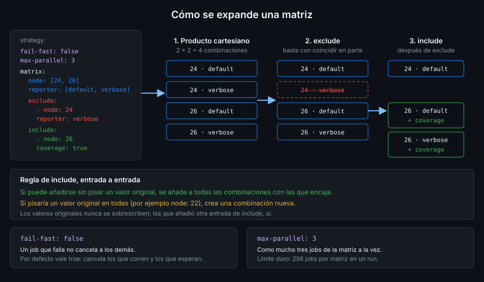

# Matrices

> Una matriz convierte una definición de job en varios jobs, uno por combinación de valores. Es la
> forma de cumplir lo que promete `engines.node: ">=24"`: probar en Node 24 y en Node 26 sin
> copiar el job.



## 🎯 Objetivos

Al terminar este archivo eres capaz de:

- Escribir `strategy.matrix` y predecir cuántos jobs genera
- Quitar combinaciones con `exclude` y ampliar o añadir con `include`, sabiendo en qué orden se aplican
- Decidir entre `fail-fast: true` y `false`, y limitar la concurrencia con `max-parallel`
- Poner los valores de la matriz en el nombre de cada job
- Generar la matriz en otro job con `fromJSON`

## 1. Qué problema resuelve

`web/package.json` dice `"node": ">=24"`. Si el CI solo prueba Node 26, esa promesa no la
comprueba nadie: una API de Node que solo existe en la 26 pasa en verde y rompe a quien use la 24.

La alternativa sin matriz es copiar el job `test` dos veces y cambiar la versión. Funciona hasta
que alguien modifica un step en una copia y no en la otra. La matriz define el job una vez y
GitHub lo multiplica.

## 2. Cómo funciona

### La expansión: producto cartesiano

Cada clave de `matrix` es una variable con una lista de valores. GitHub genera un job por cada
combinación posible:

```yaml
strategy:
  matrix:
    node: [24, 26]
    reporter: [default, verbose]
```

Dos valores por dos valores: cuatro jobs. Con una tercera variable de tres valores serían doce.
Dentro de cada job, los valores se leen con el contexto `matrix`: `${{ matrix.node }}`. Los nombres
de las variables no distinguen mayúsculas: `Node` y `node` son la misma.

El orden de las variables decide el orden en que se **crean** los jobs, no en el que terminan:
GitHub no garantiza el orden de ejecución.

**Límite: 256 jobs por matriz en un run**, en runners de GitHub y en propios.

### `exclude`: quitar combinaciones

`exclude` es una lista de combinaciones que no quieres. Basta con una **coincidencia parcial**:
`{node: 24, reporter: verbose}` quita esa combinación; `{node: 24}` quitaría todas las de Node 24.

### `include`: ampliar o añadir

Cada entrada de `include` se procesa así, según la referencia de sintaxis:

1. Si sus pares clave-valor se pueden añadir a una combinación **sin pisar ningún valor
   original**, se añaden a todas las combinaciones con las que encaja.
2. Si no encaja con ninguna sin pisar algo, se crea una **combinación nueva**.

Los valores originales de la matriz nunca se sobrescriben; los que añadió otra entrada de
`include`, sí. Y **`include` se procesa después de `exclude`**: puedes excluir algo en general y
volver a añadir un caso concreto.

En el ejemplo del diagrama, `{node: 26, coverage: true}` no pisa nada en las combinaciones con
Node 26, así que añade `coverage: true` a las dos. Una entrada `{node: 22}` pisaría el valor
`node` de todas, así que crearía una quinta combinación con solo `node: 22`.

Una matriz con **solo** `include` genera un job por entrada: útil cuando las combinaciones no son
un producto, sino una lista de casos.

### `fail-fast`: qué pasa cuando un job falla

`strategy.fail-fast` se aplica a la matriz entera y **vale `true` por defecto**. Con `true`, si
un job de la matriz falla, GitHub **cancela todos los que están en curso o en cola**.

Es razonable cuando todos los jobs prueban lo mismo y el fallo de uno condena a todos: ahorras
minutos. Es mala idea cuando la pregunta es **qué** combinaciones fallan. Con `fail-fast: true`,
si Node 24 falla, Node 26 aparece como cancelado y no sabes si el código funciona con 26. Con
`fail-fast: false` los dos terminan y el resultado es el que buscas: "falla con 24, pasa con 26"
dice que usaste algo que solo existe en la versión nueva.

`continue-on-error` es la otra palanca, por job: si un job con `continue-on-error: true` falla,
los demás no se ven afectados y el run no se marca como fallido por él. Sirve para una versión
experimental que todavía no quieres exigir. Combinado con `fail-fast: true`, solo el fallo de un
job **sin** `continue-on-error` cancela a los demás.

### `max-parallel`: cuántos a la vez

Por defecto GitHub ejecuta en paralelo todos los jobs de la matriz que permitan los runners
disponibles. `max-parallel: 2` limita a dos a la vez aunque haya runners para todos. Úsalo cuando
los jobs compiten por algo externo: un servicio con límite de peticiones o un entorno compartido.
Para ahorrar minutos no sirve: los minutos son los mismos, solo tardan más en total.

### El nombre de cada job

Sin `name:`, la UI muestra el id del job con los valores entre paréntesis, como `test (24)`. Ese
texto es también el nombre del check que verán las reglas de rama (Semana 18). Con `name:` lo
controlas tú y queda claro qué prueba cada uno:

```yaml
name: Unit (Node ${{ matrix.node }}, ${{ matrix.reporter }})
```

### Matrices dinámicas con `fromJSON`

La matriz puede venir de un output de otro job. El job previo escribe un array JSON en
`$GITHUB_OUTPUT` y el siguiente lo convierte con `fromJSON`, que viste en la Semana 02. Es el
patrón para "un job por paquete" o "un job por archivo que cambió".

## 3. Cómo se usa

### Matriz con `exclude`, `include` y nombre

```yaml
name: matrix-demo

on:
  workflow_dispatch:

# Mínimo privilegio: lo verás a fondo en la Semana 12.
permissions:
  contents: read

jobs:
  unit:
    name: Unit (Node ${{ matrix.node }}, ${{ matrix.reporter }})
    runs-on: ubuntu-24.04
    strategy:
      # Un fallo en Node 24 no cancela Node 26: quieres saber si fallan las dos.
      fail-fast: false
      max-parallel: 3
      matrix:
        node: [24, 26]
        reporter: [default, verbose]
        exclude:
          - node: 24
            reporter: verbose
        include:
          - node: 26
            coverage: true
    defaults:
      run:
        working-directory: web
    steps:
      - uses: actions/checkout@3d3c42e5aac5ba805825da76410c181273ba90b1 # v7.0.1
        with:
          persist-credentials: false
      - uses: pnpm/action-setup@ea17c68df8912ef543352723c149a84f56e3d413 # v6.1.0
        with:
          package_json_file: web/package.json
      - uses: actions/setup-node@949feb2413d6458794dcd2491c4babbbce0c15c1 # v7.1.0
        with:
          node-version: ${{ matrix.node }}
          cache: pnpm
          cache-dependency-path: web/pnpm-lock.yaml
      - run: pnpm install --frozen-lockfile
      - name: Tests
        env:
          REPORTER: ${{ matrix.reporter }}
        run: pnpm exec vitest run --reporter "$REPORTER"
      - name: Cobertura, solo donde include la activó
        if: matrix.coverage
        run: pnpm exec vitest run --coverage
```

Genera tres jobs: `Unit (Node 24, default)`, `Unit (Node 26, default)` y
`Unit (Node 26, verbose)`. En las dos de Node 26 `matrix.coverage` vale `true`; en la de Node 24
no existe, y el `if` la evalúa como falsa y salta el step.

Los valores de la matriz llegan al shell por `env:`, no interpolados en `run:`. Aquí los escribes
tú, pero en una matriz dinámica vienen de otro job, y la costumbre te protege cuando cambie el
origen.

### Matriz generada por otro job

```yaml
name: matrix-dynamic

on:
  workflow_dispatch:

# Mínimo privilegio: lo verás a fondo en la Semana 12.
permissions:
  contents: read

jobs:
  discover:
    name: Descubrir archivos de test
    runs-on: ubuntu-24.04
    outputs:
      files: ${{ steps.list.outputs.files }}
    steps:
      - uses: actions/checkout@3d3c42e5aac5ba805825da76410c181273ba90b1 # v7.0.1
        with:
          persist-credentials: false
      - id: list
        working-directory: web
        # jq -c deja el array en una sola línea: GITHUB_OUTPUT no admite saltos sin delimitador.
        run: |
          files=$(find tests -name '*.test.ts*' | sort | jq -R . | jq -sc .)
          echo "files=$files" >> "$GITHUB_OUTPUT"

  test-file:
    name: Test ${{ matrix.file }}
    needs: discover
    if: needs.discover.outputs.files != '[]'
    runs-on: ubuntu-24.04
    strategy:
      fail-fast: false
      matrix:
        file: ${{ fromJSON(needs.discover.outputs.files) }}
    defaults:
      run:
        working-directory: web
    steps:
      - uses: actions/checkout@3d3c42e5aac5ba805825da76410c181273ba90b1 # v7.0.1
        with:
          persist-credentials: false
      - uses: pnpm/action-setup@ea17c68df8912ef543352723c149a84f56e3d413 # v6.1.0
        with:
          package_json_file: web/package.json
      - uses: actions/setup-node@949feb2413d6458794dcd2491c4babbbce0c15c1 # v7.1.0
        with:
          node-version: "26"
          cache: pnpm
          cache-dependency-path: web/pnpm-lock.yaml
      - run: pnpm install --frozen-lockfile
      - name: Un solo archivo de test
        env:
          TEST_FILE: ${{ matrix.file }}
        run: pnpm exec vitest run "$TEST_FILE"
```

En `tablero`, `discover` produce `["tests/App.test.tsx","tests/api.test.ts"]` y `test-file`
genera dos jobs. El `if` evita expandir una lista vacía: si un día no hay tests, el job aparece
como saltado y lo ves en la UI. `actionlint` no puede comprobar una matriz dinámica: el valor
solo existe en tiempo de ejecución.

Verificado con actions/setup-node@v7.1.0 y ubuntu-24.04, noviembre de 2026.

## 4. Antipatrones

| Antipatrón | Por qué duele | Qué hacer en su lugar |
|---|---|---|
| Copiar el job para cada versión | Las copias divergen con el primer cambio | Una matriz |
| `fail-fast` por defecto en una matriz de compatibilidad | Un fallo cancela el resto y no sabes qué versiones funcionan | `fail-fast: false` |
| Matriz de "todas las versiones" | Minutos multiplicados por versiones que `engines` no promete | Las que promete `engines` |
| Sin `name:` en un job con matriz | Nombres como `test (24)` que cambian al tocar la matriz y rompen los checks requeridos | `name:` con los valores que importan |
| `${{ matrix.x }}` dentro de `run:` | Inyección si el valor viene de otro job o de datos externos | `env:` y la variable entre comillas |
| `max-parallel` para ahorrar | Los minutos son los mismos; solo tarda más | Quitar combinaciones con `exclude` |
| Matriz dinámica sin comprobar que no está vacía | Nada que expandir: el run no dice con claridad que no se probó nada | `if: needs.<job>.outputs.<x> != '[]'` |

## 5. Trucos

- **`gh run view <id> --json jobs --jq '.jobs[] | [.name, .conclusion] | @tsv'`** lista cada job
  de la matriz con su resultado: ves de un vistazo cuál falló y cuál quedó cancelado.
- **Una matriz con solo `include`** es una lista de casos con nombres propios: cada entrada lleva
  sus propias claves y no hay producto cartesiano que razonar.
- **`toJSON(matrix)`** en un `echo` por `env:` te enseña qué valores recibió de verdad cada job
  cuando un `include` no hace lo que esperabas.

## 📚 Recursos Adicionales

- [Running variations of jobs in a workflow](https://docs.github.com/en/actions/how-tos/write-workflows/choose-what-workflows-do/run-job-variations)
- [Workflow syntax: `jobs.<job_id>.strategy`](https://docs.github.com/en/actions/reference/workflows-and-actions/workflow-syntax#jobsjob_idstrategy)
- [Contexts: `matrix`](https://docs.github.com/en/actions/reference/workflows-and-actions/contexts#matrix-context)

## ✅ Checklist de Verificación

- [ ] Sé calcular cuántos jobs genera una matriz antes de lanzarla
- [ ] Sé en qué orden se aplican `exclude` e `include`
- [ ] Sé cuándo una entrada de `include` amplía y cuándo añade una combinación
- [ ] Sé qué hace `fail-fast` por defecto y por qué `ci-web.yml` lo desactiva
- [ ] Pongo los valores de la matriz en `name:`
- [ ] Sé generar una matriz con `fromJSON` y protegerla contra una lista vacía

---

| ← Anterior | Siguiente → |
|:---|---:|
| [Tests y build del frontend](03-tests-y-build-del-frontend.md) | [Artefactos](05-artefactos.md) |
