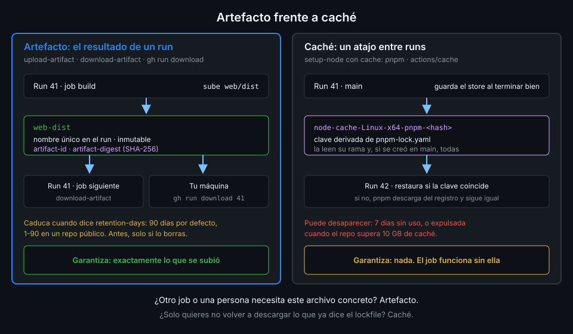

# Artefactos

> Cada job corre en una máquina que se destruye al terminar. Un artefacto es la forma de sacar
> archivos de ese job: para que otro job del mismo run los use, o para que tú los descargues
> después y veas exactamente qué construyó el CI.



## 🎯 Objetivos

Al terminar este archivo eres capaz de:

- Subir archivos con `actions/upload-artifact` y elegir nombre, ruta y caducidad
- Explicar por qué un artefacto es inmutable y qué implica en una matriz
- Descargar un artefacto en otro job con `actions/download-artifact`, por nombre o por id
- Bajar artefactos a tu máquina con `gh run download` y consultarlos con la API
- Saber qué se queda fuera de un artefacto sin avisar: archivos ocultos y permisos

## 1. Qué problema resuelve

En `ci-web.yml`, `build` produce `web/dist` y `dist-report` necesita esos archivos. Son jobs
distintos, en máquinas distintas: `dist-report` no ve nada del disco de `build`. Podrías volver a
construir en `dist-report`, pero entonces no estarías midiendo lo que construyó `build`, sino otra
compilación que debería ser igual. "Debería" no es una garantía.

Lo mismo pasa contigo: cuando un build falla en CI y no en local, quieres ver los archivos que
generó el runner, no los tuyos. El artefacto guarda exactamente esos archivos, asociados al run.

## 2. Cómo funciona

### Subir: `actions/upload-artifact`

Inputs leídos del `action.yml` de la v7.0.2 en su SHA:

| Input | Por defecto | Para qué |
|---|---|---|
| `name` | `artifact` | Nombre del artefacto. Único dentro del run |
| `path` | (obligatorio) | Archivo, directorio o patrón. Admite varias líneas y exclusiones con `!` |
| `if-no-files-found` | `warn` | `error` falla el step si no hay nada que subir; `warn` solo avisa; `ignore` calla |
| `retention-days` | (vacío) | Días hasta que caduca, entre 1 y el máximo del repo. `0` o vacío usa el valor del repo |
| `compression-level` | `6` | De 0 a 9. `0` para archivos que ya vienen comprimidos |
| `overwrite` | `false` | Con `true` borra el artefacto del mismo nombre antes de subir; el nuevo tiene otro id |
| `include-hidden-files` | `false` | Los archivos ocultos se excluyen salvo que lo actives |
| `archive` | `true` | Con `false` sube un solo archivo tal cual, sin zip, y usa su nombre como nombre del artefacto |

Outputs: `artifact-id` (el id para la API y para descargarlo), `artifact-url` (enlace que pide
sesión en GitHub) y `artifact-digest` (SHA-256 del zip subido).

Tres detalles que se aprenden con un fallo:

- **`path` es relativo a la raíz del repo**, no al `working-directory` de `defaults.run`: los steps
  `uses` no lo heredan. En `tablero` es `web/dist`, no `dist`.
- **Con un directorio, el artefacto contiene lo que hay dentro**: subir `web/dist` produce un zip
  con `index.html` y `assets/` en la raíz. Con varias rutas, la raíz es su ancestro común.
- **El zip no conserva permisos**: todos los directorios quedan en `755` y los archivos en `644`.
  Un binario que subas pierde el bit de ejecución. Si importa, empaquétalo antes con `tar` y súbelo
  con `archive: false`.

### Inmutable y con nombre único

Desde la v4 de las actions de artefactos, **un artefacto es inmutable**: una vez subido no se le
pueden añadir archivos, y un segundo `upload-artifact` con el mismo nombre en el mismo run falla.
Antes se permitía y producía artefactos corruptos cuando dos jobs escribían a la vez.

Esto choca de frente con las matrices: si el job `test` de la matriz sube `coverage` en Node 24 y
en Node 26 con el mismo nombre, el segundo falla. El nombre tiene que llevar la combinación:

```yaml
name: coverage-node-${{ matrix.node }}
```

`overwrite: true` existe para re-ejecuciones y casos parecidos, pero no es una forma de compartir
un artefacto entre jobs: borra el anterior y crea otro con otro id.

### Caducidad y almacenamiento

Según la documentación de GitHub, artefactos y logs se guardan **90 días por defecto**. El máximo
se configura en el repo: **entre 1 y 90 días en un repo público** y hasta 400 en uno privado.
`retention-days` no puede superar ese máximo. Cambiar el valor del repo solo afecta a los
artefactos nuevos.

Un artefacto ocupa almacenamiento todo ese tiempo, y en un repo privado ese almacenamiento cuenta
contra la cuota de la cuenta. Un `dist/` que solo sirve para el siguiente job no necesita vivir 90
días: `ci-web.yml` lo deja en 7. Borrar un run borra sus artefactos.

Hay además un límite de 500 artefactos por job.

### Archivos ocultos

Un archivo oculto es cualquiera que empiece por `.` o esté dentro de un directorio que empiece por
`.`. `upload-artifact` los **excluye por defecto** para no subir por accidente un `.env` con
secretos o el directorio `.git` entero. Si de verdad los necesitas, `include-hidden-files: true`, y revisa
antes qué contienen.

### Descargar: `actions/download-artifact`

Inputs leídos del `action.yml` de la v8.0.2 en su SHA:

| Input | Por defecto | Para qué |
|---|---|---|
| `name` | (vacío) | Un artefacto concreto. Sin `name` ni `artifact-ids`, descarga todos los del run |
| `artifact-ids` | (vacío) | Ids separados por comas. No se combina con `name` |
| `path` | `$GITHUB_WORKSPACE` | Destino |
| `pattern` | (vacío) | Glob de nombres, como `coverage-node-*`. Se ignora si hay `name` |
| `merge-multiple` | `false` | Con varios artefactos, `true` los extrae todos en `path` en lugar de uno por directorio |
| `github-token`, `repository`, `run-id` | run actual | Para descargar de otro run u otro repo. Exige un token con permiso de lectura de Actions |
| `skip-decompress` | `false` | Deja el zip sin extraer |
| `digest-mismatch` | `error` | Qué hacer si el digest descargado no coincide: `ignore`, `info`, `warn` o `error` |

Un solo artefacto, por nombre o por id, se extrae **directamente en `path`**, sin subdirectorio.
Varios, cada uno en un directorio con su nombre, salvo con `merge-multiple: true`.

`digest-mismatch: error` por defecto significa que, si lo descargado no es lo que se subió, el
step falla. Esa es la garantía del artefacto: lo que llega es lo que salió.

### Desde fuera del workflow: `gh` y la API

```bash
# Un artefacto concreto de un run, ya descomprimido, en ./web-dist-local
gh run download <run-id> -n web-dist -D web-dist-local

# Todos los artefactos de un run, uno por directorio
gh run download <run-id>

# Los artefactos web-dist del repo, con tamaño y caducidad
gh api 'repos/{owner}/{repo}/actions/artifacts?name=web-dist' \
  --jq '.artifacts[] | [.id, .size_in_bytes, .expires_at] | @tsv'
```

Sin `<run-id>`, `gh run download -n web-dist` busca el artefacto en todos los runs del repo. La
ayuda de `gh` avisa de que, como los artefactos se pueden borrar o sobrescribir, para uno concreto
debes dar el id del run. La API permite también borrar un artefacto antes de que caduque:
`gh api -X DELETE repos/{owner}/{repo}/actions/artifacts/<id>`.

## 3. Cómo se usa

Un job construye y sube; otro descarga por id, sin checkout ni dependencias:

```yaml
name: web-bundle

on:
  workflow_dispatch:

# Mínimo privilegio: lo verás a fondo en la Semana 12.
permissions:
  contents: read

jobs:
  bundle:
    name: Construir el bundle
    runs-on: ubuntu-24.04
    outputs:
      artifact-id: ${{ steps.upload.outputs.artifact-id }}
      artifact-digest: ${{ steps.upload.outputs.artifact-digest }}
    defaults:
      run:
        working-directory: web
    steps:
      - uses: actions/checkout@3d3c42e5aac5ba805825da76410c181273ba90b1 # v7.0.1
        with:
          persist-credentials: false
      - uses: pnpm/action-setup@ea17c68df8912ef543352723c149a84f56e3d413 # v6.1.0
        with:
          package_json_file: web/package.json
      - uses: actions/setup-node@949feb2413d6458794dcd2491c4babbbce0c15c1 # v7.1.0
        with:
          node-version: "26"
          cache: pnpm
          cache-dependency-path: web/pnpm-lock.yaml
      - run: pnpm install --frozen-lockfile
      - run: pnpm build
      - id: upload
        uses: actions/upload-artifact@cf430e030ddbb5b0abf93d22962f4752f3646cd9 # v7.0.2
        with:
          name: web-bundle
          # Relativo a la raíz del repo: defaults.run no afecta a los uses.
          path: web/dist
          if-no-files-found: error
          retention-days: 3

  inspect:
    name: Inspeccionar el bundle
    needs: bundle
    runs-on: ubuntu-24.04
    steps:
      # Sin checkout ni pnpm: este job solo necesita lo que construyó el anterior.
      - uses: actions/download-artifact@9000827ccba6bdab643e8b6fd33ac0654aef8333 # v8.0.2
        with:
          artifact-ids: ${{ needs.bundle.outputs.artifact-id }}
          path: bundle
      - name: Qué llegó
        env:
          DIGEST: ${{ needs.bundle.outputs.artifact-digest }}
        run: |
          echo "digest del zip: $DIGEST"
          find bundle -type f -printf '%s\t%p\n' | sort -n
```

`if-no-files-found: error` hace que un build que no dejó nada falle en `bundle`, que es donde está
la causa, y no en `inspect`, con un "no such file" que no explica nada. Descargar por
`artifact-ids` en lugar de por `name` ata `inspect` al artefacto exacto que subió este run.

Verificado con actions/upload-artifact@v7.0.2, actions/download-artifact@v8.0.2 y ubuntu-24.04,
noviembre de 2026.

## 4. Antipatrones

| Antipatrón | Por qué duele | Qué hacer en su lugar |
|---|---|---|
| `upload-artifact@v3` o anterior | Retirado: el step falla | La versión de `docs/stack-versions.md`, fijada por SHA |
| El mismo `name` en todos los jobs de una matriz | El segundo upload falla: los artefactos son inmutables | `name` con los valores de la matriz |
| `if-no-files-found` por defecto (`warn`) | Un build vacío pasa en verde y falla tres jobs después | `if-no-files-found: error` |
| Sin `retention-days` | 90 días de almacenamiento para algo que se usa una vez | Los días que de verdad lo vas a necesitar |
| `path: dist` con `defaults.run.working-directory: web` | El `uses` busca en la raíz y no encuentra nada | `path: web/dist` |
| `include-hidden-files: true` "por si acaso" | Puedes subir un `.env` o credenciales a algo descargable | Solo si hace falta, y revisando qué hay |
| Reconstruir en el job que necesita el resultado | Mides otra compilación, no la que se probó | Descargar el artefacto |
| Usar artefactos para dependencias entre runs | Cada run sube y baja cientos de MB que la caché resolvería | Caché (archivo 06) |

## 5. Trucos

- **`gh run download <run-id> -n web-dist -D /tmp/web-dist`** te deja el resultado del CI listo
  para servirlo en local con cualquier servidor estático y ver qué se desplegaría.
- **`gh api 'repos/{owner}/{repo}/actions/runs/<run-id>/artifacts' --jq '.artifacts[].name'`**
  lista los nombres de los artefactos de un run: útil para comprobar que la matriz los nombró bien.
- **El output `artifact-url`** se puede escribir en `$GITHUB_STEP_SUMMARY`: quien abra el run
  tiene el enlace de descarga en el resumen, sin buscarlo en la página.

## 📚 Recursos Adicionales

- [Store and share data with workflow artifacts](https://docs.github.com/en/actions/tutorials/store-and-share-data)
- [actions/upload-artifact](https://github.com/actions/upload-artifact)
- [actions/download-artifact](https://github.com/actions/download-artifact)
- [REST API: Artifacts](https://docs.github.com/en/rest/actions/artifacts)
- [`gh run download`](https://cli.github.com/manual/gh_run_download)

## ✅ Checklist de Verificación

- [ ] Sé qué inputs de `upload-artifact` uso siempre y por qué
- [ ] Sé por qué no puedo subir dos veces el mismo nombre en un run
- [ ] Nombro los artefactos de una matriz con los valores de la combinación
- [ ] Sé cuánto dura un artefacto por defecto y cuál es el máximo en un repo público
- [ ] Sé dónde extrae `download-artifact` uno y varios artefactos
- [ ] Sé bajar un artefacto con `gh run download` y listarlos con la API

---

| ← Anterior | Siguiente → |
|:---|---:|
| [Matrices](04-matrices.md) | [Artefacto frente a caché](06-artefacto-frente-a-cache.md) |
