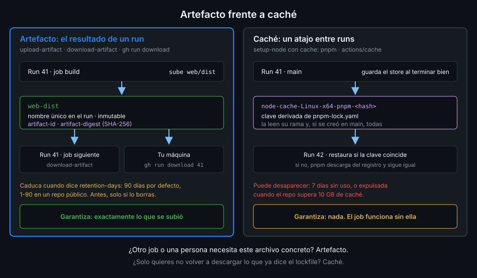

# Artefacto frente a caché

> Los dos guardan archivos en GitHub entre una máquina y otra, y por eso se confunden. Pero uno
> promete devolverte exactamente lo que guardaste y el otro no promete nada. Elegir mal da un CI
> lento en el mejor caso y uno que prueba algo distinto de lo que despliega en el peor.



## 🎯 Objetivos

Al terminar este archivo eres capaz de:

- Decir qué garantiza un artefacto y qué garantiza una caché
- Elegir entre los dos con una tabla de decisión
- Reconocer los errores típicos de usar uno en lugar del otro
- Explicar por qué `ci-web.yml` usa los dos a la vez y para cosas distintas

## 1. Qué problema resuelve

En esta semana has usado los dos mecanismos en el mismo workflow:

- `actions/setup-node` con `cache: pnpm` guarda el store de pnpm entre runs.
- `actions/upload-artifact` guarda `web/dist` para el job siguiente.

Los dos suben archivos a GitHub y los bajan en otra máquina. La documentación lo dice sin
rodeos: se parecen, pero **tienen casos de uso distintos y no son intercambiables**. La caché es
para reutilizar entre runs archivos que cambian poco y que el job sabría regenerar. El artefacto
es para guardar lo que produce un job, para usarlo en otro job o para verlo cuando el run ha
terminado.

La forma práctica de distinguirlos es preguntar **qué pasa si no está**.

## 2. Cómo funciona

### Lo que garantiza un artefacto

| Propiedad | Artefacto |
|---|---|
| Qué devuelve | **Exactamente** lo que se subió. `download-artifact` comprueba el digest y falla si no coincide |
| Ámbito | Un run. Cada run tiene los suyos; otro run solo los lee con un token y `run-id` explícitos |
| Identidad | Nombre único dentro del run e id global. Inmutable: no se añade nada después |
| Cuándo existe | Desde que se sube hasta que caduca (`retention-days`, 90 días por defecto) o lo borras |
| Quién lo ve | Los jobs del run, y cualquiera con acceso al repo desde la UI, `gh run download` o la API |
| Si no está | **El job que lo necesita falla.** Es una dependencia, no una optimización |

### Lo que garantiza una caché

Lo viste en la Semana 03 con uv; con `cache: pnpm` es lo mismo, con otra clave:

| Propiedad | Caché |
|---|---|
| Qué devuelve | Lo que se guardó con esa clave, **si sigue existiendo**. Con pnpm, solo con acierto exacto |
| Ámbito | El repo, limitado por rama: un run lee las entradas de su rama y de la rama por defecto |
| Identidad | La clave: `node-cache-Linux-x64-pnpm-<hash de pnpm-lock.yaml>` |
| Cuándo existe | Hasta 7 días sin uso, o hasta que el repo supera 10 GB y GitHub expulsa las más antiguas |
| Quién la ve | Solo los workflows del repo. Se lista y se borra con `gh cache`, pero no se descarga |
| Si no está | **Nada cambia en el resultado.** pnpm descarga del registro y el job tarda más |

### La pregunta que decide

> **Si este archivo no estuviera, ¿el job daría un resultado distinto o solo tardaría más?**

- **Distinto** (o fallaría): es un resultado. Artefacto.
- **Solo más lento**: es un atajo. Caché.

`web/dist` es un resultado: si no está, `dist-report` no tiene nada que medir, y si lo regeneras
mides otra compilación. El store de pnpm es un atajo: si no está, `pnpm install --frozen-lockfile`
instala lo mismo, porque lo que se instala lo decide el lockfile, no la caché.

### Tabla de decisión

| Quieres guardar | Mecanismo | Por qué |
|---|---|---|
| El store de pnpm, la caché de uv | Caché | Se regenera desde el lockfile; solo ahorra descargas |
| `web/dist` para otro job del mismo run | Artefacto | Es el resultado que se prueba y se despliega |
| El informe de cobertura para leerlo en tu navegador | Artefacto | Lo quieres ver cuando el run acabó |
| Los logs o capturas de un test que falló | Artefacto, solo con `if: failure()` | Es evidencia de ese run concreto |
| Un binario que otro workflow despliega | Artefacto o, desde la S06, un registro | La caché podría no estar cuando lo pidan |
| El resultado de un paso caro y determinista que sabes regenerar | Caché | Si falta, se recalcula igual |
| Un archivo que pasa de un step a otro del mismo job | Ninguno | El disco del job es el mismo: basta con dejarlo ahí |
| Un valor corto (una versión, una lista JSON) entre jobs | Ninguno: outputs de job | Lo viste en la Semana 02; un artefacto para eso es matar moscas a cañonazos |

### Tres errores típicos, contados

**"El CI pasaba ayer y hoy falla sin cambios."** Un job lee un archivo de la caché que ningún step
genera: un `dist/` cacheado "para ir más rápido", por ejemplo. Durante una semana la entrada
existe y todo va bien. Al octavo día sin uso GitHub la borra, el archivo deja de existir y el job
falla. Nadie tocó el código; cambió algo que nunca fue una garantía. La caché se trató como un
artefacto.

**"El despliegue no es lo que probamos."** El job que despliega vuelve a ejecutar `pnpm build` en
lugar de descargar `web/dist`. Casi siempre sale igual, pero no siempre: otra versión de Node en
ese job, una variable de entorno distinta, una dependencia opcional. Lo que se probó y lo que se
despliega son dos compilaciones. Faltaba un artefacto.

**"Cada run tarda lo mismo aunque haya caché."** Un workflow sube `node_modules` como artefacto
al final y lo descarga al principio del siguiente run con `github-token` y `run-id`. Funciona,
pero cada run sube y baja el árbol entero, no reutiliza nada del store y depende de que el run
anterior no haya caducado. Era un trabajo para la caché.

En los tres casos la pregunta "¿distinto o solo más lento?" habría elegido bien.

### Lo que sí comparten

- Los dos se almacenan en GitHub y se transfieren por red: subir y bajar no es gratis en tiempo.
  Un artefacto de 2 GB que el siguiente job descarga puede costar más que reconstruirlo.
- Los dos se pueden inspeccionar desde la terminal: `gh cache list` y `gh run download`.
- Ninguno sustituye al otro dentro de un mismo job: allí el disco es el mismo y basta con dejar
  el archivo donde está.

## 3. Cómo se usa

En el job `build` de un CI como el de `tablero`, los dos conviven sin pisarse:

```yaml
    steps:
      - uses: actions/checkout@3d3c42e5aac5ba805825da76410c181273ba90b1 # v7.0.1
        with:
          persist-credentials: false
      - uses: pnpm/action-setup@ea17c68df8912ef543352723c149a84f56e3d413 # v6.1.0
        with:
          package_json_file: web/package.json
      # Caché: si falta, pnpm descarga del registro y el resultado es el mismo.
      - uses: actions/setup-node@949feb2413d6458794dcd2491c4babbbce0c15c1 # v7.1.0
        with:
          node-version: "26"
          cache: pnpm
          cache-dependency-path: web/pnpm-lock.yaml
      - run: pnpm install --frozen-lockfile
      - run: pnpm build
      # Artefacto: si falta, el job siguiente no tiene nada que usar.
      - uses: actions/upload-artifact@cf430e030ddbb5b0abf93d22962f4752f3646cd9 # v7.0.2
        with:
          name: web-dist
          path: web/dist
          if-no-files-found: error
          retention-days: 7
```

Es un fragmento: el workflow completo con `permissions`, `defaults` y los demás jobs es el del
archivo 05 o el de tu proyecto. Fíjate en los comentarios: cada uno dice qué pasa si el mecanismo
falla. Si no sabes escribir esa frase, no sabes cuál de los dos necesitas.

Para comprobarlo en tu repo:

```bash
# La caché de pnpm que guardó main
gh cache list --key node-cache-Linux-x64-pnpm- --ref refs/heads/main

# Los artefactos web-dist, con su caducidad
gh api 'repos/{owner}/{repo}/actions/artifacts?name=web-dist' \
  --jq '.artifacts[] | [.id, .expires_at] | @tsv'
```

Verificado con actions/setup-node@v7.1.0, actions/upload-artifact@v7.0.2 y ubuntu-24.04,
noviembre de 2026.

## 4. Antipatrones

| Antipatrón | Por qué duele | Qué hacer en su lugar |
|---|---|---|
| Pasar `dist/` entre jobs con `actions/cache` y `github.run_id` en la clave | La caché puede expulsarse entre un job y otro, y cada run crea una entrada que nadie reutiliza | Artefacto |
| Guardar `node_modules` o el store como artefacto en cada run | Sube y baja cientos de MB y no ahorra nada al run siguiente | `cache: pnpm` |
| Un job que solo funciona si la caché acierta | El día que expire, el CI falla sin que nadie cambiara nada | El job instala siempre; la caché solo acelera |
| Leer un artefacto de otro run como si fuera una caché | Necesita token, `run-id` y que el artefacto no haya caducado | Caché para atajos; artefacto solo del run que lo produce |
| Subir a artefacto lo que puede ir en un output | Más tiempo, más almacenamiento, otra action que fijar | `outputs` del job |
| Artefactos de 90 días para pasar algo al job siguiente | Almacenamiento ocupado durante meses | `retention-days` corto |
| Reconstruir en el job que despliega "porque sale igual" | Lo desplegado no es lo probado | Descargar el artefacto del job que lo construyó |
| Cachear `web/dist` entre runs para saltarse el build | Un `dist/` viejo sirve código que ya no existe en la rama | Construir siempre; cachear solo dependencias |

## 5. Trucos

- **El output `cache-hit` de `setup-node`** te dice si la caché acertó. Escribirlo en el resumen
  del job, junto al tiempo del `pnpm install`, enseña cuánto ahorra la caché de verdad.
- **Prueba tu job sin caché** borrando la entrada (`gh cache delete <clave>`) y relanzando: si
  sigue en verde, la caché es un atajo de verdad; si falla, has encontrado una dependencia oculta.
- **`gh cache list --sort size_in_bytes`** ordena las entradas por tamaño: las de arriba son las
  que acercan el repo a los 10 GB y provocan que GitHub expulse otras.

## 📚 Recursos Adicionales

- [Workflow artifacts: artifacts versus caching](https://docs.github.com/en/actions/concepts/workflows-and-actions/workflow-artifacts)
- [Dependency caching reference](https://docs.github.com/en/actions/reference/workflows-and-actions/dependency-caching)
- [actions/setup-node: Caching packages data](https://github.com/actions/setup-node/blob/main/docs/advanced-usage.md#caching-packages-data)
- [Semana 03, teoría 05: Caché de dependencias](../../week-03-ci_de_python_con_uv/1-teoria/05-cache-de-dependencias.md)

## ✅ Checklist de Verificación

- [ ] Sé qué garantiza un artefacto y qué garantiza una caché
- [ ] Sé hacerme la pregunta "¿distinto o solo más lento?"
- [ ] Sé por qué `web/dist` es un artefacto y el store de pnpm una caché
- [ ] Sé por qué un job no puede depender de que la caché acierte
- [ ] Uso outputs de job para valores cortos, no artefactos
- [ ] Sé reconocer los tres errores típicos por su síntoma

---

| ← Anterior | Siguiente → |
|:---|---:|
| [Artefactos](05-artefactos.md) | [pnpm en local](../2-practicas/01-pnpm-en-local.md) |
