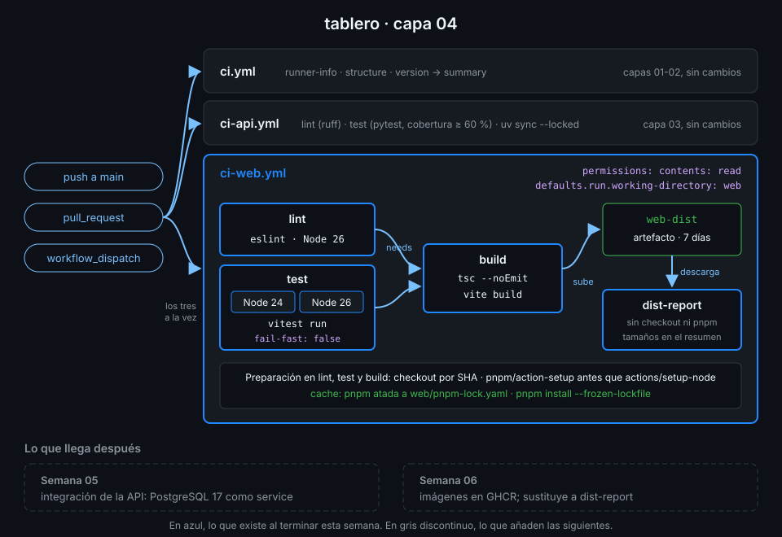

# Proyecto: capa 04 de tablero



## 🎯 Objetivo

Que el frontend de `tablero` tenga su propio CI: lint una vez, tests en las dos versiones LTS de
Node que soporta, build solo si todo lo anterior pasa, y el resultado guardado como artefacto que
otro job consume sin reconstruirlo.

## 📦 Qué añade esta capa

`ci.yml` y `ci-api.yml` se quedan como están. Esta capa añade `ci-web.yml`:

| Job | Qué hace | Por qué existe |
|---|---|---|
| `lint` | eslint con Node 26 | El análisis estático no depende de la versión de Node: con una basta |
| `test` | vitest en una matriz con Node 24 y 26, sin `fail-fast` | `web/package.json` declara `node >=24`: lo que promete, lo prueba. Sin `fail-fast`, ves si falla una versión o las dos |
| `build` | `tsc` y vite, y sube `web/dist` como `web-dist` durante 7 días | Construir una sola vez y guardar exactamente lo que se construyó |
| `dist-report` | Descarga `web-dist` y escribe el tamaño de cada archivo en el resumen | Demostrar que un job puede usar lo que otro construyó, sin checkout ni build |

La Semana 06 sustituirá a `dist-report` por la imagen Docker de la web, que se construirá a partir
del mismo código. La Semana 05 cierra el lado de la API con PostgreSQL.

## ✅ Requisitos verificables

- web/package.json fija la versión exacta de pnpm en packageManager
- web-lab.yml terminó en success al menos una vez lanzado a mano
- matrix-lab.yml terminó en success al menos una vez lanzado a mano
- El repo tiene al menos un artefacto web-dist subido por ci-web.yml
- ci-web.yml pasa actionlint
- ci-web.yml se dispara con push, pull_request y workflow_dispatch
- Todos los run de ci-web.yml se ejecutan en web/ por defecto
- ci-web.yml tiene los jobs lint, test, build y dist-report
- El job test corre en una matriz con Node 24 y Node 26
- Un fallo en una versión de Node no cancela la otra
- lint, test y build instalan con pnpm install --frozen-lockfile
- Todo actions/setup-node de ci-web.yml cachea el store de pnpm
- build solo empieza cuando lint y test han terminado bien
- El artefacto de build caduca en 30 días o menos
- dist-report descarga el artefacto en lugar de volver a construir
- Ningún workflow usa un gestor de paquetes de Node que no sea pnpm
- Toda uses: remota de tus workflows está fijada por SHA de 40 caracteres con el tag en comentario
- ci-web.yml terminó en success sobre el último commit de main

## 🎨 Criterios de calidad

Lo que `check-week.sh` no ve y la [rúbrica](../rubrica-evaluacion.md) sí puntúa:

- El nombre de cada job de la matriz dice qué versión de Node prueba.
- Un comentario explica por qué la matriz es 24 y 26 y no "todas las versiones".
- `if-no-files-found: error` en la subida: un build vacío tiene que fallar aquí, no tres jobs después.
- `dist-report` no tiene checkout ni instala dependencias: solo usa el artefacto.
- Sin `TODO` en `.github/workflows/` y commits en Conventional Commits.

## 💡 Adaptación a tu dominio

| Tu proyecto | Matriz | Artefacto |
|---|---|---|
| Librería de JavaScript publicada | Node 24 y 26, y `os` con `ubuntu-24.04` y `windows-2025` | El `.tgz` de `pnpm pack` |
| Aplicación con Playwright | `browser: [chromium, firefox]` | El informe HTML de Playwright, solo si falla (`if: failure()`) |
| Sitio estático con Astro o Vite | Una sola versión de Node | La carpeta `dist/`, para desplegarla en otro job |
| Monorepo con varios paquetes pnpm | `package` generado con `fromJSON` desde un job que lista los paquetes | Un artefacto por paquete, con el nombre del paquete |

## 🚦 Cómo entregarlo

1. Copia el starter y completa los `TODO 1` a `TODO 5`:

   ```bash
   cd ~/code/tablero
   cp ~/code/bc-github-actions/bootcamp/week-04-ci_de_frontend_pnpm_matrices_y_artefactos/3-proyecto/starter/.github/workflows/ci-web.yml .github/workflows/
   actionlint .github/workflows/ci-web.yml
   # (sin salida: no hay errores)
   ```

2. Súbelo a `main`, espera al run de **tu** commit y comprueba el artefacto:

   ```bash
   git add .github/workflows/ci-web.yml
   git commit -m "ci(web): add lint, matrix tests, build and dist artifact"
   git push
   id=$(gh run list --workflow ci-web.yml --commit "$(git rev-parse HEAD)" --json databaseId --jq '.[0].databaseId')
   gh run watch "$id" --exit-status
   gh run download "$id" -n web-dist -D /tmp/web-dist && ls /tmp/web-dist
   # assets  index.html
   ```

3. Lanza la verificación:

   ```bash
   cd ~/code/bc-github-actions
   ./scripts/check-week.sh 04
   # 18/18 comprobaciones superadas.
   ```

## 🧯 Errores comunes

| Síntoma | Causa | Solución |
|---|---|---|
| `Unable to locate executable file: pnpm` en setup-node | `actions/setup-node` con `cache: pnpm` va antes que `pnpm/action-setup` | Pon `pnpm/action-setup` primero |
| `ERR_PNPM_OUTDATED_LOCKFILE` | Cambiaste `package.json` sin `pnpm install` en local | `pnpm install` en `web/`, commit de `pnpm-lock.yaml` y push |
| Los dos jobs de la matriz se llaman igual en la UI | El `name` no usa `matrix.node` | `name: Tests (Node ${{ matrix.node }})` |
| `No files were found with the provided path: web/dist` | El build no llegó a ejecutarse o `path` no es relativo a la raíz | `path: web/dist`: `defaults.run` no afecta a los `with` de una action |
| `dist-report` falla con `Artifact not found` | El `name` de la descarga no coincide con el de la subida | El mismo `web-dist` en los dos |
| `web-dist-artifact` en rojo semanas después | El artefacto caducó: 7 días | Relanza `ci-web.yml` con `gh workflow run ci-web.yml` antes de verificar |

## 🔗 Navegación

---

| ← Anterior | Siguiente → |
|:---|---:|
| [Artefactos entre jobs](../2-practicas/04-artefactos-entre-jobs.md) | [Rúbrica de evaluación](../rubrica-evaluacion.md) |
