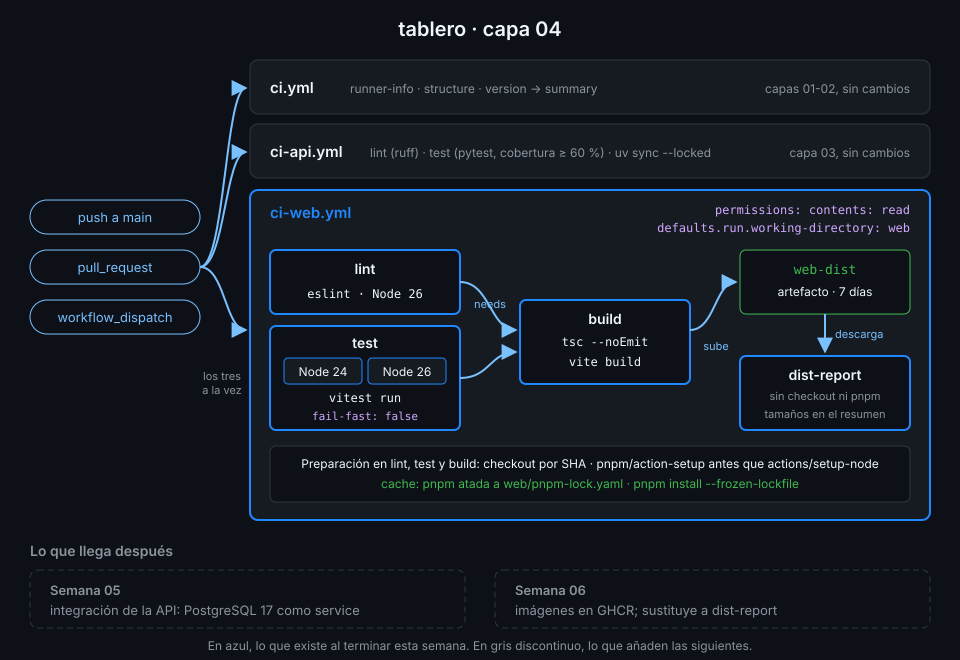

# Semana 04 — CI de frontend con pnpm, matrices y artefactos

> El frontend tiene su propio lockfile, su propio runtime y un resultado que otros jobs necesitan:
> la carpeta `dist/`. Esta semana lo pruebas en dos versiones de Node a la vez y pasas el build de
> un job a otro sin reconstruirlo.

## 🎯 Objetivos de la Semana

Al terminar la semana eres capaz de:

- Explicar qué hace distinto a pnpm (store, enlaces, `packageManager`) y por qué el CI instala con
  `pnpm install --frozen-lockfile` y nunca con npm
- Preparar pnpm y Node en un runner con `pnpm/action-setup` y `actions/setup-node`, en ese orden y
  con la caché del store
- Pasar lint, tests y build de un frontend con React, Vite y TypeScript
- Escribir matrices con `include`, `exclude`, `fail-fast`, `max-parallel` y matrices dinámicas
  con `fromJSON`
- Pasar archivos entre jobs con artefactos, controlar su caducidad y descargarlos con `gh`
- Decidir entre artefacto y caché sabiendo qué garantiza cada uno
- Añadir a `tablero` un `ci-web.yml` con matriz, build y artefacto, y cerrar la Fase 1

## 📋 Prerrequisitos

| Necesitas | Dónde se aprende |
|---|---|
| `check-week.sh 03` en 17/17: `ci-api.yml` con uv, ruff y pytest | [Semana 03](../week-03-ci_de_python_con_uv/README.md) |
| Caché de Actions: claves, aciertos y alcance por rama | [Semana 03, teoría 05](../week-03-ci_de_python_con_uv/1-teoria/05-cache-de-dependencias.md) |
| `needs`, outputs de job y `toJSON` / `fromJSON` | [Semana 02, teoría 06](../week-02-expresiones_contextos_y_flujo_de_datos/1-teoria/06-datos-entre-jobs.md) |
| pnpm 12.16.1 y Node 26 en tu máquina | [`docs/setup-entorno.md`](../../docs/setup-entorno.md), apartado 5 |

## 🗂️ Estructura de la Semana

```
week-04-ci_de_frontend_pnpm_matrices_y_artefactos/
├── README.md
├── rubrica-evaluacion.md          incluye el minisimulacro de cierre de la Fase 1
├── checks.json                    18 comprobaciones
├── 0-assets/                      3 diagramas SVG
├── 1-teoria/                      6 archivos, uno por concepto
├── 2-practicas/                   4 prácticas guiadas
├── 3-proyecto/
│   ├── README.md
│   └── starter/.github/workflows/ci-web.yml
├── 4-recursos/{ebooks-free,videografia,webgrafia}/README.md
└── 5-glosario/README.md
```

## 📝 Contenidos

### Teoría

| # | Archivo | Qué aprendes | Tiempo |
|:--:|---|---|:--:|
| 01 | [El frontend de tablero](1-teoria/01-el-web-de-tablero.md) | Qué hay en `web/`, qué hace cada script y qué tiene que correr el CI | 20 min |
| 02 | [pnpm en CI](1-teoria/02-pnpm-en-ci.md) | Store, `--frozen-lockfile`, `packageManager` y las dos actions de preparación | 35 min |
| 03 | [Tests y build del frontend](1-teoria/03-tests-y-build-del-frontend.md) | eslint, vitest, `tsc` y vite: qué falla en cada uno | 25 min |
| 04 | [Matrices](1-teoria/04-matrices.md) | Expansión, `include`, `exclude`, `fail-fast`, `max-parallel` y `fromJSON` | 30 min |
| 05 | [Artefactos](1-teoria/05-artefactos.md) | Subir, descargar, caducidad, inmutabilidad y `gh run download` | 25 min |
| 06 | [Artefacto frente a caché](1-teoria/06-artefacto-frente-a-cache.md) | Qué garantiza cada uno y cuál usar en cada caso | 15 min |

### Prácticas

| # | Archivo | Qué haces | Tiempo |
|:--:|---|---|:--:|
| 01 | [pnpm en local](2-practicas/01-pnpm-en-local.md) | Instalar, ejecutar y romper el lockfile a propósito | 1 h |
| 02 | [pnpm en un workflow](2-practicas/02-pnpm-en-un-workflow.md) | `web-lab.yml`: pnpm y Node preparados en el orden correcto, con caché | 1 h |
| 03 | [Matrices](2-practicas/03-matrices.md) | `matrix-lab.yml`: de una matriz simple a una generada por otro job | 1 h |
| 04 | [Artefactos entre jobs](2-practicas/04-artefactos-entre-jobs.md) | Subir, descargar, inspeccionar y borrar artefactos | 1 h |

### Proyecto

[Capa 04 de `tablero`](3-proyecto/README.md): `ci-web.yml` con `lint`, `test` en matriz con
Node 24 y 26, `build` que sube `web/dist` como artefacto y `dist-report`, que lo descarga y
resume su tamaño.



## ⏱️ Distribución del Tiempo (10 horas)

| Actividad | Horas |
|---|:--:|
| Teoría (6 archivos) | 2,5 |
| Práctica 01 — pnpm en local | 1 |
| Práctica 02 — pnpm en un workflow | 1 |
| Práctica 03 — Matrices | 1 |
| Práctica 04 — Artefactos entre jobs | 1 |
| Proyecto — capa 04 | 1,5 |
| Minisimulacro de cierre de la Fase 1 | 1 |
| Autoevaluación con la rúbrica | 1 |
| **Total** | **10** |

## 🎓 Cierre de la Fase 1

Con esta semana termina la Fase 1 (Fundamentos). La [rúbrica](rubrica-evaluacion.md) incluye un
minisimulacro cronometrado de 60 minutos sobre las semanas 01-04: preguntas tipo GH-200 de los
dominios que cubre la fase (D1, D2 y D4) y una tarea práctica sobre tu propio `tablero`.

## 🎩 Trucos y atajos

- **`gh run download <id> -n web-dist`** baja un artefacto concreto de un run a tu máquina, ya
  descomprimido. Es la forma más rápida de comprobar qué construyó el CI exactamente.
- **El orden importa: `pnpm/action-setup` antes que `actions/setup-node`.** Con `cache: pnpm`,
  setup-node le pregunta a pnpm dónde está su store; si pnpm aún no existe, el step falla.
- **`name: Tests (Node ${{ matrix.node }})`** pone la versión en el nombre de cada job de la
  matriz. Sin eso, la UI y los checks requeridos muestran `test (24)` y `test (26)`, y cambiar la
  matriz rompe los nombres que las reglas de rama esperan (Semana 18).
- **`pnpm why <paquete>`** te dice qué dependencia trajo un paquete transitivo; es la pregunta que
  te harás cuando un PR de Dependabot toque `pnpm-lock.yaml`.
- **La caducidad de un artefacto se elige al subirlo** (`retention-days`), no después: lo que no
  pongas toma el valor del repo, 90 días por defecto en uno público, y ocupa almacenamiento todo ese
  tiempo.

## 📌 Entregables

- `web/package.json` con `packageManager` fijado y `web/pnpm-lock.yaml` al día
- `web-lab.yml` y `matrix-lab.yml` en `.github/workflows/`, cada uno en verde lanzado a mano
- `ci-web.yml` completado desde el starter, en verde sobre el último commit de `main` y con al
  menos un artefacto `web-dist` (ver [proyecto](3-proyecto/README.md))
- La rúbrica respondida y el minisimulacro de la Fase 1 hecho con el reloj delante

## ✅ Verificación

```bash
cd ~/code/bc-github-actions
./scripts/check-week.sh 04
# Semana 04 — CI de frontend con pnpm, matrices y artefactos  [repo: <tu-org>/tablero]
#
#   ✅ web/package.json fija la versión exacta de pnpm en packageManager
#   ...
# 18/18 comprobaciones superadas.
```

Si algo sale en rojo, la pista te dice qué práctica y qué paso lo arreglan.

## 🔗 Navegación

---

| ← Anterior | Siguiente → |
|:---|---:|
| [Semana 03 — CI de Python con uv](../week-03-ci_de_python_con_uv/README.md) | [El frontend de tablero](1-teoria/01-el-web-de-tablero.md) |
