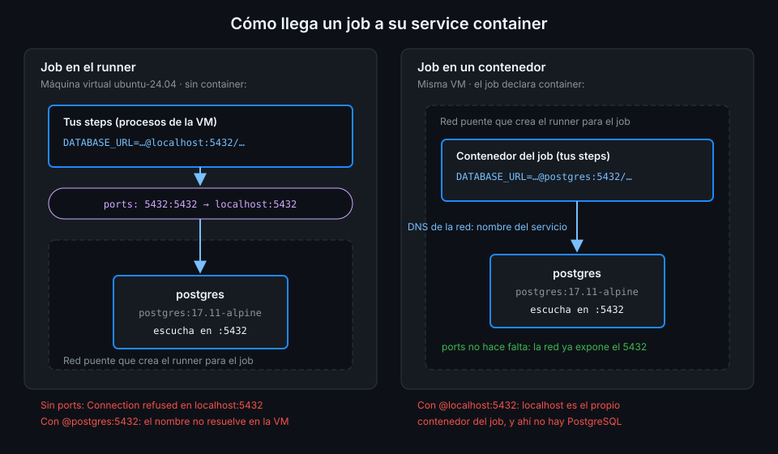

# Service containers

> Un service container es un contenedor que el runner arranca antes del primer step y borra al
> terminar el job. Es la forma de tener PostgreSQL al lado de los tests sin instalar nada, y la
> única pregunta difícil es cómo llegas a él: depende de dónde corre tu job.



## 🎯 Objetivos

Al terminar este archivo eres capaz de:

- Declarar un servicio en `jobs.<id>.services` con `image`, `env`, `ports`, `options` y
  `credentials`
- Explicar cuándo arranca y cuándo para un servicio, y qué hace el runner con la red
- Decidir entre `localhost:<puerto publicado>` y `<nombre del servicio>:5432` según el job corra
  en el runner o en `container:`
- Pedir un puerto aleatorio y leerlo del contexto `job.services`

## 1. Qué problema resuelve

En la teoría 01 arrancaste PostgreSQL con `docker run` y lo borraste a mano. En CI podrías hacer
lo mismo en un step, pero tendrías que esperar a que esté sano con un bucle, acordarte de
borrarlo aunque fallen los tests y elegir una red. Si un step anterior falla, el contenedor queda
huérfano; en un runner propio (Semana 15), para siempre.

`services:` le pasa ese trabajo al runner: crea la red, arranca cada servicio, espera a su
healthcheck antes del primer step y lo borra al final, pase lo que pase. Tú solo declaras qué
quieres.

Funciona **solo en runners Linux**: en los alojados por GitHub, con una imagen Ubuntu; en uno
propio, Linux con Docker instalado. Un job con `services:` en `windows-2025` o `macos-15` no se
puede ejecutar.

## 2. Cómo funciona

### El ciclo de vida

Cuando un job tiene `services:` (o `container:`), el log del job gana dos steps que tú no
escribiste:

1. **Initialize containers**, antes de tus steps: el runner crea una red puente de Docker para el
   job, descarga cada imagen, crea y arranca cada servicio conectado a esa red y, si el servicio
   tiene healthcheck, espera a que esté `healthy`. Si alguno no llega, el job falla aquí y tus
   steps no corren.
2. **Stop containers**, al final, siempre: imprime el log de cada servicio
   (`Print service container logs`), para y borra los contenedores y borra la red.

Cada job tiene sus propios servicios. Dos jobs con un `postgres` cada uno tienen dos bases
distintas, en dos redes distintas, y ninguna sobrevive a su job.

Sin healthcheck, el runner no tiene a qué esperar: da el servicio por listo en cuanto el
contenedor arranca y pasa al primer step, que llega antes que PostgreSQL. La teoría 04 lo cuenta
con detalle.

### Dos caminos al mismo servicio

El runner crea **una red puente definida por él**, la misma que viste en la teoría 01, y conecta
ahí todos los contenedores del job. Lo que cambia es dónde corre tu step:

| Tu job corre... | Llega al servicio por | ¿Hace falta `ports`? |
|---|---|---|
| En el runner (sin `container:`) | `localhost:<puerto publicado>` | **Sí**: si no publicas, el runner no ve el puerto |
| En un contenedor (`container:`) | `<id del servicio>:<puerto del contenedor>` | No: la red de Docker ya lo expone |

En el primer caso tus steps son procesos de la máquina virtual, fuera de la red de Docker. Igual
que tú con `-p 127.0.0.1:5433:5432`, necesitan que el puerto se **publique** en el host. En el
segundo, tu job es otro contenedor de la misma red y usa la resolución por nombre: el nombre es
la clave bajo `services:`.

### `ports`: publicar en el runner

`ports` es una lista con el formato de `-p`, `host:contenedor`:

| Valor | Qué hace |
|---|---|
| `5432:5432` | El 5432 del contenedor en el 5432 del runner |
| `5433:5432` | El 5432 del contenedor en el 5433 del runner |
| `5432` | El 5432 del contenedor en un **puerto libre aleatorio** del runner |

En un runner alojado la máquina es tuya y está vacía, así que `5432:5432` es lo normal. El puerto
aleatorio sirve cuando puede haber choque: dos servicios del mismo tipo en un job o un runner
propio con varios jobs a la vez. Docker elige el puerto y el runner lo deja en el contexto:
`job.services.<id>.ports['5432']` devuelve el puerto del host que corresponde al 5432 del
contenedor.

Si el job corre en `container:`, `ports` sobra: publicar el puerto no estorba, pero tu job no lo
usa.

### `options`, `env` y `credentials`

- **`env`**: variables **del contenedor del servicio**, no de tus steps. `POSTGRES_PASSWORD` va
  aquí; `DATABASE_URL`, que lee tu código, va en el `env:` del job o del step.
- **`options`**: flags extra que el runner pasa a `docker create`. Es donde van `--health-cmd` y
  compañía. `--network` no está soportado: la red la pone el runner.
- **`credentials`**: `username` y `password` si el registro de la imagen exige login, por ejemplo
  una imagen privada de GHCR (Semana 06). Para `postgres` de Docker Hub no hace falta.
- **`volumes`**: existe, pero en CI casi nunca lo quieres: la gracia es una base vacía por job.

### El contexto `job`

Si el job tiene contenedores, el contexto `job` gana dos claves:

| Expresión | Qué devuelve |
|---|---|
| `job.services.<id>.id` | El id del contenedor del servicio: lo que pide `docker logs` |
| `job.services.<id>.network` | El id de la red que creó el runner para el job |
| `job.services.<id>.ports` | Mapa puerto del contenedor → puerto del host |
| `job.container.id`, `job.container.network` | Lo mismo para el contenedor del job, si hay `container:` |

Sin contenedores, `job` solo tiene `status`. Como cualquier contexto, llega a `run:` por `env:`.

## 3. Cómo se usa

Tres jobs, el mismo PostgreSQL, tres formas de llegar. Ninguno necesita checkout: el runner
`ubuntu-24.04` trae el cliente de PostgreSQL, así que `pg_isready` existe en el runner, y la imagen
`postgres` lo trae dentro.

```yaml
name: services-demo

on:
  workflow_dispatch:

# Mínimo privilegio: lo verás a fondo en la Semana 12.
permissions:
  contents: read

jobs:
  on-runner:
    name: Desde el runner (localhost)
    runs-on: ubuntu-24.04
    services:
      db:
        image: postgres:17.11-alpine
        env:
          POSTGRES_USER: demo
          # Credencial desechable de CI: el contenedor muere con el job.
          POSTGRES_PASSWORD: cambiame
          POSTGRES_DB: demo
        ports:
          - 5432:5432
        options: >-
          --health-cmd "pg_isready -U demo -d demo"
          --health-interval 5s
          --health-timeout 5s
          --health-retries 10
    steps:
      - name: pg_isready contra el puerto publicado
        run: pg_isready -h localhost -p 5432 -U demo

  in-container:
    name: Desde un contenedor (nombre del servicio)
    runs-on: ubuntu-24.04
    container: postgres:17.11-alpine
    services:
      db:
        image: postgres:17.11-alpine
        env:
          POSTGRES_USER: demo
          POSTGRES_PASSWORD: cambiame
          POSTGRES_DB: demo
        options: >-
          --health-cmd "pg_isready -U demo -d demo"
          --health-interval 5s
          --health-timeout 5s
          --health-retries 10
    steps:
      - name: pg_isready contra el nombre del servicio
        run: pg_isready -h db -p 5432 -U demo

  random-port:
    name: Puerto aleatorio en el runner
    runs-on: ubuntu-24.04
    services:
      db:
        image: postgres:17.11-alpine
        env:
          POSTGRES_USER: demo
          POSTGRES_PASSWORD: cambiame
          POSTGRES_DB: demo
        ports:
          - 5432
        options: >-
          --health-cmd "pg_isready -U demo -d demo"
          --health-interval 5s
          --health-timeout 5s
          --health-retries 10
    steps:
      - name: Leer el puerto que eligió Docker
        env:
          DB_PORT: ${{ job.services.db.ports['5432'] }}
          DB_NETWORK: ${{ job.services.db.network }}
        run: |
          echo "PostgreSQL en localhost:$DB_PORT, red $DB_NETWORK"
          pg_isready -h localhost -p "$DB_PORT" -U demo
```

- `options: >-` es un bloque YAML plegado: las cuatro líneas se unen en una con espacios, que es
  lo que `docker create` espera.
- En `in-container`, `-h db` funciona porque el job y el servicio comparten red; desde
  `on-runner`, `-h db` daría `db:5432 - no response` (y `psql`, `could not translate host name`).
- En `random-port`, el puerto llega a `run:` por `env:` como cualquier dato de contexto.

## 4. Antipatrones

| Antipatrón | Por qué duele | Qué hacer en su lugar |
|---|---|---|
| Job en el runner sin `ports` | El servicio está sano, pero `localhost:5432` da `connection refused` | `ports: [5432:5432]` |
| `@postgres:5432` desde un job en el runner | El runner no resuelve nombres de la red de Docker | `localhost` y el puerto publicado |
| `@localhost:5432` desde un job con `container:` | `localhost` es el propio contenedor del job | El id del servicio |
| Servicio sin `--health-cmd` | El primer step llega antes de que la base acepte conexiones | Healthcheck en `options` |
| `docker run` de la base en un step | Sin espera, sin limpieza garantizada, huérfano si algo falla | `services:` |
| `DATABASE_URL` en el `env` del servicio | Lo lee PostgreSQL, no tu código; tus steps no la ven | `env:` del job |
| `${{ job.services.db.ports['5432'] }}` dentro de `run:` | Interpolar contexto en el shell es el hábito que la Semana 12 prohíbe | `env:` y `"$DB_PORT"` |

## 5. Trucos

- **`toJSON(job)`** en un `echo` por `env:` te enseña de una vez ids, red y puertos de todos los
  servicios del job.
- **Despliega *Initialize containers* en el log**: ahí ves la orden `docker create` exacta con tus
  `options`, el `docker pull` y la espera del healthcheck.
- **Puerto aleatorio por defecto en runners propios**: `- 5432` y leerlo del contexto evita que dos
  jobs simultáneos se peleen por el 5432 del host.

Verificado con `postgres:17.11-alpine` y ubuntu-24.04, noviembre de 2026.

## 📚 Recursos Adicionales

- [Communicating with Docker service containers](https://docs.github.com/en/actions/tutorials/use-containerized-services/use-docker-service-containers)
- [Workflow syntax: `jobs.<job_id>.services`](https://docs.github.com/en/actions/reference/workflows-and-actions/workflow-syntax#jobsjob_idservices)
- [Contexts: `job`](https://docs.github.com/en/actions/reference/workflows-and-actions/contexts#job-context)
- [Running jobs in a container](https://docs.github.com/en/actions/how-tos/write-workflows/choose-where-workflows-run/run-jobs-in-a-container)

## ✅ Checklist de Verificación

- [ ] Sé qué hacen *Initialize containers* y *Stop containers*
- [ ] Sé por qué un job en el runner necesita `ports` y uno en `container:` no
- [ ] Sé qué host usar en `DATABASE_URL` según dónde corre el job
- [ ] Sé pedir un puerto aleatorio y leerlo de `job.services.<id>.ports`
- [ ] Sé qué va en el `env` del servicio y qué en el `env` del job
- [ ] Sé que `services:` solo funciona en runners Linux

---

| ← Anterior | Siguiente → |
|:---|---:|
| [Compose, lo justo](02-compose-lo-justo.md) | [PostgreSQL 17 en CI](04-postgresql-17-en-ci.md) |
