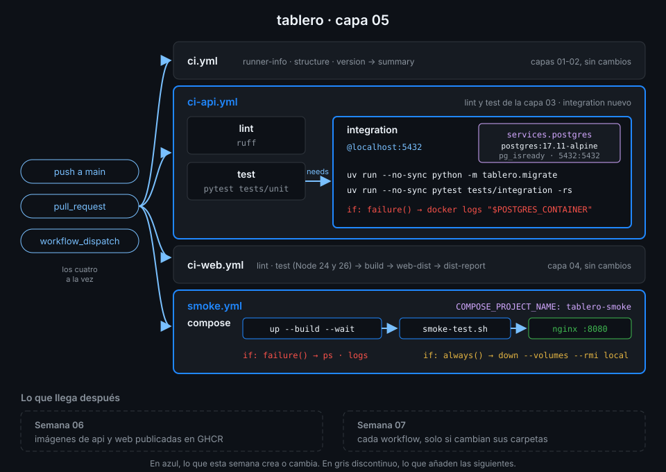

# Proyecto: capa 05 de tablero



## 🎯 Objetivo

Que el CI de `tablero` pruebe la API contra un PostgreSQL 17 de verdad y que, además, levante la
aplicación completa como la levantarías tú en local y compruebe que responde de punta a punta.

## 📦 Qué añade esta capa

`ci.yml` y `ci-web.yml` se quedan como están. Esta capa toca dos archivos:

| Archivo | Job | Qué hace | Por qué existe |
|---|---|---|---|
| `ci-api.yml` | `integration` (nuevo) | `needs: test`; PostgreSQL 17 como service container con healthcheck; migraciones y `pytest tests/integration`; logs de la base si algo falla | Lo que los tests unitarios simulan (SQL, restricciones, transacciones), aquí lo responde PostgreSQL |
| `smoke.yml` (nuevo) | `compose` | `docker compose up --build --wait`, `scripts/smoke-test.sh` a través de nginx, logs al fallar y `down` siempre | Prueba lo que ningún test de la API ve: imágenes, red entre servicios, proxy de nginx y healthchecks |

`integration` espera a `test`: si la lógica ya falla sin base, no gastas un minuto levantando
PostgreSQL. La Semana 06 publica en GHCR las imágenes que `smoke.yml` construye, y la 07 hará que
cada workflow corra solo cuando cambien sus carpetas.

## ✅ Requisitos verificables

- service-lab.yml terminó en success al menos una vez lanzado a mano
- container-lab.yml terminó en success al menos una vez lanzado a mano
- ci-api.yml y smoke.yml pasan actionlint
- ci-api.yml tiene los jobs integration, lint y test
- integration solo empieza cuando los tests unitarios han pasado
- integration levanta postgres:17.<parche>-alpine como service container
- El service de PostgreSQL tiene healthcheck con pg_isready
- El puerto 5432 del service se publica en el runner
- DATABASE_URL de integration apunta a localhost:5432, porque el job corre en el runner
- integration aplica las migraciones con uv antes de los tests
- integration ejecuta pytest sobre tests/integration
- integration vuelca los logs de PostgreSQL solo si algo falla
- smoke.yml levanta tablero con docker compose up --build --wait
- smoke.yml ejecuta scripts/smoke-test.sh contra la pila levantada
- smoke.yml apaga la pila con docker compose down aunque algo falle
- Toda uses: remota de tus workflows está fijada por SHA de 40 caracteres con el tag en comentario
- ci-api.yml terminó en success sobre el último commit de main
- smoke.yml terminó en success sobre el último commit de main

## 🎨 Criterios de calidad

Lo que `check-week.sh` no ve y la [rúbrica](../rubrica-evaluacion.md) sí puntúa:

- Un comentario dice por qué `DATABASE_URL` usa `localhost` y no `postgres`.
- La contraseña de CI está marcada como credencial desechable y no es un secreto.
- El id del contenedor llega a `docker logs` por `env:`, no interpolado en `run:`.
- `pytest` lleva `-rs`, o algo equivalente, para que un test saltado se vea en el log.
- `smoke.yml` no tiene `sleep`: confía en `--wait` y en los healthchecks de `compose.yaml`.
- Sin `TODO` en `.github/workflows/` y commits en Conventional Commits.

## 💡 Adaptación a tu dominio

| Tu proyecto | Service container | Smoke test |
|---|---|---|
| API con caché en Redis | `redis:<versión>-alpine` con `--health-cmd "redis-cli ping"` | Escribe y lee una clave a través de la API |
| Worker que consume una cola | `rabbitmq:<versión>-management-alpine` con healthcheck `rabbitmq-diagnostics ping` | Publica un mensaje y espera el efecto |
| Aplicación con varias bases | Dos services, `postgres` y `postgres-audit`, cada uno en su puerto | Compose con las dos y una petición que toque ambas |
| Búsqueda con OpenSearch | `opensearchproject/opensearch:<versión>` con `discovery.type=single-node` | Indexa un documento y búscalo |

## 🚦 Cómo entregarlo

1. Copia los dos starters y completa los `TODO 1` a `TODO 8`:

   ```bash
   cd ~/code/tablero
   cp ~/code/bc-github-actions/bootcamp/week-05-service_containers_y_postgresql/3-proyecto/starter/.github/workflows/{ci-api.yml,smoke.yml} .github/workflows/
   actionlint .github/workflows/ci-api.yml .github/workflows/smoke.yml
   # (sin salida: no hay errores)
   ```

2. Súbelo a `main` y espera a los runs de **tu** commit:

   ```bash
   git add .github/workflows/ci-api.yml .github/workflows/smoke.yml
   git commit -m "ci: add postgres integration job and compose smoke test"
   git push
   for wf in ci-api.yml smoke.yml; do
     id=$(gh run list --workflow "$wf" --commit "$(git rev-parse HEAD)" --json databaseId --jq '.[0].databaseId')
     gh run watch "$id" --exit-status
   done
   # ✓ main ci-api · ...
   # ✓ main smoke · ...
   ```

3. Lanza la verificación:

   ```bash
   cd ~/code/bc-github-actions
   ./scripts/check-week.sh 05
   # 18/18 comprobaciones superadas.
   ```

## 🧯 Errores comunes

| Síntoma | Causa | Solución |
|---|---|---|
| `connection refused` en el primer test | Sin `--health-cmd`, el runner no espera a que PostgreSQL acepte conexiones | Añade `options` con `pg_isready` y reintentos |
| `could not translate host name "postgres"` | El job corre en el runner, no en un contenedor: el nombre del servicio no resuelve | `localhost:5432` y `ports: - 5432:5432` |
| `integration` falla con `1 skipped` y código 5 | `DATABASE_URL` no llegó al proceso de pytest y el módulo entero se saltó | Defínela en el `env:` del job; `-rs` muestra el motivo del salto |
| `relation "tasks" does not exist` | Los tests corren antes que las migraciones | Step de `python -m tablero.migrate` antes de pytest |
| `smoke.yml` falla en `up` con `dependency failed to start` | Un servicio no llegó a `healthy` | El step de logs con `if: failure()` dice cuál y por qué |
| `Permission denied` en `scripts/smoke-test.sh` | El script perdió el bit de ejecución al copiarlo | `git update-index --chmod=+x scripts/smoke-test.sh`, commit y push |

## 🔗 Navegación

---

| ← Anterior | Siguiente → |
|:---|---:|
| [Smoke test con Compose](../2-practicas/04-smoke-con-compose.md) | [Rúbrica de evaluación](../rubrica-evaluacion.md) |
