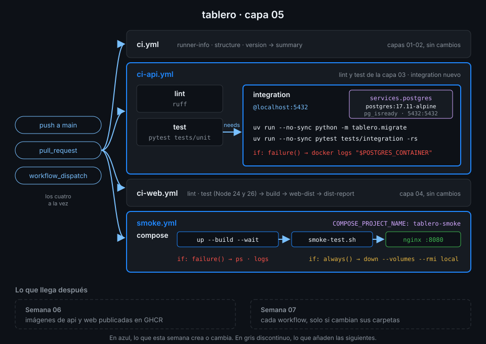

# Semana 05 — Service containers y PostgreSQL

> Los tests unitarios dicen que tu código hace lo que crees; los de integración, que PostgreSQL
> está de acuerdo. Esta semana el CI levanta una base de datos real junto a cada job y, al final,
> la pila entera de `tablero` con Docker Compose.

## 🎯 Objetivos de la Semana

Al terminar la semana eres capaz de:

- Explicar imagen, contenedor, puerto publicado, volumen, red y healthcheck lo justo para leer
  cualquier `compose.yaml` y cualquier bloque `services:`
- Levantar `tablero` en local con `docker compose up --build --wait` y apagarlo sin dejar restos
- Añadir un service container de PostgreSQL 17 a un job y saber por qué se llega por `localhost`
  desde el runner y por el nombre del servicio desde un job en contenedor
- Hacer que el job espere a que la base esté sana con `--health-cmd pg_isready`
- Separar tests unitarios y de integración en jobs distintos, y detectar unos tests de integración
  que "pasan" porque se saltaron
- Ejecutar un smoke test de punta a punta con Compose en el runner y apagarlo pase lo que pase
- Depurar un servicio que no arranca: el step *Initialize containers*, `docker logs` con el id del
  contexto `job.services` y `if: failure()`

## 📋 Prerrequisitos

| Necesitas | Dónde se aprende |
|---|---|
| `check-week.sh 04` en 18/18 | [Semana 04](../week-04-ci_de_frontend_pnpm_matrices_y_artefactos/README.md) |
| `ci-api.yml` con `lint` y `test` (capa 03) | [Semana 03, proyecto](../week-03-ci_de_python_con_uv/3-proyecto/README.md) |
| Funciones de estado: `failure()`, `always()`, `!cancelled()` | [Semana 02, teoría 03](../week-02-expresiones_contextos_y_flujo_de_datos/1-teoria/03-condiciones-y-funciones-de-estado.md) |
| Docker Engine y el plugin Compose en tu máquina | [`docs/setup-entorno.md`](../../docs/setup-entorno.md), apartado 6 |

No hace falta saber Docker: la teoría 01 y 02 cuentan lo justo para esta semana. Las imágenes
propias, sus `Dockerfile` y su publicación llegan en la Semana 06.

## 🗂️ Estructura de la Semana

```
week-05-service_containers_y_postgresql/
├── README.md
├── rubrica-evaluacion.md
├── checks.json                    18 comprobaciones
├── 0-assets/                      4 diagramas SVG
├── 1-teoria/                      7 archivos, uno por concepto
├── 2-practicas/                   4 prácticas guiadas
├── 3-proyecto/
│   ├── README.md
│   └── starter/.github/workflows/{ci-api.yml,smoke.yml}
├── 4-recursos/{ebooks-free,videografia,webgrafia}/README.md
└── 5-glosario/README.md
```

## 📝 Contenidos

### Teoría

| # | Archivo | Qué aprendes | Tiempo |
|:--:|---|---|:--:|
| 01 | [Contenedores, lo justo](1-teoria/01-contenedores-lo-justo.md) | Imagen, contenedor, puertos, volúmenes, redes y healthcheck | 30 min |
| 02 | [Compose, lo justo](1-teoria/02-compose-lo-justo.md) | El `compose.yaml` de `tablero`, `depends_on` con `service_healthy`, `--wait` y `down` | 25 min |
| 03 | [Service containers](1-teoria/03-service-containers.md) | `services:` en un job, su red, `ports`, `options` y el contexto `job.services` | 30 min |
| 04 | [PostgreSQL 17 en CI](1-teoria/04-postgresql-17-en-ci.md) | Imagen con parche, variables `POSTGRES_*`, `pg_isready`, credencial desechable y migraciones | 25 min |
| 05 | [Tests de integración](1-teoria/05-tests-de-integracion.md) | Qué prueba cada nivel, aislamiento entre tests y el falso verde de un test saltado | 25 min |
| 06 | [Compose en CI](1-teoria/06-compose-en-ci.md) | Docker en `ubuntu-24.04`, `up --build --wait`, smoke test y limpieza con `always()` | 25 min |
| 07 | [Depurar servicios](1-teoria/07-depurar-servicios.md) | *Initialize containers*, `docker logs`, `connection refused` y servicios que nunca están sanos | 20 min |

### Prácticas

| # | Archivo | Qué haces | Tiempo |
|:--:|---|---|:--:|
| 01 | [Docker y Compose en local](2-practicas/01-docker-y-compose-en-local.md) | PostgreSQL suelto, después `tablero` entero con Compose | 1 h |
| 02 | [PostgreSQL como service](2-practicas/02-postgresql-como-service.md) | `service-lab.yml`: un job contra PostgreSQL 17, con y sin healthcheck | 1 h |
| 03 | [Job en contenedor frente a runner](2-practicas/03-job-en-contenedor-frente-a-runner.md) | `container-lab.yml`: el mismo servicio visto desde el runner y desde `container:` | 1 h |
| 04 | [Smoke test con Compose](2-practicas/04-smoke-con-compose.md) | La pila completa en el runner, logs al fallar y limpieza garantizada | 1 h |

### Proyecto

[Capa 05 de `tablero`](3-proyecto/README.md): `ci-api.yml` gana el job `integration`, que corre
`tests/integration` contra PostgreSQL 17 como service container, y un workflow nuevo, `smoke.yml`,
levanta la pila con Compose y la prueba a través de nginx.



## ⏱️ Distribución del Tiempo (10 horas)

| Actividad | Horas |
|---|:--:|
| Teoría (7 archivos) | 3 |
| Práctica 01 — Docker y Compose en local | 1 |
| Práctica 02 — PostgreSQL como service | 1 |
| Práctica 03 — Job en contenedor frente a runner | 1 |
| Práctica 04 — Smoke test con Compose | 1 |
| Proyecto — capa 05 | 2 |
| Autoevaluación con la rúbrica | 1 |
| **Total** | **10** |

## 🎩 Trucos y atajos

- **`docker logs "$POSTGRES_CONTAINER"`**, con `POSTGRES_CONTAINER: ${{ job.services.postgres.id }}`
  en el `env:` del step y `if: failure()`, pone el log de la base justo debajo del step que falló.
  El runner también lo imprime en *Stop containers*, pero al final del job, lejos del error.
- **`pytest -rs`** lista los tests saltados con su motivo. Los de integración de `tablero` se
  saltan si falta `DATABASE_URL`: `pytest tests/integration` sale entonces con código 5 y
  `1 skipped`, pero un `pytest` sobre todo el proyecto sale en verde sin que nada lo avise.
- **`docker compose up --wait` ya espera y ya falla**: sale con error si un servicio no llega a
  `healthy`. Un bucle de `sleep` y `curl` delante del smoke test sobra.
- **`COMPOSE_PROJECT_NAME`** en el `env:` del job da a la pila un nombre propio. Así `down` borra
  solo lo que levantó ese job, también en un runner propio compartido (Semana 15).
- **`healthy` no es `migrado`**: `pg_isready` dice que PostgreSQL acepta conexiones, no que tu
  esquema exista. Las migraciones son un step aparte, antes de los tests.

## 📌 Entregables

- `service-lab.yml` y `container-lab.yml` en `.github/workflows/`, cada uno en verde lanzado a mano
- `ci-api.yml` con el job `integration` y `smoke.yml` nuevo, los dos en verde sobre el último
  commit de `main` (ver [proyecto](3-proyecto/README.md))
- La rúbrica respondida

## ✅ Verificación

```bash
cd ~/code/bc-github-actions
./scripts/check-week.sh 05
# Semana 05 — Service containers y PostgreSQL  [repo: <tu-org>/tablero]
#
#   ✅ service-lab.yml terminó en success al menos una vez lanzado a mano
#   ...
# 18/18 comprobaciones superadas.
```

Si algo sale en rojo, la pista te dice qué práctica y qué paso lo arreglan.

## 🔗 Navegación

---

| ← Anterior | Siguiente → |
|:---|---:|
| [Semana 04 — CI de frontend con pnpm, matrices y artefactos](../week-04-ci_de_frontend_pnpm_matrices_y_artefactos/README.md) | [Contenedores, lo justo](1-teoria/01-contenedores-lo-justo.md) |
