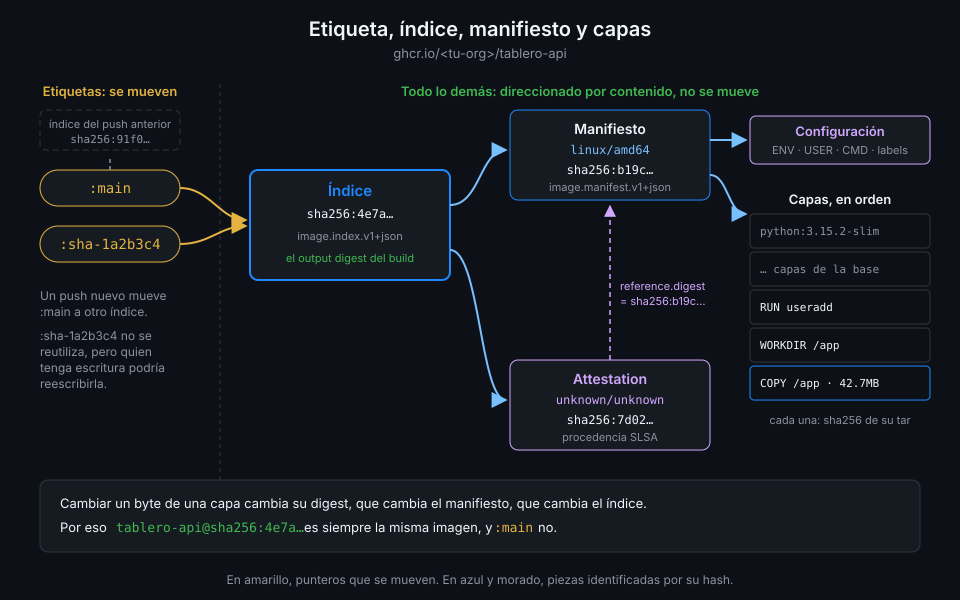

# Imágenes, capas y registros

> Esta semana `tablero` deja de construir imágenes para tirarlas y empieza a guardarlas. Para
> guardarlas bien necesitas saber de qué está hecha una imagen, qué guarda un registro y por qué
> una etiqueta se puede mover y un digest no.



## 🎯 Objetivos

Al terminar este archivo eres capaz de:

- Explicar qué es una capa, una configuración, un manifiesto y un índice, y cómo se enlazan
- Distinguir una etiqueta (un nombre que se mueve) de un digest (un hash que no se mueve)
- Leer un nombre de imagen completo: registro, repositorio, etiqueta y digest
- Describir qué pasa en un `docker pull` y por qué solo baja las capas que te faltan
- Inspeccionar una imagen local y una publicada sin descargarla

## 1. Qué problema resuelve

En la Semana 05, `smoke.yml` construye las imágenes de `tablero`, levanta la pila, la prueba y la
borra. Lo que se probó desaparece con el runner. Si mañana quieres desplegar "lo que pasó el smoke
test", no hay nada que desplegar: tendrías que reconstruir, y un build de mañana no es el build de
hoy. La imagen base pudo recibir un parche, una dependencia pudo cambiar de rueda o de tarball, y
el resultado ya no es el mismo artefacto aunque el commit sí lo sea.

Hace falta un sitio donde guardar la imagen construida, un nombre para encontrarla y un
identificador que garantice que lo que descargas es, byte a byte, lo que se probó. Ese sitio es un
**registro**; el nombre, una **etiqueta**; el identificador, un **digest**.

## 2. Cómo funciona

### Capas

Una **capa** es un archivo `tar` comprimido con los cambios que una instrucción del `Dockerfile`
hizo en el sistema de archivos: los archivos que añadió, los que modificó y marcas de los que
borró. `RUN uv sync` produce una capa con el `.venv`; `COPY src ./src` produce otra con el código.
Las instrucciones que solo cambian metadatos (`ENV`, `EXPOSE`, `CMD`, `USER`) no producen capa:
van a la configuración.

Cada capa se identifica por el `sha256` de su contenido. Dos imágenes que parten de
`python:3.15.2-slim-trixie` comparten exactamente las mismas capas base, con el mismo hash: el
registro las guarda una vez y tu máquina las descarga una vez.

### Configuración

La **configuración** es un JSON con todo lo que no es sistema de archivos: variables de entorno,
usuario, directorio de trabajo, orden de arranque, puertos expuestos, labels, plataforma y la
lista ordenada de capas (`rootfs.diff_ids`). También se identifica por su `sha256`.

### Manifiesto

El **manifiesto** es otro JSON, pequeño, que dice "esta imagen es esta configuración más estas
capas, en este orden", citando cada pieza por su digest y su tamaño. Es la imagen para **una**
plataforma, por ejemplo `linux/amd64`. Su tipo es `application/vnd.oci.image.manifest.v1+json`.

### Índice

El **índice** es una lista de manifiestos: uno por plataforma (`linux/amd64`, `linux/arm64`...) y,
desde que BuildKit genera procedencia, uno más con la **attestation**: un documento firmable que
cuenta cómo se construyó la imagen. Ese manifiesto extra no es ejecutable y aparece con plataforma
`unknown/unknown`. Su tipo es `application/vnd.oci.image.index.v1+json`. Cuando haces `docker pull`
desde un Mac con ARM y desde un runner `ubuntu-24.04`, los dos piden el mismo nombre y el índice
le da a cada uno el manifiesto de su arquitectura.

### Digest

Un **digest** es `sha256:` seguido del hash de los bytes exactos de un manifiesto o de un índice.
Como cada manifiesto cita sus piezas por hash, el digest del índice fija la imagen entera: cambiar
un solo byte de una capa cambia el hash de la capa, que cambia el manifiesto, que cambia el índice.
Un digest es **direccionamiento por contenido**: no se le asigna a una imagen, se calcula de ella.
No se puede mover porque no es un puntero: es la imagen.

### Etiqueta

Una **etiqueta** (tag) es un nombre legible que el registro asocia a un digest: `main`,
`sha-1a2b3c4`, `17.11-alpine`. Es un puntero, y quien tiene permiso de escritura lo puede mover a
otro digest con un `push`. `tablero-api:main` apuntará a una imagen distinta con cada commit de
`main`, y eso es justo lo que quieres de una etiqueta así. Lo que no quieres es desplegar por ella.

| Pieza | Qué es | Se identifica por | ¿Cambia sin que cambie el contenido? |
|---|---|---|---|
| Capa | `tar` con los cambios de una instrucción | Digest de su contenido | No |
| Configuración | JSON con entorno, usuario, orden y capas | Digest | No |
| Manifiesto | Configuración + capas de una plataforma | Digest | No |
| Índice | Manifiestos por plataforma + attestation | Digest | No |
| Etiqueta | Nombre que apunta a un digest | Su texto | **Sí**: se mueve con cada `push` |

### Registros y nombres

Un **registro** es un servidor HTTP que guarda dos cosas: **blobs** (capas y configuraciones,
direccionados por digest) y **manifiestos** (por digest o por etiqueta). Todos hablan la misma API,
la [OCI Distribution Spec](https://github.com/opencontainers/distribution-spec): Docker Hub, GHCR,
el registro de tu nube o uno local. Dentro de un registro, un **repositorio** agrupa las versiones
de una imagen.

Un nombre completo se lee así:

| Trozo | En `ghcr.io/<tu-org>/tablero-api:main` |
|---|---|
| Registro | `ghcr.io` |
| Repositorio | `<tu-org>/tablero-api` |
| Etiqueta | `main` |
| Digest (alternativa a la etiqueta) | `@sha256:…` |

Sin registro delante, Docker asume Docker Hub: `postgres:17.11-alpine` es en realidad
`docker.io/library/postgres:17.11-alpine`. Los nombres de repositorio van **en minúsculas**; si tu
organización tiene mayúsculas, la teoría 05 cuenta cómo lo resuelve `metadata-action`.

### Qué pasa en un `docker pull`

1. Docker pide al registro el manifiesto de la etiqueta y recibe el índice.
2. Elige el manifiesto de su plataforma.
3. Lee la lista de capas y descarga **solo los blobs que no tiene ya**.
4. Monta las capas en orden y deja la imagen lista.

El paso 3 es la razón de que el orden de las instrucciones importe tanto (teoría 02): si las capas
pesadas no cambian entre versiones, un `pull` de la versión nueva baja unos pocos megas.

## 3. Cómo se usa

### Mirar las capas de una imagen local

Con las imágenes de la Semana 05 construidas en tu máquina (o tras la práctica 01):

```bash
cd ~/code/tablero
docker build -q -t tablero-api:dev api
docker image inspect tablero-api:dev --format '{{len .RootFS.Layers}} capas'
# 7 capas
docker history tablero-api:dev --format '{{.Size}}\t{{.CreatedBy}}' | head -4
# 0B      CMD ["sh" "-c" "python -m tablero.migrate &&…
# 0B      EXPOSE [8000/tcp]
# 0B      USER 10001
# 42.7MB  COPY --chown=10001:10001 /app /app # buildkit
```

El número de capas depende de la imagen base; lo que importa es ver que `CMD`, `EXPOSE` y `USER`
pesan `0B`: son configuración, no capa.

### Mirar una imagen publicada sin descargarla

`docker buildx imagetools inspect` lee el índice y sus manifiestos directamente del registro. No
baja ninguna capa:

```bash
docker buildx imagetools inspect ghcr.io/<tu-org>/tablero-api:main
# Name:      ghcr.io/<tu-org>/tablero-api:main
# MediaType: application/vnd.oci.image.index.v1+json
# Digest:    sha256:4e7a…
#
# Manifests:
#   Name:        ghcr.io/<tu-org>/tablero-api:main@sha256:b19c…
#   MediaType:   application/vnd.oci.image.manifest.v1+json
#   Platform:    linux/amd64
#
#   Name:        ghcr.io/<tu-org>/tablero-api:main@sha256:7d02…
#   MediaType:   application/vnd.oci.image.manifest.v1+json
#   Platform:    unknown/unknown
#   Annotations:
#     vnd.docker.reference.digest: sha256:b19c…
#     vnd.docker.reference.type:   attestation-manifest
```

Tres digests distintos y cada uno identifica algo diferente: el del índice (el que usarás para
desplegar), el del manifiesto `linux/amd64` y el de la attestation, que apunta con
`vnd.docker.reference.digest` al manifiesto que describe.

### Hablar con la API del registro

Es la misma petición que hacen los checks `ghcr-*-public` de esta semana. GHCR entrega un token
anónimo de lectura para paquetes públicos:

```bash
org=<tu-org>
token=$(curl -fsS "https://ghcr.io/token?scope=repository:$org/tablero-api:pull" | jq -r .token)
curl -fsS -H "Authorization: Bearer $token" \
  -H 'Accept: application/vnd.oci.image.index.v1+json' \
  "https://ghcr.io/v2/$org/tablero-api/manifests/main" | jq -r '.manifests[].platform | "\(.os)/\(.architecture)"'
# linux/amd64
# unknown/unknown
```

`/v2/<repositorio>/manifests/<etiqueta o digest>` es la ruta de los manifiestos;
`/v2/<repositorio>/blobs/<digest>`, la de las capas. Todo lo que hace `docker pull` son peticiones
como esta.

### Descargar por digest

```bash
docker pull ghcr.io/<tu-org>/tablero-api@sha256:4e7a…
# ghcr.io/<tu-org>/tablero-api@sha256:4e7a…: Pulling from <tu-org>/tablero-api
# Digest: sha256:4e7a…
```

Por etiqueta, mañana bajarías otra cosa. Por digest, bajas exactamente esto o nada. La teoría 08
cuenta de dónde sacar el digest de lo que publica tu workflow.

## 4. Antipatrones

| Antipatrón | Por qué duele | Qué hacer en su lugar |
|---|---|---|
| Desplegar por una etiqueta como `main` | Entre el test y el despliegue alguien pudo mover la etiqueta | Desplegar por digest (teoría 08 y Semana 17) |
| Publicar con `latest` | Nadie sabe qué commit es; cada `push` lo mueve en silencio | Etiquetas con el SHA del commit (teoría 05) |
| Creer que dos builds del mismo commit dan la misma imagen | Cambian la base, las fechas, las dependencias resueltas | Construir una vez, guardar y reutilizar por digest |
| Descargar una imagen entera para ver su plataforma | Minutos y gigas para leer un JSON | `docker buildx imagetools inspect` |
| Tomar `unknown/unknown` por una imagen rota | Es el manifiesto de la attestation de procedencia | Leer sus anotaciones con `imagetools inspect` |
| Nombres de repositorio con mayúsculas | El registro los rechaza: `repository name must be lowercase` | Minúsculas, o dejar que `metadata-action` las calcule |

## 5. Trucos

- **`docker buildx imagetools inspect <imagen> --raw`** imprime el JSON del índice tal cual lo
  guarda el registro. Pásalo por `jq` para ver los tamaños de cada manifiesto.
- **`docker image ls --digests`** añade la columna del digest. Con el almacén de imágenes de
  containerd (el de Docker Engine 29 en esta máquina: `docker info` dice
  `io.containerd.snapshotter.v1`), el `IMAGE ID` es el principio de ese mismo digest.
- **`docker history --no-trunc`** enseña la instrucción completa que creó cada capa. Es la forma
  rápida de saber qué capa pesa 300 MB y por qué.

Verificado con Docker Engine 29.9.2, buildx v0.38.1 y GHCR, noviembre de 2026.

## 📚 Recursos Adicionales

- [OCI Image Format Specification](https://github.com/opencontainers/image-spec)
- [OCI Distribution Specification](https://github.com/opencontainers/distribution-spec)
- [Docker: Image attestation storage](https://docs.docker.com/build/metadata/attestations/attestation-storage/)
- [Docker: `docker buildx imagetools inspect`](https://docs.docker.com/reference/cli/docker/buildx/imagetools/inspect/)

## ✅ Checklist de Verificación

- [ ] Sé qué es una capa y qué instrucciones del `Dockerfile` no producen ninguna
- [ ] Sé qué hay en una configuración, un manifiesto y un índice, y cómo se citan entre sí
- [ ] Sé por qué un digest no se puede mover y una etiqueta sí
- [ ] Sé leer registro, repositorio, etiqueta y digest en un nombre completo
- [ ] Sé qué es la entrada `unknown/unknown` de un índice
- [ ] Sé inspeccionar una imagen publicada sin descargarla

---

| ← Anterior | Siguiente → |
|:---|---:|
| [Semana 06 — Imágenes Docker y GHCR](../README.md) | [Dockerfile multi-stage y contexto](02-dockerfile-multi-stage-y-contexto.md) |
