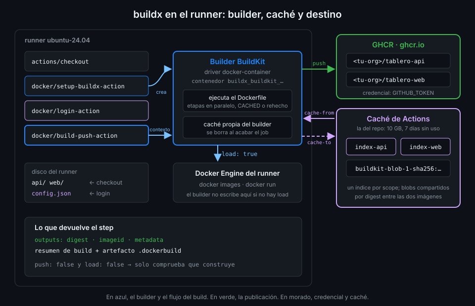

# BuildKit y buildx

> `docker build` funciona en el runner, pero no te deja elegir dónde va la imagen, no guarda capas
> entre ejecuciones y no cuenta qué hizo. Dos actions de Docker cubren eso: una crea un builder,
> la otra construye con él.



## 🎯 Objetivos

Al terminar este archivo eres capaz de:

- Distinguir BuildKit (el motor), buildx (el cliente) y un builder (una instancia del motor)
- Explicar qué hace `setup-buildx-action` y por qué su driver por defecto es `docker-container`
- Elegir entre `push`, `load` y ninguno de los dos en `build-push-action`
- Saber cuándo `build-push-action` usa Git context y cuándo el checkout
- Encontrar el resumen de build y el artefacto `.dockerbuild` de un run

## 1. Qué problema resuelve

En la Semana 05, `smoke.yml` construye con `docker compose up --build`. La imagen queda en el
Docker del runner y muere con él. Para esta semana necesitas tres cosas que eso no da:

- **Decidir el destino**: a veces quieres publicar en GHCR, a veces cargar la imagen para
  probarla en el runner y a veces solo comprobar que construye.
- **Caché de capas entre runs**: cada job empieza en una máquina limpia; sin exportar la caché a
  algún sitio, cada build parte de cero (teoría 06).
- **Saber qué pasó**: cuántos pasos salieron de caché, cuánto tardó cada uno, qué digest salió.

## 2. Cómo funciona

### Tres piezas

| Pieza | Qué es |
|---|---|
| **BuildKit** | El motor que ejecuta el `Dockerfile`: resuelve etapas en paralelo, cachea capas y exporta el resultado |
| **buildx** | El plugin de la CLI (`docker buildx`) que habla con BuildKit. `docker build` es hoy un alias de `docker buildx build` |
| **Builder** | Una instancia de BuildKit con un **driver** que dice dónde corre |

Los drivers que importan aquí:

| Driver | Dónde corre BuildKit | Consecuencia |
|---|---|---|
| `docker` | Dentro del propio Docker Engine | La imagen aparece directamente en `docker images`. Los backends de caché externos y el multiplataforma dependen de cómo esté configurado el Engine |
| `docker-container` | En un contenedor aparte, `buildx_buildkit_<nombre>0` | Admite todos los backends de caché, multiplataforma y exportadores. La imagen **no** aparece en `docker images` salvo que la cargues |

El builder `default` de tu máquina usa el driver `docker` (`docker buildx ls` lo enseña). En el
runner, la action te da otro.

### `docker/setup-buildx-action`

Crea un builder nuevo con el driver `docker-container` (su valor por defecto) y lo marca como el
builder en uso (`use: true` por defecto). A partir de ese step, todo `docker buildx build` y todo
`build-push-action` del job lo usa. Al terminar el job, un post-step lo borra (`cleanup: true` por
defecto). No necesita inputs para el caso de `tablero`:

```yaml
      - uses: docker/setup-buildx-action@f87e5991a6d7451dcb8d9637bfbc97413f497069 # v4.4.1
```

La ventaja frente al driver `docker` del runner es que el builder sabe exportar caché a `type=gha`
sin depender de cómo esté configurado el Docker Engine de la imagen `ubuntu-24.04`.

### `docker/build-push-action`

Ejecuta `docker buildx build` con lo que le pases en `with:`. Los inputs que usa esta semana:

| Input | Por defecto | Para qué |
|---|---|---|
| `context` | Git context | Ruta del contexto; con ella usa el checkout |
| `file` | `{context}/Dockerfile` | Otro `Dockerfile` |
| `push` | `false` | Sube la imagen y sus etiquetas al registro |
| `load` | `false` | Carga la imagen en el Docker del runner |
| `tags` | | Etiquetas, una por línea (teoría 05) |
| `labels` | | Labels OCI (teoría 05) |
| `cache-from`, `cache-to` | | Backends de caché (teoría 06) |
| `provenance` | | Controla la attestation de procedencia (teoría 08) |

Y sus outputs: `digest` (el digest de lo construido), `imageid` (el id de la configuración) y
`metadata` (un JSON con todo lo que devolvió BuildKit).

### `push`, `load` o ninguno

| `push` | `load` | Dónde queda la imagen | Cuándo |
|:--:|:--:|---|---|
| `false` | `false` | Solo en la caché del builder, que se borra al acabar | Comprobar que construye: un PR (teoría 07) |
| `false` | `true` | En `docker images` del runner | Probarla en el mismo job con `docker run` |
| `true` | `false` | En el registro, con sus etiquetas | Publicar desde `main` |

Con `push: false` y `load: false` el build se ejecuta entero: si un `RUN` falla, el step falla. Lo
único que no pasa es exportar el resultado. Por eso un PR puede "construir sin publicar" sin
gastar tiempo en subir nada.

### Git context frente a path context

Si no pasas `context`, la action usa **Git context**: le da a BuildKit la URL
`https://github.com/<owner>/<repo>.git#<ref>` del evento y BuildKit clona el repo por su cuenta,
autenticado con el `GITHUB_TOKEN` del job. No hace falta `actions/checkout`. Para una subcarpeta,
`context: "{{defaultContext}}:api"`.

Con `context: api`, la action usa **path context**: los archivos que hay en el disco del runner,
así que necesitas `actions/checkout` antes. `images.yml` usa esta forma porque es la que lees igual
en local (`docker build api`) y porque lo que construye es exactamente lo que el job ve.

### El resumen de build

Al terminar, `build-push-action` escribe en el resumen del run una tabla con el build: duración,
pasos, cuántos salieron de caché, el `Dockerfile` usado y los errores si los hubo. Además sube un
artefacto con extensión `.dockerbuild` con el **build record**, que Docker Desktop importa
para ver el build paso a paso.

| Variable de entorno del step | Por defecto | Efecto |
|---|---|---|
| `DOCKER_BUILD_SUMMARY` | `true` | `false` quita el resumen |
| `DOCKER_BUILD_RECORD_UPLOAD` | `true` | `false` no sube el artefacto `.dockerbuild` |

Si en el mismo workflow usas `actions/download-artifact` sin `name` ni `pattern`, también bajará
esos artefactos y fallará al tratarlos: filtra con `pattern: "!*.dockerbuild"`.

## 3. Cómo se usa

Un workflow que construye la web, la carga en el runner y comprueba que nginx responde, sin
publicar nada:

```yaml
name: web-image-check

on:
  pull_request:
  workflow_dispatch:

# Mínimo privilegio: lo verás a fondo en la Semana 12.
permissions:
  contents: read

jobs:
  web:
    name: Imagen de la web, cargada y probada
    runs-on: ubuntu-24.04
    steps:
      - uses: actions/checkout@3d3c42e5aac5ba805825da76410c181273ba90b1 # v7.0.1
        with:
          persist-credentials: false

      - uses: docker/setup-buildx-action@f87e5991a6d7451dcb8d9637bfbc97413f497069 # v4.4.1

      - name: Construir y cargar en el Docker del runner
        id: build
        uses: docker/build-push-action@c3c9e263c25d99ce0380d002d59b67737d91b0dc # v7.4.0
        with:
          context: web
          load: true
          tags: tablero-web:ci

      - name: Arrancar y pedir la portada
        # nginx.conf cita el host "api" en proxy_pass y nginx no arranca si no lo resuelve:
        # --add-host le da una dirección aunque la API no exista en este job.
        run: |
          docker run -d --name web --add-host api:127.0.0.1 -p 127.0.0.1:8080:8080 tablero-web:ci
          curl -fsS --retry 10 --retry-connrefused --retry-delay 1 \
            -o /dev/null -w '%{http_code}\n' http://127.0.0.1:8080/

      - name: Id de la imagen en el resumen
        env:
          IMAGE_ID: ${{ steps.build.outputs.imageid }}
        run: echo "tablero-web:ci → \`$IMAGE_ID\`" >> "$GITHUB_STEP_SUMMARY"
```

Fíjate en tres cosas:

- **`load: true`** es lo que hace que `docker run tablero-web:ci` encuentre la imagen. Sin él, la
  imagen se queda dentro del contenedor del builder y `docker run` intenta descargarla de Docker
  Hub.
- **`tablero-web:ci`** no lleva registro: es un nombre local que nunca sale del runner. No tiene que
  ver con la regla de "nunca `latest`", que habla de lo que publicas y de lo que consumes.
- **El output** entra al shell por `env:`, como cualquier dato de un step anterior.

### Lo mismo en local

```bash
docker buildx create --name lab --driver docker-container --use
docker buildx build --load -t tablero-web:dev web
docker buildx ls | grep -E '^(lab|default)'
# lab*       docker-container
# default    docker
docker buildx rm lab
```

Es lo que hace `setup-buildx-action` en el runner. La práctica 01 lo recorre con la caché local.

## 4. Antipatrones

| Antipatrón | Por qué duele | Qué hacer en su lugar |
|---|---|---|
| `run: docker build ... && docker push ...` | Sin resumen, sin caché exportable, sin digest como output | `setup-buildx-action` + `build-push-action` |
| `load: true` "por si acaso" en el job que publica | Exporta la imagen dos veces: más tiempo para nada | `load` solo si un step posterior hace `docker run` |
| `docker run` tras un build sin `load` | La imagen no está en el Docker del runner: intenta bajarla de Docker Hub | `load: true` |
| Git context con archivos generados en un step anterior | BuildKit clona el commit: no ve lo que el job creó en disco | `context: <ruta>` tras el checkout |
| Olvidar `setup-buildx-action` y usar `cache-to: type=gha` | El builder por defecto puede no saber exportar esa caché y el step falla | `setup-buildx-action` antes del build |
| `sleep` largo esperando a nginx | Lento y frágil | Un healthcheck, como en la Semana 05, o reintentos de `curl` |

## 5. Trucos

- **`docker buildx du`** enseña cuánto ocupa la caché del builder en uso, y
  `docker buildx prune --filter until=24h` la recorta. En local, el builder `lab` crece rápido.
- **`docker buildx history ls`** lista los últimos builds del builder con su estado y duración;
  `docker buildx history inspect` da el detalle de uno. Es lo mismo que guarda el artefacto
  `.dockerbuild`.
- **El step del build se plega en el log** en grupos por paso de BuildKit: busca `CACHED` con el
  buscador del log de Actions para ver de un vistazo qué se reutilizó.

Verificado con docker/setup-buildx-action@v4.4.1, docker/build-push-action@v7.4.0 y
ubuntu-24.04, noviembre 2026.

## 📚 Recursos Adicionales

- [Docker: Builders y drivers](https://docs.docker.com/build/builders/drivers/)
- [docker/setup-buildx-action](https://github.com/docker/setup-buildx-action)
- [docker/build-push-action](https://github.com/docker/build-push-action)
- [Docker: GitHub Actions build summary](https://docs.docker.com/build/ci/github-actions/build-summary/)

## ✅ Checklist de Verificación

- [ ] Sé distinguir BuildKit, buildx y un builder
- [ ] Sé qué crea `setup-buildx-action` y con qué driver
- [ ] Sé dónde queda la imagen con cada combinación de `push` y `load`
- [ ] Sé cuándo `build-push-action` necesita `actions/checkout`
- [ ] Sé encontrar el resumen de build y desactivarlo si no lo quiero
- [ ] Sé por qué la web necesita `--add-host api:…` para arrancar sola

---

| ← Anterior | Siguiente → |
|:---|---:|
| [Dockerfile multi-stage y contexto](02-dockerfile-multi-stage-y-contexto.md) | [GHCR y el GITHUB_TOKEN](04-ghcr-y-github-token.md) |
