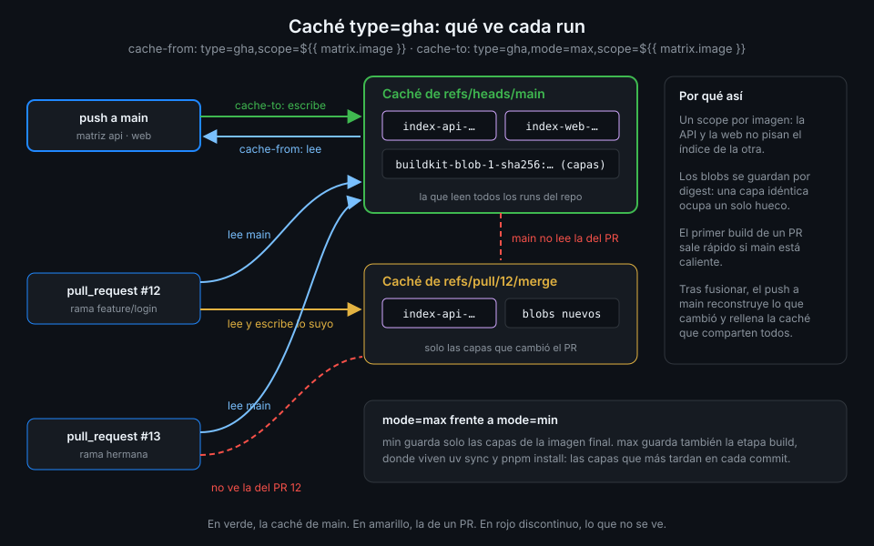

# Caché de capas type=gha

> En tu máquina, el segundo `docker build` tarda segundos porque las capas siguen ahí. En Actions
> cada job empieza en un runner vacío y el segundo build tarda lo mismo que el primero. La caché
> `type=gha` guarda las capas en la caché de Actions y se las devuelve a BuildKit en el run
> siguiente.



## 🎯 Objetivos

Al terminar este archivo eres capaz de:

- Explicar qué guardan `cache-to` y qué leen `cache-from` con el backend `type=gha`
- Explicar por qué cada imagen necesita su propio `scope`
- Elegir entre `mode=min` y `mode=max` en un `Dockerfile` multi-stage
- Saber qué caché ve un run de `main` y qué caché ve un pull request
- Medir si la caché funciona y encontrar sus entradas con `gh cache list`

## 1. Qué problema resuelve

La teoría 02 ordena los `Dockerfile` para que el `uv sync` y el `pnpm install` salgan `CACHED`
mientras el lockfile no cambie. Pero eso solo funciona si la capa existe en algún sitio, y en un
runner alojado el builder de `setup-buildx-action` nace vacío en cada job. Sin exportar la caché,
cada commit reinstala todas las dependencias de la API y de la web.

BuildKit sabe exportar su caché a varios **backends** e importarla en el build siguiente:

| Backend | Dónde guarda | Cuándo |
|---|---|---|
| `inline` | Dentro de la propia imagen publicada | Imágenes de una sola etapa; poco útil en multi-stage |
| `local` | Una carpeta | En tu máquina (práctica 01) |
| `registry` | Una imagen aparte en un registro | Cuando la caché tiene que salir de GitHub |
| `gha` | La caché de GitHub Actions | En Actions: sin credenciales extra ni registro que limpiar |

## 2. Cómo funciona

### `cache-from` y `cache-to`

Son dos inputs de `build-push-action`, cada uno con una lista de atributos separados por comas:

```yaml
          cache-from: type=gha,scope=${{ matrix.image }}
          cache-to: type=gha,mode=max,scope=${{ matrix.image }}
```

- **`cache-from`** dice de dónde leer antes de construir. Si no hay nada, el build sigue sin caché:
  no falla.
- **`cache-to`** dice dónde escribir al terminar. Sin él, nunca se llena nada y `cache-from` no
  encuentra nunca nada que leer.

`build-push-action` le pasa a BuildKit el acceso al servicio de caché del run; no hace falta
ningún token ni `permissions:` extra. Es la misma caché que usan `actions/cache` y `setup-uv` en la
Semana 03, con las mismas reglas: 10 GB por repositorio y entradas que se borran tras 7 días sin
uso.

### Qué se guarda: blobs e índice

BuildKit guarda dos tipos de entrada:

- **Blobs**: cada capa, con clave `buildkit-blob-1-sha256:<digest>`. Como la clave es el digest
  del contenido, una capa idéntica se guarda una vez aunque la usen las dos imágenes.
- **Un índice por `scope`**, con clave que empieza por `index-<scope>-`: la lista de qué pasos del
  `Dockerfile` corresponden a qué blobs. Es lo que BuildKit lee para decidir qué sale `CACHED`.

### `scope`: un índice por imagen

Si no pones `scope`, vale `buildkit` para todos los builds del repo. `tablero` construye dos
imágenes en la misma matriz: la API escribe su índice en `buildkit`, la web escribe el suyo en
`buildkit` encima, y en el run siguiente la API encuentra el índice de la web, que no le sirve de
nada. Cada imagen pisa la caché de la otra y ninguna aprovecha la suya.

Con `scope=${{ matrix.image }}` cada imagen tiene su índice: `index-api-…` y `index-web-…`. Es lo
que comprueba el check `images-cache-gha`: `type=gha` con el mismo scope por imagen en lectura y en
escritura. Si `cache-from` y `cache-to` usan scopes distintos, se escribe en uno y se lee de otro.

### `mode=min` frente a `mode=max`

Este es el punto que más tiempo ahorra en un multi-stage, y el que se olvida.

| Modo | Qué exporta `cache-to` | Por defecto |
|---|---|---|
| `mode=min` | Solo las capas que acaban en la **imagen final** | ✅ |
| `mode=max` | Las capas de **todas las etapas**, también las intermedias | |

Mira los `Dockerfile` de la teoría 02. En la API, `RUN uv sync --locked --no-dev --no-install-project`
ocurre en la etapa `build`; en la web, `RUN pnpm install --frozen-lockfile` también. La imagen final
no contiene esas capas: solo contiene lo que se copia de ellas. Con `mode=min`, la caché guarda la
etapa final y nada más, y en el run siguiente:

- Si **no** cambió nada, el build entero sale de caché (la etapa final coincide).
- Si cambió **una línea de código**, la etapa `build` se tiene que rehacer desde `COPY src`... pero
  las capas anteriores de esa etapa (las dependencias) no están en la caché. Se reinstala todo.

El segundo caso es el de casi todos los commits. Con `mode=max`, las capas de dependencias de la
etapa `build` también se guardan y salen `CACHED`. El precio es más espacio en la cuota de 10 GB:
para `tablero` sigue siendo poco. El check `images-cache-mode-max` comprueba `mode=max` en
`cache-to`; en `cache-from` el modo no aplica.

### Qué caché ve cada rama

La caché de Actions está aislada por rama, como viste en la Semana 03. Para `images.yml`:

| Run | Lee índices y blobs escritos por | Escribe en |
|---|---|---|
| Push a `main` | `main` | `main` |
| Pull request desde `feature/x` | Su merge ref y `main` | Su merge ref (`refs/pull/N/merge`) |
| Push a `main` tras fusionar ese PR | `main` | `main` |

La consecuencia práctica:

- **El primer build de un PR ya sale rápido** si `main` tiene la caché caliente: lee la de `main`.
- **Lo que escribe un PR no lo ve `main`.** Tras fusionar, el primer push a `main` reconstruye lo
  que cambió el PR y vuelve a llenar la caché de `main`.
- **Dos PR no se ven entre sí.** Cada uno parte de `main`.

Por eso `images.yml` corre también en `push` a `main` aunque ahí no haya nada que revisar: es el
run que mantiene caliente la caché que leen todos.

## 3. Cómo se usa

### El step de `images.yml`

```yaml
      - name: Construir y, fuera de los PR, publicar
        id: build
        uses: docker/build-push-action@c3c9e263c25d99ce0380d002d59b67737d91b0dc # v7.4.0
        with:
          context: ${{ matrix.image }}
          push: ${{ github.event_name != 'pull_request' }}
          tags: ${{ steps.meta.outputs.tags }}
          labels: ${{ steps.meta.outputs.labels }}
          cache-from: type=gha,scope=${{ matrix.image }}
          cache-to: type=gha,mode=max,scope=${{ matrix.image }}
```

Necesita `setup-buildx-action` antes: el builder `docker-container` es el que sabe exportar a
`gha` (teoría 03).

### Medir que funciona

La forma honesta es comparar dos runs del mismo commit con la caché fría y caliente. Lanza el
workflow dos veces seguidas en `main` y compara la duración de los jobs:

```bash
gh workflow run images.yml --ref main
# (espera a que termine y lánzalo otra vez)
for id in $(gh run list --workflow images.yml --event workflow_dispatch --limit 2 --json databaseId --jq '.[].databaseId'); do
  gh run view "$id" --json jobs --jq '.jobs[] | "\(.name)\t\(.startedAt)\t\(.completedAt)"'
done
```

El resumen de build de cada job (teoría 03) da el mismo dato más fino: cuántos pasos salieron de
caché. En el segundo run, el `uv sync` y el `pnpm install` tienen que aparecer como cacheados.

### Ver las entradas

```bash
gh cache list --ref refs/heads/main --key index- --json key --jq '.[].key'
# index-api-1-…
# index-web-1-…
gh cache list --ref refs/heads/main --key buildkit-blob- --limit 100 --json key --jq length
# (un número: una entrada por capa guardada)
```

Si sale un `index-buildkit-…`, algún build no lleva `scope`. Si no sale nada, falta `cache-to`.

### En local, lo mismo con `type=local`

```bash
docker buildx build --cache-to type=local,dest=/tmp/bk-cache,mode=max \
  --cache-from type=local,src=/tmp/bk-cache -t tablero-api:dev api
```

La práctica 01 lo usa para ver la diferencia entre `min` y `max` sin esperar al runner.

## 4. Antipatrones

| Antipatrón | Por qué duele | Qué hacer en su lugar |
|---|---|---|
| `cache-from` sin `cache-to` | Nunca se escribe nada: cada run parte de cero | Los dos |
| Sin `scope` con varias imágenes | Cada imagen pisa el índice de la otra | `scope=${{ matrix.image }}` |
| Scopes distintos en `cache-from` y `cache-to` | Se escribe en uno y se lee de otro | El mismo en los dos |
| `mode=min` (por defecto) en multi-stage | Las dependencias de la etapa `build` no se cachean | `mode=max` |
| Correr el build solo en PR | La caché de los PR no la ve nadie; `main` siempre está fría | Que también corra en `push` a `main` |
| `cache-to: type=inline` en un multi-stage | Solo guarda la etapa final, como `mode=min`, y dentro de la imagen publicada | `type=gha,mode=max` |

## 5. Trucos

- **`gh cache delete --all`** vacía la caché del repo entera. Úsalo para medir un build frío de
  verdad; avisa antes de hacerlo en un repo compartido, porque también borra la de `setup-uv` y
  `pnpm`.
- **`ignore-error=true`** en `cache-to` hace que un fallo al escribir la caché no rompa el build.
  Útil si el servicio de caché da un error transitorio y prefieres una imagen publicada sin caché
  a un run rojo.
- **El índice es pequeño y los blobs grandes**: si la cuota se llena, mira el tamaño con
  `gh cache list --sort size_in_bytes --limit 5`. Las capas grandes suelen ser la base y el `.venv`.

Verificado con docker/build-push-action@v7.4.0, BuildKit del builder de
docker/setup-buildx-action@v4.4.1 y ubuntu-24.04, noviembre 2026.

## 📚 Recursos Adicionales

- [Docker: GitHub Actions cache backend](https://docs.docker.com/build/cache/backends/gha/)
- [Docker: Cache management with GitHub Actions](https://docs.docker.com/build/ci/github-actions/cache/)
- [GitHub Docs: Dependency caching reference](https://docs.github.com/en/actions/reference/workflows-and-actions/dependency-caching)
- [Semana 03, teoría 05: caché de dependencias](../../week-03-ci_de_python_con_uv/1-teoria/05-cache-de-dependencias.md)

## ✅ Checklist de Verificación

- [ ] Sé qué hace `cache-from` y qué hace `cache-to`
- [ ] Sé por qué cada imagen necesita su `scope`, y el mismo en lectura y escritura
- [ ] Sé qué capas deja fuera `mode=min` en un multi-stage
- [ ] Sé qué caché lee un PR y por qué `main` no ve la del PR
- [ ] Sé encontrar los índices de cada imagen con `gh cache list`

---

| ← Anterior | Siguiente → |
|:---|---:|
| [Etiquetas con metadata-action](05-etiquetas-con-metadata-action.md) | [Construir en PR, publicar en main](07-construir-en-pr-publicar-en-main.md) |
