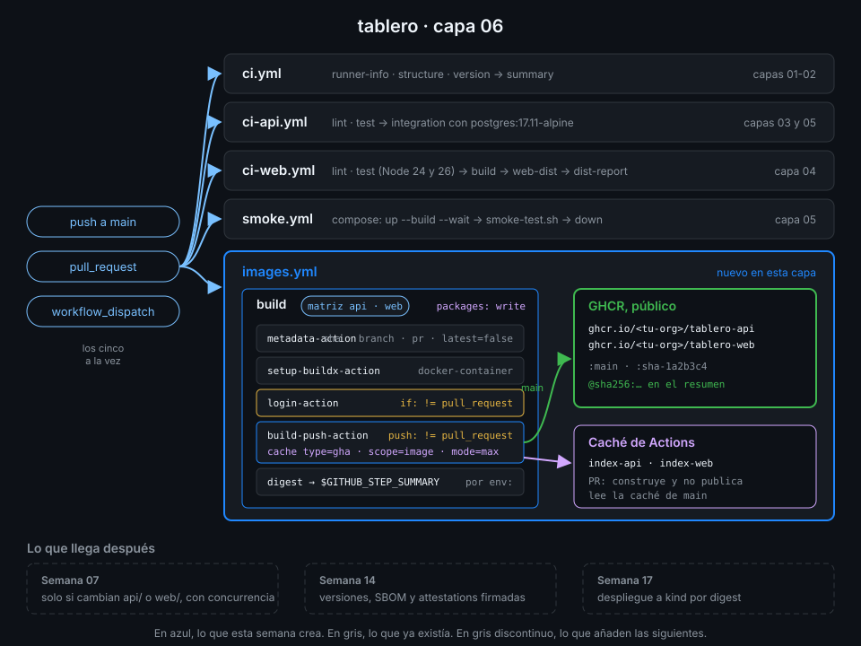

# Proyecto: capa 06 de tablero



## 🎯 Objetivo

Que cada commit de `main` deje en GitHub Container Registry una imagen de la API y otra de la web,
públicas, etiquetadas con el SHA del commit e identificadas por digest, y que cada pull request
compruebe que las dos imágenes siguen construyendo sin publicar nada.

## 📦 Qué añade esta capa

`ci.yml`, `ci-api.yml`, `ci-web.yml` y `smoke.yml` se quedan como están. Esta capa añade un
archivo:

| Archivo | Job | Qué hace | Por qué existe |
|---|---|---|---|
| `images.yml` (nuevo) | `build`, en matriz `api` y `web` | Etiquetas con `metadata-action`, buildx, login a GHCR fuera de los PR, `build-push-action` con caché `type=gha` y digest en el resumen | `smoke.yml` construye y tira las imágenes; aquí se construyen una vez y se guardan, para que lo que se pruebe y lo que se despliegue sea el mismo artefacto |

| Evento | Construye | Publica | Etiquetas |
|---|:--:|:--:|---|
| `pull_request` | ✅ | ❌ | `pr-<número>`, `sha-<sha corto>` (solo calculadas) |
| `push` a `main` | ✅ | ✅ | `main`, `sha-<sha corto>` |
| `workflow_dispatch` en `main` | ✅ | ✅ | `main`, `sha-<sha corto>` |

La Semana 07 hará que `images.yml` corra solo si cambian `api/` o `web/` y cancelará los runs
obsoletos de un PR. La 09 lo convertirá en el reutilizable `_image.yml`, la 14 añadirá versiones
semánticas, SBOM y attestations, y la 17 desplegará estas imágenes por su digest.

## ✅ Requisitos verificables

- build-lab.yml terminó en success al menos una vez lanzado a mano
- images.yml pasa actionlint
- El job build de images.yml recorre las imágenes api y web con una matriz
- Solo el job build pide packages: write; la raíz se queda en contents: read
- metadata-action no genera la etiqueta latest
- Cada imagen lleva una etiqueta con el SHA del commit (type=sha)
- login-action inicia sesión en ghcr.io con el GITHUB_TOKEN
- El login a GHCR no se ejecuta en los pull requests
- build-push-action construye en cada PR pero solo publica fuera de ellos
- build-push-action usa las etiquetas y labels que calcula metadata-action
- La caché de capas usa type=gha con un scope por imagen, en lectura y en escritura
- cache-to guarda también las capas de la etapa de build (mode=max)
- El digest de cada imagen llega al resumen del job por env:, no interpolado en run:
- Toda uses: remota de tus workflows está fijada por SHA de 40 caracteres con el tag en comentario
- images.yml terminó en success sobre el último commit de main
- ghcr.io/<tu-org>/tablero-api:main se puede descargar sin iniciar sesión
- ghcr.io/<tu-org>/tablero-web:main se puede descargar sin iniciar sesión

## 🎨 Criterios de calidad

Lo que `check-week.sh` no ve y la [rúbrica](../rubrica-evaluacion.md) sí puntúa:

- Un comentario explica por qué el job repite `contents: read` al declarar sus permisos.
- `fail-fast: false`: si la web no construye, la API se publica igual y el fallo se ve aislado.
- El nombre del job incluye la imagen (`Imagen tablero-api`), y se lee en la lista de checks del PR.
- El resumen del job enseña el digest y, cuando se publica, el comando `docker pull` por digest.
- Los dos paquetes aparecen en la pestaña **Packages** de `<tu-org>/tablero`, enlazados al repo.
- Ningún paquete se publicó a mano desde tu máquina: lo crea el `GITHUB_TOKEN` del workflow.
- Sin `TODO` en `.github/workflows/` y commits en Conventional Commits.

## 💡 Adaptación a tu dominio

| Tu proyecto | Matriz | Etiquetas | Caché |
|---|---|---|---|
| Una sola imagen | Sin matriz; `context: .` | `type=sha` y `type=ref,event=branch` | `scope` fijo, por ejemplo `app` |
| Imagen para amd64 y arm64 | `platforms: linux/amd64,linux/arm64` con `docker/setup-qemu-action`, o un job por arquitectura | Las mismas: un índice cubre las dos plataformas | Un `scope` por imagen y arquitectura |
| Microservicios en un monorepo | `include:` con `name` y `context` de cada servicio | `type=sha` por servicio | Un `scope` por servicio |
| Imagen publicada en Docker Hub además de GHCR | La misma | `images:` con las dos rutas, una por línea | La misma; el login de Docker Hub usa un secreto propio (Semana 13) |

## 🚦 Cómo entregarlo

Si hiciste las prácticas 03 y 04 ya tienes `images.yml`: repásalo contra los requisitos y los
criterios. Si no, parte del starter.

1. Copia el starter y completa los `TODO 1` a `TODO 9`:

   ```bash
   cd ~/code/tablero
   cp ~/code/bc-github-actions/bootcamp/week-06-imagenes_docker_y_ghcr/3-proyecto/starter/.github/workflows/images.yml .github/workflows/
   actionlint .github/workflows/images.yml
   # (sin salida: no hay errores)
   ```

2. Súbelo a `main` y espera al run de **tu** commit:

   ```bash
   git add .github/workflows/images.yml
   git commit -m "ci: build images on every pr and publish them to ghcr from main"
   git push
   id=$(gh run list --workflow images.yml --commit "$(git rev-parse HEAD)" --json databaseId --jq '.[0].databaseId')
   gh run watch "$id" --exit-status
   # ✓ main images · ...
   ```

3. Si es la primera vez que se publica `tablero-web`, hazlo público como hiciste con la API en la
   [práctica 03, paso 5](../2-practicas/03-publicar-en-ghcr.md). Después, comprueba que se descarga
   sin sesión:

   ```bash
   docker logout ghcr.io
   docker pull "ghcr.io/$(gh repo view --json owner --jq '.owner.login | ascii_downcase')/tablero-web:main"
   # main: Pulling from <tu-org>/tablero-web
   # ...
   # Status: Downloaded newer image for ghcr.io/<tu-org>/tablero-web:main
   ```

4. Lanza la verificación:

   ```bash
   cd ~/code/bc-github-actions
   ./scripts/check-week.sh 06
   # 17/17 comprobaciones superadas.
   ```

## 🧯 Errores comunes

| Síntoma | Causa | Solución |
|---|---|---|
| `denied: installation not allowed to Create organization package` | El job no tiene `packages: write`, o la org no deja crear paquetes públicos | Permiso en el job; en la org, **Settings → Packages** permite paquetes públicos |
| `denied: permission_denied: write_package` en un paquete que ya existía | Lo creaste a mano desde tu máquina y no está enlazado al repo | En el paquete, **Package settings → Manage Actions access → Add repository** con `tablero` y rol *Write* |
| `repository name must be lowercase` | Construiste el nombre de la imagen a mano con `github.repository_owner` en mayúsculas | Usa los `tags` de `metadata-action`, que pasa el nombre a minúsculas |
| El PR falla en *Iniciar sesión en GHCR* | El login no tiene `if:` y un PR desde un fork no recibe un token con escritura | `if: ${{ github.event_name != 'pull_request' }}` en el login |
| El segundo run tarda lo mismo que el primero | Falta `cache-to`, o `cache-from` y `cache-to` usan `scope` distintos | El mismo `scope=${{ matrix.image }}` en los dos, con `mode=max` |
| `ghcr-*-public` en rojo con `403` | El paquete se creó privado: es lo que hace GHCR por defecto | Práctica 03, paso 5: **Change visibility → Public** |

## 🔗 Navegación

---

| ← Anterior | Siguiente → |
|:---|---:|
| [Matriz y caché de capas](../2-practicas/04-matriz-y-cache-de-capas.md) | [Rúbrica de evaluación](../rubrica-evaluacion.md) |
