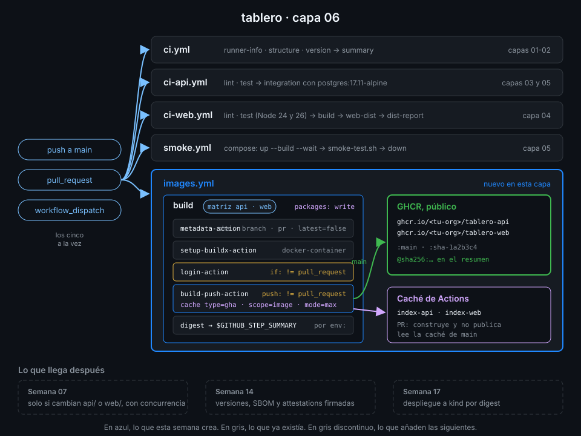

# Semana 06 — Imágenes Docker y GHCR

> Hasta ahora el CI construía `tablero` y lo tiraba al acabar el job. Esta semana cada commit de
> `main` deja dos imágenes en GitHub Container Registry, identificadas por digest, que cualquiera
> puede descargar y que la Semana 17 desplegará sin reconstruir nada.

## 🎯 Objetivos de la Semana

Al terminar la semana eres capaz de:

- Explicar imagen, capa, manifiesto, índice, etiqueta y digest, y por qué una etiqueta se mueve y
  un digest no
- Leer los `Dockerfile` multi-stage de `tablero` y decir qué capa se reconstruye cuando cambia
  cada archivo
- Construir con BuildKit y buildx en local y en Actions, y distinguir `push`, `load` y un build que
  solo comprueba
- Publicar en GHCR con el `GITHUB_TOKEN` y `packages: write`, y dejar el paquete público y
  enlazado a su repo
- Generar etiquetas y labels OCI con `docker/metadata-action`, sin `latest`
- Reutilizar capas entre ejecuciones con la caché `type=gha`, un `scope` por imagen y `mode=max`
- Construir en cada pull request sin publicar nada y publicar solo desde `main`
- Recuperar el digest de lo publicado y descargar exactamente esa imagen

## 📋 Prerrequisitos

| Necesitas | Dónde se aprende |
|---|---|
| `check-week.sh 05` en 18/18 | [Semana 05](../week-05-service_containers_y_postgresql/README.md) |
| Imagen, contenedor, puertos y Compose | [Semana 05, teoría 01](../week-05-service_containers_y_postgresql/1-teoria/01-contenedores-lo-justo.md) y [02](../week-05-service_containers_y_postgresql/1-teoria/02-compose-lo-justo.md) |
| Matrices con `strategy.matrix` y `fail-fast` | [Semana 04, teoría 04](../week-04-ci_de_frontend_pnpm_matrices_y_artefactos/1-teoria/04-matrices.md) |
| Outputs de un step y `$GITHUB_STEP_SUMMARY` | [Semana 02, teoría 05](../week-02-expresiones_contextos_y_flujo_de_datos/1-teoria/05-datos-entre-steps.md) |
| Docker Engine con buildx en tu máquina | [`docs/setup-entorno.md`](../../docs/setup-entorno.md), apartado 6 |

## 🗂️ Estructura de la Semana

```
week-06-imagenes_docker_y_ghcr/
├── README.md
├── rubrica-evaluacion.md
├── checks.json                    17 comprobaciones
├── 0-assets/                      4 diagramas SVG
├── 1-teoria/                      8 archivos, uno por concepto
├── 2-practicas/                   4 prácticas guiadas
├── 3-proyecto/
│   ├── README.md
│   └── starter/.github/workflows/images.yml
├── 4-recursos/{ebooks-free,videografia,webgrafia}/README.md
└── 5-glosario/README.md
```

## 📝 Contenidos

### Teoría

| # | Archivo | Qué aprendes | Tiempo |
|:--:|---|---|:--:|
| 01 | [Imágenes, capas y registros](1-teoria/01-imagenes-capas-y-registros.md) | Capa, manifiesto, índice, etiqueta frente a digest y qué guarda un registro | 30 min |
| 02 | [Dockerfile multi-stage y contexto](1-teoria/02-dockerfile-multi-stage-y-contexto.md) | Los `Dockerfile` de `tablero`, orden de capas, `.dockerignore` y contexto de build | 25 min |
| 03 | [BuildKit y buildx](1-teoria/03-buildkit-y-buildx.md) | `setup-buildx-action`, `build-push-action`, drivers, `push` frente a `load` y el resumen de build | 30 min |
| 04 | [GHCR y el GITHUB_TOKEN](1-teoria/04-ghcr-y-github-token.md) | `login-action`, `packages: write`, visibilidad y enlace del paquete con su repo | 25 min |
| 05 | [Etiquetas con metadata-action](1-teoria/05-etiquetas-con-metadata-action.md) | `type=sha`, `type=ref`, `flavor`, labels OCI y por qué nunca `latest` | 25 min |
| 06 | [Caché de capas type=gha](1-teoria/06-cache-de-capas-type-gha.md) | `cache-from`, `cache-to`, `scope`, `mode=max` y qué ve cada rama | 25 min |
| 07 | [Construir en PR, publicar en main](1-teoria/07-construir-en-pr-publicar-en-main.md) | `push` condicional, PR desde forks, una matriz por imagen y sus permisos | 25 min |
| 08 | [Digest y consumo](1-teoria/08-digest-y-consumo.md) | El output `digest`, pull por digest, el índice con attestation y cómo depurar un push | 25 min |

### Prácticas

| # | Archivo | Qué haces | Tiempo |
|:--:|---|---|:--:|
| 01 | [Construir en local con buildx](2-practicas/01-construir-en-local-con-buildx.md) | Las dos imágenes de `tablero`, sus capas, su digest y la caché local | 1 h |
| 02 | [Primer build en Actions](2-practicas/02-primer-build-en-actions.md) | `build-lab.yml`: construir la web en el runner, cargarla y probarla sin publicar | 1 h |
| 03 | [Publicar en GHCR](2-practicas/03-publicar-en-ghcr.md) | `images.yml` con la API: login, etiquetas, push desde `main` y paquete público | 1 h |
| 04 | [Matriz y caché de capas](2-practicas/04-matriz-y-cache-de-capas.md) | Las dos imágenes en matriz, caché `type=gha` medida y digest en el resumen | 1 h |

### Proyecto

[Capa 06 de `tablero`](3-proyecto/README.md): un workflow nuevo, `images.yml`, construye
`tablero-api` y `tablero-web` en cada pull request y las publica en GHCR desde `main`, con caché de
capas y el digest de cada una en el resumen del job.



## ⏱️ Distribución del Tiempo (10 horas)

| Actividad | Horas |
|---|:--:|
| Teoría (8 archivos) | 3.5 |
| Práctica 01 — Construir en local con buildx | 1 |
| Práctica 02 — Primer build en Actions | 1 |
| Práctica 03 — Publicar en GHCR | 1 |
| Práctica 04 — Matriz y caché de capas | 1 |
| Proyecto — capa 06 | 1.5 |
| Autoevaluación con la rúbrica | 1 |
| **Total** | **10** |

## 🎩 Trucos y atajos

- **`docker buildx imagetools inspect ghcr.io/<tu-org>/tablero-api:main`** enseña el índice y sus
  manifiestos sin descargar ni una capa. Ahí ves que la entrada `unknown/unknown` que muestra la UI
  de GHCR no es una plataforma rota: es el manifiesto de la attestation de procedencia.
- **El resumen de build de `build-push-action`** aparece solo en el resumen del run, con la
  duración, las capas cacheadas y un artefacto `.dockerbuild` que abre Docker Desktop. Si no lo
  quieres, `DOCKER_BUILD_SUMMARY: false` en el `env:` del step.
- **`gh api /orgs/<tu-org>/packages/container/tablero-api/versions --jq '.[0].metadata.container.tags'`**
  lista las etiquetas de la última versión publicada. Necesita el scope `read:packages`:
  `gh auth refresh -s read:packages`.
- **El digest también vale en local**: `docker buildx build --metadata-file meta.json` y
  `jq -r '."containerimage.digest"' meta.json` te dan lo mismo que el output `digest` de la action.
- **`mode=max` frente a `mode=min`**: el modo por defecto solo cachea las capas de la imagen final.
  En un multi-stage eso deja fuera el `uv sync` y el `pnpm install` de la etapa de build, que son
  justo las capas que más tardan.

## 📌 Entregables

- `build-lab.yml` en `.github/workflows/`, en verde lanzado a mano
- `images.yml` nuevo, en verde sobre el último commit de `main`, con `tablero-api` y `tablero-web`
  públicas en `ghcr.io/<tu-org>/` (ver [proyecto](3-proyecto/README.md))
- La rúbrica respondida

## ✅ Verificación

```bash
cd ~/code/bc-github-actions
./scripts/check-week.sh 06
# Semana 06 — Imágenes Docker y GHCR  [repo: <tu-org>/tablero]
#
#   ✅ build-lab.yml terminó en success al menos una vez lanzado a mano
#   ...
# 17/17 comprobaciones superadas.
```

Si algo sale en rojo, la pista te dice qué práctica y qué paso lo arreglan.

## 🔗 Navegación

---

| ← Anterior | Siguiente → |
|:---|---:|
| [Semana 05 — Service containers y PostgreSQL](../week-05-service_containers_y_postgresql/README.md) | [Imágenes, capas y registros](1-teoria/01-imagenes-capas-y-registros.md) |
