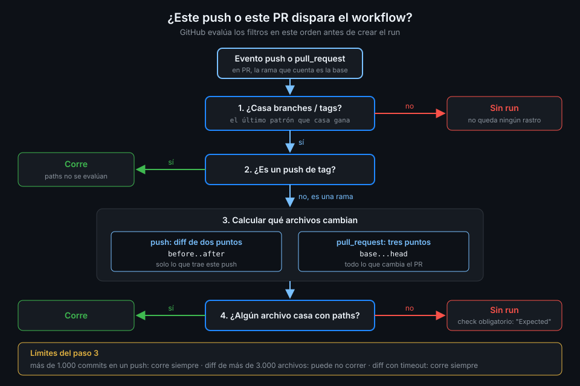

# Filtros de ramas y tags

> `on: push` a secas despierta al workflow en cualquier rama y con cualquier tag. Los filtros de
> ramas y tags son la primera pregunta que GitHub se hace antes de crear un run: si no la pasas,
> no hay run, ni gris ni rojo.



## 🎯 Objetivos

Al terminar este archivo eres capaz de:

- Filtrar `push` y `pull_request` por rama con `branches` y `branches-ignore`
- Filtrar los pushes de tags con `tags` y `tags-ignore`
- Escribir patrones glob con `*`, `**`, `?`, `+`, `[]` y la negación `!`
- Predecir el resultado de una lista de patrones sabiendo que **el último que coincide gana**
- Explicar por qué un workflow con solo `tags` deja de correr en los pushes a ramas

## 1. Qué problema resuelve

Desde la Semana 03, `ci-api.yml` empieza así:

```yaml
on:
  push:
    branches: [main]
  pull_request:
```

Ese `branches: [main]` ya era un filtro. Sin él, cada push a una rama de trabajo lanzaría el CI
**dos veces**: una por el `push` a la rama y otra por el `pull_request` abierto sobre ella. Mismo
código, doble gasto de minutos, dos checks iguales en el PR.

Los filtros de ramas y tags resuelven tres casos que vas a tener en `tablero`:

- **CI en PR y en `main`, no en cada rama suelta**: el PR ya cubre las ramas de trabajo.
- **Release solo con tags `v*`**: un workflow que publica cuando empujas `v1.4.0` y nunca con un
  push normal (lo verás en la Semana 14).
- **Excluir ramas automáticas**: ramas de Dependabot o de experimentos que no quieres que gasten
  un runner.

## 2. Cómo funciona

### Qué filtra cada clave

| Clave | Evento | Contra qué compara |
|---|---|---|
| `branches` / `branches-ignore` | `push` | La rama a la que empujas (`refs/heads/<rama>`) |
| `tags` / `tags-ignore` | `push` | El tag que empujas (`refs/tags/<tag>`) |
| `branches` / `branches-ignore` | `pull_request` | La rama **base** del PR, la de destino, no la tuya |

La última fila sorprende la primera vez. `pull_request: branches: [main]` significa "PR que
quieren entrar en `main`", sin importar cómo se llame la rama de origen. Por eso un PR de
`feature/login` contra `main` dispara, y uno de `main` contra `release/1.x` no.

### Dos reglas de combinación

- **`branches` y `branches-ignore` no van juntas en el mismo evento**. Lo mismo `tags` y
  `tags-ignore`. Si necesitas incluir y excluir a la vez, usa `branches` con patrones `!`.
- **Si filtras solo un tipo de ref, el otro deja de disparar**. Con solo `tags`, los pushes a
  ramas no corren; con solo `branches`, los pushes de tags no corren. Sin ninguno de los dos, corre
  con todo.

```yaml
on:
  push:
    # Solo tags: un push a main ya NO dispara este workflow.
    tags:
      - "v*"
```

### Los patrones

Los filtros usan glob, no expresiones regulares:

| Carácter | Coincide con | Ejemplo | Casa con |
|---|---|---|---|
| `*` | Cero o más caracteres, **salvo `/`** | `feature/*` | `feature/login`, no `feature/a/b` |
| `**` | Cero o más caracteres, **incluida `/`** | `feature/**` | `feature/a/b` |
| `?` | Cero o una vez el carácter anterior | `releases?/**` | `release/1.x`, `releases/1.x` |
| `+` | Uno o más del anterior | `v[0-9]+` | `v1`, `v10` |
| `[]` | Un carácter del conjunto o rango | `v[12].*` | `v1.0`, `v2.3` |
| `!` | Al principio: niega el patrón | `!release/**-alpha` | Excluye las alpha |

Dos detalles de YAML: un patrón que empieza por `*`, `!` o `[` **va entre comillas**, porque sin
ellas YAML lo lee como alias, etiqueta o lista. Y el `!` solo tiene sentido después de algún
patrón positivo: una lista que solo niega no deja entrar nada.

### El último que coincide gana

GitHub recorre la lista entera y se queda con **el último patrón que coincide**. El orden cambia
el resultado:

```yaml
    branches:
      - "release/**"
      - "!release/**-alpha"
```

`release/2.0-alpha` casa con los dos; el último es la negación: **no dispara**. Si inviertes el
orden, la negación queda primero, el positivo después, y `release/2.0-alpha` **sí dispara**.

## 3. Cómo se usa

### El CI de `tablero`

```yaml
name: filters-demo

on:
  push:
    branches:
      - main
      - "release/**"
      - "!release/**-alpha"
    tags:
      - "v*"
  pull_request:
    branches:
      - main

# Mínimo privilegio: lo verás a fondo en la Semana 12.
permissions:
  contents: read

jobs:
  show:
    runs-on: ubuntu-24.04
    timeout-minutes: 5
    steps:
      - name: Qué ref me ha despertado
        env:
          REF: ${{ github.ref }}
          EVENT: ${{ github.event_name }}
        run: echo "Evento $EVENT sobre $REF"
```

Resultado para cada caso:

| Acción | ¿Corre? | Por qué |
|---|:--:|---|
| Push a `main` | ✅ | Casa con `main` |
| Push a `feature/login` | ❌ | Ningún patrón de `branches` casa |
| Push a `release/2.0` | ✅ | Casa con `release/**` y no con la negación |
| Push a `release/2.0-alpha` | ❌ | El último patrón que casa es `!release/**-alpha` |
| Push del tag `v1.4.0` | ✅ | Casa con `v*` |
| Push del tag `nightly-3` | ❌ | Hay `tags` y no casa |
| PR de `feature/login` a `main` | ✅ | La base es `main` |
| PR de `feature/a` a `feature/b` | ❌ | La base no es `main` |

Fíjate en que `github.ref` llega por `env:`: el nombre de una rama lo elige quien la crea, así que
es dato no confiable (regla 4 de
[`docs/reglas-de-seguridad-de-workflows.md`](../../../docs/reglas-de-seguridad-de-workflows.md)).

### Comprobar un patrón sin hacer pushes

No hay un comando que evalúe filtros en local, pero sí puedes ver qué ref y qué evento tuvo cada
run reciente, y comparar con lo que esperabas:

```bash
gh run list --workflow filters-demo.yml --limit 5 \
  --json event,headBranch,conclusion --jq '.[] | "\(.event)\t\(.headBranch)\t\(.conclusion)"'
# push          main          success
# push          v1.4.0        success
# pull_request  feature/login success
```

Para un tag, `headBranch` trae el nombre del tag. Si un push que esperabas no aparece en la lista,
el filtro lo descartó: un filtro que no casa **no deja rastro**, ni siquiera un run saltado.

## 4. Antipatrones

| Antipatrón | Por qué duele | Qué hacer en su lugar |
|---|---|---|
| `on: [push, pull_request]` sin filtros | Cada push a una rama con PR corre dos veces | `push: branches: [main]` + `pull_request` |
| `branches` y `branches-ignore` en el mismo evento | El workflow es inválido | `branches` con patrones `!` |
| Añadir solo `tags` a un CI que no tenía filtros | Los pushes a ramas dejan de correr | Lista también `branches`, o un workflow de release aparte (Semana 14) |
| `feature/*` para ramas con subcarpetas | `*` no cruza `/`: `feature/a/b` no casa | `feature/**` |
| `- !release/**` sin comillas | YAML lo lee como etiqueta y el filtro no hace lo que crees | `- "!release/**"` |
| Poner la negación antes del positivo | El positivo vuelve a incluir lo que negaste | Negaciones al final |
| Leer `pull_request: branches` como la rama de origen | Esperas runs que no llegan | Filtra la base; para el origen, `if:` sobre `github.head_ref` en un step con `env:` |

## 5. Trucos

- **`gh run list --event push --branch main`** filtra por evento y rama a la vez: la forma rápida
  de ver solo los runs de `main` en un repo con muchos PR.
- **Un tag también es un push**: `git push origin v1.4.0` genera un evento `push` con
  `github.ref_type == 'tag'`. En un workflow que escucha ramas y tags, esa expresión separa los
  dos casos dentro de un `if:`.
- **`git push --tags` empuja todos los tags locales a la vez**, y cada uno es un evento. Con
  `tags: ["v*"]` y diez tags viejos, son diez runs. Empuja el tag concreto.

Verificado con actionlint 1.7.12 y ubuntu-24.04, noviembre 2026.

## 📚 Recursos Adicionales

- [GitHub Docs: `on.<push|pull_request>.<branches|tags>`](https://docs.github.com/en/actions/reference/workflows-and-actions/workflow-syntax#onpushpull_requestpull_request_targetbranchesbranches-ignore)
- [GitHub Docs: Filter pattern cheat sheet](https://docs.github.com/en/actions/reference/workflows-and-actions/workflow-syntax#filter-pattern-cheat-sheet)
- [GitHub Docs: Events that trigger workflows](https://docs.github.com/en/actions/reference/workflows-and-actions/events-that-trigger-workflows)

## ✅ Checklist de Verificación

- [ ] Sé contra qué rama compara `branches` en un `pull_request`
- [ ] Sé por qué un workflow con solo `tags` no corre en los pushes a ramas
- [ ] Sé la diferencia entre `*` y `**`
- [ ] Sé por qué los patrones con `!` van entre comillas
- [ ] Sé predecir el resultado de una lista con negaciones según su orden
- [ ] Sé que un filtro que no casa no deja ningún run en la lista

---

| ← Anterior | Siguiente → |
|:---|---:|
| [Semana 07 — Disparadores, filtros y concurrencia](../README.md) | [Filtros de rutas](02-filtros-de-rutas.md) |
