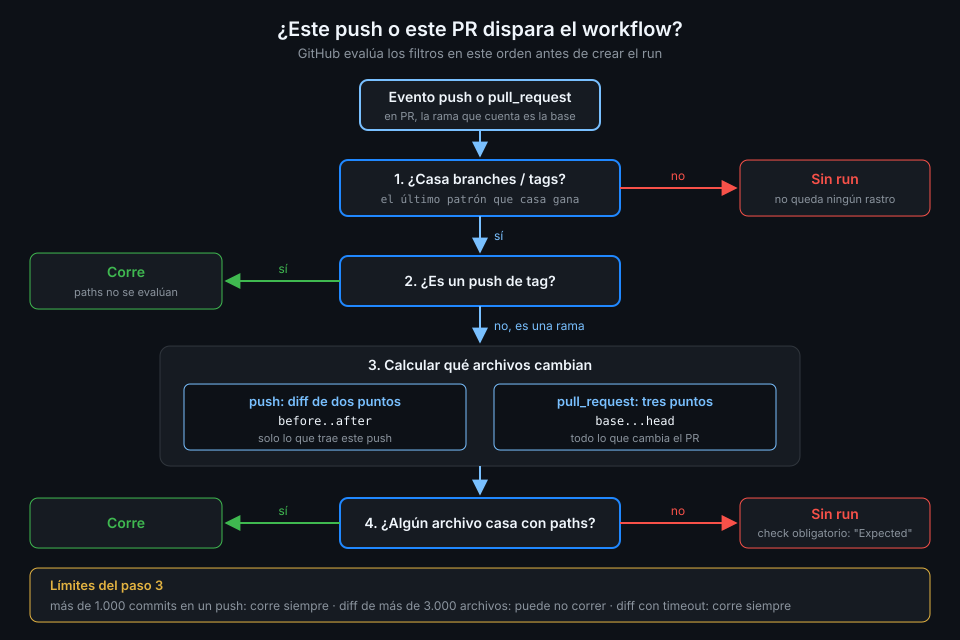

# Filtros de rutas

> En un monorepo, un cambio en `web/` no tiene nada que demostrar a los tests de la API. Los
> filtros de rutas hacen que cada workflow despierte solo cuando cambia lo suyo, y esconden una
> trampa que conviene conocer antes de hacer obligatorio un check.



## 🎯 Objetivos

Al terminar este archivo eres capaz de:

- Limitar un workflow a unas carpetas con `paths` y excluir otras con `paths-ignore` o `!`
- Explicar cómo se combinan los filtros de ramas y de rutas
- Distinguir el diff de dos puntos de un push del de tres puntos de un pull request
- Conocer los límites en los que GitHub ignora el filtro y corre igualmente
- Explicar por qué un check obligatorio se queda en "Expected" cuando un filtro salta el workflow

## 1. Qué problema resuelve

Al cerrar la Semana 06, `tablero` tiene cinco workflows y todos despiertan con cualquier push a
`main`. Corregir una errata en `README.md` cuesta:

| Workflow | Minutos aproximados | ¿Tenía algo que comprobar? |
|---|:--:|:--:|
| `ci-api` | 3 | No |
| `ci-web` | 3 | No |
| `smoke` | 4 | No |
| `images` | 5 | No |

Quince minutos de runner y cuatro checks que no dicen nada nuevo. Y el coste no es solo de
minutos: un CI que corre siempre acostumbra a no mirar sus resultados. Con filtros de rutas, el
mismo push no despierta a ninguno, y un cambio en `api/` despierta solo a los que dependen de la
API.

## 2. Cómo funciona

### `paths` y `paths-ignore`

- **`paths`**: el workflow corre si **al menos un** archivo cambiado casa con algún patrón.
- **`paths-ignore`**: el workflow **no** corre si **todos** los archivos cambiados casan con
  algún patrón. Basta un archivo fuera de la lista para que corra.
- **No van juntas en el mismo evento**. Para incluir y excluir a la vez, usa `paths` con `!`,
  con la misma regla que en las ramas: el último patrón que casa gana.

```yaml
    paths:
      - "api/**"
      - "!api/**/*.md"
```

Un cambio solo en `api/README.md` no dispara; uno en `api/src/tablero/main.py`, sí. Los patrones
son los mismos glob del archivo anterior y se evalúan contra rutas desde la raíz del repo.

### Ramas y rutas: tienen que cumplirse las dos

Si un evento declara `branches` y `paths`, el workflow corre solo si **los dos** filtros pasan.
El orden de evaluación lo resume el diagrama de arriba:

1. ¿Casa la rama, o el tag? Si no, no hay run.
2. ¿Es un push de **tag**? Entonces los `paths` **no se evalúan**: corre.
3. ¿Casa algún archivo del diff con `paths`? Si no, no hay run.

El punto 2 importa en la Semana 14: un workflow de release con `tags: ["v*"]` y `paths` correrá
con cada tag, cambien o no esos archivos.

### Con qué se compara: dos puntos y tres puntos

GitHub no mira "los archivos del commit": calcula un diff, y el diff es distinto según el evento.

| Evento | Diff | Compara | Consecuencia |
|---|---|---|---|
| `push` | Dos puntos `before..after` | El commit anterior de la rama con el nuevo | Solo cuenta lo que trae **este** push |
| `pull_request` | Tres puntos `base...head` | La base de fusión con la punta del PR | Cuenta **todo** lo que el PR cambia respecto a `main` |

Ejemplo: abres un PR que toca `api/` en el primer commit y `web/` en el segundo. En el segundo
push, el diff de tres puntos sigue viendo `api/`, así que `ci-api` corre otra vez. Es lo que
quieres: el check del PR refleja el PR entero, no el último commit.

### Los límites

| Situación | Qué hace GitHub |
|---|---|
| Un push con más de 1.000 commits | Corre siempre, sin mirar `paths` |
| Un diff de más de 3.000 archivos | Puede **no** correr aunque algún archivo case |
| El cálculo del diff da timeout | Corre siempre |

El segundo es el único que juega en tu contra: un PR gigante de formateo masivo puede dejar sin
CI una carpeta que sí cambió. Divide esos PR.

### El check obligatorio que se queda esperando

Cuando un filtro de rutas salta un workflow, **no se crea ningún run**: no hay check en verde ni
en gris, sencillamente no hay check. Si ese check está marcado como obligatorio en la protección
de `main`, el PR muestra:

```text
ci-api / Tests (pytest)   Expected — Waiting for status to be reported
```

Y el botón de fusionar no se habilita nunca, porque el estado que espera no va a llegar. Un PR que
solo toca `web/` queda bloqueado por un check de la API que nunca se ejecutará.

Esta semana no hay checks obligatorios en `tablero`, así que no te afecta todavía. En la Semana 18
lo resuelves con un **job puerta**: un workflow que corre siempre y decide qué partes eran
necesarias, y es ese el único check obligatorio.

## 3. Cómo se usa

### Los filtros de `ci-api`

```yaml
name: ci-api-filters

on:
  push:
    branches: [main]
    paths:
      - "api/**"
      - ".github/workflows/ci-api-filters.yml"
  pull_request:
    paths:
      - "api/**"
      - ".github/workflows/ci-api-filters.yml"
  # Sin filtros: un dispatch corre siempre, para relanzar a mano.
  workflow_dispatch:

# Mínimo privilegio: lo verás a fondo en la Semana 12.
permissions:
  contents: read

jobs:
  test:
    runs-on: ubuntu-24.04
    timeout-minutes: 10
    steps:
      - uses: actions/checkout@3d3c42e5aac5ba805825da76410c181273ba90b1 # v7.0.1
        with:
          persist-credentials: false
      - name: Archivos de la API
        run: find api -name '*.py' | head -n 5
```

Tres decisiones que repetirás en los cuatro workflows de la capa:

- **El propio workflow en `paths`**. Si cambias `ci-api.yml` y no está en la lista, tu cambio de
  CI no se prueba hasta que alguien toque `api/`. Es el olvido más común.
- **Los mismos `paths` en `push` y en `pull_request`**. YAML no te deja compartirlos entre eventos
  sin anclas, y las anclas complican la lectura. Repítelos: son cuatro líneas.
- **`workflow_dispatch` sin filtros**. Los filtros no se aplican a un dispatch: es tu botón para
  correr el CI completo cuando quieras, y lo usa `nightly.yml` en la práctica 03.

### Comprobar qué despierta un cambio

Haz un push que solo toque documentación y mira qué runs aparecen para ese SHA:

```bash
git commit --allow-empty -m "docs: probe path filters" && git push
sha=$(git rev-parse HEAD)
gh run list --commit "$sha" --json workflowName --jq '.[].workflowName'
# (sin salida)
```

Un commit vacío no cambia ningún archivo: ningún `paths` casa y no aparece ningún run. Si sale
alguno, ese workflow no tiene filtros o tiene un patrón demasiado amplio.

## 4. Antipatrones

| Antipatrón | Por qué duele | Qué hacer en su lugar |
|---|---|---|
| `paths` y `paths-ignore` en el mismo evento | El workflow es inválido | `paths` con patrones `!` |
| No incluir el propio workflow en `paths` | Los cambios de CI no se prueban | Añade `.github/workflows/<nombre>.yml` |
| `api/*` en vez de `api/**` | `*` no cruza `/`: los archivos de `api/src/` no cuentan | `api/**` |
| Filtrar por rutas un check obligatorio sin job puerta | El PR se queda bloqueado en "Expected" | Job puerta, Semana 18 |
| `paths` en un workflow de release por tag | En un tag no se evalúan: corre igual | Filtra por tag y decide en un `if:` |
| Solo `paths-ignore: ["**.md"]` en un monorepo | Cualquier cambio de código en cualquier carpeta despierta a todos los workflows | `paths` positivos por carpeta |
| PR gigantes de formateo | Más de 3.000 archivos y el filtro puede saltarse el run | Divide el PR |

## 5. Trucos

- **`gh run list --commit <sha>`** lista los runs de un commit concreto: es la forma de comprobar
  que un filtro funcionó, porque lo que importa es **lo que no aparece**.
- **`git diff --name-only origin/main...HEAD`**, con tres puntos, te da la misma lista de archivos
  que GitHub usa para los `paths` de tu PR. Con dos puntos verías otra cosa.
- **`gh pr diff --name-only`** lista los archivos que cambia el PR abierto en tu rama. Antes de
  hacer push, te dice qué workflows deberían despertar.

Verificado con actions/checkout@v7.0.1, actionlint 1.7.12 y ubuntu-24.04, noviembre 2026.

## 📚 Recursos Adicionales

- [GitHub Docs: `on.<push|pull_request>.paths`](https://docs.github.com/en/actions/reference/workflows-and-actions/workflow-syntax#onpushpull_requestpull_request_targetpathspaths-ignore)
- [GitHub Docs: Troubleshooting required status checks](https://docs.github.com/en/repositories/configuring-branches-and-merges-in-your-repository/managing-protected-branches/troubleshooting-required-status-checks)
- [Git: two-dot and three-dot diff](https://git-scm.com/docs/git-diff#_description)

## ✅ Checklist de Verificación

- [ ] Sé la diferencia entre `paths` (al menos uno casa) y `paths-ignore` (todos casan)
- [ ] Sé que con `branches` y `paths` tienen que cumplirse los dos
- [ ] Sé que los `paths` no se evalúan en los pushes de tags
- [ ] Sé qué diff usa un push y cuál un pull request
- [ ] Sé en qué límites GitHub corre o no corre ignorando el filtro
- [ ] Sé por qué un check obligatorio se queda en "Expected" y qué lo resuelve
- [ ] Incluyo siempre el propio workflow en sus `paths`

---

| ← Anterior | Siguiente → |
|:---|---:|
| [Filtros de ramas y tags](01-filtros-de-ramas-y-tags.md) | [Schedule y cron](03-schedule-y-cron.md) |
