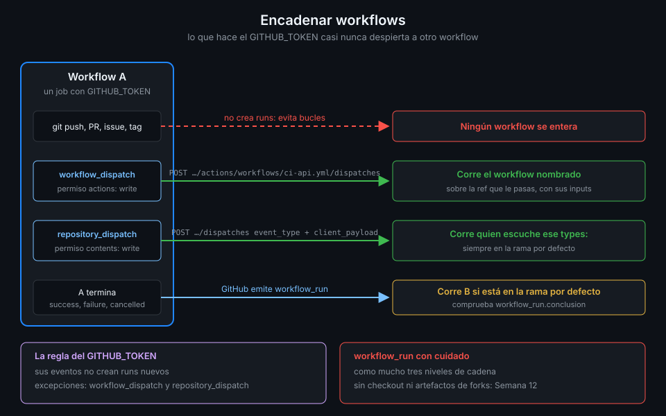

# Encadenar workflows

> Un workflow puede despertar a otro de tres formas: pidiéndoselo por la API, mandando un evento
> propio al repo o esperando a que el otro termine. Las tres chocan con la misma regla: lo que hace
> el `GITHUB_TOKEN` casi nunca dispara workflows.



## 🎯 Objetivos

Al terminar este archivo eres capaz de:

- Explicar por qué un push hecho con el `GITHUB_TOKEN` no lanza el CI, y cuáles son las dos
  excepciones
- Lanzar otro workflow con `workflow_dispatch` desde un job
- Mandar un evento propio con `repository_dispatch` y filtrarlo con `types:`
- Reaccionar al final de otro workflow con `workflow_run` y comprobar su conclusión
- Saber en qué rama tiene que estar cada pieza para que la cadena funcione

## 1. Qué problema resuelve

El proyecto de esta semana necesita que `nightly.yml` relance `ci-api`, `ci-web` y `smoke` sobre
`main` cada noche. La idea ingenua es que `nightly.yml` haga un commit vacío y un push: el push
despertaría a todos. No funciona, y no por un fallo: GitHub lo impide a propósito.

Si un evento creado por el `GITHUB_TOKEN` disparara workflows, un workflow que hace push sobre su
propia rama se despertaría a sí mismo, y ese a sí mismo otra vez, sin fin. Para cortar los bucles
de raíz, **los eventos que provoca el `GITHUB_TOKEN` no crean runs nuevos**. Un push, un PR, una
issue o un tag hechos con él existen en el repo, pero ningún workflow se entera.

Hay dos excepciones, y son la forma correcta de encadenar:

| Evento creado con `GITHUB_TOKEN` | ¿Crea run? |
|---|:--:|
| `push`, `pull_request`, `issues`, `release`… | ❌ |
| `workflow_dispatch` | ✅ |
| `repository_dispatch` | ✅ |

A ellas se suma `workflow_run`, que no lo crea ningún token: lo emite GitHub cuando otro workflow
cambia de estado.

## 2. Cómo funciona

### `workflow_dispatch` desde otro workflow

Es el botón del archivo anterior, pulsado por un job. El endpoint es
`POST /repos/{owner}/{repo}/actions/workflows/{workflow_id}/dispatches` y el job necesita
`actions: write`. El workflow lanzado recibe `github.event_name == 'workflow_dispatch'` y corre
sobre la `ref` que le pases. Es lo que hace `nightly.yml`, con `github-script` (archivo 08).

**Cuándo**: sabes exactamente qué workflow quieres lanzar y sobre qué rama.

### `repository_dispatch`: un evento con nombre propio

En lugar de nombrar al workflow, mandas un evento al repo con un tipo inventado por ti; reacciona
quien lo escuche.

- **Envío**: `POST /repos/{owner}/{repo}/dispatches` con `event_type` (el nombre) y
  `client_payload` (un objeto JSON libre). Con el `GITHUB_TOKEN`, el job necesita
  `contents: write`.
- **Recepción**: `on: repository_dispatch` con `types: [nombre]`. Sin `types`, cualquier evento
  despierta al workflow.
- **Rama**: corre siempre sobre **la rama por defecto**, con el YAML que hay en ella.
- **Datos**: `github.event.action` trae el `event_type` y `github.event.client_payload` el objeto.

**Cuándo**: el evento viene de fuera (otro repo, un sistema externo, un script), o quieres que
varios workflows reaccionen al mismo aviso sin que el emisor los conozca.

### `workflow_run`: cuando otro termina

```yaml
on:
  workflow_run:
    workflows: [ci-api]
    types: [completed]
    branches: [main]
```

- **`workflows`** lista los workflows a vigilar por su `name:`, no por el archivo.
- **`types`**: `requested`, `in_progress` o `completed`.
- **`branches`** filtra por la rama en la que corrió el workflow vigilado.
- **`completed` no significa `success`**: también es `completed` un run fallido o cancelado. La
  conclusión está en `github.event.workflow_run.conclusion` y hay que comprobarla.
- **Solo funciona si el workflow que declara `workflow_run` está en la rama por defecto.**
- **Encadena como mucho tres niveles**: A dispara B, B dispara C, C dispara D, y ahí se corta.

`workflow_run` tiene una cara peligrosa: corre con los permisos y secretos del repo aunque el
workflow vigilado viniera de un PR de un fork. Si descarga los artefactos de ese run o hace
checkout de su código, ejecuta código ajeno con privilegios. Aquí lo usarás **sin checkout ni
artefactos**, solo para leer metadatos; el patrón seguro completo lo ves en la Semana 12.

**Cuándo**: quieres que algo pase después de otro workflow sin tocar ese otro workflow.

## 3. Cómo se usa

### Un laboratorio con las dos piezas de recepción

```yaml
name: chain-demo

on:
  repository_dispatch:
    types: [lab-ping]
  workflow_run:
    workflows: [ci-api]
    types: [completed]
    branches: [main]

# Mínimo privilegio: lo verás a fondo en la Semana 12.
permissions:
  contents: read

jobs:
  ping:
    if: ${{ github.event_name == 'repository_dispatch' }}
    runs-on: ubuntu-24.04
    timeout-minutes: 5
    steps:
      - name: Leer el payload
        env:
          EVENT_TYPE: ${{ github.event.action }}
          REASON: ${{ github.event.client_payload.reason }}
        run: echo "Recibido $EVENT_TYPE con motivo $REASON"

  after-ci:
    # completed incluye failure y cancelled: solo seguimos si ci-api salió verde.
    if: ${{ github.event_name == 'workflow_run' && github.event.workflow_run.conclusion == 'success' }}
    runs-on: ubuntu-24.04
    timeout-minutes: 5
    steps:
      - name: Qué run de ci-api terminó
        env:
          RUN_URL: ${{ github.event.workflow_run.html_url }}
          HEAD_SHA: ${{ github.event.workflow_run.head_sha }}
        run: echo "ci-api verde en $HEAD_SHA, $RUN_URL"
```

El payload y los metadatos llegan por `env:`. `client_payload` lo escribe quien manda el evento y
`workflow_run` describe un run que pudo empezar en una rama ajena: los dos son datos no
confiables.

### Mandar el evento

Primero fusiona `chain-demo.yml` en `main`: tanto `repository_dispatch` como `workflow_run` leen
el workflow de la rama por defecto.

```bash
echo '{"event_type":"lab-ping","client_payload":{"reason":"probar la cadena"}}' \
  | gh api repos/{owner}/{repo}/dispatches --input -
gh run list --workflow chain-demo.yml --event repository_dispatch --limit 1 \
  --json conclusion --jq '.[0].conclusion'
# success
```

`gh api` usa tu token de `gh auth`, no el `GITHUB_TOKEN`; desde un workflow sería el mismo
endpoint con un job que pide `contents: write`.

### Ver la cadena de `workflow_run`

```bash
gh run list --workflow chain-demo.yml --event workflow_run --limit 3 \
  --json conclusion,headSha --jq '.[] | "\(.conclusion)\t\(.headSha[0:7])"'
# success   9f1c2ab
# skipped   41d07e3
```

El `skipped` es un `ci-api` que no salió verde: el run de `chain-demo` existió, pero el `if:` del
job lo saltó. Esa es la conclusión comprobada de la sección 2.

## 4. Antipatrones

| Antipatrón | Por qué duele | Qué hacer en su lugar |
|---|---|---|
| Hacer push con el `GITHUB_TOKEN` para despertar el CI | No crea runs: el CI nunca corre | `workflow_dispatch` o `repository_dispatch` |
| Un PAT clásico para que el push sí dispare | Credencial personal, amplia y sin caducidad | Los dos dispatch; la GitHub App llega en la Semana 16 |
| `workflow_run` sin mirar `conclusion` | Reacciona también a fallos y cancelaciones | `if: github.event.workflow_run.conclusion == 'success'` |
| Probar `workflow_run` desde una rama | No corre hasta estar en la rama por defecto | Fusiona primero |
| Checkout o artefactos del run vigilado en `workflow_run` | Código de un fork con permisos del repo | Solo metadatos; patrón seguro en la Semana 12 |
| `repository_dispatch` sin `types:` | Cualquier evento del repo lo despierta | `types: [nombre]` |
| `${{ github.event.client_payload.x }}` dentro de `run:` | Inyección con el payload | `env:` y `"$X"` |
| Cadenas de cuatro `workflow_run` | GitHub corta en el tercer nivel | Menos niveles, o `workflow_dispatch` explícito |

## 5. Trucos

- **`gh run list --event workflow_run`** te enseña solo los runs encadenados. Si está vacía tras
  un run vigilado, el workflow no está en la rama por defecto o el `name:` de `workflows:` no
  coincide.
- **`gh api ... --input -`** manda un JSON entero desde la entrada estándar. Para
  `client_payload`, con objetos anidados, es más legible que encadenar `-f`.
- **`github.event.workflow_run.head_sha`** es el commit sobre el que corrió el workflow vigilado,
  no el de tu run: es el que usas para comprobar sobre qué código se decidió.

Verificado con actionlint 1.7.12 y ubuntu-24.04, noviembre 2026.

## 📚 Recursos Adicionales

- [GitHub Docs: Triggering a workflow from a workflow](https://docs.github.com/en/actions/how-tos/write-workflows/choose-when-workflows-run/trigger-a-workflow#triggering-a-workflow-from-a-workflow)
- [GitHub Docs: `repository_dispatch`](https://docs.github.com/en/actions/reference/workflows-and-actions/events-that-trigger-workflows#repository_dispatch)
- [GitHub Docs: `workflow_run`](https://docs.github.com/en/actions/reference/workflows-and-actions/events-that-trigger-workflows#workflow_run)
- [GitHub REST API: Create a repository dispatch event](https://docs.github.com/en/rest/repos/repos#create-a-repository-dispatch-event)

## ✅ Checklist de Verificación

- [ ] Sé por qué un push con el `GITHUB_TOKEN` no crea runs
- [ ] Sé cuáles son las dos excepciones
- [ ] Sé qué permiso pide un job para cada dispatch
- [ ] Sé filtrar un `repository_dispatch` con `types:`
- [ ] Sé comprobar la conclusión en un `workflow_run`
- [ ] Sé en qué rama tienen que estar `repository_dispatch` y `workflow_run`
- [ ] Sé por qué `workflow_run` no hace checkout ni baja artefactos esta semana

---

| ← Anterior | Siguiente → |
|:---|---:|
| [workflow_dispatch e inputs](04-workflow-dispatch-e-inputs.md) | [Concurrencia](06-concurrencia.md) |
