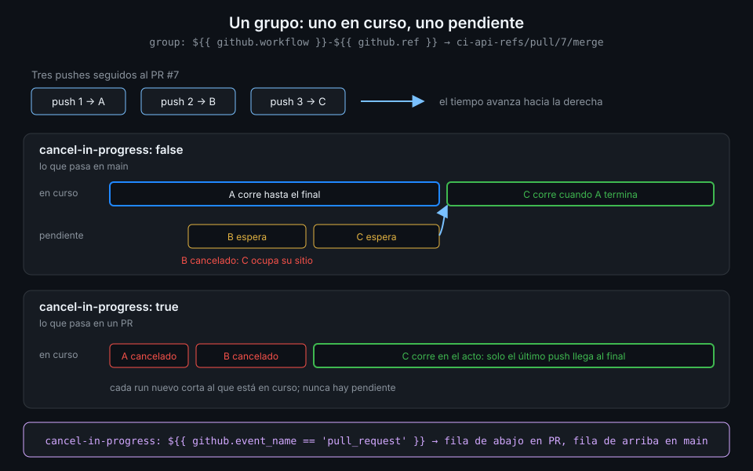

# Concurrencia

> Tres pushes seguidos a un PR lanzan tres runs, y solo el último importa. `concurrency` agrupa los
> runs que compiten por lo mismo y decide cuál sigue: el que está en marcha, el que espera o
> ninguno de los anteriores.



## 🎯 Objetivos

Al terminar este archivo eres capaz de:

- Declarar un grupo de concurrencia en el workflow o en el job
- Explicar la regla de un run en curso y uno pendiente por grupo
- Construir un nombre de grupo que separe workflows y refs
- Cancelar los runs obsoletos de un PR sin cortar nunca los de `main`
- Leer en un run cancelado qué lo canceló

## 1. Qué problema resuelve

Abres un PR y haces tres pushes en cinco minutos: corriges un test, luego una errata, luego el
formato. Sin `concurrency`, GitHub lanza tres runs completos de cada workflow y los tres corren
hasta el final. Dos de ellos comprueban código que ya no existe.

El coste es doble:

- **Minutos y runners**: en un repo con varios contribuidores los runs viejos ocupan runners que
  hacen falta para los nuevos, y la cola crece.
- **Confusión**: el check del PR va cambiando según termina cada run. Un run viejo que acaba
  después del nuevo puede dejar un rojo de un código que ya arreglaste.

El caso contrario también existe: dos despliegues a la vez sobre el mismo clúster se pisan. Ahí no
quieres cancelar, quieres que esperen en fila (Semana 17).

## 2. Cómo funciona

### Un grupo, una cadena

```yaml
concurrency:
  group: ${{ github.workflow }}-${{ github.ref }}
  cancel-in-progress: false
```

`group` es una cadena cualquiera. Todos los runs (o jobs) que, al empezar, calculen **la misma
cadena** pertenecen al mismo grupo, **aunque sean de workflows distintos**. GitHub compara los
nombres sin distinguir mayúsculas.

Se declara en dos sitios:

| Dónde | Qué agrupa | Contextos disponibles |
|---|---|---|
| Raíz del workflow | Runs enteros | `github`, `inputs`, `vars` |
| Dentro de un job | Ese job en todos los runs | Además `needs`, `strategy`, `matrix` |

### Uno en curso, uno pendiente

La regla que explica todo lo demás: en un grupo hay **como mucho un run en curso y uno
pendiente**.

1. Llega el run A. El grupo está vacío: A **corre**.
2. Llega B mientras A corre. B queda **pendiente**.
3. Llega C mientras A corre y B espera. C **cancela a B** y ocupa su sitio de pendiente.
4. A termina. C corre.

B no llegó a empezar. El pendiente nuevo siempre sustituye al anterior, sea cual sea el valor de
`cancel-in-progress`. Lo que cambia `cancel-in-progress` es qué pasa con **A**:

| `cancel-in-progress` | Cuando llega un run nuevo |
|---|---|
| `false` (por defecto) | A termina; el nuevo espera como pendiente |
| `true` | A se cancela; el nuevo corre ya |

Existe además la clave `queue: max`, que convierte el pendiente único en una fila de hasta 100
runs que esperan en orden, sin sustituirse. Es incompatible con `cancel-in-progress: true`, y
actionlint 1.7.12 todavía no la reconoce y da error de sintaxis: no la uses en `tablero` hasta que
el linter la acepte. Su caso natural son los despliegues de la Semana 17.

### El nombre del grupo

| Grupo | Qué agrupa | Problema |
|---|---|---|
| `ci` | Todos los runs de todos los workflows que digan `ci` | El PR de Ana cancela el de Luis |
| `${{ github.workflow }}` | Todos los runs del workflow, en cualquier rama | Un PR cancela a `main` |
| `${{ github.ref }}` | Todos los workflows de la misma rama | `ci-api` cancela a `ci-web` |
| `${{ github.workflow }}-${{ github.ref }}` | Un workflow en una ref | Ninguno: es el que quieres |

En un PR, `github.ref` vale `refs/pull/<número>/merge`: cada PR tiene su propio grupo y los pushes
a un mismo PR comparten grupo. En `main`, vale `refs/heads/main`.

## 3. Cómo se usa

### Cancelar solo en los PR

```yaml
name: concurrency-demo

on:
  push:
    branches: [main]
  pull_request:

# Un grupo por workflow y ref. En un PR, el push nuevo cancela el run anterior;
# en main el run en curso siempre termina.
concurrency:
  group: ${{ github.workflow }}-${{ github.ref }}
  cancel-in-progress: ${{ github.event_name == 'pull_request' }}

# Mínimo privilegio: lo verás a fondo en la Semana 12.
permissions:
  contents: read

jobs:
  test:
    runs-on: ubuntu-24.04
    timeout-minutes: 10
    steps:
      - name: Simular un test largo
        run: sleep 120
```

`cancel-in-progress` acepta una expresión, y esta da `true` en los PR y `false` en todo lo demás:

- **En un PR**, cada push deja obsoleto al anterior. Cancelar ahorra minutos y deja como único
  check el del código actual. Nadie pierde nada: el commit viejo ya no se va a fusionar.
- **En `main`**, cada commit **ya está fusionado**. Si el run del commit 1 se cancela porque llega
  el commit 2, nunca sabrás si el commit 1 rompió algo: el historial de `main` tendrá huecos sin
  verde ni rojo. Y si `main` publica imágenes (Semana 06), cancelar a medias puede dejar una
  imagen subida y su etiqueta sin mover.

Hay un matiz que la regla de la sección 2 deja ver: con `false`, en `main` el run **en curso**
termina siempre, pero si llegan tres commits seguidos el del medio, que esperaba como pendiente,
se sustituye. El último commit siempre se comprueba; el intermedio puede quedarse sin run.

¿Por qué `== 'pull_request'` y no `!= 'push'`? Porque así cualquier evento nuevo que añadas
(`workflow_dispatch`, `schedule`) **no cancela** por defecto. Cancelar es la excepción y solo la
tiene quien está nombrado.

### Verlo en un PR

Abre un PR, haz tres pushes seguidos y mira la lista:

```bash
gh run list --workflow concurrency-demo.yml --branch "$(git branch --show-current)" --limit 3 \
  --json conclusion,headSha --jq '.[] | "\(.conclusion)\t\(.headSha[0:7])"'
# success     c4e81d0
# cancelled   7a2f913
# cancelled   1b9e5aa
```

Abre uno de los cancelados en la UI y la anotación del run dice qué lo canceló. Verás el mensaje "Canceling since a higher priority waiting request for
'concurrency-demo-refs/pull/7/merge' exists": el nombre del grupo calculado, útil para comprobar
que tu expresión da lo que esperas.

## 4. Antipatrones

| Antipatrón | Por qué duele | Qué hacer en su lugar |
|---|---|---|
| `cancel-in-progress: true` para todo | Cancela runs de `main` a medias | `${{ github.event_name == 'pull_request' }}` |
| Grupo fijo (`group: ci`) | Runs de PR distintos y de `main` se cancelan entre sí | `${{ github.workflow }}-${{ github.ref }}` |
| Grupo solo con `github.ref` | Los workflows de una misma rama se cancelan entre ellos | Añade `github.workflow` |
| Grupo con `github.run_id` o `github.sha` | Cada run tiene su propio grupo: `concurrency` no hace nada | Algo que compartan los runs que compiten: la ref |
| Grupo con `github.head_ref` | Vacío en los `push`: todos los push caen en el mismo grupo | `github.ref`, que existe siempre |
| `cancel-in-progress: true` en un despliegue | Un despliegue cortado a medias | `false`, y fila con `queue` cuando actionlint la acepte |
| Escribir `queue: max` en el YAML hoy | actionlint falla y el CI de `tablero` se rompe | Mencionarla, no usarla todavía |
| Esperar que `false` garantice un run por commit | El pendiente intermedio se sustituye igual | Asumir "el último siempre corre" |

## 5. Trucos

- **El mensaje de cancelación trae el nombre del grupo calculado**: es la forma más rápida de
  depurar una expresión de `group` que no hace lo que crees.
- **`gh run list --status cancelled`** lista los runs cancelados. Si en `main` aparece alguno
  lanzado por `push`, tu `cancel-in-progress` no está distinguiendo eventos.
- **`concurrency` a nivel de job** sirve para serializar solo el paso delicado (un despliegue, una
  migración) y dejar que los tests del mismo workflow corran en paralelo entre runs.

- **Un mismo grupo en dos workflows distintos** es a propósito una forma de que no se solapen: dos
  workflows que tocan el mismo recurso externo pueden compartir `group: tablero-db-${{ github.ref }}`
  y esperarse el uno al otro.

Verificado con actionlint 1.7.12 y ubuntu-24.04, noviembre 2026.

## 📚 Recursos Adicionales

- [GitHub Docs: Control the concurrency of workflows and jobs](https://docs.github.com/en/actions/how-tos/write-workflows/choose-when-workflows-run/control-workflow-concurrency)
- [GitHub Docs: `concurrency` en la sintaxis de workflows](https://docs.github.com/en/actions/reference/workflows-and-actions/workflow-syntax#concurrency)
- [GitHub Docs: `jobs.<job_id>.concurrency`](https://docs.github.com/en/actions/reference/workflows-and-actions/workflow-syntax#jobsjob_idconcurrency)

## ✅ Checklist de Verificación

- [ ] Sé declarar `concurrency` en el workflow y en un job
- [ ] Sé la regla de un run en curso y uno pendiente por grupo
- [ ] Sé qué cambia `cancel-in-progress` y qué no
- [ ] Sé por qué el grupo combina `github.workflow` y `github.ref`
- [ ] Sé por qué cancelo en los PR y nunca en `main`
- [ ] Sé qué es `queue: max` y por qué no la escribo todavía

---

| ← Anterior | Siguiente → |
|:---|---:|
| [Encadenar workflows](05-encadenar-workflows.md) | [Timeouts y cancelación](07-timeouts-y-cancelacion.md) |
