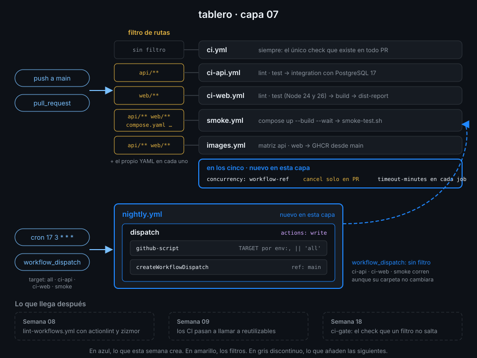

# Proyecto: capa 07 de tablero



## 🎯 Objetivo

Que cada workflow de `tablero` corra solo cuando cambia lo que comprueba, que un PR con varios
pushes seguidos deje un único run vivo por workflow, que ningún job pueda colgarse seis horas, y
que una vez al día el CI completo vuelva a pasar sobre `main` aunque nadie haya hecho push.

## 📦 Qué añade esta capa

| Archivo | Cambio | Por qué |
|---|---|---|
| `ci-api.yml` | `paths: [api/**, .github/workflows/ci-api.yml]` en `push` y `pull_request` | Un cambio en la web ya no gasta minutos en ruff y pytest |
| `ci-web.yml` | `paths: [web/**, .github/workflows/ci-web.yml]` en `push` y `pull_request` | Lo mismo al revés |
| `smoke.yml` | `paths` con `api/**`, `web/**`, `compose.yaml`, `scripts/smoke-test.sh` y el propio workflow | El smoke test depende de las dos partes y de cómo se componen |
| `images.yml` | `paths` con `api/**`, `web/**` y el propio workflow | Sin cambios en el código no hay imagen nueva que construir |
| `ci.yml` | Sin `paths`: sigue corriendo en todo push y PR | Es el único check que existe siempre; la Semana 18 lo convertirá en la puerta `ci-gate` |
| Los cinco anteriores | `concurrency` con grupo `${{ github.workflow }}-${{ github.ref }}` y `cancel-in-progress` solo en PR; `timeout-minutes` en cada job | Un push nuevo a un PR mata el run obsoleto; en `main` cada commit termina el suyo |
| `nightly.yml` (nuevo) | `schedule` diario y `workflow_dispatch` con input `target`; `github-script` lanza `ci-api`, `ci-web` y `smoke` sobre `main` | Los filtros de rutas dejan commits de `main` sin pasar por todo el CI: el nightly lo recupera |

| Evento | Qué corre |
|---|---|
| PR que solo toca `web/` | `ci`, `ci-web`, `smoke`, `images` |
| PR que solo toca `README.md` | `ci` |
| Push a un PR con un run en curso | El run anterior del mismo workflow se cancela |
| Push a `main` con un run en curso | El nuevo espera; ninguno se cancela |
| Cron de las 03:17 UTC | `nightly`, que lanza `ci-api`, `ci-web` y `smoke` por `workflow_dispatch` |

La Semana 08 añade `lint-workflows.yml`, con sus propios `paths`. La 09 convierte los CI en
llamadas a reutilizables y mueve `concurrency` a quien llama. La 18 resuelve el check obligatorio
que un filtro de rutas deja esperando.

## ✅ Requisitos verificables

- Todos tus workflows pasan actionlint
- ci-api.yml solo corre en push y en PR si cambia api/ o el propio workflow
- ci-web.yml solo corre en push y en PR si cambia web/ o el propio workflow
- smoke.yml corre si cambia api/, web/, compose.yaml, scripts/smoke-test.sh o el propio workflow
- images.yml corre si cambia api/, web/ o el propio workflow
- ci, ci-api, ci-web, smoke e images declaran concurrency con un grupo por workflow y ref
- cancel-in-progress cancela runs obsoletos solo en los pull requests, nunca en main
- Todo job de ci, ci-api, ci-web, smoke, images y nightly declara timeout-minutes
- nightly.yml se programa con un cron de cinco campos
- nightly.yml se lanza a mano con un input target de tipo choice: all, ci-api, ci-web o smoke
- Solo el job dispatch de nightly.yml pide actions: write; la raíz se queda en contents: read
- github-script recibe el target por env: con valor por defecto all, sin ${{ }} dentro de script:
- Toda uses: remota de tus workflows está fijada por SHA de 40 caracteres con el tag en comentario
- Un workflow tuyo terminó en success disparado por repository_dispatch
- nightly.yml terminó en success sobre el último commit de main
- ci-web.yml terminó en success sobre el último commit de main en un run lanzado por workflow_dispatch

## 🎨 Criterios de calidad

Lo que `check-week.sh` no ve y la [rúbrica](../rubrica-evaluacion.md) sí puntúa:

- Cada `timeout-minutes` está calibrado: unas tres veces la duración normal del job, no 360 ni 1.
- `nightly.yml` tiene `concurrency` con un grupo fijo y `cancel-in-progress: false`: dos nightlies
  no se pisan, y uno lanzado a mano no mata al del cron.
- El cron no cae en el minuto 0, y un comentario dice por qué.
- Los filtros de `push` y `pull_request` son idénticos en cada workflow: no hay cambios que pasen
  el PR sin CI y lleguen a `main` con CI, ni al revés.
- Un comentario en cada workflow con `concurrency` explica por qué `main` no cancela.
- El resumen del run de `nightly.yml` lista los workflows que lanzó.
- Sin `TODO` en `.github/workflows/` y commits en Conventional Commits.

## 💡 Adaptación a tu dominio

| Tu proyecto | Filtros | Concurrencia | Nightly |
|---|---|---|---|
| Un solo paquete, sin monorepo | `paths-ignore: ['**.md', 'docs/**']` en lugar de `paths` | La misma | Solo si hay tests lentos que no corren en cada PR |
| Monorepo con muchos servicios | Un workflow por servicio con su `paths`, o un job que detecta cambios con `git diff` y decide la matriz | La misma, por workflow | Lanza solo los servicios con cambios en las últimas 24 h |
| Despliegue en cada push a `main` | Igual que aquí | `cancel-in-progress: false` también en el despliegue, y `queue: max` si quieres que no se pierda ninguno | — |
| Librería con versiones mantenidas | `branches: [main, 'release/**']` | Grupo por rama: cada rama de release mantiene su propia cola | Una matriz de ramas con `ref:` en el dispatch |

## 🚦 Cómo entregarlo

Si hiciste las prácticas 01 y 02, los cinco workflows ya tienen filtros, `concurrency` y
`timeout-minutes`: repásalos contra los requisitos. `nightly.yml` sale del starter.

1. Copia el starter, completa los `TODO 1` a `TODO 6` y pasa actionlint sobre todo:

   ```bash
   cd ~/code/tablero
   cp ~/code/bc-github-actions/bootcamp/week-07-disparadores_filtros_y_concurrencia/3-proyecto/starter/.github/workflows/nightly.yml .github/workflows/
   actionlint
   # (sin salida: no hay errores)
   ```

2. Súbelo a `main`. Un cambio que solo toca `.github/workflows/nightly.yml` no despierta a
   `ci-api`, `ci-web`, `smoke` ni `images`; solo a `ci`:

   ```bash
   git add .github/workflows/
   git commit -m "ci: add nightly workflow that re-runs ci on main"
   git push
   gh run list --commit "$(git rev-parse HEAD)" --json workflowName --jq '[.[].workflowName] | sort | join(",")'
   # ci
   ```

3. Lanza el nightly a mano sobre ese mismo commit y espera a lo que dispara:

   ```bash
   gh workflow run nightly.yml -f target=all --ref main
   sleep 10
   id=$(gh run list --workflow nightly.yml --limit 1 --json databaseId --jq '.[0].databaseId')
   gh run watch "$id" --exit-status
   # ✓ main nightly · ...
   id=$(gh run list --workflow ci-web.yml --event workflow_dispatch --limit 1 --json databaseId --jq '.[0].databaseId')
   gh run watch "$id" --exit-status
   # ✓ main ci-web · ...
   ```

4. Lanza la verificación:

   ```bash
   cd ~/code/bc-github-actions
   ./scripts/check-week.sh 07
   # 16/16 comprobaciones superadas.
   ```

## 🧯 Errores comunes

| Síntoma | Causa | Solución |
|---|---|---|
| `nightly` falla con `Resource not accessible by integration` | El job no tiene `actions: write` | `permissions: actions: write` en el job `dispatch` |
| `nightly` falla con `Workflow does not have 'workflow_dispatch' trigger` | Quitaste `workflow_dispatch:` de `ci-web.yml` al añadir los filtros | Vuelve a ponerlo; `workflow_dispatch` no tiene `paths` y siempre corre |
| `nightly` en verde pero no aparece ningún run de `ci-web` | El dispatch se pidió sobre una rama que no tiene el workflow, o falta la llamada del `TODO 6` | `ref: 'main'` y `await github.rest.actions.createWorkflowDispatch(...)` |
| El cron no ha corrido nunca | `nightly.yml` no está en la rama por defecto, o el repo lleva 60 días sin actividad | Comprueba que está en `main`; `gh workflow enable nightly.yml` si GitHub lo desactivó |
| `ci-web-dispatched-on-main` en rojo tras un push nuevo | El último commit de `main` cambió después del nightly | Relanza el nightly (paso 3) sobre el commit actual |
| Un push a `main` cancela el run anterior | `cancel-in-progress: true` a secas | `${{ github.event_name == 'pull_request' }}` |
| El workflow no corre al cambiar el propio YAML | Falta `.github/workflows/<archivo>.yml` en `paths` | Añádelo en `push` y en `pull_request` |

## 🔗 Navegación

---

| ← Anterior | Siguiente → |
|:---|---:|
| [Encadenar workflows](../2-practicas/04-encadenar-workflows.md) | [Rúbrica de evaluación](../rubrica-evaluacion.md) |
