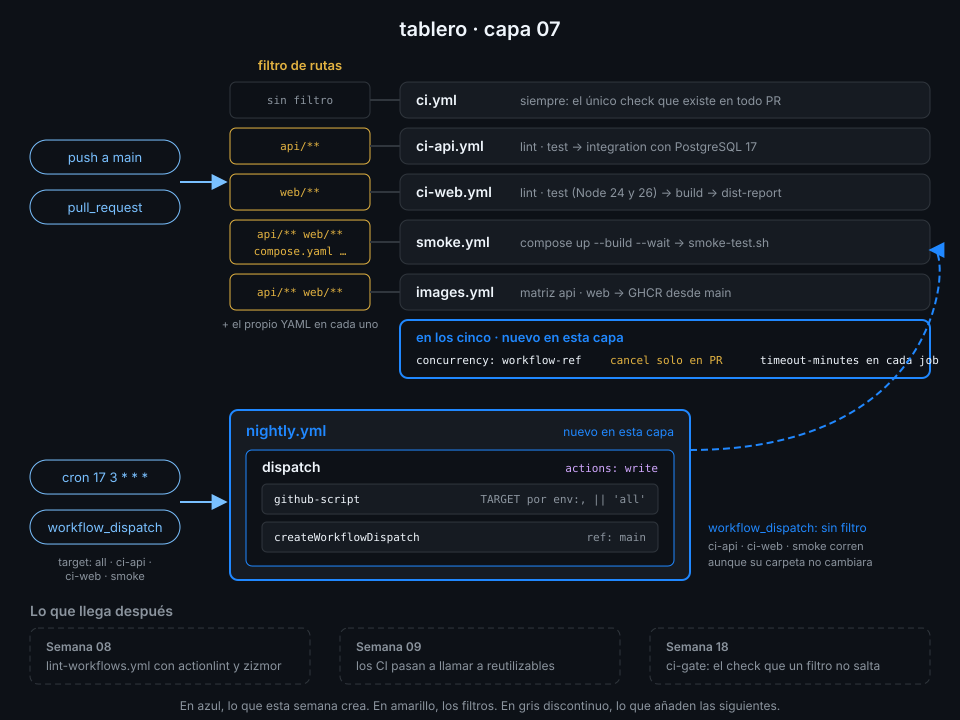

# Semana 07 — Disparadores, filtros y concurrencia

> Hasta ahora cada push despertaba a los cinco workflows de `tablero`, tocara lo que tocara, y un
> PR con tres pushes seguidos dejaba tres runs compitiendo. Esta semana decides tú cuándo corre
> cada workflow, cuántos corren a la vez y cuánto pueden durar.

## 🎯 Objetivos de la Semana

Al terminar la semana eres capaz de:

- Filtrar un workflow por rama, tag y ruta, y predecir si un push o un PR concreto lo dispara
- Explicar con qué compara GitHub los archivos de un push y de un pull request, y qué pasa con un
  check obligatorio cuando un filtro de rutas salta el workflow
- Programar workflows con `schedule` y cron, sabiendo en qué rama corren y por qué se retrasan
- Lanzar workflows a mano con `workflow_dispatch` e inputs tipados, desde la UI, `gh` y la API
- Encadenar workflows con `workflow_dispatch`, `workflow_run` y `repository_dispatch`, y saber qué
  eventos puede disparar el `GITHUB_TOKEN`
- Agrupar runs con `concurrency` y cancelar los obsoletos de un PR sin cortar nunca `main`
- Poner un techo de tiempo a cada job con `timeout-minutes` y entender qué pasa al cancelar
- Hablar con la API de GitHub desde un step con `actions/github-script`, sin inyección

## 📋 Prerrequisitos

| Necesitas | Dónde se aprende |
|---|---|
| `check-week.sh 06` en 17/17 | [Semana 06](../week-06-imagenes_docker_y_ghcr/README.md) |
| Eventos, `on:` y el modelo evento → workflow → job | [Semana 01, teoría 05](../week-01-primer_workflow_y_modelo_de_ejecucion/1-teoria/05-eventos-basicos.md) |
| Expresiones, el contexto `github` y `inputs` | [Semana 02](../week-02-expresiones_contextos_y_flujo_de_datos/README.md) |
| Datos no confiables por `env:` | [`docs/reglas-de-seguridad-de-workflows.md`](../../docs/reglas-de-seguridad-de-workflows.md), regla 4 |
| Los cinco workflows de `tablero` en verde | Capas [03](../week-03-ci_de_python_con_uv/3-proyecto/README.md) a [06](../week-06-imagenes_docker_y_ghcr/3-proyecto/README.md) |

## 🗂️ Estructura de la Semana

```
week-07-disparadores_filtros_y_concurrencia/
├── README.md
├── rubrica-evaluacion.md
├── checks.json                    16 comprobaciones
├── 0-assets/                      4 diagramas SVG
├── 1-teoria/                      8 archivos, uno por concepto
├── 2-practicas/                   4 prácticas guiadas
├── 3-proyecto/
│   ├── README.md
│   └── starter/.github/workflows/nightly.yml
├── 4-recursos/{ebooks-free,videografia,webgrafia}/README.md
└── 5-glosario/README.md
```

## 📝 Contenidos

### Teoría

| # | Archivo | Qué aprendes | Tiempo |
|:--:|---|---|:--:|
| 01 | [Filtros de ramas y tags](1-teoria/01-filtros-de-ramas-y-tags.md) | `branches`, `branches-ignore`, `tags`, patrones glob, negación con `!` y por qué el orden importa | 25 min |
| 02 | [Filtros de rutas](1-teoria/02-filtros-de-rutas.md) | `paths`, `paths-ignore`, diff de dos y tres puntos, límites, y el check obligatorio que se queda esperando | 30 min |
| 03 | [Schedule y cron](1-teoria/03-schedule-y-cron.md) | Los cinco campos, UTC y `timezone`, rama por defecto, retrasos y desactivación por inactividad | 25 min |
| 04 | [workflow_dispatch e inputs](1-teoria/04-workflow-dispatch-e-inputs.md) | Los cinco tipos de input, `inputs` frente a `github.event.inputs`, y lanzar desde UI, `gh` y API | 25 min |
| 05 | [Encadenar workflows](1-teoria/05-encadenar-workflows.md) | `workflow_run`, `repository_dispatch`, el `GITHUB_TOKEN` que no dispara y sus dos excepciones | 30 min |
| 06 | [Concurrencia](1-teoria/06-concurrencia.md) | `group`, `cancel-in-progress`, el run pendiente que se sustituye y `queue` | 25 min |
| 07 | [Timeouts y cancelación](1-teoria/07-timeouts-y-cancelacion.md) | `timeout-minutes` de job y de step, qué recibe un job cancelado, `cancelled()` y `always()` | 20 min |
| 08 | [github-script](1-teoria/08-github-script.md) | `github`, `context`, `core`, `result-encoding`, `retries` y la inyección dentro de `script:` | 30 min |

### Prácticas

| # | Archivo | Qué haces | Tiempo |
|:--:|---|---|:--:|
| 01 | [Filtros de ramas y rutas](2-practicas/01-filtros-de-ramas-y-rutas.md) | `paths` en los cuatro workflows por carpeta; un push que solo toca docs no despierta a nadie | 1 h |
| 02 | [Concurrencia y timeouts](2-practicas/02-concurrencia-y-timeouts.md) | `concurrency` y `timeout-minutes` en todo el CI; tres pushes a un PR y dos runs cancelados | 1 h |
| 03 | [Cron y dispatch con inputs](2-practicas/03-cron-y-dispatch-con-inputs.md) | `dispatch-lab.yml` con un input de cada tipo, lanzado desde `gh`, y un cron real | 1 h |
| 04 | [Encadenar workflows](2-practicas/04-encadenar-workflows.md) | `chain-lab.yml` con `repository_dispatch` y `workflow_run`, y `github-script` hablando con la API | 1 h |

### Proyecto

[Capa 07 de `tablero`](3-proyecto/README.md): `ci-api`, `ci-web`, `smoke` e `images` corren solo
si cambia lo suyo, `concurrency` cancela los runs obsoletos de un PR, todo job tiene techo de
tiempo, y un `nightly.yml` nuevo relanza el CI sobre `main` cada noche o cuando tú se lo pides.



## ⏱️ Distribución del Tiempo (10 horas)

| Actividad | Horas |
|---|:--:|
| Teoría (8 archivos) | 3.5 |
| Práctica 01 — Filtros de ramas y rutas | 1 |
| Práctica 02 — Concurrencia y timeouts | 1 |
| Práctica 03 — Cron y dispatch con inputs | 1 |
| Práctica 04 — Encadenar workflows | 1 |
| Proyecto — capa 07 | 1.5 |
| Autoevaluación con la rúbrica | 1 |
| **Total** | **10** |

## 🎩 Trucos y atajos

- **`gh workflow run nightly.yml -f target=ci-web --ref main`** lanza un `workflow_dispatch` con
  sus inputs sin abrir la UI. Con `--json` lee los inputs de la entrada estándar:
  `echo '{"target":"smoke"}' | gh workflow run nightly.yml --json`.
- **`gh run list --event schedule --workflow nightly.yml`** filtra los runs por evento. Es la forma
  rápida de saber si tu cron se ha ejecutado de verdad, y a qué hora, sin bucear en la UI.
- **`gh api repos/{owner}/{repo}/dispatches -f event_type=tablero-ping -F 'client_payload[from]=cli'`**
  dispara un `repository_dispatch` desde tu terminal. `-F` con corchetes construye el objeto
  anidado sin escribir JSON a mano.
- **Un run cancelado por `concurrency` dice por qué**: en sus anotaciones aparece *Canceling since
  a higher priority waiting request for '<grupo>' exists*. Con `gh run view <id> --json jobs --jq
  '.jobs[].conclusion'` ves `cancelled` sin abrir el log.
- **El minuto 0 está saturado**: los cron en punto se retrasan más porque media plataforma programa
  ahí. Un minuto raro (`17 3 * * *`) llega antes y no compite.
- **`gh workflow disable` / `enable`** apagan un workflow sin borrar el archivo. Útil para parar un
  cron mientras investigas por qué falla cada noche.

## 📌 Entregables

- `dispatch-lab.yml` y `chain-lab.yml` en `.github/workflows/`, con al menos un run de
  `repository_dispatch` en verde
- `ci.yml`, `ci-api.yml`, `ci-web.yml`, `smoke.yml` e `images.yml` con filtros, `concurrency` y
  `timeout-minutes`, y `nightly.yml` nuevo, en verde sobre el último commit de `main` (ver
  [proyecto](3-proyecto/README.md))
- La rúbrica respondida

## ✅ Verificación

```bash
cd ~/code/bc-github-actions
./scripts/check-week.sh 07
# Semana 07 — Disparadores, filtros y concurrencia  [repo: <tu-org>/tablero]
#
#   ✅ Todos tus workflows pasan actionlint
#   ...
# 16/16 comprobaciones superadas.
```

Si algo sale en rojo, la pista te dice qué práctica y qué paso lo arreglan.

## 🔗 Navegación

---

| ← Anterior | Siguiente → |
|:---|---:|
| [Semana 06 — Imágenes Docker y GHCR](../week-06-imagenes_docker_y_ghcr/README.md) | [Filtros de ramas y tags](1-teoria/01-filtros-de-ramas-y-tags.md) |
