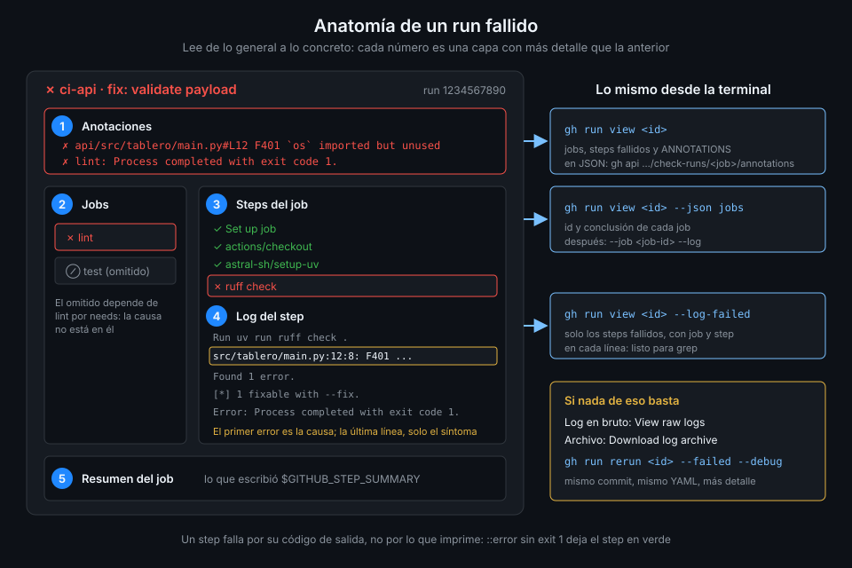

# Leer un run que falla

> Un run en rojo cuenta su historia en cinco sitios distintos, y casi nadie mira en el orden
> correcto. Aprender ese orden convierte "no sé por qué falla" en dos minutos de lectura.



## 🎯 Objetivos

Al terminar este archivo eres capaz de:

- Recorrer un run fallido de lo general a lo concreto: anotaciones, job, step, log en bruto
- Explicar por qué un step falla: el código de salida del proceso y las opciones de `bash`
- Leer un run desde la terminal con `gh run view`, `--log-failed` y `--job`
- Sacar las anotaciones de un job en JSON con la API de check runs
- Relanzar solo lo que falló y distinguir un fallo real de uno intermitente

## 1. Qué problema resuelve

Llega la notificación: `ci-api` falló en tu PR. Abres el run, ves una cruz roja junto a un job,
haces clic y te encuentras 1.400 líneas de log. Haces scroll hasta el final, lees
`Process completed with exit code 1.` y no sabes más que antes.

El problema no es la falta de información, es el exceso. GitHub guarda el mismo fallo en varias
capas, cada una con un nivel de detalle distinto:

- La **anotación** te dice qué falló y, si alguien se molestó en darle archivo y línea, dónde.
- El **step** marcado en rojo te dice en qué comando.
- El **log del step** te da la salida completa de ese comando.
- El **log en bruto** te da todo, con marcas de tiempo, sin plegar.
- El **resumen** del job (`$GITHUB_STEP_SUMMARY`, Semana 02) te da lo que el autor del workflow
  quiso que vieras primero.

Leer en ese orden, y no al revés, es la diferencia entre encontrar la causa y encontrar el último
síntoma.

## 2. Cómo funciona

### Por qué un step se pone en rojo

Un step de `run:` falla cuando el proceso que lanza termina con un código de salida distinto de
0. Nada más. GitHub no lee el texto del log para decidir si algo falló: una línea que diga
`ERROR` con código 0 deja el step en verde, y un `exit 1` sin ningún mensaje lo deja en rojo.

Cuánto tolera tu script depende del shell que use el step:

| Cómo lo declaras | Comando real en Linux | Qué pasa si falla un comando intermedio |
|---|---|---|
| Sin `shell:` | `bash -e {0}` | El step para en el primer comando que falla |
| `shell: bash` | `bash --noprofile --norc -eo pipefail {0}` | Igual, y además falla una tubería si falla cualquier parte |

La diferencia importa con tuberías: sin `pipefail`, `pytest | tee salida.txt` termina con el
código de `tee`, que casi siempre es 0. El test falla, el step queda en verde.

### Run, job, step

Un run es un árbol. El run falla si falla algún job; un job falla si falla algún step que no
tenga `continue-on-error`. Los jobs que dependen de uno fallido (`needs:`) aparecen como
**omitidos**, no como fallidos: no busques la causa en ellos.

### Anotaciones

Una anotación es un mensaje con nivel (`notice`, `warning`, `error`), un título opcional y,
opcionalmente, archivo y línea. Sale de tres fuentes:

1. El propio runner: `Process completed with exit code 1.` cuando un step falla.
2. Tu workflow, con comandos como `::error file=api/app.py,line=12::...` (archivo 02).
3. Un problem matcher que convierte la salida de una herramienta en anotaciones (archivo 04).

Las anotaciones aparecen arriba del todo en la página del run y, si tienen archivo y línea de un
archivo del PR, también sobre esa línea en la pestaña **Files changed**. Por debajo, son
anotaciones del **check run** de cada job: por eso las puedes pedir a la API.

### Log por step y log en bruto

La vista normal pliega cada step y respeta los grupos (`::group::`). El log en bruto (**View raw
logs** en el menú del job) es texto plano con marca de tiempo por línea: el sitio para buscar con
el buscador del navegador o para comparar tiempos. El archivo de logs completo (**Download log
archive** en el menú del run) es un zip con un `.txt` por step; con los logs de depuración del
runner activados trae además la carpeta `runner-diagnostic-logs` (archivo 03).

## 3. Cómo se usa

### El orden de lectura

1. **Anotaciones del run.** Si hay una con archivo y línea, ve ahí y para.
2. **Primer job en rojo**, no el último: los demás pueden ser consecuencia.
3. **Primer step en rojo** dentro del job.
4. **Primer error** dentro del log de ese step, no la última línea. La última suele ser el
   `exit code` y el resumen; la causa está más arriba.
5. **Resumen del job**, si el workflow escribe uno.
6. Si nada de eso basta, **logs de depuración** en un reintento (archivo 03).

### Desde la terminal

Todo lo anterior existe en `gh`, y desde la terminal se busca mejor que en la UI:

```bash
# Los últimos runs fallidos de un workflow
gh run list --workflow ci-api.yml --status failure --limit 5

# Vista general: jobs, steps fallidos y anotaciones
id=$(gh run list --workflow ci-api.yml --status failure --limit 1 --json databaseId --jq '.[0].databaseId')
gh run view "$id"
# X main ci-api · 1234567890
# ...
# ANNOTATIONS
# X Process completed with exit code 1.
# lint: .github#4

# Solo el log de los steps que fallaron, con el nombre del job y del step en cada línea
gh run view "$id" --log-failed
```

`--log-failed` es casi siempre lo que quieres: cada línea lleva delante el job y el step, así que
`grep` funciona sin perder el contexto. Para un job concreto, saca su id y pide su log:

```bash
gh run view "$id" --json jobs --jq '.jobs[] | "\(.databaseId)\t\(.conclusion)\t\(.name)"'
# 31415926535   failure   lint
# 31415926536   skipped   test

gh run view "$id" --job 31415926535 --log | grep -n -i 'error' | head -20
```

Si el run se relanzó, `gh run view` enseña el último intento; `--attempt 1` enseña el primero.

### Las anotaciones como datos

Cada job es un check run, y sus anotaciones están en la API con archivo, línea y nivel:

```bash
gh api "repos/{owner}/{repo}/check-runs/31415926535/annotations" \
  --jq '.[] | "\(.annotation_level)\t\(.path):\(.start_line)\t\(.message)"'
# failure   api/src/tablero/main.py:12   F401 `os` imported but unused
```

`{owner}` y `{repo}` los rellena `gh` con el repo actual (o con `GH_REPO`). Es la base de un
informe o de un script que cuenta errores por archivo.

### Reintentar sin relanzarlo todo

```bash
# Solo los jobs fallidos y los que dependen de ellos
gh run rerun "$id" --failed

# Un job concreto (y sus dependencias)
gh run rerun "$id" --job 31415926535
```

Un reintento no cambia el commit ni el workflow: corre **el mismo YAML del mismo SHA**. Si
arreglaste algo en el workflow, el reintento no lo ve; necesitas un push nuevo.

### ¿Fallo real o intermitente?

Antes de tocar nada, compara con el último verde del mismo workflow:

```bash
gh run list --workflow ci-api.yml --status success --limit 1 --json headSha,createdAt
```

Si el último verde es del mismo SHA, el fallo no viene de tu código: es la red, un servicio que
tardó en arrancar o una dependencia que cambió por fuera. Un `--failed` lo confirma. Si el verde
es de un commit anterior, `git log <verde>..<rojo>` te dice qué cambió entre los dos.

## 4. Antipatrones

| Antipatrón | Por qué duele | Qué hacer en su lugar |
|---|---|---|
| Empezar por la última línea del log | La última línea es el `exit code`, no la causa | Buscar el primer error del primer step rojo |
| Buscar la causa en un job omitido | Se omitió porque falló otro del que depende | Ir al primer job en rojo |
| Relanzar hasta que salga verde | Un fallo intermitente sin investigar vuelve el peor día | Comparar con el último verde y anotar el patrón |
| `cmd \| tee log.txt` sin `shell: bash` | Sin `pipefail` el step queda verde aunque `cmd` falle | Declarar `shell: bash` o evitar la tubería |
| Relanzar tras arreglar el workflow | El reintento usa el YAML del commit original | Push nuevo con el arreglo |
| Mirar solo la UI | No se puede buscar en todo el run ni guardar lo encontrado | `gh run view --log-failed` y `grep` |

## 5. Trucos

- **`gh run view "$id" --log-failed | grep -n -m 5 -i -E 'error|failed'`** te da las cinco
  primeras líneas sospechosas con su número: casi siempre la primera es la causa.
- **`gh run view "$id" --web`** abre el run en el navegador justo cuando la terminal no basta.
- **`gh run watch "$id" --exit-status`** devuelve el código del run: encadénalo con
  `&& echo verde || gh run view "$id" --log-failed` y tienes el log del fallo sin pedirlo.
- **Haz clic en el número de línea** de un log en la UI: la URL cambia a esa línea y puedes
  pegarla en el PR para que otro vea exactamente lo mismo.

Verificado con gh 2.103 y ubuntu-24.04, noviembre 2026.

## 📚 Recursos Adicionales

- [GitHub Docs: Using workflow run logs](https://docs.github.com/en/actions/how-tos/monitor-workflows/use-workflow-run-logs)
- [GitHub Docs: Re-running workflows and jobs](https://docs.github.com/en/actions/how-tos/manage-workflow-runs/re-run-workflows-and-jobs)
- [GitHub Docs: `defaults.run.shell` y los comandos de cada shell](https://docs.github.com/en/actions/reference/workflows-and-actions/workflow-syntax#jobsjob_idstepsshell)
- [GitHub CLI: `gh run view`](https://cli.github.com/manual/gh_run_view)
- [REST API: List check run annotations](https://docs.github.com/en/rest/checks/runs#list-check-run-annotations)

## ✅ Checklist de Verificación

- [ ] Sé por qué un step se pone en rojo y qué cambia `shell: bash`
- [ ] Sé el orden de lectura: anotaciones, job, step, primer error, resumen
- [ ] Sé sacar el log de lo fallido con `gh run view --log-failed`
- [ ] Sé obtener el id de un job y leer solo su log
- [ ] Sé pedir las anotaciones de un job a la API
- [ ] Sé relanzar solo lo fallido y por qué un reintento no ve mis arreglos al YAML

---

| ← Anterior | Siguiente → |
|:---|---:|
| [Semana 08 — Probar y depurar workflows](../README.md) | [Comandos de workflow](02-comandos-de-workflow.md) |
