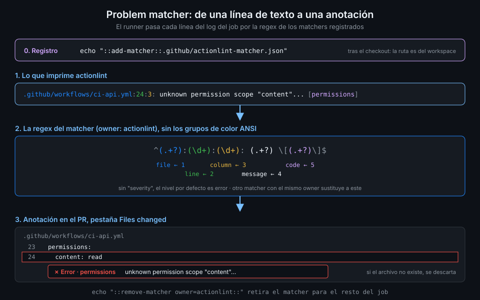

# Problem matchers y actionlint en CI

> Un problem matcher es una expresión regular que el runner pasa por cada línea del log. Cuando
> casa, la línea se convierte en una anotación. Con él, cualquier linter anota tu PR sin que
> cambies una línea de su código.



## 🎯 Objetivos

Al terminar este archivo eres capaz de:

- Leer un archivo de problem matcher y saber qué grupo de la regex alimenta cada campo
- Registrar y retirar un matcher con `::add-matcher::` y `::remove-matcher`
- Instalar actionlint en CI desde su release con checksum, nunca con un script remoto
- Usar el matcher oficial de actionlint para que cada error sea una anotación en el PR
- Explicar qué caza actionlint y qué no

## 1. Qué problema resuelve

En el archivo 02 viste que un script puede emitir `::error file=...,line=...::`. Eso exige
controlar el formato de salida, y la mayoría de herramientas no lo dan: actionlint, `ruff`,
`tsc` o `shellcheck` imprimen `archivo:línea:col: mensaje` a su manera y no saben nada de Actions.

Tienes tres opciones: reescribir la salida con `sed` o `awk` (frágil), buscar una action de
terceros que lo haga (otra dependencia que fijar y auditar) o decirle al runner cómo leer esa
salida. Un problem matcher es la tercera.

## 2. Cómo funciona

### El archivo

Un matcher es un JSON con una lista de `problemMatcher`. Este es el oficial de actionlint, el que
copias de su repo en el tag `v1.7.12`:

```json
{
  "problemMatcher": [
    {
      "owner": "actionlint",
      "pattern": [
        {
          "regexp": "^(?:\\x1b\\[\\d+m)?(.+?)(?:\\x1b\\[\\d+m)*:(?:\\x1b\\[\\d+m)*(\\d+)(?:\\x1b\\[\\d+m)*:(?:\\x1b\\[\\d+m)*(\\d+)(?:\\x1b\\[\\d+m)*: (?:\\x1b\\[\\d+m)*(.+?)(?:\\x1b\\[\\d+m)* \\[(.+?)\\]$",
          "file": 1,
          "line": 2,
          "column": 3,
          "message": 4,
          "code": 5
        }
      ]
    }
  ]
}
```

| Campo | Qué es |
|---|---|
| `owner` | Nombre del matcher. Obligatorio. Sirve para retirarlo; registrar otro con el mismo `owner` sustituye al anterior |
| `severity` | Nivel por defecto, `error` o `warning`. Si falta, `error` |
| `pattern[].regexp` | La expresión regular, en sintaxis ECMAScript |
| `file`, `line`, `column`, `message`, `code` | Número del grupo de captura que da cada dato. `message` es obligatorio |
| `loop` | Solo en el último patrón de un matcher de varias líneas: repetir mientras case |

Quita los `(?:\x1b\[\d+m)*` y la regex de actionlint se lee sola:
`^(.+?):(\d+):(\d+): (.+?) \[(.+?)\]$`. Esos grupos opcionales absorben los códigos de color ANSI
que actionlint imprime con `-color`: así el log se ve coloreado y el matcher sigue casando.

Para una línea como esta:

```text
.github/workflows/ci-api.yml:24:3: unknown permission scope "content". all available permission scopes are ... [permissions]
```

el runner crea una anotación de error en `.github/workflows/ci-api.yml`, línea 24, columna 3, con
el mensaje `unknown permission scope "content". all available...` y el código `permissions`.

### Registrar y retirar

```bash
echo "::add-matcher::.github/actionlint-matcher.json"
# ... a partir de aquí, cada línea del log del job pasa por la regex ...
echo "::remove-matcher owner=actionlint::"
```

La ruta es relativa al directorio de trabajo: por eso el matcher va en el repo y se registra
después del checkout. El matcher sigue activo en los steps siguientes del mismo job hasta que lo
retiras; en otro job no existe.

Si el archivo de una coincidencia no existe en el repo, la anotación se descarta. Con un matcher
que no da anotaciones, el primer sospechoso es una ruta que no casa con el checkout.

## 3. Cómo se usa

### actionlint en CI, con checksum

actionlint no tiene action oficial y no hace falta: es un binario de Go. La regla 9 de seguridad
de este bootcamp dice cómo se instala una herramienta: **versión fijada y checksum**. El checksum
no se copia de un blog ni de otro repo; sale de la propia release, que publica el `digest` de
cada archivo:

```bash
gh api repos/rhysd/actionlint/releases/tags/v1.7.12 \
  --jq '.assets[] | select(.name == "actionlint_1.7.12_linux_amd64.tar.gz") | .digest'
# sha256:8aca8db96f1b94770f1b0d72b6dddcb1ebb8123cb3712530b08cc387b349a3d8
```

Con eso, el job:

```yaml
name: actionlint-demo

on:
  pull_request:
    paths:
      - ".github/workflows/**"

concurrency:
  group: ${{ github.workflow }}-${{ github.ref }}
  cancel-in-progress: true

# Mínimo privilegio: lo verás a fondo en la Semana 12.
permissions:
  contents: read

jobs:
  actionlint:
    runs-on: ubuntu-24.04
    timeout-minutes: 5
    env:
      ACTIONLINT_VERSION: "1.7.12"
      # Campo digest de la release v1.7.12; si el tarball cambia, sha256sum -c falla.
      ACTIONLINT_SHA256: 8aca8db96f1b94770f1b0d72b6dddcb1ebb8123cb3712530b08cc387b349a3d8
    steps:
      - uses: actions/checkout@3d3c42e5aac5ba805825da76410c181273ba90b1 # v7.0.1
        with:
          persist-credentials: false

      - name: Instalar actionlint con checksum
        run: |
          archive="actionlint_${ACTIONLINT_VERSION}_linux_amd64.tar.gz"
          curl -fsSLO "https://github.com/rhysd/actionlint/releases/download/v${ACTIONLINT_VERSION}/${archive}"
          echo "${ACTIONLINT_SHA256}  ${archive}" | sha256sum -c
          tar -xzf "$archive" actionlint

      - name: actionlint con anotaciones
        run: |
          echo "::add-matcher::.github/actionlint-matcher.json"
          ./actionlint -color
```

Por qué cada pieza:

- **`curl` descarga, no ejecuta.** El archivo no corre hasta que `sha256sum -c` confirma que es
  el que publicó el autor. Un script remoto con `curl | bash` correría lo que el servidor
  quisiera ese día.
- **`set -e` implícito**: si `sha256sum -c` falla, el step para antes de descomprimir.
- **`-color`**: el log se lee mejor y el matcher oficial está hecho para tolerarlo.
- **Sin argumentos**, actionlint busca todos los workflows de `.github/workflows/`.

### Qué caza actionlint

- Sintaxis: claves inexistentes, tipos equivocados, eventos o filtros mal escritos.
- Expresiones: contextos que no existen o no están disponibles en esa clave, funciones mal
  llamadas, comparaciones de tipos incompatibles.
- `needs:` que apunta a un job que no existe, o ciclos.
- Inputs inexistentes de las actions más populares, de las que lleva una base de datos.
- Expresiones no confiables dentro de `run:` (regla `expression`): el mismo
  `${{ github.event.head_commit.message }}` que zizmor llama `template-injection`.
- Los scripts de `run:`, con **shellcheck** si está en el `PATH`. El runner `ubuntu-24.04` lo
  trae, así que en CI ves también los avisos de shell que en tu máquina quizá no.

Lo que no caza: la lógica. Un `if:` sintácticamente perfecto que nunca se cumple, un filtro de
rutas que no casa con nada o un permiso que falta solo se ven ejecutando.

## 4. Antipatrones

| Antipatrón | Por qué duele | Qué hacer en su lugar |
|---|---|---|
| `bash <(curl ... download-actionlint.bash)` | Ejecuta lo que sirva el servidor ese día | Tarball de la release y `sha256sum -c` |
| Checksum copiado de otro repo o de un blog | No sabes de qué archivo es | Campo `digest` de la release con `gh api` |
| Registrar el matcher antes del checkout | La ruta no existe: no hay anotaciones | `add-matcher` después del checkout |
| Una regex propia para actionlint | No tolera los códigos de color o una forma de línea | El matcher oficial, copiado del tag fijado |
| Dos herramientas con salida parecida y un matcher activo | Anotaciones falsas de la otra | `::remove-matcher owner=...::` entre las dos |
| `actionlint \|\| true` "para que no rompa" | La puerta deja de serlo | Que falle, y arreglar lo que dice |

## 5. Trucos

- **`actionlint -oneline`** da una línea por error, sin el fragmento de código: ideal para
  `grep` o para contar errores en local.
- **`actionlint -shellcheck=`** (vacío) desactiva shellcheck. Útil para separar en local los
  errores de sintaxis de los de shell; en CI déjalo activo.
- **Prueba tu matcher en local** antes de subirlo: la regex es ECMAScript, así que
  `node -e` o el buscador de tu editor sirven para ver qué grupos captura.
- **Para salidas en varias líneas** (el archivo en una línea y sus errores debajo), la
  documentación del toolkit trae un ejemplo completo con `loop`: el de `eslint-stylish`.

Verificado con actionlint 1.7.12 y ubuntu-24.04, noviembre 2026.

## 📚 Recursos Adicionales

- [actions/toolkit: docs/problem-matchers.md](https://github.com/actions/toolkit/blob/main/docs/problem-matchers.md)
- [actionlint: Usage, "Use actionlint on GitHub Actions"](https://github.com/rhysd/actionlint/blob/v1.7.12/docs/usage.md)
- [actionlint: lista de comprobaciones](https://github.com/rhysd/actionlint/blob/v1.7.12/docs/checks.md)
- [GitHub Docs: Workflow commands, "Adding a matcher"](https://docs.github.com/en/actions/reference/workflows-and-actions/workflow-commands)

## ✅ Checklist de Verificación

- [ ] Sé qué hace cada campo de un problem matcher
- [ ] Sé por qué la regex de actionlint tiene grupos para los códigos de color
- [ ] Sé registrar y retirar un matcher, y desde dónde se resuelve su ruta
- [ ] Sé sacar el checksum de una release con `gh api` y comprobarlo con `sha256sum -c`
- [ ] Sé qué caza actionlint, incluido shellcheck, y qué no

---

| ← Anterior | Siguiente → |
|:---|---:|
| [Logs de depuración](03-logs-de-depuracion.md) | [zizmor](05-zizmor.md) |
