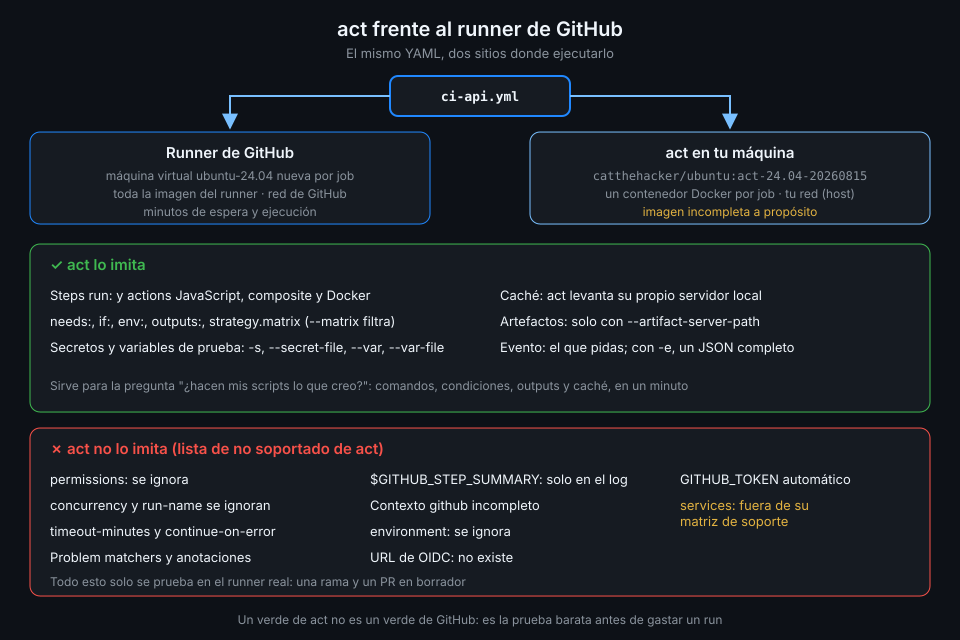

# act

> act lee tus workflows y ejecuta sus jobs en contenedores Docker de tu máquina. Prueba en un
> minuto lo que un push tardaría cinco en contarte, siempre que sepas dónde deja de parecerse al
> runner de verdad.



## 🎯 Objetivos

Al terminar este archivo eres capaz de:

- Explicar cómo convierte act un workflow en contenedores Docker
- Elegir y fijar la imagen que hace de runner `ubuntu-24.04`
- Lanzar un evento, un workflow o un job concreto, con secretos y variables de prueba
- Saber qué partes de Actions act no imita y no fiarte de él en ellas
- Leer la salida de act sin confundir sus marcas con errores de tu YAML

## 1. Qué problema resuelve

Cambias un step de `ci-api.yml`, haces push, esperas a que un runner quede libre, a que se
instale uv, a que se resuelvan las dependencias, y ves que te faltaba una comilla. Otro push. El
historial del PR se llena de `fix ci`, `fix ci again`, y cada intento cuesta minutos.

actionlint caza la comilla. Lo que no caza es que el script funcione: que `uv sync --locked`
encuentre el lock, que el comando de `ruff` sea el correcto, que el `if:` deje pasar el step.
Para eso hay que ejecutar, y act ejecuta en tu máquina.

## 2. Cómo funciona

1. **Lee los workflows** de `.github/workflows/` (o el que le digas con `-W`) y monta el plan:
   qué jobs dispara el evento pedido y en qué orden según `needs:`.
2. **Elige una imagen por cada `runs-on:`**. La etiqueta `ubuntu-24.04` no significa nada para
   Docker: con `-P ubuntu-24.04=<imagen>` le dices qué imagen hace de runner.
3. **Clona las actions** de cada `uses:` en su caché (`~/.cache/act`), en el SHA que fijaste.
4. **Arranca un contenedor por job** con tu repo montado como espacio de trabajo y ejecuta los
   steps dentro, con las variables de entorno `GITHUB_*` que puede reconstruir.
5. **Construye el evento** con lo que sabe de tu repo local (rama, commit, remoto). Para un
   evento con más datos le pasas un JSON con `-e`.

### La imagen del runner

El runner real de `ubuntu-24.04` es una máquina virtual con decenas de gigas de herramientas. act
usa imágenes Docker mucho más pequeñas que imitan lo justo. Las más usadas son las de
`catthehacker/ubuntu`:

| Tag | Qué es |
|---|---|
| `act-24.04` | La imagen de tamaño medio para Ubuntu 24.04. **Se mueve**: cada publicación la reapunta |
| `act-24.04-20260815` | La misma, congelada en una fecha. La que fijas |
| `full-24.04` | Un volcado del sistema de archivos del runner real; enorme |

La documentación de act lo dice claro: estas imágenes son **intencionadamente incompletas**. No
traen todas las herramientas del runner, y algunas cosas no funcionan dentro de un contenedor
aunque estén instaladas (todo lo que necesite `systemd`, por ejemplo). Fijar la imagen con fecha
es la misma regla que con una action: hoy y dentro de un mes pruebas contra lo mismo.

### Lo que act imita

- Steps `run:` y actions JavaScript, composite y Docker.
- `needs:`, `if:`, `env:`, `outputs:`, `strategy.matrix` (con `--matrix` filtras una combinación).
- Secretos (`-s`, `--secret-file`) y variables (`--var`, `--var-file`), enmascarados en el log.
- La caché: act levanta su propio servidor de caché local, así que `actions/cache` y la caché de
  `setup-uv` guardan y restauran entre ejecuciones en tu máquina.
- Los artefactos, **solo** si arrancas su servidor con `--artifact-server-path <dir>`.

### Lo que act no imita

Según su propia lista de funcionalidades no soportadas:

| No imita | Consecuencia |
|---|---|
| `concurrency` y `run-name` | Se ignoran: no puedes probar cancelaciones |
| `permissions` | Se ignoran: un permiso que falta no se nota en local |
| `timeout-minutes` y `continue-on-error` | Se ignoran |
| Problem matchers y anotaciones | Los `::error` salen como texto; no hay anotaciones |
| `$GITHUB_STEP_SUMMARY` | No hay página de resumen: act 0.2.94 imprime el contenido en el log con `⚙ Summary` |
| Contexto `github` completo | Faltan campos; los que dependen del evento salen vacíos si no pasas `-e` |
| `environment:` | Se ignora (Semana 13) |
| URL de OIDC | No existe: nada que use OIDC funciona (Semana 13) |
| `GITHUB_TOKEN` | No hay token automático: si un step lo necesita, falla |

Y una diferencia de fondo: el runner real es una máquina virtual desechable y act es un
contenedor en tu máquina, con tu Docker y tu red (`--network host` por defecto). Lo que el job
haga con Docker o con la red lo hace en tu equipo. La matriz de soporte de act, que avisa de que
está incompleta, tampoco da `services:` por soportado: no cuentes con probar en act los jobs con
PostgreSQL de la Semana 05.

## 3. Cómo se usa

### Ver antes de ejecutar

```bash
act -l
# Stage  Job ID  Job name               Workflow name  Workflow file  Events
# 0      lint    Lint y formato (ruff)  ci-api         ci-api.yml     push,pull_request,workflow_dispatch
# 0      test    Tests unitarios        ci-api         ci-api.yml     push,pull_request,workflow_dispatch
# ...
```

`-l` lista jobs, etapas (el orden que sale de `needs:`) y eventos de todos los workflows, en un
segundo y sin crear contenedores.

### Ejecutar un job

```bash
act pull_request \
  -W .github/workflows/ci-api.yml \
  -j lint \
  -P ubuntu-24.04=catthehacker/ubuntu:act-24.04-20260815 \
  --container-architecture linux/amd64
# [ci-api/Lint y formato (ruff)] 🚀  Start image=catthehacker/ubuntu:act-24.04-20260815
# ...
# [ci-api/Lint y formato (ruff)] 🏁  Job succeeded
```

| Pieza | Para qué |
|---|---|
| `pull_request` | El evento. Sin él, act usa `push` |
| `-W` | Un archivo o carpeta de workflows; sin él, todos |
| `-j lint` | Solo ese job, por su id (no por su `name:`) |
| `-P` | Qué imagen hace de `ubuntu-24.04` |
| `--container-architecture linux/amd64` | En un Mac con Apple Silicon, la imagen de `amd64` emulada |

Sobre la capa de `tablero`, ese comando termina en verde en torno a un minuto, con la caché de
`setup-uv` guardada para la siguiente vez. En `scripts/ci-local.sh` envuelves todo esto en un
comando corto (proyecto de la semana).

### Secretos, variables y eventos

```bash
# .secrets y .vars en formato .env; nunca en git
printf 'DATABASE_PASSWORD=cambiame\n' > .secrets
act pull_request -j test --secret-file .secrets --var API_LOG_LEVEL=debug

# Un evento concreto, con los campos que tu workflow lee
act workflow_dispatch -e event.json --input dry_run=true
```

Añade `.secrets` y `.vars` a `.gitignore` antes de crearlos. Y ni en local pongas un secreto real:
act imprime mucho, tu terminal guarda historial y un error de copia lo deja en un archivo. La
documentación de act sugiere `-s GITHUB_TOKEN="$(gh auth token)"` para los workflows que
necesitan token; ese token es **tuyo**, con todos los permisos de tu cuenta, y un step de terceros
lo recibiría entero. En `tablero` ningún job que pruebes en local lo necesita.

### Leer la salida de act

- Cada línea lleva `[workflow/nombre del job]` delante, como `--log-failed` en `gh`.
- `⭐ Run Main ...` y `✅ Success - Main ...` marcan inicio y fin de cada step.
- Líneas como `⚙ ::set-output:: uv-version=0.13.6`, `⚙ ::set-env:: ...` o `⚙ ::add-path:: ...`
  son la forma en que act **pinta** los outputs, variables y cambios de `PATH` que el step
  escribió en `$GITHUB_OUTPUT`, `$GITHUB_ENV` y `$GITHUB_PATH`. No significan que tu YAML (ni la
  action) use los comandos deprecados.
- `--dryrun` (`-n`) no crea contenedores pero sí clona las actions: en `tablero` tarda casi lo
  mismo que la ejecución real. Para ver el plan, `-l` es mejor.

## 4. Antipatrones

| Antipatrón | Por qué duele | Qué hacer en su lugar |
|---|---|---|
| `-P ubuntu-24.04=catthehacker/ubuntu:act-24.04` | La etiqueta se mueve: tu prueba cambia sin que cambies nada | Tag con fecha |
| Secretos reales en `.secrets` o en `-s` | Acaban en el historial o en un log | Valores de prueba (`cambiame`) |
| `.secrets` sin `.gitignore` | Un `git add .` lo publica | Ignorarlo antes de crearlo |
| Dar por bueno un verde de act | No comprueba permisos, concurrencia, timeouts ni anotaciones | act para la lógica; la rama de prueba para el resto |
| Instalar act con `curl ... \| bash` | Ejecuta lo que sirva el servidor | Binario de la release con checksum |
| Probar con act un job que despliega | Corre en tu máquina, con tu red y tu Docker | Solo jobs de CI sin efectos fuera |

## 5. Trucos

- **`act -g`** dibuja el grafo de jobs de cada workflow en la terminal: útil cuando `needs:` se
  complica.
- **`--action-offline-mode`** no vuelve a descargar actions ni imágenes que ya tienes: la segunda
  ejecución arranca antes y funciona sin red.
- **`.actrc`** guarda flags por defecto, uno por línea. El de tu carpeta personal se aplica
  siempre; el del proyecto solo puede fijar flags que no tocan tu máquina salvo que pases
  `--trust-project-actrc`. Así un repo clonado no puede montarte nada a escondidas.
- **`act --list-options`** imprime en JSON todas las opciones que entiende tu versión: la forma
  rápida de comprobar si un flag existe antes de escribirlo en un script.

Verificado con act 0.2.94, catthehacker/ubuntu:act-24.04-20260815 y ubuntu-24.04, noviembre 2026.

## 📚 Recursos Adicionales

- [act: documentación](https://nektosact.com/)
- [act: funcionalidades no soportadas](https://nektosact.com/not_supported.html)
- [act: runners e imágenes](https://nektosact.com/usage/runners.html)
- [catthehacker/docker_images](https://github.com/catthehacker/docker_images)

## ✅ Checklist de Verificación

- [ ] Sé qué hace act con un workflow, paso a paso
- [ ] Sé por qué fijo la imagen del runner con un tag con fecha
- [ ] Sé lanzar un evento, un workflow y un job concretos
- [ ] Sé pasar secretos y variables de prueba sin publicarlos
- [ ] Sé qué no imita act y qué pruebo en una rama real
- [ ] Sé leer las marcas `⚙ ::set-output::` de su salida

---

| ← Anterior | Siguiente → |
|:---|---:|
| [zizmor](05-zizmor.md) | [Estrategia de pruebas de workflows](07-estrategia-de-pruebas-de-workflows.md) |
