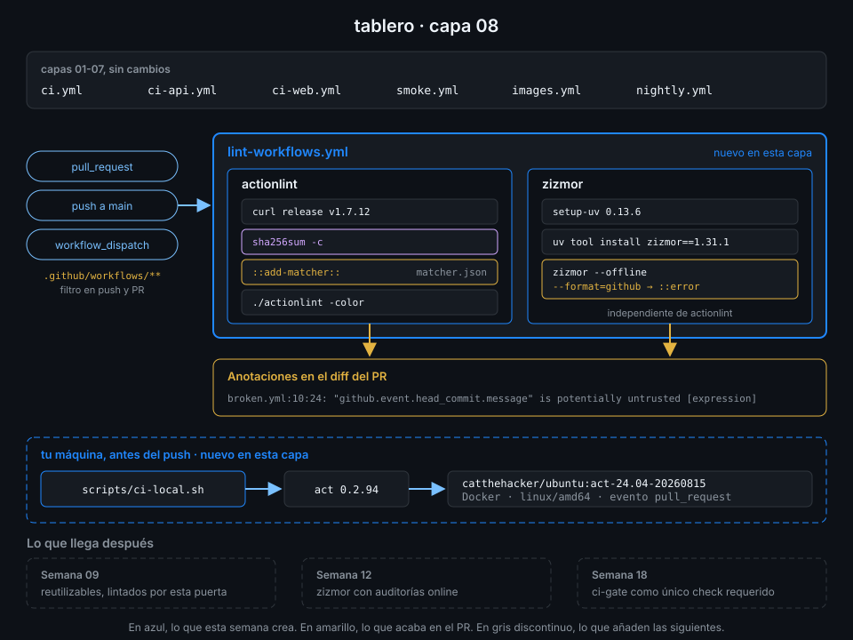

# Proyecto: capa 08 de tablero



## 🎯 Objetivo

Que ningún cambio en los workflows de `tablero` llegue a `main` sin pasar por actionlint y zizmor,
con cada error marcado en la línea exacta del PR, y que puedas ejecutar cualquier workflow en tu
máquina antes de gastar un minuto de runner.

## 📦 Qué añade esta capa

Los seis workflows de la capa 07 se quedan como están. Esta capa añade tres archivos:

| Archivo | Qué hace | Por qué existe |
|---|---|---|
| `.github/workflows/lint-workflows.yml` (nuevo) | Job `actionlint`: descarga actionlint 1.7.12 de su release, comprueba el checksum, registra el matcher y lo ejecuta. Job `zizmor`: lo instala con `uv tool install` y lo ejecuta sin red con `--format=github` | Hasta ahora actionlint y zizmor corrían solo si tú te acordabas. Ahora son una puerta del PR |
| `.github/actionlint-matcher.json` (nuevo) | El problem matcher que publica actionlint, copiado de su repo en el tag 1.7.12 | Convierte `archivo:línea:col: mensaje [regla]` en una anotación sobre la línea del diff |
| `scripts/ci-local.sh` (nuevo) | Envuelve act con la imagen de runner fijada, `linux/amd64` y el evento `pull_request` por defecto | Que probar en local sea un comando corto e igual para todos, no una línea de act que cada uno recuerda a su manera |

| Situación | Qué pasa |
|---|---|
| PR que toca `.github/workflows/` | `lint-workflows` corre con sus dos jobs; un error queda anotado en la línea |
| PR que solo toca `api/` | `lint-workflows` no corre: su filtro de rutas lo salta |
| `scripts/ci-local.sh ci-api lint` | El job `lint` de `ci-api.yml` corre en tu Docker con la imagen `act-24.04` fechada |
| `scripts/ci-local.sh --list` | Lista los jobs de todos los workflows sin ejecutar nada |

La Semana 09 seguirá pasando por esta puerta: cada reutilizable nuevo se lintea igual. La 12
activa las auditorías de zizmor que consultan la API y deja el pipeline sin hallazgos con ellas.

## ✅ Requisitos verificables

- Todos tus workflows pasan actionlint
- zizmor no encuentra hallazgos en tus workflows
- lint-workflows.yml corre en los PR que cambian .github/workflows/
- El job actionlint instala actionlint 1.7.12 desde su release y comprueba el checksum
- .github/actionlint-matcher.json es el problem matcher de actionlint
- El job actionlint registra el problem matcher antes de ejecutar actionlint
- El job zizmor instala zizmor 1.31.1 con uv tool install
- zizmor emite sus hallazgos como anotaciones (--format=github)
- Todo job de ci, ci-api, ci-web, smoke, images, nightly y lint-workflows declara timeout-minutes
- scripts/ci-local.sh es ejecutable, empieza por #!/usr/bin/env bash y usa set -euo pipefail
- ci-local.sh fija la imagen del runner de act con un tag con fecha, nunca act-24.04 a secas
- ci-local.sh --list enseña los jobs de tus workflows, lint-workflows incluido
- Toda uses: remota de tus workflows está fijada por SHA de 40 caracteres con el tag en comentario
- lint-workflows.yml paró al menos un pull request con un workflow roto
- lint-workflows.yml terminó en success sobre el último commit de main

## 🎨 Criterios de calidad

Lo que `check-week.sh` no ve y la [rúbrica](../rubrica-evaluacion.md) sí puntúa:

- El checksum de actionlint sale del campo `digest` de la release (`gh api`), no de un hash copiado
  de otro repo, y un comentario dice de dónde viene.
- `actionlint-matcher.json` es la copia exacta del tag 1.7.12 (`diff` contra el original vacío).
- Los dos jobs de `lint-workflows.yml` son independientes: si actionlint falla, zizmor también
  informa.
- `ci-local.sh` falla con un mensaje claro si falta act o el workflow no existe, y avisa si la
  versión de act no es la fijada.
- El PR roto de la práctica 02 se cerró sin fusionar y su rama se borró.
- Ningún hallazgo de zizmor se silenció sin un comentario que diga por qué.
- Sin `TODO` en `.github/workflows/` ni en `scripts/`, y commits en Conventional Commits.

## 💡 Adaptación a tu dominio

| Tu proyecto | actionlint | zizmor | act |
|---|---|---|---|
| Un repo con pocos workflows | Igual, sin filtro de rutas si cambian poco | Igual | `act -j <job>` a mano puede bastar |
| Muchos repos en una org | El mismo job en un reutilizable central (Semanas 09 y 11) | Igual, con un `zizmor.yml` común | Un `ci-local.sh` por repo, misma imagen |
| Workflows con mucho shell | Mantén shellcheck: actionlint lo usa si está en el runner | Igual | act con `-s` para secretos de prueba, nunca reales |
| Equipo con Macs ARM | Igual | Igual | `--container-architecture linux/amd64`, ya incluido |

## 🚦 Cómo entregarlo

Si hiciste las prácticas 02 a 04 ya tienes los tres archivos: repásalos contra los requisitos y
los criterios. Si no, parte del starter.

1. Copia el starter y el matcher, completa los `TODO 1` a `TODO 7` y pasa los dos linters:

   ```bash
   cd ~/code/tablero
   S=~/code/bc-github-actions/bootcamp/week-08-probar_y_depurar_workflows/3-proyecto/starter
   cp "$S/.github/workflows/lint-workflows.yml" .github/workflows/
   cp "$S/scripts/ci-local.sh" scripts/ && chmod +x scripts/ci-local.sh
   gh api 'repos/rhysd/actionlint/contents/.github/actionlint-matcher.json?ref=v1.7.12' \
     --jq .content | base64 -d > .github/actionlint-matcher.json
   actionlint && zizmor --offline .github/workflows/
   # No findings to report. Good job! (... suppressed)
   ```

2. Pruébalo en local antes del push:

   ```bash
   ./scripts/ci-local.sh lint-workflows
   # ...
   # [lint-workflows/actionlint] 🏁  Job succeeded
   # [lint-workflows/zizmor    ] 🏁  Job succeeded
   ```

3. Súbelo a `main` y espera al run de **tu** commit:

   ```bash
   git add .github/ scripts/ci-local.sh
   git commit -m "ci: lint workflows with actionlint and zizmor on every pr"
   git push
   sleep 10
   id=$(gh run list --workflow lint-workflows.yml --commit "$(git rev-parse HEAD)" --json databaseId --jq '.[0].databaseId')
   gh run watch "$id" --exit-status
   # ✓ main lint-workflows · ...
   ```

   Si tu último commit de `main` no toca `.github/workflows/`, el filtro salta el workflow: lánzalo
   a mano con `gh workflow run lint-workflows.yml --ref main`.

4. Lanza la verificación:

   ```bash
   cd ~/code/bc-github-actions
   ./scripts/check-week.sh 08
   # 15/15 comprobaciones superadas.
   ```

## 🧯 Errores comunes

| Síntoma | Causa | Solución |
|---|---|---|
| `actionlint_1.7.12_linux_amd64.tar.gz: FAILED` | El hash de `ACTIONLINT_SHA256` no es el del tarball | Sácalo de `gh api repos/rhysd/actionlint/releases/tags/v1.7.12 --jq '.assets[] \| select(.name \| endswith("linux_amd64.tar.gz")) \| .digest'` |
| actionlint falla pero el PR no tiene anotaciones | Falta `::add-matcher::`, o la ruta del JSON no coincide | Registra `.github/actionlint-matcher.json` en el mismo step, antes de ejecutar actionlint |
| Anotaciones en archivos raros o duplicadas | El matcher sigue activo cuando otra herramienta imprime el mismo formato | `::remove-matcher owner=actionlint::` al terminar |
| `zizmor: command not found` | `uv tool install` deja el binario en `~/.local/bin`, fuera del `PATH` del step | Usa `setup-uv`, que añade esa ruta al `PATH` |
| zizmor en verde en local y en rojo en CI | Versiones distintas | `zizmor==1.31.1` en los dos sitios |
| `ci-local.sh` tarda minutos la primera vez | act descarga la imagen de runner (~570 MB) y clona cada action | Normal; la segunda vez ya está en tu Docker |
| `lint-green-on-main` en rojo | El último commit de `main` no tocó workflows y el filtro saltó el run | Paso 3: `gh workflow run lint-workflows.yml --ref main` |

## 🔗 Navegación

---

| ← Anterior | Siguiente → |
|:---|---:|
| [act en local](../2-practicas/04-act-en-local.md) | [Rúbrica de evaluación](../rubrica-evaluacion.md) |
