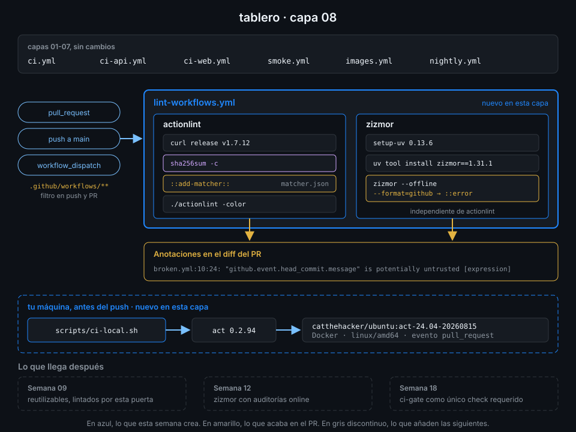

# Semana 08 — Probar y depurar workflows

> Un workflow es código, y el código se rompe. Esta semana aprendes a leer por qué falló un run,
> a sacarle más información sin tocar el YAML, a cazar los errores antes del push y a probar un
> workflow en tu máquina sin gastar un minuto de runner.

## 🎯 Objetivos de la Semana

Al terminar la semana eres capaz de:

- Leer un run fallido de arriba abajo: anotaciones, log del step, log en bruto y resumen, desde la
  UI y desde `gh`
- Emitir anotaciones, grupos, máscaras y mensajes de depuración con comandos de workflow
  (`::error`, `::warning`, `::notice`, `::group`, `::debug`, `::add-mask`)
- Activar los logs de depuración del step y del runner (`ACTIONS_STEP_DEBUG`,
  `ACTIONS_RUNNER_DEBUG`) para un único reintento o para todo el repo
- Convertir la salida de cualquier linter en anotaciones del PR con un problem matcher
- Usar actionlint y zizmor como puerta de cada PR que toque `.github/workflows/`, y entender qué
  caza cada uno
- Ejecutar un workflow en local con act, saber qué imita bien y dónde se separa del runner real
- Elegir dónde probar cada cambio: linter, act, rama de prueba o `workflow_dispatch`

## 📋 Prerrequisitos

| Necesitas | Dónde se aprende |
|---|---|
| `check-week.sh 07` en 16/16 | [Semana 07](../week-07-disparadores_filtros_y_concurrencia/README.md) |
| actionlint y zizmor instalados | [`docs/setup-entorno.md`](../../docs/setup-entorno.md), apartados 3 y 4 |
| Leer una ejecución en la UI | [Semana 01, teoría 06](../week-01-primer_workflow_y_modelo_de_ejecucion/1-teoria/06-leer-una-ejecucion.md) |
| Funciones de estado y `$GITHUB_STEP_SUMMARY` | [Semana 02, teoría 03](../week-02-expresiones_contextos_y_flujo_de_datos/1-teoria/03-condiciones-y-funciones-de-estado.md) y [05](../week-02-expresiones_contextos_y_flujo_de_datos/1-teoria/05-datos-entre-steps.md) |
| Filtros de rutas y `concurrency` | [Semana 07](../week-07-disparadores_filtros_y_concurrencia/README.md) |
| Docker funcionando en tu máquina | [Semana 05](../week-05-service_containers_y_postgresql/README.md) |

## 🗂️ Estructura de la Semana

```
week-08-probar_y_depurar_workflows/
├── README.md
├── rubrica-evaluacion.md          incluye el minisimulacro de cierre de la Fase 2
├── checks.json                    15 comprobaciones
├── 0-assets/                      4 diagramas SVG
├── 1-teoria/                      7 archivos, uno por concepto
├── 2-practicas/                   4 prácticas guiadas
├── 3-proyecto/
│   ├── README.md
│   └── starter/
│       ├── .github/workflows/lint-workflows.yml
│       └── scripts/ci-local.sh
├── 4-recursos/{ebooks-free,videografia,webgrafia}/README.md
└── 5-glosario/README.md
```

## 📝 Contenidos

### Teoría

| # | Archivo | Qué aprendes | Tiempo |
|:--:|---|---|:--:|
| 01 | [Leer un run que falla](1-teoria/01-leer-un-run-que-falla.md) | Anotaciones, log por step, log en bruto, `gh run view --log-failed` y reintentar solo lo fallido | 25 min |
| 02 | [Comandos de workflow](1-teoria/02-comandos-de-workflow.md) | `::error`, `::warning`, `::notice` con archivo y línea, `::group`, `::add-mask`, `::stop-commands` y sus límites | 30 min |
| 03 | [Logs de depuración](1-teoria/03-logs-de-depuracion.md) | `ACTIONS_STEP_DEBUG` y `ACTIONS_RUNNER_DEBUG` como secreto o variable, `gh run rerun --debug` y `runner.debug` | 25 min |
| 04 | [Problem matchers y actionlint en CI](1-teoria/04-problem-matchers-y-actionlint-en-ci.md) | Cómo un matcher convierte texto en anotaciones; actionlint instalado con checksum y su matcher | 25 min |
| 05 | [zizmor](1-teoria/05-zizmor.md) | Auditorías, severidad y confianza, personas, `--offline`, `--format=github` e ignorar un hallazgo con motivo | 30 min |
| 06 | [act](1-teoria/06-act.md) | Cómo simula act un runner, imágenes, eventos, secretos y variables, y qué no imita | 30 min |
| 07 | [Estrategia de pruebas de workflows](1-teoria/07-estrategia-de-pruebas-de-workflows.md) | Qué prueba cada capa (linter, act, rama, dispatch) y cómo depurar sin ensuciar `main` | 15 min |

### Prácticas

| # | Archivo | Qué haces | Tiempo |
|:--:|---|---|:--:|
| 01 | [Depurar un run que falla](2-practicas/01-depurar-un-run-que-falla.md) | Un workflow de laboratorio que falla, leído con `gh`, anotado con comandos de workflow y relanzado con `--debug` | 1 h |
| 02 | [actionlint y problem matchers](2-practicas/02-actionlint-y-problem-matchers.md) | El job `actionlint` de `lint-workflows.yml`, con checksum y matcher; un PR roto que se queda en rojo con anotaciones | 1 h |
| 03 | [zizmor: primer contacto](2-practicas/03-zizmor-primer-contacto.md) | zizmor sobre tus workflows, un hallazgo provocado y corregido, y el job `zizmor` en CI | 1 h |
| 04 | [act en local](2-practicas/04-act-en-local.md) | act instalado con checksum, `scripts/ci-local.sh` y el job `lint` de `ci-api` corriendo en tu Docker | 1 h |

### Proyecto

[Capa 08 de `tablero`](3-proyecto/README.md): `lint-workflows.yml` revisa con actionlint y zizmor
cada cambio en `.github/workflows/` y deja los errores como anotaciones en el PR, y
`scripts/ci-local.sh` ejecuta cualquier workflow de `tablero` en tu máquina con act.



## ⏱️ Distribución del Tiempo (10 horas)

| Actividad | Horas |
|---|:--:|
| Teoría (7 archivos) | 3 |
| Práctica 01 — Depurar un run que falla | 1 |
| Práctica 02 — actionlint y problem matchers | 1 |
| Práctica 03 — zizmor: primer contacto | 1 |
| Práctica 04 — act en local | 1 |
| Proyecto — capa 08 | 1 |
| Minisimulacro de cierre de la Fase 2 | 1 |
| Autoevaluación con la rúbrica | 1 |
| **Total** | **10** |

## 🎓 Cierre de la Fase 2

Con esta semana termina la Fase 2 (Pipelines de Integración). La [rúbrica](rubrica-evaluacion.md)
incluye un minisimulacro cronometrado de 60 minutos sobre las semanas 05-08: preguntas tipo GH-200
de los dominios que cubre la fase (D1 y D2) y una tarea práctica de depuración sobre tu propio
`tablero`.

## 🎩 Trucos y atajos

- **`gh run view <id> --log-failed`** imprime solo el log de los steps que fallaron. Con
  `gh run view <id> --log | grep -n 'error'` buscas en todo el run sin abrir el navegador.
- **`gh run rerun <id> --failed --debug`** relanza solo los jobs fallidos con los logs de
  depuración activados para ese intento, sin crear ningún secreto ni variable.
- **`act -l`** lista jobs, etapas y eventos de todos tus workflows en un segundo, sin crear
  ningún contenedor: es la forma rápida de ver el grafo de `needs:`.
- **`zizmor --persona=pedantic`** enseña lo que el modo normal suprime (en `tablero`,
  `undocumented-permissions` y la imagen de PostgreSQL sin digest). Útil para revisar, no para
  la puerta del CI.
- **`echo "::remove-matcher owner=actionlint::"`** desactiva un problem matcher a mitad de job:
  así las líneas de otra herramienta con el mismo formato no se convierten en anotaciones falsas.
- **Las anotaciones viven en la API**: `gh api repos/{owner}/{repo}/check-runs/<job-id>/annotations`
  te las da en JSON, con archivo y línea, para un informe o un script.

## 📌 Entregables

- Un PR con un workflow roto que `lint-workflows.yml` dejó en rojo, con sus anotaciones
- `lint-workflows.yml` y `.github/actionlint-matcher.json` en `main`, en verde sobre el último
  commit, y `scripts/ci-local.sh` ejecutable (ver [proyecto](3-proyecto/README.md))
- La rúbrica respondida, con el minisimulacro de cierre de la Fase 2

## ✅ Verificación

```bash
cd ~/code/bc-github-actions
./scripts/check-week.sh 08
# Semana 08 — Probar y depurar workflows  [repo: <tu-org>/tablero]
#
#   ✅ Todos tus workflows pasan actionlint
#   ...
# 15/15 comprobaciones superadas.
```

Si algo sale en rojo, la pista te dice qué práctica y qué paso lo arreglan.

## 🔗 Navegación

---

| ← Anterior | Siguiente → |
|:---|---:|
| [Semana 07 — Disparadores, filtros y concurrencia](../week-07-disparadores_filtros_y_concurrencia/README.md) | [Leer un run que falla](1-teoria/01-leer-un-run-que-falla.md) |
