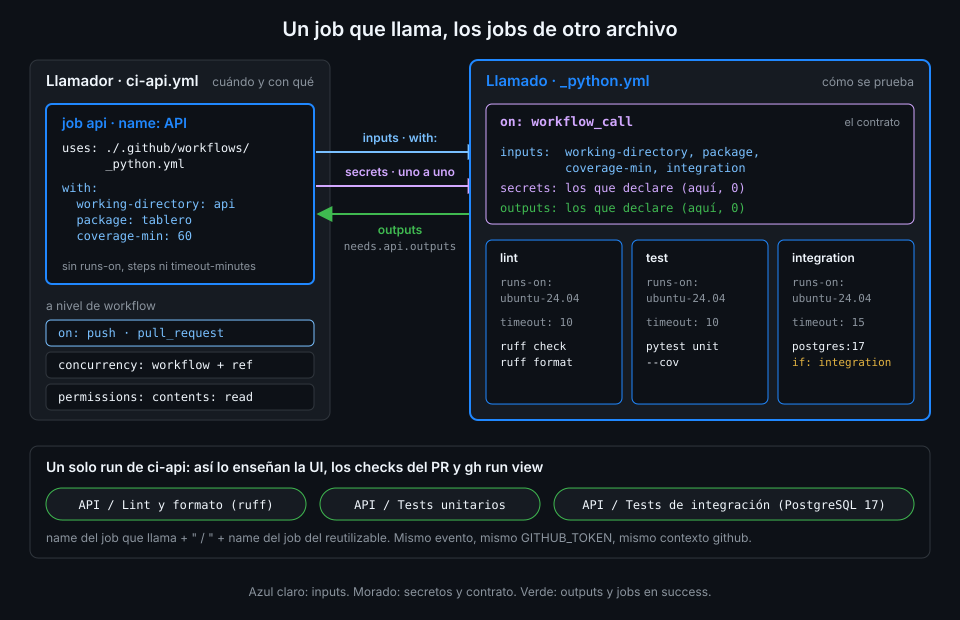

# Llamar a un reutilizable

> Un reutilizable tiene dos lados: el `on: workflow_call` que lo convierte en función y el job con
> `uses:` que lo llama. Este archivo explica los dos, las tres formas de apuntar al archivo y por
> qué el job que llama no es un job normal.



## 🎯 Objetivos

Al terminar este archivo eres capaz de:

- Escribir el esqueleto de un reutilizable con `on: workflow_call`
- Llamarlo con `uses:` a nivel de job, desde el mismo repo o desde otro fijado por SHA
- Elegir entre las referencias `./`, `$/` y `owner/repo/...@sha`, y explicar por qué `tablero`
  usa `./`
- Saber qué claves admite el job que llama y dónde va lo que no admite, como `timeout-minutes`

## 1. Qué problema resuelve

En el archivo 01 decidiste extraer los jobs de `ci-api` a `_python.yml`. Ahora tienes que
resolver tres cosas: cómo dice un workflow "puedo ser llamado", cómo lo llama otro y desde qué
versión del archivo. La tercera es la que tiene consecuencias de seguridad: un reutilizable
ejecuta código con el `GITHUB_TOKEN` de tu run, así que apuntar a una versión que puede cambiar
sin que lo veas es lo mismo que una action por tag.

## 2. Cómo funciona

### El lado del llamado: `on: workflow_call`

Un workflow se vuelve llamable con el evento `workflow_call`. Debajo declara su contrato:

```yaml
on:
  workflow_call:
    inputs: {}    # datos que acepta (archivo 03)
    secrets: {}   # secretos que acepta (archivo 04)
    outputs: {}   # lo que devuelve (archivo 03)
```

Las tres claves son opcionales. El resto del archivo es un workflow normal: `permissions`,
`jobs`, cada job con su `runs-on` y sus `steps`.

El archivo tiene que estar **directamente en `.github/workflows/`**. Las subcarpetas no están
soportadas: `./.github/workflows/python/_python.yml` no es una referencia válida.

### El lado del llamador: `uses:` en el job

La llamada es un job entero, no un step. Donde un job normal tiene `runs-on` y `steps`, el que
llama tiene `uses:` y, si el reutilizable los pide, `with:` y `secrets:`.

### Tres formas de apuntar al archivo

| Referencia | Qué versión ejecuta | Cuándo |
|---|---|---|
| `./.github/workflows/_python.yml` | La del **mismo commit** que el llamador | Mismo repo; la que usa `tablero` |
| `$/.github/workflows/_python.yml` | La del mismo commit, con la sintaxis "self-repository" | Mismo repo, en github.com |
| `<tu-org>/actions-tablero/.github/workflows/_python.yml@<sha>` | La del SHA de 40 caracteres | Otro repo; el repo central de la Semana 11 |

- **`./`** resuelve el archivo en el mismo commit que disparó el run. En un PR que cambia
  `_python.yml`, el run del PR usa el `_python.yml` del PR: pruebas el cambio antes de fusionarlo.
- **`$/`** es la sintaxis "self-repository" que GitHub admite desde julio de 2026 (no está
  disponible en GitHub Enterprise Server). En una llamada a un reutilizable del mismo repo
  apunta al mismo repo y commit que `./`; en un step, `./` lee el workspace y `$/` no (la
  diferencia importa en la Semana 11) y las políticas de la
  organización que exigen referencias fijadas la cuentan como fijada.
- **`owner/repo/...@ref`** apunta a otro repo. El `@ref` es obligatorio y, con las reglas de
  este bootcamp, es un SHA de 40 caracteres con el tag en comentario, como cualquier action. Una
  rama o un tag pueden moverse; un SHA, no.

### Por qué `tablero` usa `./`

zizmor 1.31.1 trae la auditoría `self-repository` (nivel `help`, introducida en zizmor 1.30.0),
que pide `$/` en lugar de `./`. Pero actionlint 1.7.12 todavía rechaza `$/` (issue abierto
rhysd/actionlint#711), y la puerta de la Semana 08 pasa los dos linters. Así que la llamada se
queda en `./` y el hallazgo se ignora con el motivo escrito:

```yaml
uses: ./.github/workflows/_python.yml # zizmor: ignore[self-repository] actionlint 1.7.12 no admite $/
```

Sin ese comentario, zizmor sale con código distinto de cero aunque el hallazgo sea solo `help`,
y `lint-workflows` se pone en rojo. Y `./` tiene una ventaja más: actionlint **lee el reutilizable
local** y valida la llamada contra su contrato. Con una referencia remota no puede leerlo.

Verificado con actionlint 1.7.12, zizmor 1.31.1 y ubuntu-24.04, noviembre 2026.

### Qué admite el job que llama

| Admite | No admite |
|---|---|
| `name`, `uses`, `with`, `secrets` (o `secrets: inherit`, archivo 04) | `runs-on`, `steps` |
| `needs`, `if`, `strategy` | `env`, `defaults` |
| `permissions`, `concurrency` | `timeout-minutes` |
| `cache-mode` (archivo 05) | `services`, `container` |

Todo lo que describe *cómo corre* un job (runner, pasos, variables, servicios, límite de tiempo)
pertenece a los jobs del reutilizable. El job que llama solo decide *si* corre (`if`, `needs`),
*cuántas veces* (`strategy`), *con qué* (`with`, `secrets`) y *con qué techo* (`permissions`).

## 3. Cómo se usa

### Un reutilizable mínimo y su llamada

Una versión reducida de `_python.yml`, solo con el lint, para ver las piezas sin ruido:

```yaml
name: _python

on:
  workflow_call:
    inputs:
      working-directory:
        description: Carpeta del proyecto, la que contiene pyproject.toml y uv.lock
        type: string
        required: true

# Techo de permisos del reutilizable: el llamador puede dar menos, nunca más.
permissions:
  contents: read

jobs:
  lint:
    name: Lint y formato (ruff)
    runs-on: ubuntu-24.04
    timeout-minutes: 10
    defaults:
      run:
        working-directory: ${{ inputs.working-directory }}
    steps:
      - uses: actions/checkout@3d3c42e5aac5ba805825da76410c181273ba90b1 # v7.0.1
        with:
          persist-credentials: false
      - uses: astral-sh/setup-uv@68559e99cc807c1eb7e9238fd43a15bba460eec2 # v10.3.3
        with:
          version: "0.13.6"
          enable-cache: true
          cache-dependency-glob: ${{ inputs.working-directory }}/uv.lock
      - name: Dependencias exactas del lockfile
        run: uv sync --locked
      - name: ruff check
        run: uv run --no-sync ruff check --output-format=github .
```

Y el llamador:

```yaml
name: ci-api

on:
  pull_request:
    paths:
      - "api/**"
      - ".github/workflows/ci-api.yml"
      - ".github/workflows/_python.yml"

# Mínimo privilegio: lo verás a fondo en la Semana 12.
permissions:
  contents: read

jobs:
  api:
    name: API
    uses: ./.github/workflows/_python.yml # zizmor: ignore[self-repository] actionlint 1.7.12 no admite $/
    with:
      working-directory: api
```

`working-directory` viaja de `with:` a `inputs.working-directory`, y ahí se usa en `defaults` y
en `with:` de una action. Ninguna de las dos es un `run:`: el valor no pasa por el shell.

### El nombre que ves en la UI

El job que llama se llama `API`; el job del reutilizable, `Lint y formato (ruff)`. En la lista de
jobs del run, en los checks del PR y en `gh run view` aparece la combinación:
`API / Lint y formato (ruff)`. Por eso el job que llama lleva un `name:` corto y legible: es el
prefijo de todo lo que venga de esa llamada.

### `timeout-minutes` va en los jobs del reutilizable

Desde la Semana 07, todo job de `tablero` lleva `timeout-minutes`. El reflejo es ponerlo en el
job que llama, y actionlint lo para:

```text
.github/workflows/ci-api.yml:8:5: when a reusable workflow is called with "uses", "timeout-minutes" is not available. only following keys are allowed: "name", "uses", "with", "secrets", "needs", "if", and "permissions" in job "api" [syntax-check]
```

El job que llama no tiene runner propio, así que no hay nada que cronometrar. El límite va en
**cada job del reutilizable**, donde están el `runs-on` y los `steps`: en `_python.yml`, 10
minutos para `lint` y `test`, 15 para `integration`. Por eso la comprobación `jobs-timeout` de
esta semana mira solo los jobs con `runs-on`: los que llaman quedan fuera porque no pueden
llevarlo.

La lista del mensaje de actionlint 1.7.12 se queda corta: no nombra `strategy` ni `concurrency`,
pero los acepta en el job que llama, como la documentación de GitHub. `cache-mode`, en cambio, lo
rechaza (archivo 05).

### Desde otro repo

Cuando en la Semana 11 muevas los reutilizables a `<tu-org>/actions-tablero`, el job que llama
cambia solo en la referencia: `<tu-org>/actions-tablero/.github/workflows/_python.yml@<sha>`
seguido de `# v1.0.0`. El SHA lo resuelves con `scripts/resolve-sha.sh`, como el de cualquier
action. A cambio pierdes la validación local de actionlint: el archivo ya no está en tu disco.

## 4. Antipatrones

| Antipatrón | Por qué duele | Qué hacer en su lugar |
|---|---|---|
| `uses:` del reutilizable dentro de `steps` | Un step espera una action: GitHub no expande un workflow desde un step | `uses:` a nivel de job |
| Reutilizable en `.github/workflows/ci/_python.yml` | Las subcarpetas no están soportadas | Directamente en `.github/workflows/` |
| `timeout-minutes`, `env` o `runs-on` en el job que llama | Claves no admitidas: actionlint falla y GitHub rechaza el workflow | En los jobs del reutilizable |
| Reutilizable de otro repo por `@main` o `@v1` | La rama o el tag se mueven y tu CI cambia sin un commit tuyo | SHA de 40 caracteres con el tag en comentario |
| Quitar el `# zizmor: ignore[self-repository]` sin cambiar a `$/` | La puerta de linters se pone en rojo | Mantener `./` con el motivo hasta que actionlint admita `$/` |
| Job que llama sin `name` | El prefijo de todos sus jobs en la UI pierde sentido | `name:` corto: `API`, `Web` |

## 5. Trucos

- **Prueba el cambio del reutilizable en el propio PR**: con `./`, el run del PR usa el
  reutilizable del PR. No necesitas fusionar para ver si `_python.yml` funciona.
- **actionlint te da el contrato gratis**: si no recuerdas qué inputs declara `_python.yml`,
  pasa uno inventado. El error de actionlint los enumera todos:
  `defined inputs are "coverage-min", "integration", "package", "working-directory"`.
- **`yq '.jobs[] | .uses // "sin uses"' .github/workflows/ci-api.yml`** te dice de un vistazo
  qué jobs de un workflow son llamadas y cuáles son jobs normales.
- **Un `name:` con expresión en el job del reutilizable** distingue llamadas al mismo archivo:
  `_image.yml` se llama `Imagen tablero-${{ inputs.component }}`, y en la UI ves
  `API / Imagen tablero-api` y `Web / Imagen tablero-web`.

## 📚 Recursos Adicionales

- [GitHub Docs: Reuse workflows](https://docs.github.com/en/actions/how-tos/reuse-automations/reuse-workflows)
- [GitHub Docs: Reusing workflow configurations, `jobs.<job_id>.uses`](https://docs.github.com/en/actions/reference/workflows-and-actions/reusing-workflow-configurations)
- [zizmor: auditoría `self-repository`](https://docs.zizmor.sh/audits/#self-repository)
- [actionlint: issue #711, sintaxis `$/`](https://github.com/rhysd/actionlint/issues/711)

## ✅ Checklist de Verificación

- [ ] Sé escribir el `on: workflow_call` de un reutilizable
- [ ] Sé que la llamada es un job con `uses:`, no un step
- [ ] Sé qué versión del archivo ejecuta cada referencia: `./`, `$/` y `owner/repo/...@sha`
- [ ] Sé por qué `tablero` usa `./` con un `zizmor: ignore` y el motivo escrito
- [ ] Sé qué claves admite el job que llama y por qué `timeout-minutes` va en el reutilizable
- [ ] Sé de dónde sale el nombre `API / Tests unitarios`

---

| ← Anterior | Siguiente → |
|:---|---:|
| [Por qué reutilizar workflows](01-por-que-reutilizar-workflows.md) | [Inputs y outputs](03-inputs-y-outputs.md) |
