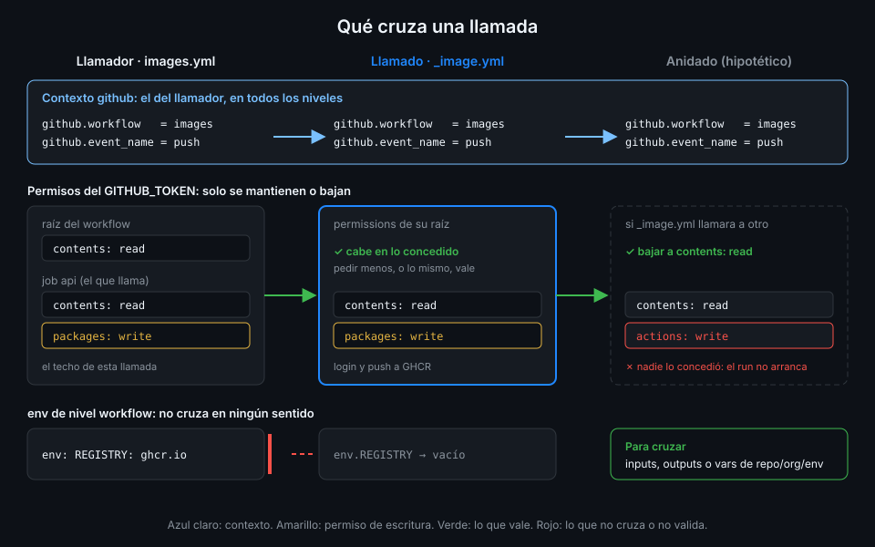

# Contexto, permisos y concurrencia

> Un reutilizable corre dentro del run de quien lo llama: ve su evento, usa su token y comparte su
> nombre. Saberlo te deja predecir qué vale `github.workflow`, qué puede hacer el `GITHUB_TOKEN` y
> por qué una `concurrency` mal copiada hace que el reutilizable cancele a su propio llamador.



## 🎯 Objetivos

Al terminar este archivo eres capaz de:

- Predecir el valor del contexto `github` dentro de un reutilizable
- Explicar cómo se calculan los permisos del `GITHUB_TOKEN` en una cadena de llamadas
- Conceder un permiso solo al job que llama que lo necesita
- Evitar el interbloqueo de `concurrency` con `github.workflow`
- Saber qué hace `cache-mode` y por qué aún no lo usas en `tablero`

## 1. Qué problema resuelve

Tres preguntas que se responden mal por intuición:

- Dentro de `_image.yml`, ¿`github.event_name` es `workflow_call` o el evento que disparó
  `images`? Si te equivocas, el `if:` que decide si publicar nunca se cumple.
- Si `_image.yml` declara `packages: write`, ¿basta con eso para publicar? Si la respuesta fuera
  sí, cualquier reutilizable podría darse los permisos que quisiera.
- Si copias la `concurrency` de `ci-api.yml` a `_python.yml`, ¿qué pasa? La respuesta es que el
  run se cancela a sí mismo.

## 2. Cómo funciona

### El contexto `github` es el del llamador

No hay un evento `workflow_call` visible desde dentro. El reutilizable hereda el contexto
`github` completo del workflow que lo llama:

| Expresión dentro de `_python.yml` | Llamado desde `ci-api` en un PR |
|---|---|
| `github.workflow` | `ci-api`, el `name:` del llamador |
| `github.event_name` | `pull_request` |
| `github.ref`, `github.sha` | Los del PR |
| `github.event` | El payload del `pull_request` |
| `github.token` | El `GITHUB_TOKEN` de este run |

Por eso `_image.yml` *podría* decidir solo si publica con `github.event_name`. No lo hace: el
input `push` deja esa decisión en el llamador y el reutilizable no se ata a un evento.

### Permisos que solo bajan

Hay un único `GITHUB_TOKEN` por run y sus permisos se calculan de arriba abajo:

1. **El llamador** fija el techo: la raíz de `images.yml` da `contents: read` a todos sus jobs.
2. **El job que llama** puede cambiarlo para esa llamada con su propio `permissions:`. Si no lo
   declara, la documentación dice que el reutilizable recibe los permisos por defecto del
   `GITHUB_TOKEN`. En `tablero` cada job que llama a `_image.yml` declara los suyos para no
   depender de ese detalle.
3. **El reutilizable** solo puede mantener o **bajar** lo que recibe. Su `permissions:` de raíz
   es su techo y, a la vez, lo que necesita: si pide un permiso que el job que llama no concede,
   la llamada no valida y el run no arranca.
4. **Un reutilizable anidado** recibe lo que deja el anterior y, otra vez, solo puede mantenerlo o
   bajarlo.

`_image.yml` declara en su raíz `contents: read` y `packages: write`. En `images.yml`, la raíz se
queda en `contents: read` y solo los jobs `api` y `web` conceden `packages: write`. El job
`summary`, que no publica, sigue en `contents: read`. Lo verás a fondo en la Semana 12.

### `concurrency` y el interbloqueo de `github.workflow`

El job que llama admite `concurrency`, y el reutilizable puede tener la suya, de workflow o de
job. El problema es que **las dos se evalúan con el mismo contexto `github`**: el del llamador.

Si `_python.yml` copia la `concurrency` de `ci-api.yml`:

```text
# En _python.yml: no lo hagas.
concurrency:
  group: ${{ github.workflow }}-${{ github.ref }}
  cancel-in-progress: true
```

`github.workflow` vale `ci-api` en los dos archivos, así que el grupo es el mismo:
`ci-api-refs/pull/7/merge`. El llamador ya ocupa ese grupo; el reutilizable entra en el mismo
grupo con `cancel-in-progress: true` y cancela lo que está en curso, que es su propio llamador.
El run termina cancelado sin que nadie haya empujado un commit nuevo.

La regla: **si usas `cancel-in-progress: true`, no repitas el mismo `group` en llamador y
llamado.** En `tablero` la regla es más simple todavía: la `concurrency` vive solo en los
llamadores. El reutilizable no sabe cuándo corre, así que no le toca decidir qué se cancela.

### `cache-mode`

`cache-mode` es una clave del job que llama que limita el acceso del reutilizable a la caché de
Actions:

| Valor | El reutilizable puede |
|---|---|
| `read` | Restaurar cachés, no guardarlas |
| `write` | Restaurar y guardar |
| `write-only` | Guardar, no restaurar |
| `none` | Ni restaurar ni guardar |

Si el llamador fija un modo y el reutilizable pide más, la llamada no valida. Sirve para que un
reutilizable que ejecuta código poco fiable no pueda envenenar la caché que luego usan los
workflows de `main`.

`tablero` no lo usa todavía: actionlint 1.7.12 lo rechaza con
`unexpected key "cache-mode" for "job" section`, y la puerta de linters se pondría en rojo.
Verificado con actionlint 1.7.12 y ubuntu-24.04, noviembre 2026.

## 3. Cómo se usa

### Conceder el permiso en el job que llama

```yaml
name: images-permissions

on:
  workflow_dispatch:

# Mínimo privilegio: lo verás a fondo en la Semana 12.
permissions:
  contents: read

jobs:
  api:
    name: API
    # El reutilizable pide packages: write; si este job no lo concede, el run no arranca.
    permissions:
      contents: read
      packages: write
    uses: ./.github/workflows/_image.yml # zizmor: ignore[self-repository] actionlint 1.7.12 no admite $/
    with:
      component: api
      push: true
    secrets:
      registry-password: ${{ secrets.GITHUB_TOKEN }}

  summary:
    name: Digest
    needs: api
    runs-on: ubuntu-24.04
    timeout-minutes: 5
    steps:
      - name: Digest en el resumen
        env:
          WORKFLOW: ${{ github.workflow }}
          DIGEST: ${{ needs.api.outputs.digest }}
        run: echo "$WORKFLOW publicó $DIGEST" >> "$GITHUB_STEP_SUMMARY"
```

Dos detalles:

- El `permissions:` del job que llama **sustituye** al de la raíz, no se suma. Por eso repite
  `contents: read`: sin él, el checkout de `_image.yml` se quedaría sin permiso de lectura.
- El secreto `registry-password` es el `GITHUB_TOKEN`, y su alcance es el que concede el job
  `api`. Pasarlo como secreto no le añade permisos (archivo 04).

### La `concurrency` correcta

En el llamador, a nivel de workflow, como desde la Semana 07:

```yaml
# Un run por workflow y ref: en un PR, el push nuevo cancela el run anterior;
# en main cada commit termina su run.
concurrency:
  group: ${{ github.workflow }}-${{ github.ref }}
  cancel-in-progress: ${{ github.event_name == 'pull_request' }}
```

Si algún día un reutilizable necesita su propia `concurrency` (por ejemplo, un despliegue que no
puede correr dos veces a la vez), su `group` tiene que llevar algo que el llamador no
use, como un prefijo fijo: `deploy-${{ github.ref }}`.

## 4. Antipatrones

| Antipatrón | Por qué duele | Qué hacer en su lugar |
|---|---|---|
| `if: github.event_name == 'workflow_call'` en el reutilizable | Nunca se cumple: el evento es el del llamador | Un input que el llamador calcula |
| `packages: write` en la raíz de `images.yml` | Todos los jobs, también `summary`, reciben escritura | Solo en los jobs que llaman a `_image.yml` |
| Dar en el reutilizable un permiso que el llamador no concede | La llamada no valida y el run no arranca | Concederlo en el job que llama |
| `permissions:` del job que llama sin `contents: read` | Sustituye al de la raíz: el checkout se queda sin lectura | Repetir `contents: read` |
| La misma `concurrency` con `cancel-in-progress: true` en llamador y llamado | El reutilizable cancela a su propio llamador | `concurrency` solo en el llamador |
| `cache-mode` en `tablero` hoy | actionlint 1.7.12 no lo conoce y la puerta falla | Esperar a que actionlint lo admita |

## 5. Trucos

- **Un step con `env: WORKFLOW: ${{ github.workflow }}` y `echo "$WORKFLOW"`** dentro del
  reutilizable te demuestra en un minuto que el contexto es el del llamador.
- **La sección "Set up job" del log** enseña los permisos reales del `GITHUB_TOKEN` en cada job,
  bajo `GITHUB_TOKEN Permissions`. Es la forma más rápida de comprobar qué le llegó al
  reutilizable.
- **`yq '.jobs[] | select(has("uses")) | .permissions'`** sobre un llamador te lista qué concede
  cada llamada: si sale `null`, esa llamada no declara permisos propios.
- **Si un run aparece cancelado sin commit nuevo**, busca `concurrency` en los reutilizables:
  `grep -n concurrency .github/workflows/_*.yml` debería no devolver nada en `tablero`.

## 📚 Recursos Adicionales

- [GitHub Docs: Reusing workflow configurations, contexto, permisos y concurrencia](https://docs.github.com/en/actions/reference/workflows-and-actions/reusing-workflow-configurations)
- [GitHub Docs: Contexts, `github`](https://docs.github.com/en/actions/reference/workflows-and-actions/contexts#github-context)
- [GitHub Docs: Control the concurrency of workflows and jobs](https://docs.github.com/en/actions/how-tos/write-workflows/choose-when-workflows-run/control-workflow-concurrency)

## ✅ Checklist de Verificación

- [ ] Sé que `github.workflow` y `github.event_name` dentro del reutilizable son los del llamador
- [ ] Sé que los permisos del `GITHUB_TOKEN` solo se mantienen o bajan en la cadena
- [ ] Sé conceder `packages: write` solo al job que llama que lo necesita
- [ ] Sé por qué el `permissions:` del job que llama repite `contents: read`
- [ ] Sé reproducir y evitar el interbloqueo de `concurrency`
- [ ] Sé qué hace `cache-mode` y por qué `tablero` no lo usa

---

| ← Anterior | Siguiente → |
|:---|---:|
| [Secretos en reutilizables](04-secretos-en-reutilizables.md) | [Límites y depuración](06-limites-y-depuracion.md) |
