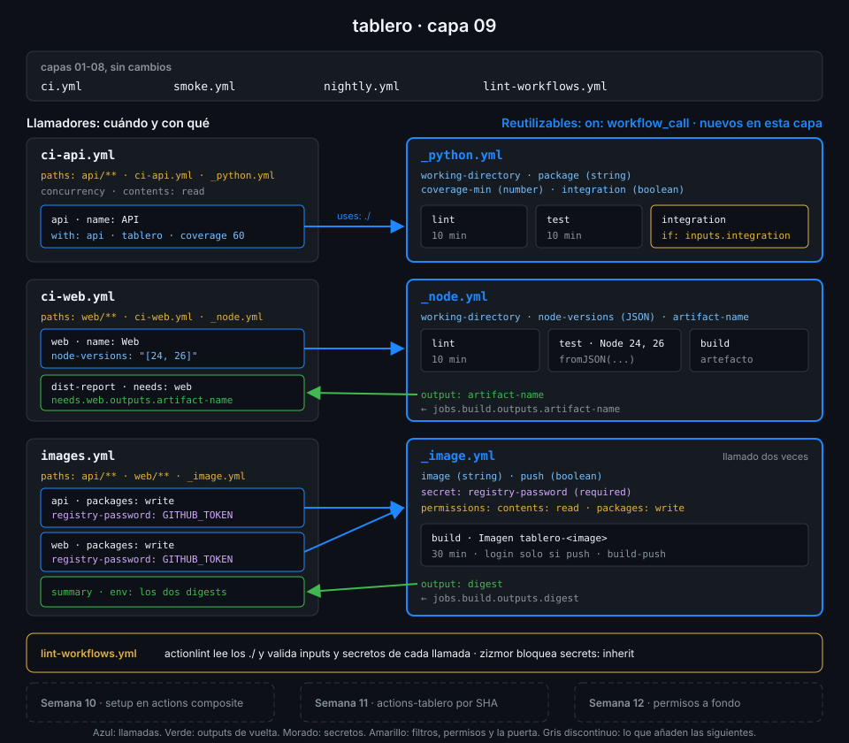

# Proyecto: capa 09 de tablero



## 🎯 Objetivo

Que los jobs de Python, de frontend y de imagen de `tablero` existan una sola vez, en tres
workflows reutilizables, y que `ci-api`, `ci-web` e `images` se limiten a decidir cuándo corren y
con qué inputs. Cuando en la Semana 20 llegue `worker/`, su CI será una llamada, no una copia.

## 📦 Qué añade esta capa

`ci.yml`, `smoke.yml`, `nightly.yml` y `lint-workflows.yml` se quedan como están. Cambian tres
workflows y nacen tres:

| Archivo | Qué hace | Por qué existe |
|---|---|---|
| `.github/workflows/_python.yml` (nuevo) | `lint`, `test` e `integration` de un proyecto uv. Inputs `working-directory`, `package`, `coverage-min` e `integration` | Los tres jobs de `ci-api` repetían checkout, `setup-uv` y `uv sync`; ahora un cambio de versión se hace en un sitio |
| `.github/workflows/_node.yml` (nuevo) | `lint`, `test` en matriz y `build` de un proyecto pnpm. Input `node-versions` como lista JSON; output `artifact-name` | La matriz de Node la decide quien llama; el nombre del artefacto vuelve como dato, no como cadena repetida |
| `.github/workflows/_image.yml` (nuevo) | Construye una imagen y, si `push` es `true`, la publica en GHCR. Secreto `registry-password`; output `digest` | Una imagen por llamada: el digest de cada una vuelve con su nombre, cosa que la matriz de la capa 06 no permitía |
| `ci-api.yml` | Un job `api` que llama a `_python.yml` | Solo eventos, `paths`, `concurrency` y permisos de raíz |
| `ci-web.yml` | Un job `web` que llama a `_node.yml` y `dist-report`, que descarga el artefacto devuelto | `dist-report` es propio de `tablero`, no del reutilizable |
| `images.yml` | Jobs `api` y `web` que llaman a `_image.yml` con `packages: write` y el secreto explícito; `summary` con los dos digests | El permiso de escritura lo concede quien llama, job a job |

| Situación | Qué pasa |
|---|---|
| PR que toca `api/` | `ci-api` llama a `_python.yml`; en la UI ves `API / Lint y formato (ruff)`, `API / Tests unitarios`… |
| PR que solo toca `_python.yml` | `ci-api` corre igual: el reutilizable está en sus `paths` |
| PR que toca `web/` | `images` construye las dos imágenes sin publicarlas (`push: false`) y el resumen deja `Publicadas: false` |
| Push a `main` | `images` publica y el resumen lista los dos digests |

La Semana 10 sacará el bloque checkout + `setup-uv` + `uv sync` a una action composite,
`setup-tablero`, que estos reutilizables usarán. La 11 mueve los tres a `<tu-org>/actions-tablero`
y los llamas por SHA desde `tablero`.

## ✅ Requisitos verificables

- _python.yml, _node.yml e _image.yml solo se disparan con workflow_call
- _python.yml declara los inputs working-directory y package (string), coverage-min (number) e integration (boolean)
- El job integration de _python.yml solo corre si el input integration es true
- La matriz de tests de _node.yml sale del input node-versions con fromJSON
- _node.yml devuelve el nombre del artefacto como output artifact-name, sacado del job build
- _image.yml declara el secreto registry-password como obligatorio
- _image.yml devuelve el digest de la imagen como output digest, sacado del job build
- ci-api.yml tiene un único job y ese job llama a _python.yml
- El job web de ci-web.yml llama a _node.yml y dist-report descarga el artefacto que este devuelve
- images.yml llama a _image.yml desde dos jobs, api y web, y les pasa registry-password de forma explícita
- En images.yml solo los jobs api y web conceden packages: write; la raíz se queda en contents: read
- El job summary de images.yml espera a api y web y recibe sus digests por env:
- Los filtros paths de ci-api, ci-web e images, en push y en pull_request, incluyen el reutilizable que llaman
- Ningún workflow usa secrets: inherit
- Todo job con runs-on, en cualquier workflow, declara timeout-minutes
- Todos tus workflows pasan actionlint y zizmor
- Toda uses: remota de tus workflows está fijada por SHA de 40 caracteres con el tag en comentario
- ci-api, ci-web e images terminaron en success sobre el último commit de main

## 🎨 Criterios de calidad

Lo que `check-week.sh` no ve y la [rúbrica](../rubrica-evaluacion.md) sí puntúa:

- Cada input y cada output tiene `description`: el reutilizable se entiende sin abrir sus jobs.
- Ningún reutilizable escribe a mano `api`, `web` ni el paquete `tablero` en sus jobs: carpeta,
  paquete e imagen llegan por input. Las dos excepciones conscientes son el prefijo `tablero-` de
  las imágenes y la base desechable de PostgreSQL, y un comentario lo dice.
- Ningún `${{ inputs.* }}` dentro de un `run:`: los inputs llegan al shell por `env:`.
- `concurrency` solo en los llamadores; ningún reutilizable declara la suya.
- Cada reutilizable declara en su raíz el techo de `permissions` que necesita, con un comentario.
- Los `# zizmor: ignore[self-repository]` dicen por qué (actionlint 1.7.12 no admite `$/`), y
  no hay ningún otro hallazgo silenciado.
- Los runs de la capa se ven con nombres legibles: el job que llama tiene `name:`.
- Sin `TODO` en `.github/workflows/` y commits en Conventional Commits.

## 💡 Adaptación a tu dominio

| Tu proyecto | Qué reutilizar | Inputs típicos | Ojo con |
|---|---|---|---|
| Varios servicios Python en un monorepo | Un `_python.yml` llamado una vez por servicio | `working-directory`, `package`, `integration` | Un `paths` por llamador, o cada servicio dispara a todos |
| Librería Node publicada en varias versiones | `_node.yml` con la matriz de Node como input | `node-versions` en JSON | Un output desde una matriz devuelve solo el último valor |
| Varias imágenes de un mismo repo | `_image.yml` llamado desde un job por imagen | `component`, `push` | `packages: write` en cada job llamador, no en la raíz |
| Muchos repos con el mismo CI | Los mismos reutilizables en un repo central (Semana 11) | Los mismos, más la versión del lenguaje | Llamarlos por SHA, no por rama |

## 🚦 Cómo entregarlo

Si hiciste las cuatro prácticas ya tienes los seis archivos: repásalos contra los requisitos y
los criterios. Si no, parte del starter.

1. Copia el starter, completa los `TODO 1` a `TODO 11` y pasa los dos linters:

   ```bash
   cd ~/code/tablero
   S=~/code/bc-github-actions/bootcamp/week-09-workflows_reutilizables/3-proyecto/starter
   cp "$S"/.github/workflows/*.yml .github/workflows/
   actionlint && zizmor --offline .github/workflows/
   # No findings to report. Good job! (4 ignored, ... suppressed)
   ```

   Los cuatro ignorados son los `self-repository` de las llamadas.

2. Pruébalo en local antes del push:

   ```bash
   ./scripts/ci-local.sh ci-api api
   # ...
   # [API/_python/Tests de integración (PostgreSQL 17) ] 🏁  Job succeeded
   ```

3. Súbelo a `main` en un solo commit, para que los tres llamadores corran sobre él, y espera a
   los runs de **tu** commit:

   ```bash
   git add .github/workflows/
   git commit -m "ci: extract python, node and image jobs into reusable workflows"
   git push
   sleep 10
   for w in ci-api ci-web images; do
     id=$(gh run list --workflow "$w.yml" --commit "$(git rev-parse HEAD)" --json databaseId --jq '.[0].databaseId')
     gh run watch "$id" --exit-status > /dev/null && echo "$w ok"
   done
   # ci-api ok
   # ci-web ok
   # images ok
   ```

   Si tu último commit de `main` no cambió los tres, el filtro de rutas salta alguno: lánzalo a
   mano con `gh workflow run <workflow>.yml --ref main`.

4. Lanza la verificación:

   ```bash
   cd ~/code/bc-github-actions
   ./scripts/check-week.sh 09
   # 18/18 comprobaciones superadas.
   ```

## 🧯 Errores comunes

| Síntoma | Causa | Solución |
|---|---|---|
| `input "package" is required by "./.github/workflows/_python.yml" reusable workflow` | Declaraste el input en el TODO 1 pero `ci-api.yml` no lo pasa | Añade `package: tablero` al `with:` de la llamada |
| `"timeout-minutes" is not available` en el llamador | El job que llama solo admite `name`, `uses`, `with`, `secrets`, `strategy`, `needs`, `if`, `concurrency` y `permissions` | El `timeout-minutes` va en cada job del reutilizable |
| `images` no arranca y el run dice que un job pide `packages: write` | El job llamador no concede ese permiso y el reutilizable no puede subirlo | `permissions: {contents: read, packages: write}` en los jobs `api` y `web` |
| El run de `ci-api` se cancela solo al empezar | Pusiste en `_python.yml` una `concurrency` con `github.workflow`, que dentro vale `ci-api` | Quita la `concurrency` del reutilizable |
| `dist-report` no encuentra el artefacto | Descarga `web-dist` escrito a mano y el input `artifact-name` dice otra cosa | `name: ${{ needs.web.outputs.artifact-name }}` |
| Cambias `_node.yml` y `ci-web` no corre | Falta el reutilizable en los `paths` del llamador | Añade `.github/workflows/_node.yml` en `push` y en `pull_request` |
| `ci-local.sh ci-web web` falla en el post de `setup-node` | Limitación de act con la caché de pnpm, también sin reutilizables | Prueba en local con `ci-api`; `ci-web` se valida en GitHub |

## 🔗 Navegación

---

| ← Anterior | Siguiente → |
|:---|---:|
| [Límites y depuración](../2-practicas/04-limites-y-depuracion.md) | [Rúbrica de evaluación](../rubrica-evaluacion.md) |
