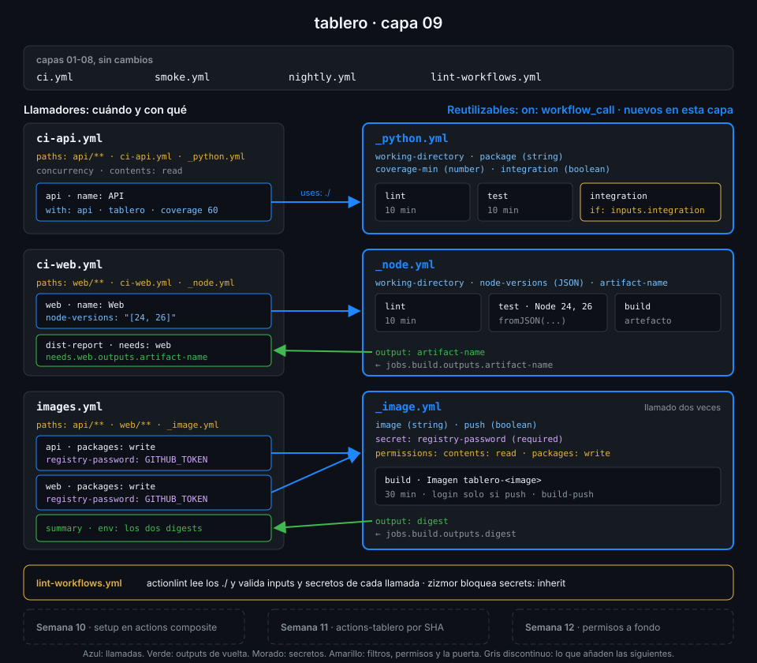

# Semana 09 — Workflows reutilizables

> `ci-api`, `ci-web` e `images` repiten checkout, setup y caché job tras job. Esta semana los
> conviertes en tres workflows que se llaman como una función: con inputs, secretos y outputs.

## 🎯 Objetivos de la Semana

Al terminar la semana eres capaz de:

- Explicar qué resuelve un workflow reutilizable y cuándo pide uno, cuándo una action propia
  (Semana 10) y cuándo una plantilla de la org (Semana 11)
- Escribir un workflow con `on: workflow_call` y llamarlo con `uses:` a nivel de job, desde el
  mismo repo o desde otro fijado por SHA
- Declarar inputs tipados (`string`, `number`, `boolean`), pasar listas como JSON para una matriz
  y devolver outputs del reutilizable al llamador
- Pasar secretos uno a uno y argumentar por qué `secrets: inherit` no es una costumbre aceptable
- Predecir el contexto `github`, los permisos del `GITHUB_TOKEN` y la `concurrency` dentro de un
  reutilizable, y evitar el interbloqueo que provoca `github.workflow`
- Conocer los límites (diez niveles, cincuenta reutilizables únicos, nada en subcarpetas) y
  depurar una llamada con actionlint, zizmor, act y `gh run view`

## 📋 Prerrequisitos

| Necesitas | Dónde se aprende |
|---|---|
| `check-week.sh 08` en 15/15 | [Semana 08](../week-08-probar_y_depurar_workflows/README.md) |
| Outputs de job y `needs` | [Semana 02, teoría 05](../week-02-expresiones_contextos_y_flujo_de_datos/1-teoria/05-datos-entre-steps.md) |
| Matrices y `fromJSON` | [Semana 04](../week-04-ci_de_frontend_pnpm_matrices_y_artefactos/README.md) |
| `packages: write` y GHCR | [Semana 06](../week-06-imagenes_docker_y_ghcr/README.md) |
| Filtros `paths` y `concurrency` | [Semana 07](../week-07-disparadores_filtros_y_concurrencia/README.md) |
| actionlint, zizmor y `scripts/ci-local.sh` | [Semana 08](../week-08-probar_y_depurar_workflows/README.md) |

## 🗂️ Estructura de la Semana

```
week-09-workflows_reutilizables/
├── README.md
├── rubrica-evaluacion.md
├── checks.json                    18 comprobaciones
├── 0-assets/                      3 diagramas SVG
├── 1-teoria/                      6 archivos, uno por concepto
├── 2-practicas/                   4 prácticas guiadas
├── 3-proyecto/
│   ├── README.md
│   └── starter/.github/workflows/
│       ├── _python.yml · _node.yml · _image.yml
│       └── ci-api.yml · ci-web.yml · images.yml
├── 4-recursos/{ebooks-free,videografia,webgrafia}/README.md
└── 5-glosario/README.md
```

## 📝 Contenidos

### Teoría

| # | Archivo | Qué aprendes | Tiempo |
|:--:|---|---|:--:|
| 01 | [Por qué reutilizar workflows](1-teoria/01-por-que-reutilizar-workflows.md) | El coste de copiar jobs, el modelo llamador-llamado y reutilizable frente a action y plantilla | 25 min |
| 02 | [Llamar a un reutilizable](1-teoria/02-llamar-a-un-reutilizable.md) | `on: workflow_call`, `uses:` en el job, referencias `./`, `$/` y `owner/repo@sha`, y qué claves admite el job que llama | 30 min |
| 03 | [Inputs y outputs](1-teoria/03-inputs-y-outputs.md) | Tipos, `required` y `default`, listas JSON para matrices, outputs de job a workflow y el output de una matriz de llamadas | 35 min |
| 04 | [Secretos en reutilizables](1-teoria/04-secretos-en-reutilizables.md) | `secrets:` declarados, `GITHUB_TOKEN` automático, `secrets: inherit` y por qué no, `env` que no cruza | 30 min |
| 05 | [Contexto, permisos y concurrencia](1-teoria/05-contexto-permisos-y-concurrencia.md) | El `github` del llamador, permisos que solo bajan, el interbloqueo de `github.workflow` y `cache-mode` | 30 min |
| 06 | [Límites y depuración](1-teoria/06-limites-y-depuracion.md) | Diez niveles, cincuenta únicos, sin subcarpetas, `paths` que olvidan el reutilizable, y cómo leer y probar una llamada | 30 min |

### Prácticas

| # | Archivo | Qué haces | Tiempo |
|:--:|---|---|:--:|
| 01 | [Primer reutilizable](2-practicas/01-primer-reutilizable.md) | `_python.yml` con inputs, `ci-api.yml` reducido a una llamada, probado con act y leído en `gh run view` | 1 h |
| 02 | [Inputs tipados y matrices](2-practicas/02-inputs-tipados-y-matrices.md) | `_node.yml` con la matriz de Node como input JSON y el nombre del artefacto como output | 1 h |
| 03 | [Secretos y outputs](2-practicas/03-secretos-y-outputs.md) | `_image.yml` con un secreto declarado y el digest como output; `images.yml` con dos llamadas y un resumen | 1 h |
| 04 | [Límites y depuración](2-practicas/04-limites-y-depuracion.md) | `paths` completos, un permiso que no alcanza, el interbloqueo de `concurrency` y la puerta de linters | 1 h |

### Proyecto

[Capa 09 de `tablero`](3-proyecto/README.md): `_python.yml`, `_node.yml` e `_image.yml` guardan
los jobs; `ci-api`, `ci-web` e `images` solo deciden cuándo corren y con qué inputs.



## ⏱️ Distribución del Tiempo (10 horas)

| Actividad | Horas |
|---|:--:|
| Teoría (6 archivos) | 3 |
| Práctica 01 — Primer reutilizable | 1 |
| Práctica 02 — Inputs tipados y matrices | 1 |
| Práctica 03 — Secretos y outputs | 1 |
| Práctica 04 — Límites y depuración | 1 |
| Proyecto — capa 09 | 2 |
| Autoevaluación con la rúbrica | 1 |
| **Total** | **10** |

## 🎩 Trucos y atajos

- **`gh run view <id> --json jobs --jq '.jobs[].name'`** enseña los jobs de un reutilizable con
  su prefijo, `API / Tests unitarios`: así filtras con `grep 'API /'` lo que vino de una llamada
  concreta.
- **`actionlint` valida la llamada local**: si pasas un input que `_python.yml` no declara, u
  olvidas uno obligatorio, falla antes del push. Con una referencia remota (`owner/repo/...@sha`)
  no puede leer el reutilizable y esa comprobación se pierde.
- **`act` ejecuta los reutilizables locales**: `scripts/ci-local.sh ci-api api` corre los tres
  jobs de `_python.yml` en tu Docker y los nombra `API/_python/<job>`.
- **Un input `string` con JSON** es la forma de pasar listas: `node-versions: "[24, 26]"` y, dentro,
  `${{ fromJSON(inputs.node-versions) }}`. `workflow_call` no tiene tipo lista.
- **`zizmor` caza `secrets: inherit`** con la auditoría `secrets-inherit`, sin red y con la
  persona por defecto: la puerta de la Semana 08 ya lo bloquea.

## 📌 Entregables

- `_python.yml`, `_node.yml` e `_image.yml` en `main`, llamados por `ci-api`, `ci-web` e
  `images`, los tres en verde sobre el último commit (ver [proyecto](3-proyecto/README.md))
- La rúbrica respondida

## ✅ Verificación

```bash
cd ~/code/bc-github-actions
./scripts/check-week.sh 09
# Semana 09 — Workflows reutilizables  [repo: <tu-org>/tablero]
#
#   ✅ _python.yml, _node.yml e _image.yml solo se disparan con workflow_call
#   ...
# 18/18 comprobaciones superadas.
```

Si algo sale en rojo, la pista te dice qué práctica y qué paso lo arreglan.

## 🔗 Navegación

---

| ← Anterior | Siguiente → |
|:---|---:|
| [Semana 08 — Probar y depurar workflows](../week-08-probar_y_depurar_workflows/README.md) | [Por qué reutilizar workflows](1-teoria/01-por-que-reutilizar-workflows.md) |
