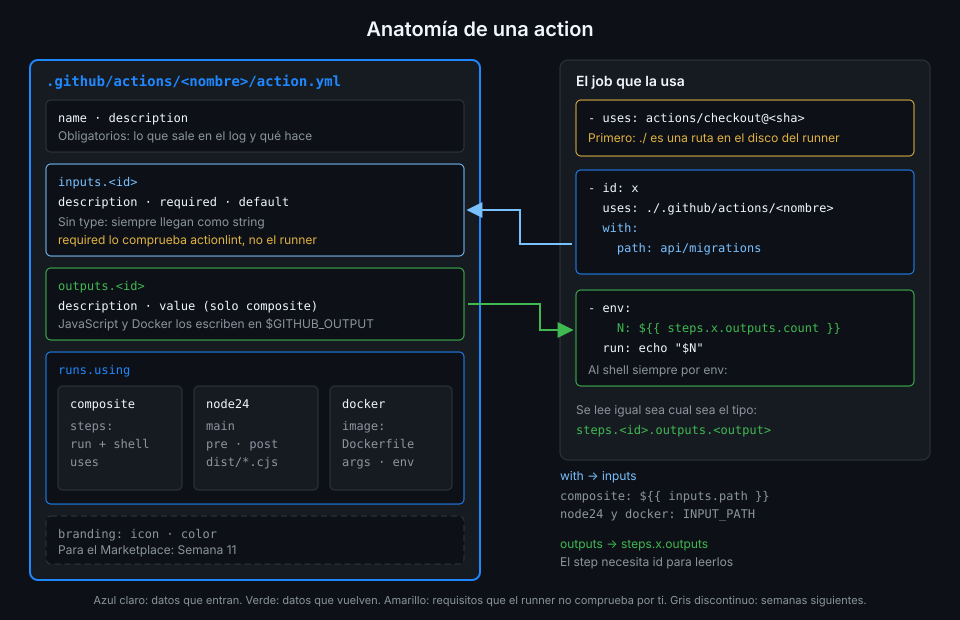
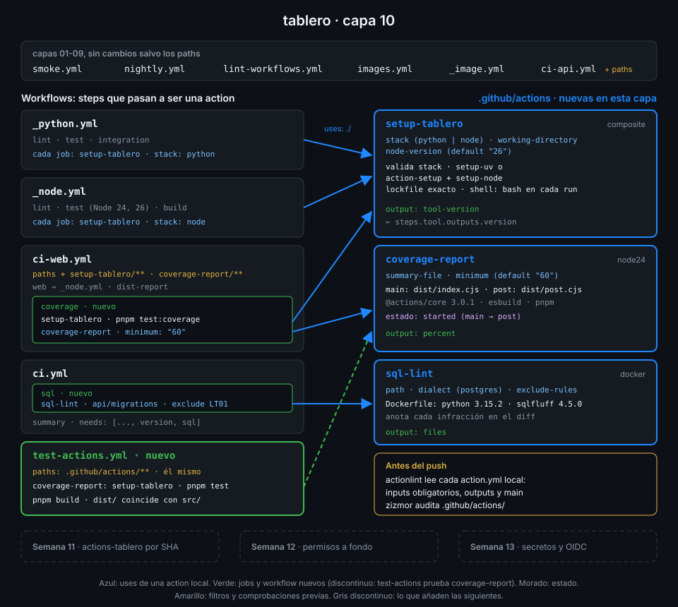

# Anatomía de una action

> Una action es una carpeta con un `action.yml`: un contrato de inputs y outputs y una forma de
> ejecutarse. Es la pieza que reutilizas **dentro** de un job, igual que reutilizas
> `actions/checkout`, pero escrita por ti y para tu repo.



## 🎯 Objetivos

Al terminar este archivo eres capaz de:

- Distinguir cuándo toca una action y cuándo un workflow reutilizable
- Leer y escribir cada campo de un `action.yml`: `name`, `description`, `inputs`, `outputs`, `runs`
- Elegir entre los tres tipos de `runs.using`: `composite`, `node24` y `docker`
- Explicar cómo llega un input a la action y cómo vuelve un output al workflow
- Usar una action local con `uses: ./ruta` y saber por qué exige un checkout antes

## 1. Qué problema resuelve

En la capa 09 los reutilizables `_python.yml` y `_node.yml` quitaron la copia entre workflows,
pero dentro de ellos queda otra: cada uno de sus tres jobs empieza con los mismos tres o cuatro
steps de preparación.

| Reutilizable | Jobs | Steps de preparación repetidos en cada job |
|---|---|---|
| `_python.yml` | `lint`, `test`, `integration` | `setup-uv` con caché y `uv sync --locked` |
| `_node.yml` | `lint`, `test`, `build` | `pnpm/action-setup`, `setup-node` con caché y `pnpm install --frozen-lockfile` |

Un workflow reutilizable no arregla esto: se llama desde `jobs.<id>.uses` y aporta **jobs
enteros**, con su runner propio. Lo que hace falta es empaquetar **steps** que corren dentro de
un job que ya existe, en su mismo runner y su mismo workspace. Eso es una action.

| | Workflow reutilizable (Semana 09) | Action (esta semana) |
|---|---|---|
| Se llama desde | `jobs.<id>.uses` | `jobs.<id>.steps[*].uses` |
| Aporta | Uno o varios jobs, cada uno con su `runs-on` | Uno o varios steps dentro del job que la llama |
| Runner | Lo decide el reutilizable | El del job que la usa |
| Workspace | El suyo: hay que hacer checkout dentro | El del job: ve lo que ya hay en disco |
| Secretos | `secrets:` declarados uno a uno | No ve `secrets`: llegan como inputs |
| Permisos | Puede pedir los suyos por job | Usa el `GITHUB_TOKEN` del job tal cual |
| Archivo | `.github/workflows/<nombre>.yml` | `<carpeta>/action.yml` |

La regla práctica: si lo que repites es "cómo se prepara un job", es una action; si es "qué jobs
corren y en qué orden", es un reutilizable. Muchas veces van juntos: el reutilizable `_node.yml`
de esta capa usa la action `setup-tablero` en cada uno de sus jobs.

## 2. Cómo funciona

### Los campos del `action.yml`

El runner busca `action.yml` (o `action.yaml`) en la raíz de la carpeta que apunta `uses:`.

| Campo | Obligatorio | Qué hace |
|---|:--:|---|
| `name` | Sí | Nombre que sale en el log |
| `description` | Sí | Qué hace, en una frase |
| `author` | No | Quién la mantiene |
| `inputs.<id>` | No | Parámetros: `description`, `required`, `default`, `deprecationMessage` |
| `outputs.<id>` | No | Valores de vuelta: `description` y, solo en composite, `value` |
| `runs` | Sí | Cómo se ejecuta: `using` y lo que pida cada tipo |
| `branding` | No | `icon` y `color` para el Marketplace; publicar allí lo verás en la Semana 11 |

### Los inputs no tienen tipo

A diferencia de `workflow_call`, los inputs de una action **son siempre strings**. No hay
`type:`. Un `default: "60"` llega como el texto `60`; un booleano llega como `true` o `false`
en texto y es la action quien lo interpreta. Por eso el workflow que la usa escribe
`minimum: "60"` con comillas: no cambia nada para el runner, pero deja claro que es texto.

`required: true` documenta el contrato y actionlint lo comprueba antes del push. El runner, en
cambio, no corta el job si falta: el input llega vacío. Una action seria valida lo que recibe y
falla con un mensaje claro, como hace `setup-tablero` con su input `stack`.

### Cómo llega un input y cómo vuelve un output

| Tipo | El input se lee con | El output se escribe con |
|---|---|---|
| `composite` | El contexto `inputs` en expresiones: `${{ inputs.<id> }}` | `outputs.<id>.value` apuntando al output de un step interno |
| `node24` | `core.getInput("<id>")`, que lee la variable `INPUT_<ID>` | `core.setOutput("<id>", valor)`, que escribe en `$GITHUB_OUTPUT` |
| `docker` | La variable de entorno `INPUT_<ID>` dentro del contenedor | Una línea `<id>=valor` en `$GITHUB_OUTPUT` |

En `INPUT_<ID>` el nombre va en mayúsculas y los espacios pasan a `_`; el guion se conserva, y eso
tiene consecuencias en bash que verás en el archivo 06.

Desde el workflow, el resultado se lee igual sea cual sea el tipo:
`steps.<id-del-step>.outputs.<id-del-output>`. El step necesita un `id:` para eso.

## 3. Cómo se usa

### Una action local

Una action vive en cualquier carpeta del repo; la convención es `.github/actions/<nombre>/`.
Este `action.yml` mínimo, de tipo composite, cuenta los archivos de una carpeta:

```yaml
name: count-files
description: Cuenta los archivos con una extensión dentro de una carpeta
inputs:
  path:
    description: Carpeta, relativa al workspace
    required: true
  extension:
    description: Extensión sin punto
    default: sql
outputs:
  count:
    description: Número de archivos encontrados
    value: ${{ steps.count.outputs.count }}
runs:
  using: composite
  steps:
    - id: count
      shell: bash
      env:
        SEARCH_PATH: ${{ inputs.path }}
        EXTENSION: ${{ inputs.extension }}
      run: echo "count=$(find "$SEARCH_PATH" -name "*.$EXTENSION" | wc -l)" >> "$GITHUB_OUTPUT"
```

Y el workflow que la usa:

```yaml
name: count-demo

on:
  workflow_dispatch:

# Mínimo privilegio: lo verás a fondo en la Semana 12.
permissions:
  contents: read

jobs:
  count:
    name: Contar migraciones
    runs-on: ubuntu-24.04
    timeout-minutes: 5
    steps:
      - uses: actions/checkout@3d3c42e5aac5ba805825da76410c181273ba90b1 # v7.0.1
        with:
          persist-credentials: false
      - id: migrations
        uses: ./.github/actions/count-files # zizmor: ignore[self-repository] actionlint 1.7.12 no admite $/
        with:
          path: api/migrations
      - name: Publicar el resultado
        env:
          COUNT: ${{ steps.migrations.outputs.count }}
        run: echo "Migraciones SQL encontradas = $COUNT" >> "$GITHUB_STEP_SUMMARY"
```

Fíjate en tres cosas:

1. **El checkout va primero.** `uses: ./...` es una ruta en el disco del runner. Antes del
   checkout el workspace está vacío y el step falla con `Can't find 'action.yml'`.
2. **El output sale por `env:`** hacia el shell, como cualquier dato (regla 4 de seguridad).
3. **El comentario de zizmor.** zizmor 1.31.1 propone la sintaxis `$/` para acciones del propio
   repo y actionlint 1.7.12 la rechaza con `ref is missing`; mientras no coincidan, se ignora
   el aviso con su motivo, igual que en la Semana 09.

### Las formas de `uses:` en un step

| Forma | Ejemplo | Cuándo |
|---|---|---|
| Ruta local | `./.github/actions/setup-tablero` | Actions del propio repo: esta semana |
| Repo remoto | `actions/checkout@<sha> # v7.0.1` | Actions de terceros, fijadas por SHA |
| Mismo repo, en el commit del run | `$/setup-tablero` | Sintaxis self-repository: Semanas 09 y 11 |
| Subcarpeta de un repo | `<tu-org>/actions-tablero/setup-tablero@<sha>` | Un repo con varias actions: Semana 11 |
| Imagen Docker | `docker://imagen@sha256:<digest>` | Ejecutar una imagen sin `action.yml` |

Una action `./` se lee del workspace del job: coincide con el commit del run solo porque
`actions/checkout` descargó ese commit. No hay que fijar nada, y por eso la regla del SHA no
aplica a `./`. En la Semana 11 verás el caso en que deja de coincidir, y `$/` (Semana 09).

### Las tres actions de `tablero` en esta capa



| Action | `runs.using` | Qué hace | Dónde se usa |
|---|---|---|---|
| `setup-tablero` | `composite` | Prepara uv o pnpm con Node e instala el lockfile | Los seis jobs de `_python.yml` y `_node.yml`, `ci-web` y `test-actions` |
| `coverage-report` | `node24` | Lee el resumen de cobertura de Vitest, lo publica y falla si baja | Job `coverage` de `ci-web.yml` |
| `sql-lint` | `docker` | Revisa las migraciones con sqlfluff y anota cada infracción | Job `sql` de `ci.yml` |

Cada una es de un tipo distinto a propósito: cada tipo resuelve un problema diferente, y el
archivo 06 cierra con una tabla para elegir.

## 4. Antipatrones

| Antipatrón | Por qué duele | Qué hacer en su lugar |
|---|---|---|
| Un reutilizable para empaquetar tres steps de setup | Cada llamada es un job nuevo: otro runner, otro checkout, otra caché | Una action composite dentro del job |
| `uses: ./.github/actions/x` antes del checkout | El runner no encuentra el `action.yml` en un workspace vacío | Checkout como primer step |
| Confiar en `required: true` para validar | El runner no corta el job; el input llega vacío | actionlint en CI y validación dentro de la action |
| `minimum: 60` pensando que es un número | Para la action es el texto `60`; si espera otra cosa, nadie avisa | Comillas, y la action convierte y valida |
| Una action sin `description` en sus inputs | Quien la usa tiene que leer el código para saber qué pasar | `description` en cada input y output |
| Pasar un secreto como `default:` | Queda en el repo, en texto plano | Input obligatorio y el workflow lo pasa desde `secrets` |

## 5. Trucos

- **`yq '.inputs | keys' .github/actions/<x>/action.yml`** te da la firma de una action en una
  línea, sin abrir el archivo. Con `'.runs.using'` sabes de qué tipo es.
- **actionlint lee las actions locales**: con `uses: ./...` comprueba cada `with:` contra el
  `action.yml` y avisa de `missing input "stack" which is required by action "setup-tablero"`
  o de `input "stak" is not defined in action`. Verificado con actionlint 1.7.12 y
  ubuntu-24.04, noviembre 2026.
- **El runner avisa de inputs que no existen** con un `Unexpected input(s)` en el log del step:
  si ves ese aviso, alguien ha escrito mal un `with:`.
- **Lee el `action.yml` de cualquier action en su SHA** con
  `gh api repos/<o>/<r>/contents/action.yml?ref=<sha> --jq .content | base64 -d`: es la única
  fuente fiable de qué inputs acepta de verdad.

## 📚 Recursos Adicionales

- [GitHub Docs: Metadata syntax for GitHub Actions](https://docs.github.com/en/actions/reference/workflows-and-actions/metadata-syntax)
- [GitHub Docs: About custom actions](https://docs.github.com/en/actions/concepts/workflows-and-actions/custom-actions)
- [GitHub Docs: Reusing workflow configurations](https://docs.github.com/en/actions/reference/workflows-and-actions/reusing-workflow-configurations)

## ✅ Checklist de Verificación

- [ ] Sé cuándo toca una action y cuándo un workflow reutilizable
- [ ] Sé qué campos de `action.yml` son obligatorios y qué hace cada uno
- [ ] Sé que los inputs de una action son siempre strings
- [ ] Sé que `required: true` no lo hace cumplir el runner
- [ ] Sé cómo llega un input y cómo vuelve un output en cada tipo
- [ ] Sé por qué una action local exige checkout antes

---

| ← Anterior | Siguiente → |
|:---|---:|
| [Semana 10 — Actions propias: composite, JavaScript y Docker](../README.md) | [Actions composite](02-actions-composite.md) |
