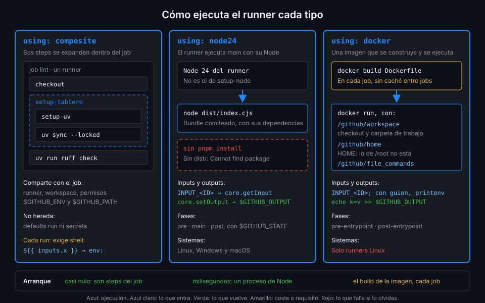

# Actions composite

> Una action composite es una lista de steps con nombre propio. Se escribe en YAML, como un
> workflow, y corre dentro del job que la usa como si sus steps estuvieran escritos allí. Es el
> tipo más sencillo y el que más veces vas a escribir.



## 🎯 Objetivos

Al terminar este archivo eres capaz de:

- Escribir `runs.steps` de una composite con `run:` y con `uses:`
- Explicar por qué cada `run:` de una composite declara `shell:`
- Llevar un input a un `run:` sin abrir una inyección
- Publicar un output de la composite a partir del output de un step interno
- Predecir qué comparte la composite con el job que la usa y qué no

## 1. Qué problema resuelve

Los seis jobs de `_python.yml` y `_node.yml` empiezan con steps casi idénticos. Si mañana la
caché de uv necesita otro `cache-dependency-glob`, o pnpm pasa a leer su versión de otro sitio,
hay que tocarlos todos y no olvidarse de ninguno. Lo que se repite no es lógica de negocio: es
**cómo se prepara un job de tablero**, y eso se puede nombrar.

Una composite convierte esos steps en uno solo, `uses: ./.github/actions/setup-tablero`, con
dos inputs que dicen qué pila preparar y en qué carpeta. El job queda con lo que lo distingue:
el lint, los tests o el build.

## 2. Cómo funciona

### `runs.steps`

```yaml
runs:
  using: composite
  steps:
    - name: Lo que se lee en el log
      shell: bash
      run: echo "un step de shell"
    - uses: actions/setup-node@949feb2413d6458794dcd2491c4babbbce0c15c1 # v7.1.0
      with:
        node-version: "26"
```

Cada step admite casi lo mismo que un step de workflow:

| Clave | En una composite |
|---|---|
| `name`, `id`, `if`, `env`, `working-directory` | Igual que en un workflow |
| `run` | Exige `shell:` en el mismo step |
| `uses` + `with` | Cualquier action: remota fijada por SHA, local o `docker://` |
| `continue-on-error` | Igual que en un workflow |

### Por qué `shell:` es obligatorio

En un workflow, un `run:` sin `shell:` hereda el de `defaults.run.shell` o el del sistema. Una
composite no puede contar con eso: no sabe desde qué workflow ni en qué sistema la van a usar, y
**`defaults.run` del workflow no llega a sus steps**. Por eso el esquema exige `shell:` en cada
`run:`; sin él, el runner rechaza el `action.yml` al cargarlo y el step falla antes de ejecutar
nada. `shell: bash` es además el que activa `-e -o pipefail`: un comando que falla corta el step.

### Inputs: en expresiones sí, en el shell por `env:`

Dentro de la composite, `inputs.<id>` es un contexto más. Vale directamente donde la expresión
no pasa por el shell: `if:`, `with:`, `working-directory:`. Dentro de `run:`, **no**: el runner
pega el valor en el script antes de que bash lo lea, y un input como `x"; curl ... #` se
ejecuta. zizmor lo detecta en un `action.yml` igual que en un workflow:

```text
error[template-injection]: code injection via template expansion
```

La forma correcta es la de siempre, por `env:`:

```yaml
- name: Instalar dependencias
  shell: bash
  working-directory: ${{ inputs.working-directory }}
  env:
    LOCKFILE: ${{ inputs.lockfile }}
  run: test -f "$LOCKFILE" || { echo "::error::No existe $LOCKFILE"; exit 1; }
```

### Outputs: un salto más

Los steps de dentro de la composite tienen sus propios `id`, y esos ids **no se ven** desde el
workflow. Para sacar un valor, el `action.yml` lo publica en `outputs.<id>.value`:

1. Un step interno con `id: hash` escribe `sha256=...` en `$GITHUB_OUTPUT`.
2. `outputs.sha256.value: ${{ steps.hash.outputs.sha256 }}` lo publica.
3. El workflow lo lee como `steps.<id-del-step-que-usa-la-action>.outputs.sha256`.

Es la cadena step → job de la Semana 02 con el job sustituido por la action. Si te saltas el
paso 2, el workflow lee una cadena vacía y nadie avisa.

### Qué comparte con el job

| Comparte con el job | No comparte |
|---|---|
| Runner, sistema y workspace: ve el checkout y lo que dejaron los steps anteriores | El contexto `secrets`: un secreto entra como input |
| `$GITHUB_ENV` y `$GITHUB_PATH`: lo que escribe vale para los steps siguientes del job | `defaults.run` del workflow |
| El `GITHUB_TOKEN` del job y sus permisos | Los `id` de los steps del job, y el job los de la composite |
| El `env:` del job y del workflow | |

Lo de `$GITHUB_PATH` es lo que hace útil a `setup-tablero`: `setup-uv` y `setup-node` añaden sus
binarios al PATH **dentro** de la composite, y los steps del job que vienen después encuentran
`uv` y `pnpm` sin hacer nada.

### Las actions de dentro y sus post

Si una composite usa `actions/setup-node` con `cache: pnpm`, el post de `setup-node` (el que
guarda la caché) corre al final del **job**, no al final de la composite. Verás por qué en el
archivo 05. Para ti significa que meter `setup-node` en una composite no rompe la caché.

## 3. Cómo se usa

### Un ejemplo completo con otros nombres

Esta composite, `lockfile-hash`, comprueba que existe el lockfile de un componente y devuelve su
SHA-256. Junta todo lo anterior: input obligatorio, input con default, `shell:` en cada `run:`,
datos por `env:` y un output que sale de un step interno.

```yaml
name: lockfile-hash
description: Comprueba que existe el lockfile de un componente y devuelve su SHA-256
inputs:
  working-directory:
    description: Carpeta del componente
    required: true
  lockfile:
    description: Nombre del lockfile dentro de la carpeta
    default: uv.lock
outputs:
  sha256:
    description: SHA-256 del lockfile
    value: ${{ steps.hash.outputs.sha256 }}
runs:
  using: composite
  steps:
    - name: El lockfile existe
      shell: bash
      working-directory: ${{ inputs.working-directory }}
      env:
        LOCKFILE: ${{ inputs.lockfile }}
      run: test -f "$LOCKFILE" || { echo "::error title=lockfile-hash::No existe $LOCKFILE"; exit 1; }

    - name: SHA-256
      id: hash
      shell: bash
      working-directory: ${{ inputs.working-directory }}
      env:
        LOCKFILE: ${{ inputs.lockfile }}
      run: echo "sha256=$(sha256sum "$LOCKFILE" | cut -d' ' -f1)" >> "$GITHUB_OUTPUT"
```

`setup-tablero` sigue el mismo esqueleto con tres diferencias: elige qué steps corren con
`if: ${{ inputs.stack == 'python' }}` o `'node'`, usa actions remotas fijadas por SHA dentro y
valida su input `stack` con un primer step que falla si no es `python` ni `node`.

### Un job de `_node.yml` antes y después

Antes, en la capa 09, el job `lint` dedicaba tres steps a prepararse después del checkout.
Después:

```yaml
lint:
  name: Lint (eslint)
  runs-on: ubuntu-24.04
  timeout-minutes: 10
  defaults:
    run:
      working-directory: ${{ inputs.working-directory }}
  steps:
    - uses: actions/checkout@3d3c42e5aac5ba805825da76410c181273ba90b1 # v7.0.1
      with:
        persist-credentials: false
    - uses: ./.github/actions/setup-tablero # zizmor: ignore[self-repository] actionlint 1.7.12 no admite $/
      with:
        stack: node
        working-directory: ${{ inputs.working-directory }}
    - run: pnpm lint
```

El `defaults.run.working-directory` del job vale para `pnpm lint`, pero no para los steps de
`setup-tablero`: por eso la action recibe la carpeta como input.

Una action local dentro de un reutilizable se resuelve contra el **workspace del job**, es
decir, contra el repo que hizo checkout. En `tablero` es el mismo repo y no hay sorpresa; cuando
el reutilizable viva en otro repo, en la Semana 11, la ruta `./` dejará de servir.

### Qué ves en el log

La UI enseña el step `Run ./.github/actions/setup-tablero` como uno solo; al desplegarlo
aparecen dentro los steps de la composite, cada uno con su nombre y su tiempo. Los `name:` de la
composite son, por tanto, lo que lee quien depura: escríbelos para esa persona.

## 4. Antipatrones

| Antipatrón | Por qué duele | Qué hacer en su lugar |
|---|---|---|
| `run:` sin `shell:` | El runner rechaza el `action.yml` y el step falla al cargarlo | `shell: bash` en cada `run:` |
| `${{ inputs.x }}` dentro de `run:` | Inyección: el valor se pega en el script | `env: X: ${{ inputs.x }}` y `"$X"` |
| Contar con `defaults.run.working-directory` del workflow | No llega a la composite: los comandos corren en la raíz | Input `working-directory` y `working-directory:` en cada step |
| Leer `steps.hash.outputs.sha256` desde el workflow | Los ids internos no se ven: cadena vacía | `outputs.<id>.value` en el `action.yml` |
| Actions de dentro por tag (`@v7`) | La composite hereda un tag movible aunque el workflow fije por SHA | SHA de 40 caracteres también dentro |
| Una composite que hace checkout | Repite trabajo y puede pisar el del job | El checkout lo decide el job, antes de llamarla |

## 5. Trucos

- **`$GITHUB_ACTION_PATH`** es la carpeta de la action en el runner. Con él, una composite
  ejecuta un script que vive a su lado: `run: "$GITHUB_ACTION_PATH/check.sh"`. Así el bash
  largo sale del YAML, se prueba con shellcheck y se lee con resaltado.
- **`::error title=<action>::`** en los fallos de validación pone el nombre de la action en la
  anotación del resumen: quien lo ve sabe a quién mirar sin abrir el log.
- **`if:` dentro de la composite** evalúa los inputs antes de arrancar cada step: un step que
  no aplica no se ejecuta y no cuesta nada. Es la forma más barata de una action con dos modos,
  como `stack: python | node`, sin dos actions casi iguales.

## 📚 Recursos Adicionales

- [GitHub Docs: Creating a composite action](https://docs.github.com/en/actions/tutorials/create-actions/create-a-composite-action)
- [GitHub Docs: Metadata syntax, `runs` para composite](https://docs.github.com/en/actions/reference/workflows-and-actions/metadata-syntax#runs-for-composite-actions)
- [zizmor: template-injection](https://docs.zizmor.sh/audits/#template-injection)

## ✅ Checklist de Verificación

- [ ] Sé escribir `runs.steps` con `run:` y con `uses:`
- [ ] Sé por qué cada `run:` lleva `shell:`
- [ ] Sé llevar un input a `run:` por `env:`
- [ ] Sé publicar un output con `outputs.<id>.value`
- [ ] Sé qué comparte la composite con el job y qué no
- [ ] Sé por qué `setup-tablero` recibe la carpeta como input

---

| ← Anterior | Siguiente → |
|:---|---:|
| [Anatomía de una action](01-anatomia-de-una-action.md) | [Actions JavaScript](03-actions-javascript.md) |
