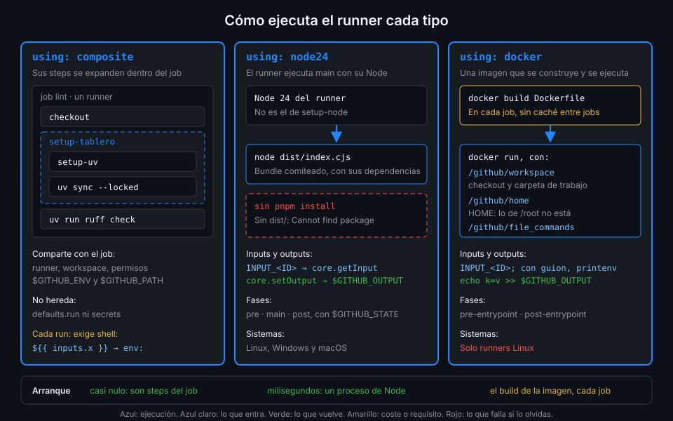

# Actions JavaScript

> Cuando la lógica no cabe cómoda en bash (leer un JSON, decidir, escribir una tabla en el
> resumen), una action JavaScript la escribe en un lenguaje de verdad, con tests. El runner la
> ejecuta con su propio Node, sin instalar nada y sin contenedor: es el tipo más rápido.



## 🎯 Objetivos

Al terminar este archivo eres capaz de:

- Declarar una action con `runs.using: node24` y su archivo `main`
- Explicar qué Node ejecuta la action y por qué no es el de `setup-node`
- Leer inputs, escribir outputs y fallar con `@actions/core`
- Escribir una tabla en el resumen del job desde la action
- Separar la lógica pura del código que habla con el runner para poder probarla

## 1. Qué problema resuelve

`ci-web` genera con Vitest un `coverage-summary.json`. Quieres tres cosas: ver la cobertura en el
resumen del run sin descargar nada, recibirla como output y que el job falle si las líneas bajan
del mínimo. En bash eso es `jq`, aritmética con decimales que bash no tiene y una tabla markdown
a base de `echo`. Funciona, pero nadie lo prueba y nadie lo quiere tocar.

En JavaScript es un `JSON.parse`, una comparación y una llamada a `core.summary`. Y la
comparación, separada en una función pura, se prueba con `node --test` como cualquier otro
código.

## 2. Cómo funciona

### `runs` de una action JavaScript

```yaml
runs:
  using: node24
  main: dist/index.cjs
```

| Clave | Qué hace |
|---|---|
| `using` | El runtime: `node24` es el vigente en los runners de GitHub |
| `main` | El archivo que ejecuta el runner, relativo a la carpeta de la action |
| `pre`, `pre-if` | Un script antes de todos los steps del job: archivo 05 |
| `post`, `post-if` | Un script al final del job: archivo 05 |

Verificado con actionlint 1.7.12 y ubuntu-24.04, noviembre 2026. `node16` y `node20` son
runtimes retirados: los verás en actions antiguas y en guías de 2023-2025, pero el runner ya no
los admite y una action que los declare hay que migrarla.

### Qué Node la ejecuta

El runner lleva su propio Node para cada runtime que soporta, y ejecuta `main` con él:
`node24` significa "el Node 24 que trae el runner". No es el que instala `actions/setup-node`
en el job, ni el de la imagen del runner. Por eso una action JavaScript funciona igual en un job
que prueba Node 26 que en uno que no ha instalado Node.

Dos consecuencias que debes tener claras:

1. **El runner no instala dependencias.** No hay `pnpm install` antes de `main`: ejecuta el
   archivo tal cual. Si `main` hace `import "@actions/core"` y no hay `node_modules`, falla con
   `Cannot find package`. El archivo 04 resuelve esto empaquetando todo en `dist/`.
2. **No hay contenedor.** La action corre en el sistema del runner, con su sistema de archivos
   y sus variables. Arranca en milisegundos y funciona en Linux, Windows y macOS.

### Hablar con el runner: `@actions/core`

Todo lo que una action hace con el runner son variables de entorno y archivos especiales:
`INPUT_<ID>` para los inputs, `$GITHUB_OUTPUT`, `$GITHUB_STEP_SUMMARY`, comandos `::error::`
en la salida. `@actions/core` los envuelve:

| Función | Qué hace por debajo |
|---|---|
| `core.getInput("id", { required: true })` | Lee `INPUT_ID`, recorta espacios y falla si está vacío y es obligatorio |
| `core.getBooleanInput("id")` | Acepta `true`/`True`/`TRUE` y `false`...; cualquier otra cosa lanza un error |
| `core.setOutput("id", valor)` | Escribe en `$GITHUB_OUTPUT` con el formato de delimitador |
| `core.setFailed(mensaje)` | Imprime `::error::mensaje` y deja el código de salida en 1 |
| `core.info`, `core.warning`, `core.error`, `core.notice` | Línea de log o anotación |
| `core.group(nombre, fn)` | Agrupa el log de `fn` en un bloque plegable |
| `core.summary` | Construye markdown y lo añade a `$GITHUB_STEP_SUMMARY` con `.write()` |
| `core.setSecret(valor)` | Enmascara el valor en el resto del log |
| `core.saveState` / `core.getState` | Pasan datos de `main` a `post`: archivo 05 |

En `tablero` se fija la versión exacta de `@actions/core` en `package.json`: 3.0.1. La 3 es un
paquete ESM, así que se importa con `import * as core from "@actions/core"`.

### Fallar bien

Una action falla cuando su proceso termina con código distinto de 0. `core.setFailed` hace las
dos cosas útiles a la vez: anotación con el motivo y código 1, sin cortar la ejecución, de modo
que puedes escribir el resumen y el output antes de salir. Un `throw` sin capturar también hace
fallar el step, pero el mensaje es una traza de Node.

Los comandos de workflow codifican algunos caracteres. Un `%` en el mensaje sale en la salida
cruda como `%25`, y la UI lo muestra como `%`: si buscas el texto en el log descargado, busca
`%25`.

## 3. Cómo se usa

### Separar lógica y runner

La lógica de decisión no necesita saber nada de Actions. Ponla en una función pura y deja el
archivo de entrada para leer inputs y escribir resultados. Este ejemplo, otra action llamada
`bundle-size`, falla si el build de la web pesa más de lo permitido:

```javascript
// src/limit.js: lógica pura, sin @actions/core, probada con node --test
export function checkLimit(bytes, maxKb) {
  const kb = Math.round(bytes / 1024);
  return { kb, ok: kb <= maxKb };
}
```

```javascript
// src/index.js: lee inputs, llama a la lógica y habla con el runner
import { readdir, stat } from "node:fs/promises";
import { join } from "node:path";
import * as core from "@actions/core";
import { checkLimit } from "./limit.js";

async function run() {
  const dir = core.getInput("dist-dir", { required: true });
  const maxKb = Number(core.getInput("max-kb"));
  if (!Number.isFinite(maxKb)) {
    core.setFailed(`max-kb debe ser un número y es '${core.getInput("max-kb")}'`);
    return;
  }

  const files = await readdir(dir, { recursive: true });
  let bytes = 0;
  for (const f of files) {
    const s = await stat(join(dir, f));
    if (s.isFile()) bytes += s.size;
  }

  const { kb, ok } = checkLimit(bytes, maxKb);
  await core.summary
    .addHeading("Tamaño del build", 2)
    .addTable([
      [{ data: "Total", header: true }, { data: "Límite", header: true }],
      [`${kb} kB`, `${maxKb} kB`],
    ])
    .write();

  core.setOutput("kb", String(kb));
  if (!ok) core.setFailed(`El build pesa ${kb} kB y el límite es ${maxKb} kB`);
}

run().catch((error) => core.setFailed(error.message));
```

```javascript
// tests/limit.test.js
import { test } from "node:test";
import assert from "node:assert/strict";
import { checkLimit } from "../src/limit.js";

test("dentro del límite", () => {
  assert.deepEqual(checkLimit(100 * 1024, 120), { kb: 100, ok: true });
});

test("por encima del límite", () => {
  assert.equal(checkLimit(130 * 1024, 120).ok, false);
});
```

Fíjate en el patrón:

- **El input numérico se convierte y se valida** en la frontera. Los inputs son strings
  (archivo 01); un `max-kb: "ciento veinte"` debe fallar con un mensaje, no con `NaN`.
- **`run().catch(...)`** convierte cualquier excepción en un `setFailed` legible.
- **`node --test`** viene con Node: no hace falta Vitest ni Jest para probar una función.
  Sin argumentos encuentra los `*.test.js` del paquete y se salta `node_modules/`.

`coverage-report` sigue este mismo esqueleto: `evaluate.js` decide, `index.js` lee el
`coverage-summary.json` que indica el input `summary-file`, escribe la tabla de las cuatro
métricas, publica `percent` y falla si las líneas quedan por debajo de `minimum`.

### Usarla desde el workflow

```yaml
- id: size
  uses: ./.github/actions/bundle-size # zizmor: ignore[self-repository] actionlint 1.7.12 no admite $/
  with:
    dist-dir: web/dist
    max-kb: "400"
```

Y en el job, después, `steps.size.outputs.kb` como cualquier output.

### El `action.yml` de una action JavaScript

```yaml
name: bundle-size
description: Suma el tamaño de una carpeta de build y falla si supera el límite
inputs:
  dist-dir:
    description: Carpeta del build, relativa al workspace
    required: true
  max-kb:
    description: Tamaño máximo en kB
    default: "500"
outputs:
  kb:
    description: Tamaño total en kB
runs:
  using: node24
  main: dist/index.cjs
```

A diferencia de la composite, los outputs **no llevan `value:`**: los escribe el código con
`core.setOutput`. Y `main` apunta a `dist/`, no a `src/`: lo verás en el siguiente archivo.

## 4. Antipatrones

| Antipatrón | Por qué duele | Qué hacer en su lugar |
|---|---|---|
| `using: node20` copiado de una guía antigua | Runtime retirado: el runner no lo ejecuta | `using: node24` |
| `main: src/index.js` con dependencias sin empaquetar | El runner no instala nada: `Cannot find package` | Bundle en `dist/` (archivo 04) |
| Toda la lógica en `index.js` | Para probarla hay que simular el runner entero | Función pura en otro módulo y `node --test` |
| `process.exit(1)` tras el primer error | Se corta antes de escribir el resumen y el output | `core.setFailed` y seguir hasta el final |
| `console.log("::set-output name=x::1")` | Comando deshabilitado por inyección | `core.setOutput` |
| `Number(input)` sin comprobar | `NaN` compara siempre falso: la action "pasa" sin motivo | `Number.isFinite` y `setFailed` con el valor recibido |

## 5. Trucos

- **Prueba `index.js` en tu máquina sin runner**: exporta el input como variable y apunta los
  archivos especiales a temporales.
  `INPUT_DIST-DIR` no se puede exportar en bash por el guion; usa
  `touch /tmp/out /tmp/sum` (`core.summary` falla si el archivo no existe) y después
  `env 'INPUT_DIST-DIR=web/dist' GITHUB_OUTPUT=/tmp/out GITHUB_STEP_SUMMARY=/tmp/sum node dist/index.cjs`.
  En `/tmp/out` ves los outputs y en `/tmp/sum` el HTML del resumen.
- **`core.isDebug()`** es `true` cuando el run se relanza con el log de depuración activado
  (Semana 08): úsalo para volcar detalles con `core.debug` sin ensuciar el log normal.
- **`core.summary.addRaw(texto, true)`** añade markdown arbitrario con salto de línea: para un
  enlace o un `<details>`, más cómodo que encadenar métodos.

## 📚 Recursos Adicionales

- [GitHub Docs: Creating a JavaScript action](https://docs.github.com/en/actions/tutorials/create-actions/create-a-javascript-action)
- [actions/toolkit: `@actions/core`](https://github.com/actions/toolkit/tree/main/packages/core)
- [Node.js: test runner](https://nodejs.org/api/test.html)

## ✅ Checklist de Verificación

- [ ] Sé declarar `runs.using: node24` y `main`
- [ ] Sé qué Node ejecuta la action y por qué no depende de `setup-node`
- [ ] Sé leer inputs, escribir outputs y fallar con `@actions/core`
- [ ] Sé escribir una tabla en el resumen del job
- [ ] Sé separar la lógica pura para probarla con `node --test`
- [ ] Sé por qué los outputs de una action JavaScript no llevan `value:`

---

| ← Anterior | Siguiente → |
|:---|---:|
| [Actions composite](02-actions-composite.md) | [Empaquetar dist/ con pnpm](04-empaquetar-dist-con-pnpm.md) |
