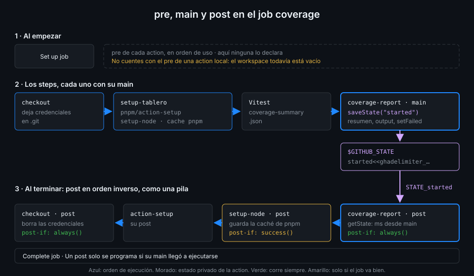

# pre, post y estado

> Una action no solo corre en su step. Puede pedir un hueco al principio del job, `pre`, y otro
> al final, `post`, que corre aunque el job haya fallado. Entre las tres fases se pasan datos con
> `$GITHUB_STATE`. Así guardan su caché `setup-node` y `setup-uv`, y así se limpia lo que una
> action deja a medias.



## 🎯 Objetivos

Al terminar este archivo eres capaz de:

- Declarar `pre` y `post` en una action JavaScript, con sus condiciones `pre-if` y `post-if`
- Predecir en qué orden corren los `pre` y los `post` de varias actions en un job
- Pasar un dato de `main` a `post` con `core.saveState` y `core.getState`
- Explicar qué hay debajo: el archivo `$GITHUB_STATE` y las variables `STATE_<nombre>`
- Saber qué ofrecen los otros dos tipos: `pre-entrypoint` y `post-entrypoint` en Docker, nada en
  composite

## 1. Qué problema resuelve

Mira el final de cualquier run de la capa 09: después de tus steps aparecen
`Post Run actions/setup-node@...` y `Post Run actions/checkout@...`. No los escribiste. Son la
segunda mitad de esas actions:

| Action | Qué hace en su `post` | `post-if` |
|---|---|---|
| `actions/setup-node` con `cache: pnpm` | Guarda la caché del store de pnpm | `success()` |
| `astral-sh/setup-uv` con `enable-cache` | Guarda la caché de uv | `success()` |
| `actions/checkout` | Borra la configuración de credenciales que dejó en `.git` | Por defecto, `always()` |

Todas tienen el mismo problema: algo que hacer **después** de que el resto del job haya usado lo
que prepararon. Un step normal no sirve: obligaría a cada workflow a acordarse de añadirlo, y si
el job falla antes, no corre. El `post` lo declara la action una vez y el runner lo programa
solo. La columna de la derecha es una decisión de diseño: una caché solo se guarda si el job
salió bien (no quieres cachear el estado de un job roto), pero las credenciales se borran
siempre. Comprobado en el `action.yml` de cada una en el SHA de `docs/stack-versions.md`,
noviembre 2026.

## 2. Cómo funciona

### Las claves en `runs`

```yaml
runs:
  using: node24
  pre: dist/pre.cjs
  pre-if: runner.os == 'Linux'
  main: dist/index.cjs
  post: dist/post.cjs
  post-if: failure()
```

| Clave | Qué hace | Si no la pones |
|---|---|---|
| `pre` | Script que corre al principio del job, antes del primer step | No hay fase previa |
| `pre-if` | Condición del `pre`; las funciones de estado miran el **job** | `always()` |
| `post` | Script que corre al final del job, después del último step | No hay fase final |
| `post-if` | Condición del `post` | `always()`: corre aunque el job haya fallado |

Lo normal es solo `main` y `post`. `pre` sirve para preparar algo antes de que corra **ningún**
step, incluido el checkout; es raro necesitarlo.

### El orden en un job

1. **`pre`**: al empezar el job, en el orden en que aparecen las actions en `steps`.
2. **Los steps**, cada uno con su `main`.
3. **`post`**: al terminar, en **orden inverso**. La última action que se preparó es la primera
   que se recoge, como una pila.

El orden inverso tiene sentido: si `setup-node` se usó después de `checkout`, su caché se guarda
antes de que `checkout` borre credenciales. Cada fase sale en el log como un step propio: `Pre
Run ...` y `Post Run ...`.

Un `post` solo se programa si su `main` llegó a ejecutarse. Si el step de la action se saltó por
un `if:` o porque un step anterior falló, no hay `post` para ella.

### El estado: de `main` a `post`

`pre`, `main` y `post` son tres procesos de Node distintos, separados por otros steps. No
comparten memoria. Para pasar un dato:

```javascript
// main
core.saveState("pid", String(child.pid));
```

```javascript
// post
const pid = Number(core.getState("pid"));
```

Por debajo, `saveState` escribe en el archivo `$GITHUB_STATE` con el mismo formato de
delimitador que `$GITHUB_OUTPUT`:

```text
pid<<ghadelimiter_<uuid>
4242
ghadelimiter_<uuid>
```

Y el runner, al lanzar el `post`, convierte cada entrada en la variable `STATE_pid`, que es lo
que lee `getState`. El estado es **privado de esa action en ese step**: otra action, o la misma
usada dos veces en el job, no lo ve. No es un canal entre steps; para eso están los outputs.

### Los otros dos tipos

| Tipo | Fases |
|---|---|
| JavaScript | `pre`, `main`, `post`, con `pre-if` y `post-if` |
| Docker | `pre-entrypoint`, `entrypoint`, `post-entrypoint`: el mismo contenedor con otro comando |
| Composite | Ninguna propia. Los `post` de las actions que usa por dentro sí se programan, en el job |

Lo último explica por qué `setup-tablero` guarda bien la caché: `setup-node` corre dentro de la
composite, pero su `post` se apunta al job y corre al final, tras los tests (si han pasado,
por su `post-if: success()`).

### `pre` en una action local

Una action local se lee del disco del workspace, y al empezar el job el workspace todavía está
vacío: el checkout es un step. El runner prepara las fases `pre` antes de eso, así que **no
cuentes con el `pre` de una action local**. El `post` no tiene ese problema: cuando se programa,
la action ya está en disco. Por eso `coverage-report` usa `post` y no `pre`.

## 3. Cómo se usa

### Un servidor de prueba con su log al final

Esta action, `mock-server`, arranca en segundo plano un servidor falso para los tests y, en su
`post`, enseña su log y lo para. El log sale **aunque los tests fallen**, que es justo cuando lo
necesitas.

```javascript
// src/index.js
import { spawn } from "node:child_process";
import { openSync } from "node:fs";
import { join } from "node:path";
import * as core from "@actions/core";

const script = core.getInput("script", { required: true });
const log = join(process.env.RUNNER_TEMP, "mock-server.log");
const out = openSync(log, "a");

const child = spawn("node", [script], { detached: true, stdio: ["ignore", out, out] });
child.unref();

core.saveState("pid", String(child.pid));
core.saveState("log", log);
core.info(`mock-server arrancado con pid ${child.pid}`);
```

```javascript
// src/post.js
import { readFile } from "node:fs/promises";
import * as core from "@actions/core";

async function run() {
  const pid = Number(core.getState("pid"));
  const log = core.getState("log");

  if (log) {
    await core.group("Log de mock-server", async () => core.info(await readFile(log, "utf8")));
  }
  if (pid) {
    try {
      process.kill(pid);
    } catch {
      core.info("mock-server ya había terminado");
    }
  }
}

// Sin await en el nivel superior: esbuild no lo admite con --format=cjs.
run().catch((error) => core.warning(error.message));
```

```yaml
runs:
  using: node24
  main: dist/index.cjs
  post: dist/post.cjs
```

- **El estado son dos strings**: `pid` y `log`. Todo lo que guardas es texto, como los inputs.
- **El `post` comprueba que hay estado** antes de usarlo. Si `main` falló antes de llamar a
  `saveState`, `getState` devuelve cadena vacía, y el `post` corre igual por su `always()`.
- **`$RUNNER_TEMP`** es la carpeta temporal del job: el runner la vacía al terminar.

`coverage-report` usa el mismo mecanismo para algo más modesto: `main` guarda la hora a la que
empezó y `post` escribe cuántos milisegundos pasaron hasta el final del job. No hace falta para
la cobertura; está para que veas el ciclo funcionando en un run real.

### Cómo lo verás en el log

En el run del job `coverage` de `ci-web` aparecen, en este orden: los steps, `Post Run
./.github/actions/coverage-report`, `Post Run actions/setup-node@...` y `Post Run
pnpm/action-setup@...` (los dos de dentro de `setup-tablero`) y `Post Run actions/checkout@...`.
Cuatro `post`, en orden inverso al de uso. Si la cobertura baja del mínimo, el de `setup-node`
no guarda nada: su `post-if` es `success()`.

## 4. Antipatrones

| Antipatrón | Por qué duele | Qué hacer en su lugar |
|---|---|---|
| Un step de limpieza al final del workflow | No corre si el job falla antes y cada workflow tiene que recordarlo | `post` en la action |
| `post-if: success()` para limpiar | Justo cuando falla, que es cuando más importa, no limpia | El default `always()`; `success()` solo para guardar cachés o resultados |
| `getState` sin comprobar | Si `main` falló pronto, el `post` trabaja con cadenas vacías | Comprobar el valor y salir si falta |
| Usar el estado para pasar datos a otro step | No lo ve nadie más que la propia action | Outputs |
| `pre` en una action local | El runner no tiene el `action.yml` al empezar el job | `post`, o mover la lógica a `main` |
| Guardar un secreto en el estado | Acaba en un archivo del runner y en una variable de entorno | No guardarlo, o `core.setSecret` antes |

## 5. Trucos

- **Los `Post Run` de una ejecución** salen en `gh run view --log --job <id>`: filtra con
  `grep 'Post Run'` y ves qué actions dejaron trabajo para el final y cuánto tardó cada una.
- **Una caché que no se guarda** casi siempre es un `post` que no corrió: mira si el step de
  `setup-node` llegó a ejecutarse o si un `if:` lo saltó.
- **`post-if: failure()`** convierte el `post` en un "recoge pruebas si algo falla": volcar logs
  o subir un diagnóstico solo cuando hace falta.

## 📚 Recursos Adicionales

- [GitHub Docs: Metadata syntax, `runs.pre` y `runs.post`](https://docs.github.com/en/actions/reference/workflows-and-actions/metadata-syntax#runspost)
- [GitHub Docs: Workflow commands, sending values to the pre and post actions](https://docs.github.com/en/actions/reference/workflows-and-actions/workflow-commands#sending-values-to-the-pre-and-post-actions)
- [actions/toolkit: `saveState` y `getState`](https://github.com/actions/toolkit/tree/main/packages/core#action-state)

## ✅ Checklist de Verificación

- [ ] Sé declarar `pre`, `post`, `pre-if` y `post-if`
- [ ] Sé en qué orden corren los `pre` y los `post` de un job
- [ ] Sé que un `post` solo existe si su `main` llegó a ejecutarse
- [ ] Sé pasar datos de `main` a `post` con `saveState` y `getState`
- [ ] Sé qué hay en `$GITHUB_STATE` y cómo llega a `STATE_<nombre>`
- [ ] Sé qué fases tienen Docker y composite

---

| ← Anterior | Siguiente → |
|:---|---:|
| [Empaquetar dist/ con pnpm](04-empaquetar-dist-con-pnpm.md) | [Actions Docker](06-actions-docker.md) |
